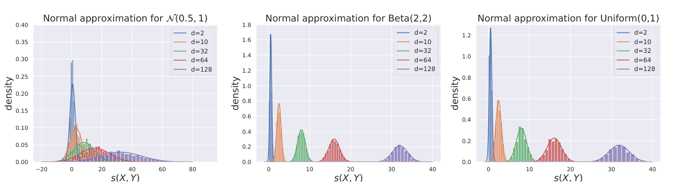
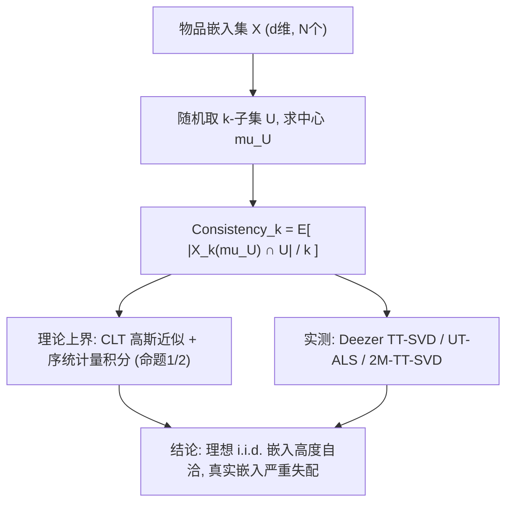

# On the Consistency of Average Embeddings for Item Recommendation (论平均嵌入用于物品推荐的自洽性)

- **会议/期刊**: RecSys 2023（第17届 ACM 推荐系统会议，短文/short paper）
- **作者与机构**: Walid Bendada, Guillaume Salha-Galvan, Romain Hennequin, Thomas Bouabça (Deezer Research)；Tristan Cazenave (LAMSADE, Université Paris Dauphine-PSL)
- **推荐链路定位**: 召回（表征构建与用户/歌单/专辑向量 pooling 环节）
- **研究方向**: 协同过滤与双塔召回 / 自监督表征与鲁棒表征
- **论文原文**: [https://arxiv.org/abs/2308.12767v2](https://arxiv.org/abs/2308.12767v2)
- **开源代码**: [https://github.com/deezer/consistency](https://github.com/deezer/consistency)

## TL;DR (1分钟核心速览)

工业界普遍把物品嵌入**算术平均**当作 user / playlist / album / session 向量（Spotify、Deezer、Yahoo、Alibaba 皆如此），却从未验证"平均向量是否仍与构成它的物品相似"。本文提出 `Consistency_k` 期望精度指标，在 i.i.d. 嵌入 + 内积相似度假设下用 CLT 推出其序统计量闭式解，证明理想分布下 k 小时自洽性接近 1（即使 N=10⁶）；但在 Deezer 真实嵌入上 k=2 时自洽性仅 ≤14%(TT-SVD)、≤6%(2M-TT-SVD)、≤2%(UT-ALS)，即"平均两个向量的最近邻往往不含这两个向量本身"，断言平均池化在真实数据上系统性失效。

## Background & Motivation (背景与核心矛盾)

- **主流范式**: 用矩阵分解 / SVD / ALS 学得物品 $d$维嵌入，再对一组物品做算术平均$\boldsymbol{\mu}_{\mathcal{U}}=\frac{1}{k}\sum_{u_i\in\mathcal{U}}u_i$ 得到歌单、专辑、会话乃至长期用户向量，理由是"简单、可扩展、定长输出"。
- **前人局限**: (i) 该做法缺乏理论依据，从未分析 pool 后向量与源物品的邻域一致性；(ii) 已有零散工作只指出平均对异构/上下文偏好表达不足，但未量化"何时失效、失效到什么程度"。
- **核心洞察 (Key Insight)**: 自洽性等价于一个**可解析的比较概率**——随机 $u_{in}\in\mathcal{U}$与随机$u_{out}\notin\mathcal{U}$，谁与$\boldsymbol{\mu}_{\mathcal{U}}$更相似？借助内积为$d$项之和，CLT 使该概率在$d$ 较大时退化为高斯 CDF 之差，从而得到不依赖具体学习算法的通用结论。
- **本文切入点**: 先造尺度（`Consistency_k`），再解闭式（命题 1/2），最后用真实嵌入打靶，指出"理想嵌入分布"与"真实嵌入分布"的鸿沟。

<figure class="paper-figure" markdown="span">
  <figcaption>图1. 1 000个𝑑维向量之间内积相似度值的直方图，向量元素随机抽取自 N(0.5, 1)（图1a）、Beta(2, 2)（图1b）或 Uniform(0, 1)（图1c）分布，其中𝑑∈{2, 10, 32, 64, 128}。随着𝑑增大，直方图向右移动，因为相似度计算涉及对更多元素求和（见第3.1节）。曲线对应相似度分布的正态近似。我们观察到，对于𝑑的最大取值，正态分布能忠实近似所有相似度分布，这是一个用于验证……的重要结果</figcaption>
</figure>

## Method (核心方法设计)

### 1. 整体框架 (Overall Architecture)

全文是一个"指标—理论—实测"三段式分析框架，而非新模型：①给定物品嵌入集 $\mathbf{X}=\{X_i\}_{i=1}^{N}\subset\mathbb{R}^d$与相似度$s$，定义$\mathcal{X}_k(\boldsymbol{\mu})$为$\boldsymbol{\mu}$的 top-$k$近邻集；②定义 `Consistency_k` 为"平均向量近邻中命中源物品的比例"在随机$k$-子集上的期望，作为平均池化保真度的代理指标；③在"嵌入各维 i.i.d.、四阶矩有限、$s$为内积"的理论设定下，用 CLT 把$\sin$与$\text{sout}$化为联合正态，推出$\sin>\text{sout}$ 的概率闭式并与序统计量结合得 `Consistency_k` 解析式；④在 Deezer 三套真实嵌入上做 Monte-Carlo 估计并与理论曲线对比。

### 2. 关键设计拆解 (Key Designs)

1. **`Consistency_k` 期望精度指标（作用：把"平均是否可信"变成可计算的标量）**：痛点是平均池化只有直觉没有度量 $\to$定义源物品在 top-$k$ 中的占比并取期望：
$\text{Consistency}_k(\mathbf{X}) = \mathbb{E}_{\mathcal{U}\in\mathcal{X}_k}\left[\text{Precision}_k(\mathcal{U})\right],\ \text{Precision}_k(\mathcal{U}) = \frac{|\mathcal{X}_k(\boldsymbol{\mu}_{\mathcal{U}})\cap\mathcal{U}|}{k}$直觉：$\text{Precision}=1$表示「平均向量的近邻恰好是它自己」，指标越接近 1 说明 pool 越保真；它天然是 Full-Ranking 口径（候选为全集$\mathbf{X}$，无负采样、无采样偏差）。

2. **命题 1：单对比较概率的高斯闭式（作用：给出"源内 vs 源外"可分性的解析条件）**：痛点是 top-$k$命中率是组合量、难直接分析$\to$先降到成对比较$\sin>\text{sout}$，由 CLT 得
$\mathbb{P}\big(s(u_{in},\boldsymbol{\mu}_{\mathcal{U}}) > s(u_{out},\boldsymbol{\mu}_{\mathcal{U}})\big) = \frac{1}{2}\Big(1+\mathrm{erf}\Big(\sqrt{\frac{d\,\sigma^2}{2\big((2(k-1)+\kappa)\sigma^2+2k\gamma\mu\sigma+2k^2\mu^2\big)}}\Big)\Big)$核心直觉：中心化（$\mu=0$）时该概率恒 >0.5 且随$d$单调上升（维度越高越可分），但随$k$与峰度$\kappa$单调下降——集合越大、离群值越多，平均向量越难"既贴近全部$\mathcal{U}$又远离全部$\bar{\mathcal{U}}$。这顺便解释了为什么 Rademacher 这类低峰度离散分布理论上最优（但离散化会牺牲相似度精度，存在 trade-off）。

3. **命题 2：序统计量积分式（作用：从成对概率升级为 top-$k$命中期望）**：利用"至少$i/k$命中$\iff$ $\sin$的第$i$高值 >$\text{sout}$的第$k-i+1$ 高值"，得到
$\text{Consistency}_k(\mathbf{X}) = \frac{1}{k}\sum_{i=1}^{k}\int_{-\infty}^{+\infty} f_{\text{in},(i)}(x)\,F_{\text{out},(k-i+1)}(x)\,\mathrm{d}x$分解思想是把组合问题拆成$k$个独立的序统计量尾部概率求和，从而可数值积分（scipy）快速评估任意$k,N,d$。

4. **训练目标 / 推理开销**: 本文不训练模型，无损失函数与负采样策略；评估是"给定嵌入 → 采样 $k$-子集多次（每次$k$取 1000 次重复取均值）→ 算 Precision"。解析式（式 4）只需一次数值积分即可替代 Monte-Carlo，开销从$O(\text{采样次数}\times N d)$降到$O(k)$ 次一维积分，对工业侧做体检极其廉价。

## Experimental Setup & Evaluation Protocol (实验设置与评估协议)

- **数据集与预处理**: 三套音乐曲目嵌入（无用户交互过滤，无需 `5-core`）：

| 数据集 | #Users | #Items | #Interactions | 稀疏度/密度 | 特征/场景说明 |
| :--- | :---: | :---: | :---: | :---: | :--- |
| TT-SVD (Deezer 公开) | — | 50,000 | track–track PMI 共现 | — | $d=128$，SVD 分解歌单共现矩阵 |
| UT-ALS (Deezer 公开) | 用户维隐式 | 50,000 | user–track 交互 | — | $d=256$，ALS 分解交互矩阵 |
| 2M-TT-SVD (Deezer 私有) | — | 2,000,000 | 生产共现矩阵 | — | $d=128$，线上生产环境抽取，细节保密 |

- **数据划分与防穿越**: 不涉及训练/测试划分；所有实验均在**中心化后（centered）**的完整嵌入上做全库分析，避免均值偏移污染内积比较。
- **排名评测协议**: 无偏 `Full-Ranking`——$\mathcal{X}_k(\boldsymbol{\mu})$在全集$\mathbf{X}$上取 top-$k$，无负采样、无候选裁剪，因此指标不含采样偏差，但也不是 Recall@K/NDCG 等真实排序指标。
- **对比基线与超参设置**: 无 learned baseline，对比对象是**理论参照系**——同维度、同物品数、元素 i.i.d. 服从 $\mathcal{N}(0,1)$/ Rademacher / Uniform$(-1,1)$的合成嵌入；扫描$k\in\{2,\dots,50\}$、$d=128$、$N\in\{10^3,10^6\}$，并与式 (4) 数值积分结果逐点对齐校验。

## Key Experimental Results (实验关键数据)

### 1. 主实验对比 (Main Results)

**真实嵌入 vs 理论理想嵌入的 `Consistency_k`（$k=2$ 即"平均两个向量"的极端情形）**：

| 嵌入类型 | $d$|$N$| Consistency@$k$=2 | 随$k$ 变化趋势 | 与理想分布差距 |
| :--- | :---: | :---: | :---: | :---: | :---: |
| 理论 i.i.d. 高斯（参照） | 128 | $10^6$| ≈1.0（小$k$接近 1） | 缓降至$k$=50 时约 0.4（$N=10^3$） | — |
| **TT-SVD** | 128 | 50,000 | **≤ 0.14** | 随 $k$ 单调下降（同理论） | **约 7×** |
| **2M-TT-SVD** | 128 | 2,000,000 | **≤ 0.06** | 随 $k$ 单调下降 | **约 17×** |
| **UT-ALS** | 256 | 50,000 | **≤ 0.02** | 基本持平在 ~2%（不随 $k$ 降） | **约 50×** |

> 数值为原文明确给出的上界（"does not surpass 14%, 6%, and 2%"）；`Improv.` 一栏改为"理想/实测"的倍数差距，因为论文不存在可击败的 SOTA 基线。

### 2. 消融实验 (Ablation Study)

| 变化因素 | 设置变化 | `Consistency_k` 方向 | 幅度/依据 |
| :--- | :--- | :---: | :--- |
| 集合规模 $k$|$k$: 2 → 50 | ↓ | 理论（命题1）与 TT-SVD / 2M-TT-SVD 实测同步下降 |
| 目录规模 $N$|$10^3$→$10^6$| ↓ | 无关物品"碰巧变近"的机会增多；小$k$ 仍接近 1 |
| 嵌入中心化 | 原始 → 中心化 | ↑（轻微） | TT-SVD / UT-ALS / 2M-TT-SVD 三套嵌入均小幅提升 |
| 分布峰度 $\kappa$| 高斯 → Rademacher | ↑ | 式 (3) 中$\kappa$ 在分母，低峰度理论上更自洽 |
| 解析式 vs 模拟 | 式 (4) 积分 ↔ Monte-Carlo | ≈ 完全重合 | 三种分布、$k\in\{2..50\}$、$N\in\{10^3,10^6\}$ 全部对齐 |

### 3. 关键实验发现 (Key Findings)

1. **$k=2$ 就已经崩了**：TT-SVD/2M-TT-SVD/UT-ALS 的自洽性分别不超过 14%/6%/2%，意味着取两条曲目嵌入做平均，其 top-2 近邻大概率**不包含这两条曲目本身**；这把"平均池化无害"的默认假设直接推翻。
2. **SVD 与 ALS 的失效形态不同**：SVD 类嵌入随 $k$增大而一致性持续衰减（与理论同形），而 UT-ALS 稳定钉在约 2%——说明学习算法决定了嵌入的逐维分布，进而决定 pooling 行为，提示"按下游$k$ 大小选嵌入类型"（大集合下游更适合 ALS）。
3. **理论—实测鸿沟的根因是分布假设被破坏**：真实嵌入各维既非独立也非同分布（低秩 SVD 结构 + 均值漂移），故尽管理论在 $N=10^6$且$k$ 小时仍给出接近 1 的乐观值，实测却差 7–50 倍；中心化只能带来"轻微"改善，说明需要在训练目标里做分布对齐（如插入向合规分布的投影步骤，或对 embedding 加 KL 正则可微约束）。

## Highlights & Limitations (亮点、对比与审稿批判)

- **与代表作对比 (vs. Prior Work)**: 与 Spotify 的会话/长期用户平均嵌入实践 [9]、Deezer 的歌单/专辑平均嵌入 [4]、Alibaba 冷启动侧信息平均 [25] 相比，本文不提出新 pooling 算子，而是首次给出"平均是否可信"的**可证伪判据**；与 NLP 中 average/sentence-embedding 的退化性研究 [2,5] 相比，本文把分析搬到内积 + Full-Ranking + 大规模目录的推荐语境，且推导了 $k$ 元序统计量而非仅成对结论。
- **可迁移亮点**: ①`Consistency_k` 可直接作为上线前的 embedding 体检项（成本仅 $k$次一维积分），用于判定"某路召回向量能否安全平均"；②命题 1 的$\frac{1}{2}(1+\mathrm{erf}(\cdot))$形式给出了"维度$d$↑ 提可分性、峰度$\kappa$ ↓ 提可分性"的设计准则，可指导 embedding 初始化分布选择与正则。
- **审稿级局限批判**: ①指标只衡量"近邻是否包含源物品"，与 Recall/NDCG 等真实效用无直接相关性证明，缺少 offline 排序实验或线上 A/B 佐证，"低一致性 = 差推荐"仍是隐含假设；②全部结果建立在**内积 + 中心化 + 固定 $k$ 均匀采样**上，未覆盖余弦、欧氏距离、注意力池化、加权平均（按播放次数）等工业常见变体，也未处理用户本身作为"概念"时的多峰兴趣；③仅 3 套音乐嵌入、其中最大一套为私有不可复现，泛化性到电商/新闻场景未知；④论文只给出"应当对齐分布"的方向性建议，未给出可执行且经验证有效的训练修正方案。

## Rating (四维评分)

- **方法创新性 (Novelty)**: ⭐⭐⭐⭐ （首次把"平均嵌入可信度"形式化为 `Consistency_k`，并用 CLT + 序统计量给出闭式解，$k$、$N$、$d$、$\kappa$ 的影响方向都有解析依据）
- **评估协议与实验扎实度 (Protocol & Experiments)**: ⭐⭐⭐ （Full-Ranking 无偏且理论/模拟逐点对齐很严谨，但缺乏真实排序指标与公开大数据，结论依赖代理指标）
- **写作与数学规范度 (Clarity & Rigor)**: ⭐⭐⭐⭐⭐ （命题—证明—附录完整，式 (3)(4) 与图 1/2 的验证闭环清晰，符号定义紧凑）
- **工业落地与复现价值 (Industrial & Practical Value)**: ⭐⭐⭐⭐ （来自 Deezer 生产嵌入、代码已开源、诊断成本极低，但只诊断不给药方，落地需自行设计分布对齐正则）

