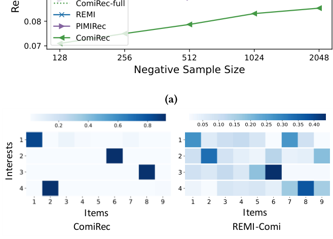
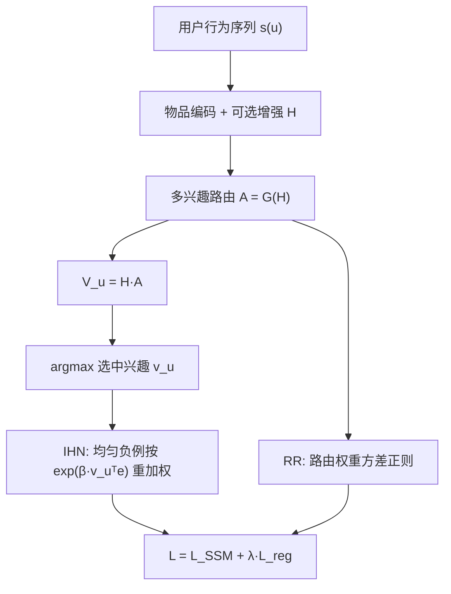
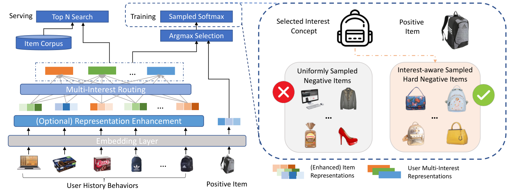

# Rethinking Multi-Interest Learning for Candidate Matching in Recommender Systems (重思推荐系统候选召回中的多兴趣学习)

- **会议/期刊**: RecSys 2023
- **作者与机构**: Yueqi Xie, Jingqi Gao, Peilin Zhou, Qichen Ye, Yining Hua, Jae Boum Kim, Fangzhao Wu, Sunghun Kim (HKUST / HKUST-GZ / Upstage / PKU / MIT / MSRA)
- **推荐链路定位**: 召回（多兴趣候选匹配）
- **研究方向**: 协同过滤与双塔召回 / 自监督对比学习与交互去噪
- **论文原文**: [https://arxiv.org/abs/2302.14532v2](https://arxiv.org/abs/2302.14532v2)
- **开源代码**: [https://github.com/Tokkiu/REMI](https://github.com/Tokkiu/REMI)

## TL;DR (1分钟核心速览)

多兴趣召回（MIND/ComiRec/PIMIRec）近年只在**模型架构**上内卷，却忽视了训练方案。本文指出两大训练缺陷：(1) 选中单一兴趣后，均匀/对数均匀采样负例几乎全为「易负例」，采样 softmax 远逊于 full softmax；(2) 注意力路由坍缩，每个兴趣只由单个物品构成。为此提出 REMI：**兴趣感知难负采样 (IHN)** 用蒙特卡洛重要性采样以几行代码近似理想分布，**路由正则 (RR)** 惩罚路由权重方差。在 Amazon Books/Gowalla/RetailRocket 上以 ComiRec-SA 为底座，Full-Ranking 协议下 Recall@20 相对最强基线提升 19.7%/10.4%/15.3%，且几乎零额外开销。

## Background & Motivation (背景与核心矛盾)

- **主流范式**: 先用物品编码器得到序列表征 $\mathbf{H}\in\mathbb{R}^{d\times n}$，再经多头注意力/胶囊路由得到$\mathbf{A}\in\mathbb{R}^{n\times K}$与多兴趣矩阵$\mathbf{V}_u=\mathbf{H}\mathbf{A}$；训练时用 argmax 选出与正例最匹配的兴趣$k=\arg\max_k(\mathbf{V}_u^\top\mathbf{e}_{i^+})$，再套用采样的 softmax。
- **前人局限 1**: 采样 softmax 在单向量推荐中被证明有效，但多兴趣训练只激活**某一个**兴趣概念，此时绝大多数均匀采样负例与该兴趣毫不相干（图 2 右侧：训练「包」兴趣时，面包/电脑都成了无信息的易负例），有效难负例严重稀缺。
- **前人局限 2**: 基于多头注意力的路由在训练若干 epoch 后出现 **routing collapse**——某兴趣的路由权重几乎全压在一个物品上，兴趣表征从构成阶段就丢失了序列信息（图 1(b)）。
- **核心洞察 (Key Insight)**: 难负例的「硬度」应是**相对于当前被选中兴趣**而非相对于整体用户表征定义的；且路由坍缩的根因是路由矩阵 $\mathbf{A}$ 的行内稀疏，而非表征空间分布。
- **本文切入点**: 不改架构，只改训练目标——一个重加权损失 + 一个方差正则项，即可即插即用地提升所有多兴趣模型。

<figure class="paper-figure" markdown="span">
  <figcaption>图 1：(a) 在 Amazon Book 上，不同方法在实际负采样规模下的性能，与 full softmax（以虚线表示，在实际场景中不切实际）进行比较。多兴趣模型，即 ComiRec 和 PIMIRec，在使用均匀采样 softmax 时出现显著性能下降。使用我们的 REMI 框架训练可缓解该问题并进一步提升性能。(b) ComiRec 及其 REMI 增强版本的物品到兴趣路由权重示例可视化。REMI 有助于避免路由坍缩。</figcaption>
</figure>

## Method (核心方法设计)

### 1. 整体框架 (Overall Architecture)

REMI 是纯训练期框架：输入用户行为序列，经物品编码与（可选）表征增强得 $\mathbf{H}$，路由模块产出$\mathbf{A}$与$\mathbf{V}_u$；训练时由 argmax 选中的兴趣$\mathbf{v}_u$同时驱动两条支路——IHN 用重要性采样把均匀采样负例按与$\mathbf{v}_u$的相似度重加权，RR 对$\mathbf{A}$的列内方差施加正则。推理完全沿用原模型（各兴趣分别 Faiss 检索，取$\max_k$ 融合打分），零额外延迟。

### 2. 关键设计拆解 (Key Designs)

1. **兴趣感知难负采样 IHN（把「难」定义在当前兴趣上）**：痛点是理想分布需遍历全库打分，成本等同 full softmax。作者先定义理想分布 $q_\beta(i^-)\propto \exp(\beta\mathbf{v}_u^\top\mathbf{e}_{i^-})$，$\beta$控制硬度；再用重要性采样从均匀分布$p$近似：$\mathbb{E}_{i^-\sim q_\beta}\left[e^{\mathbf{v}_u^\top\mathbf{e}_{i^-}}\right]=\mathbb{E}_{i^-\sim p}\left[\frac{e^{(\beta+1)\mathbf{v}_u^\top\mathbf{e}_{i^-}}}{Z_\beta}\right]$，配分函数用$\hat{Z}_\beta=\frac{1}{L}\sum_{l=1}^{L}e^{\beta\mathbf{v}_u^\top\mathbf{e}_{i^-_l}}$经验估计。工程实现仅是 `Neg=(imp*neg).sum()/imp.mean()`，等价于对已采样的均匀负例按$\text{score}^{\beta+1}$重加权，采样流程与开销完全不变。$\beta=0$退化为均匀采样，$\beta\to\infty$退化为最难样本（易引入假负例），故$\beta$ 需可调。
2. **路由正则 RR（用方差对抗路由坍缩）**：坍缩本质是 $\mathbf{A}$行内过度稀疏，故不在表征空间加约束，而是最大化各兴趣在物品维度上的权重方差：$\mathbf{C}=(\mathbf{A}-\bar{\mathbf{A}})^\top(\mathbf{A}-\bar{\mathbf{A}})$，$\mathcal{L}_{reg}=\|\mathrm{diag}(\mathbf{C})\|_F^2$，其中$\bar{\mathbf{A}}$为沿序列轴的均值。$\mathrm{diag}(\mathbf{C})$ 即各兴趣路由权重的方差，最小化其 Frobenius 范数等价于逼迫每个兴趣均匀融合多个相关物品，从而「从源头」保住兴趣构成信息。
3. **训练目标与推理效率**：总损失 $\mathcal{L}=\mathcal{L}_{SSM}+\lambda\mathcal{L}_{reg}$，$\lambda=1e2$（$\mathcal{L}_{SSM}$为采样 softmax 的负对数似然）。负例沿用批内共享的 1280 个均匀负例（128×10），IHN 不引入任何新采样器；RR 只作用于$n\times K$ 的小矩阵，整体开销可忽略，且与 log-uniform、MNS、DNS 等采样器正交。

<figure class="paper-figure" markdown="span">
  <figcaption>图 2：现有框架演示（左）和不同采样策略说明（右）。尽管均匀采样的负样本中的一些物品（例如面包、计算机）在为由食品、电子设备和包组成的序列训练通用用户表示时可能是有信息量的难负样本，但在现有多兴趣训练方案中训练与“包”相关的所选兴趣表示时，它们变成不相关的易负样本。兴趣感知难负采样（IHN）通过优先考虑</figcaption>
</figure>

## Experimental Setup & Evaluation Protocol (实验设置与评估协议)

- **数据集与预处理**: 沿用 ComiRec 的 **5-core** 过滤，全部交互视为隐式反馈。

| 数据集 | #Users | #Items | #Interactions | 稀疏度 | 特征/场景说明 |
| :--- | :---: | :---: | :---: | :---: | :--- |
| Amazon Books | 603,668 | 367,982 | 8,898,041 | 99.996% | 电商图书，最大序列长 20 |
| Gowalla | 65,506 | 174,605 | 2,061,264 | 99.98% | LBSN 签到，最大序列长 40 |
| RetailRocket | 33,708 | 81,635 | 356,840 | 99.87% | 电商，仅用 view 事件，序列长 20 |

- **数据划分与防穿越**: **用户级 8:1:1 比例划分**（按用户切分训练/验证/测试）；测试时用每个用户序列的**前 80%** 推断用户多兴趣表征，**后 20%** 作为待预测正例——即 leave-last-20%-out 的序列切分，非全局时间戳切分。
- **排名评测协议**: **Full-Ranking**（Faiss 在完整物品库上检索 top-N，未交互物品即隐式负例），报告 Recall/HR/NDCG @20 与 @50。
- **对比基线与超参**: MostPopular、GRU4Rec、YouTube DNN、MIND、ComiRec-SA、Re4、UMI_HN、PIMIRec 共 8 个基线；$d=64$、batch 128、Adam$lr=1e{-3}$、训练 1M 迭代、兴趣数$K=4$（基线在$\{2,4,6,8\}$中取最优）、$\beta\in\{0.1,1,4,10\}$、$\lambda=1e2$；配对 t 检验$p\le 0.01$。

## Key Experimental Results (实验关键数据)

### 1. 主实验对比 (Main Results)

| 方法 | Books R@20 | Books HR@20 | Books NDCG@20 | Gowalla R@20 | Gowalla HR@20 | Gowalla NDCG@20 | Retail R@20 | Retail HR@20 | Retail NDCG@20 |
| :--- | :---: | :---: | :---: | :---: | :---: | :---: | :---: | :---: | :---: |
| MostPopular | 0.0158 | 0.0345 | 0.0143 | 0.0231 | 0.1121 | 0.0483 | 0.0129 | 0.0252 | 0.0098 |
| GRU4Rec | 0.0441 | 0.1004 | 0.0378 | 0.0900 | 0.3359 | 0.1433 | 0.0827 | 0.1376 | 0.0517 |
| YouTube DNN | 0.0467 | 0.1043 | 0.0391 | 0.0864 | 0.3211 | 0.1384 | 0.1050 | 0.1711 | 0.0641 |
| MIND | 0.0420 | 0.0986 | 0.0357 | 0.0901 | 0.3129 | 0.1331 | 0.1171 | 0.1883 | 0.0698 |
| ComiRec-SA | 0.0557 | 0.1142 | 0.0446 | 0.0805 | 0.2901 | 0.1210 | 0.1304 | 0.1904 | 0.0689 |
| Re4 | 0.0597 | 0.1240 | 0.0476 | 0.0843 | 0.3104 | 0.1287 | 0.1397 | 0.2103 | 0.0785 |
| UMI_HN | 0.0690 | 0.1423 | 0.0527 | 0.0961 | 0.3314 | 0.1391 | 0.1519 | 0.2364 | 0.0875 |
| PIMIRec | 0.0682 | 0.1411 | 0.0526 | **0.1193** | **0.3843** | **0.1603** | **0.1828** | **0.2764** | **0.1025** |
| **REMI (ComiRec+)** | **0.0826** | **0.1650** | **0.0623** | **0.1317** | **0.4145** | **0.1774** | **0.2109** | **0.3144** | **0.1170** |
| **Improv.%** | +19.7% | +16.0% | +18.2% | +10.4% | +7.9% | +10.7% | +15.3% | +13.7% | +14.1% |

（下划线表示次优，此处以加粗统一标注最优；@50 指标趋势一致，Books HR@50 0.2298 vs 0.2062，+11.4%。）

### 2. 消融实验 (Ablation Study)

| IHN | RR | Books HR@50 | Δ | Gowalla HR@50 | Δ | Retail HR@50 | Δ |
| :---: | :---: | :---: | :---: | :---: | :---: | :---: | :---: |
| ✗ | ✗ | 0.1661 | — | 0.3891 | — | 0.2738 | — |
| ✓ | ✗ | 0.1975 | +18.90% | 0.4715 | +21.17% | 0.3307 | +20.78% |
| ✗ | ✓ | 0.2135 | +28.53% | 0.5067 | +30.22% | 0.4028 | +47.11% |
| ✓ | ✓ | **0.2298** | **+38.35%** | **0.5455** | **+40.19%** | **0.4544** | **+65.96%** |

**泛化性（表 3）**: 同一框架挂到 PIMIRec 上 Books R@20 提升 22.28%、UMI_HN 提升 20.00%、ComiRec-SA 提升 48.29%，Gowalla 上 ComiRec 提升达 63.60%——越简单的底座收益越大。

### 3. 关键实验发现 (Key Findings)

1. **RR 比 IHN 更「值钱」，且两者互补**：单独加 RR 在 RetailRocket 上 HR@50 就涨 47.11%（+0.1290 绝对值），远超单独 IHN 的 20.78%；二者叠加 65.96%，说明「兴趣构成完整」与「负例判别性」解决的是两个独立瓶颈。对比其他正则：表征空间正则 SINE 仅 +3.07%、Re4 反向流 +18.90%，而 RR 达 +28.53%（Books），证明坍缩必须从路由矩阵本身治。
2. **IHN 在负例预算越小的时候优势越大**（图 3）：采样规模从 1024 降到 128 时，IHN 与 uniform/log-uniform 的差距持续拉大，且 IHN 以 uniform 级别的采样开销超过 DNS/SRNS/GenNi 等显式难负采样器；相反 log-uniform 在大物品池上明显劣于 uniform，因为其对长尾物品采样概率过低、加剧流行度偏置与欠训练。
3. **$K$与$\beta$都是数据依赖的**：Books 上$K$从 2→8 时 HR@50 单调 0.2182→0.2360，而 RetailRocket 在$K=4$最优（序列短、物品池小）；$\beta$ 最优在 Books/RetailRocket 为 4、Gowalla 为 1，验证「最难≠最好」（假负例与易负例都仍是有效监督）。

## Highlights & Limitations (亮点、对比与审稿批判)

- **与代表作对比 (vs. Prior Work)**: 相比 MIND/ComiRec 只堆路由结构、PIMIRec/UMI 只加时序与用户画像等额外信息，本文指出**训练方案才是木桶短板**；相比 UMI 的 HN 策略（candidate-aware 打分但负例仍等权、效率更低），IHN 以重加权实现真正的兴趣感知难负例；相比 Re4/SINE 在表征空间做正则，RR 直接在路由矩阵上消除稀疏。
- **可迁移亮点**: ①「理想分布 + 重要性采样重加权」的套路可零成本移植到任何采样 softmax 场景（序列推荐、双塔召回、跨域迁移）；②「用列方差正则防止注意力/路由坍缩」对多向量表征（多兴趣、多行为、多场景）建模具有普适性，代码量不到 5 行。
- **审稿级局限批判**: ① 评估仍非严格时间切分（用户级 8:1:1 + 序列前缀推断），且正例仅取序列末 20%，未报告冷启动/新物品分桶，泛化结论偏乐观；② 图 1(a) 显示 REMI 与 full softmax 之间仍存差距，$\beta$与$\lambda$ 需按数据集网格搜索，工业上线需额外调参成本；③ 仅验证隐式反馈与注意力路由（胶囊路由未测），且缺少线上 A/B 与推理吞吐实测。

## Rating (四维评分)

- **方法创新性 (Novelty)**: ⭐⭐⭐⭐ （把「难负例」重定义为兴趣条件分布并用重要性采样零成本近似，问题洞察比模型堆叠更有价值，但技术组件本身均为已有工具的组合）
- **评估协议与实验扎实度 (Protocol & Experiments)**: ⭐⭐⭐⭐ （三数据集 + 8 基线 + Full-Ranking + 泛化/消融/正则/采样器四组对照齐全，$p\le0.01$ 显著性检验；扣分在于划分方式非严格时序、缺少稀疏度分桶）
- **写作与数学规范度 (Clarity & Rigor)**: ⭐⭐⭐⭐⭐ （两大问题—两个模块一一对应，$\beta=0$/$\beta\to\infty$ 极端情形分析清晰，伪代码与开源实现可直接对齐）
- **工业落地与复现价值 (Industrial & Practical Value)**: ⭐⭐⭐⭐⭐ （纯训练期改动、几行代码、零推理延迟，可直接插入现有多兴趣召回系统，代码已开源）

