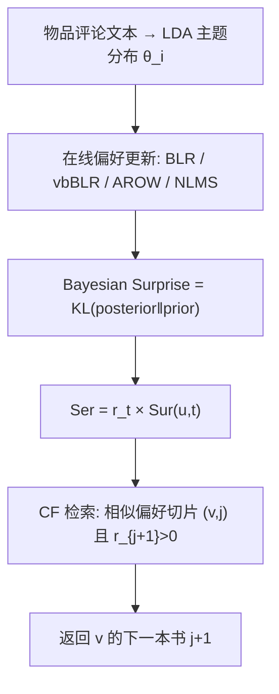

# Topic-Level Bayesian Surprise and Serendipity for Recommender Systems (面向推荐系统的主题级贝叶斯惊喜与机缘性)

- **会议/期刊**: RecSys 2023 (第十七届 ACM 推荐系统会议, Singapore)
- **作者与机构**: Tonmoy Hasan, Razvan Bunescu (University of North Carolina at Charlotte)
- **推荐链路定位**: 召回（基于用户-时序相似度的惊喜候选项检索）
- **研究方向**: 协同过滤与双塔召回 / 序列与会话推荐
- **论文原文**: [arXiv:2308.06368v2](https://arxiv.org/abs/2308.06368v2)
- **开源代码**: [surprise-and-serendipity](https://github.com/Ton-moy/surprise-and-serendipity)

## TL;DR (1分钟核心速览)

针对"只拟合历史评分必然造成信息茧房"这一痛点，本文不再用后处理重排做多样性，而是把"机缘性 (serendipity)"拆成**惊喜 × 价值**两个可计算因子：惊喜由用户主题偏好分布 $\mathbf{p}_t\sim\mathcal{N}(\boldsymbol{\mu}_t,\Sigma_t)$ 在消费该物品后 KL 后验-先验散度（Bayesian Surprise）给出，价值由实际评分给出，二者相乘构成事后机缘度；再用协作过滤在"偏好相近且下一步读到高惊喜好书"的历史切片上取回候选。在自建 Goodreads 标注集（4 位参考用户 449 本书，人工标注主题级惊喜）上，AROW 的惊喜检测平均 F1 达 **56.5%**，较距离启发式 Basic 的 42.7% 提升 13.8 个点；AROW+vbBLR 混合的机缘推荐平均 F1 达 **37.0%**，是随机基线 9.3% 的 4 倍。

## Background & Motivation (背景与核心矛盾)

- **主流范式**：推荐系统在 CB（内容相似）与 CF（相似用户）两个目标上持续优化，缓解茧房主要靠显式建模多样性（MMR 重排、多样性正则项）或直接优化惊喜/新颖性指标。
- **前人局限**：(1) 现有"惊喜"多定义为物品与历史闭包的**距离**（如 unexpectedness），是静态点估计，无法刻画"随着用户被曝光，同一物品的惊喜度应当衰减"的时序动态；(2) 用户偏好本身是**非平稳**的，传统 Bayesian Linear Regression 的后验协方差 $\Sigma_t$ 一旦收缩到接近 0，参数几乎不再更新，无法跟踪兴趣漂移。
- **核心洞察 (Key Insight)**：惊喜的本质不是"离历史多远"，而是"看了这个物品后我的信念被改变了多少"——这正是 Itti & Baldi 的 Bayesian Surprise 定义（后验与先验的 KL 散度），它天然带有时序衰减性与个性化尺度。
- **本文切入点**：用主题分布作为可解释的内容空间，在线维护高斯偏好分布，以 KL 散度算惊喜、以评分算价值，并把"惊喜测量"降级为离线事后量，通过协作过滤迁移到"还没读"的用户身上。

## Method (核心方法设计)

### 1. 整体框架 (Overall Architecture)

每个物品 $i$用 LDA 主题分布$\boldsymbol{\theta}_i\in\mathbb{R}^K$（$K=100$）表示。用户按时间顺序消费物品并给出评分$r_t\in[-2,2]$（原始 5 星减 3）。核心是在线学习器把偏好从先验$\mathbf{p}_{t-1}\sim\mathcal{N}(\boldsymbol{\mu}_{t-1},\Sigma_{t-1})$更新为后验$\mathbf{p}_t$，再用 KL 散度量化该次消费带来的惊喜，与评分相乘得事后机缘度。推荐阶段（Algorithm 1）做一次"时序切片检索"：对参考用户$u$的当前状态，在全库中找出偏好距离$d(\langle u,i\rangle,\langle v,j\rangle)<\tau_d$的$N$个历史切片$\langle v,j\rangle$，筛掉$v=u$与负评者，返回使$Sur(v,j{+}1)$最大的那个$v$ 的下一本书。

### 2. 关键设计拆解 (Key Designs)

1. **贝叶斯惊喜与可加性机缘度 (Bayesian Surprise × Rating)**：距离式定义会把"共同但低概率的主题"噪声累加进来，导致惊喜判别失效；本文改为分布层面的信念位移 $Sur(u,t)=KL\big(\mathcal{N}(\boldsymbol{\mu}_t,\Sigma_t)\,\|\,\mathcal{N}(\boldsymbol{\mu}_{t-1},\Sigma_{t-1})\big)$，并定义$Ser(u,t)=r_t\times Sur(u,t)$。乘法形式恰好等价于"惊喜且值得"的合取语义：当$r_t\le 0$ 时机缘度自动归零，避免把"惊讶但讨厌"误判为机缘。

2. **方差下界贝叶斯线性回归 vbBLR (Variance-Bounded BLR)**：标准 BLR 的 $\Sigma_{t+1}^{-1}=\Sigma_t^{-1}+\beta\boldsymbol{\theta}_t^{T}\boldsymbol{\theta}_t$在长序列上使协方差塌缩、失去非平稳适应力。本文在每次更新前做特征分解并对特征值截断：$\Sigma_t=U_t\Lambda U_t^{T}\rightarrow \Lambda_v=\mathrm{diag}(\max(\lambda_k,\tau_v))\rightarrow S_t=U_t\Lambda_vU_t^{T}$，再以$S_t$替代$\Sigma_t$代入更新式。直觉上$\tau_v$ 为"信念可塑性"设了下限——用户永远保留重新被惊到的可能。

3. **回归化 AROW (Adaptive Regularization of Weights)**：AROW 原用于分类的平方 hinge 损失，本文替换为平方误差并**解耦两个正则系数**：$\boldsymbol{\mu}_t=\boldsymbol{\mu}_{t-1}+\frac{(r_t-\boldsymbol{\mu}_{t-1}^{T}\boldsymbol{\theta}_t)\Sigma_{t-1}\boldsymbol{\theta}_t}{r_1+\boldsymbol{\theta}_t^{T}\Sigma_{t-1}\boldsymbol{\theta}_t}$，$\Sigma_t=\Sigma_{t-1}-\frac{\Sigma_{t-1}\boldsymbol{\theta}_t\boldsymbol{\theta}_t^{T}\Sigma_{t-1}}{r_2+\boldsymbol{\theta}_t^{T}\Sigma_{t-1}\boldsymbol{\theta}_t}$；令$r_2\neq r_1$ 才能在兴趣漂移时让协方差衰减得更快。

4. **训练目标、负采样与推理开销**：不存在批量训练目标，全部为逐样本在线最小化 $\sum_t (r_t-\mathbf{p}_t^{T}\boldsymbol{\theta}_t)^2$，**无负采样**（评测是人工标签判别而非排序）。Basic 对照模型用无穷范数$d(\boldsymbol{\theta}_t,\boldsymbol{h}_{t-1})=\|\boldsymbol{\theta}_t-\boldsymbol{m}_{t-1}\|_\infty$，其中$\boldsymbol{m}_{t-1}$是各主题历史最大概率向量——只惩罚"最突出的那个新主题"，绕开欧氏距离被大量小概率公共主题淹没的问题。推理时 Algorithm 1 需对全库用户-时刻对做一次$O(|\mathcal{U}|\cdot T)$ 的偏好距离扫描，是主要开销瓶颈。

## Experimental Setup & Evaluation Protocol (实验设置与评估协议)

- **数据集与预处理**：原始 Goodreads 抽取约 15M 评论 / 2M 书 / 465K 用户。因无正式书稿，作者用**评论拼接（≤10K tokens）伪造书籍内容**；仅保留 ≥50 tokens 的 1,294,532 本书；LDA 仅在 ≥1,000 tokens 的 303,832 本书上训练（$K=100$）；仅保留评分过 ≥100 本书的 26,374 名用户。

| 数据集 | #Users | #Items | #Interactions | 稀疏度/密度 | 特征/场景说明 |
| :--- | :---: | :---: | :---: | :---: | :--- |
| Goodreads (main) | 26,374 | 1,294,532 | 1,043,437 (被读唯一书) | 极稀疏 | 图书时序阅读史，1–5 星评分 |
| LDA-Books | — | 303,832 | — | — | 仅用于训练 $K{=}100$ 主题模型 |
| 标注子集 | 4 (参考用户) | 449 (人工标注) | 509 (读书数) | — | 跳过前 15 本 burn-in |

- **数据划分与防穿越**：无常规 train/test 划分，而是 **Leave-One-User-Out 超参调优**：以某参考用户为测试者时，用其余 3 人的最佳平均 F1 选超参，轮换 4 次。前置 15 本书作为 burn-in 冷启动期；对参考用户 $u$**不使用任何未来信息**，仅在候选用户$v$的历史切片上允许$t+k-1$的"相对未来"（NLMS 的$k$ 视角），这是评测成立的关键假设。
- **排名评测协议**：**非 Full-Ranking / Sampled Ranking**，而是人工标注下的检测式 P/R/F1：若 $Sur(v,j{+}1)>\tau_s$且该切片来自相似用户，则预测$u$的下一本为"惊喜"，与人工标签$mSur(u,i{+}1)\wedge r_{i+1}>0$比对。共 5 个模型 + 2 个随机基线（$p{=}0.5$与$p{=}P/T$）。
- **对比基线与超参**：BLR$(\beta,\tau_s,\tau_d,N)$、vbBLR$(+\tau_v)$、AROW$(r_1,r_2,\cdot)$、NLMS$(\eta,k,\cdot)$、Basic、AROW+vbBLR 混合；未设显著性检验，规模所限为探索性实验。

## Key Experimental Results (实验关键数据)

### 1. 主实验对比 (Main Results)

**表 2 惊喜物品检测 (Surprising item detection, %)**（注意原文 Errata：该表标题应为 *detection*）

| 方法 | U1 F1 | U2 F1 | U3 F1 | U4 F1 | **Avg F1** | Improv. |
| :--- | :---: | :---: | :---: | :---: | :---: | :---: |
| BLR | 40.0 | 58.1 | 64.3 | 57.1 | 54.9 | +12.2 |
| vbBLR | 33.3 | 58.1 | 64.3 | 57.9 | 53.4 | +10.7 |
| **AROW** | 40.0 | **61.5** | 64.3 | **60.0** | **56.5** | **+13.8** |
| NLMS | 40.0 | 46.2 | 41.7 | 44.0 | 43.0 | +0.3 |
| Basic | 24.0 | 51.6 | 52.2 | 42.9 | 42.7 | — |
| Random ($p{=}0.5$) | 13.8 | 20.8 | 18.6 | 24.8 | 19.5 | −23.2 |
| Random ($p{=}P/T$) | 8.0 | 13.1 | 11.4 | 16.5 | 12.3 | −30.4 |

**表 3 机缘物品推荐 (Serendipitous item recommendation, %)**

| 方法 | U1 F1 | U2 F1 | U3 F1 | U4 F1 | **Avg F1** | Improv. |
| :--- | :---: | :---: | :---: | :---: | :---: | :---: |
| BLR | 22.2 | 44.4 | 29.4 | 31.3 | 31.8 | +2.5 |
| vbBLR | 27.0 | **45.0** | 27.0 | 40.0 | 34.8 | +5.5 |
| AROW | 22.9 | 38.5 | 30.3 | 31.3 | 30.8 | +1.5 |
| NLMS | 20.0 | 24.0 | 21.6 | 26.3 | 23.0 | −6.3 |
| Basic | 26.3 | 44.4 | **38.1** | 0.00 | 27.2 | −2.1 |
| **AROW+vbBLR** | **30.3** | 43.8 | 29.4 | **44.4** | **37.0** | **+7.7** |
| Random ($p{=}0.5$) | 10.1 | 18.2 | 16.4 | 17.6 | 15.6 | −13.7 |
| Random ($p{=}P/T$) | 5.6 | 11.1 | 9.8 | 10.7 | 9.3 | −20.0 |

### 2. 消融实验 (Ablation Study)（以"惊喜估计器"作为消融维度，数取自表 2/表 3 平均 F1）

| 配置 | 惊喜检测 Avg F1 | 机缘推荐 Avg F1 | 说明 |
| :--- | :---: | :---: | :--- |
| w/o Bayesian（Basic 距离式） | 42.7 | 27.2 | 用 $\|\boldsymbol{\theta}_t-\boldsymbol{m}_{t-1}\|_\infty$ 替代 KL |
| w/o 分布（NLMS 点估计） | 43.0 | 23.0 | 只有 $\boldsymbol{\mu}$无$\Sigma$，$k{=}1$ |
| w/ BLR（平稳假设，无下界） | 54.9 | 31.8 | 协方差塌缩 → 漂移跟踪失灵 |
| w/ vbBLR（加 $\tau_v$ 截断） | 53.4 | 34.8 | 惊喜判别略降，机缘推荐显著升 |
| w/ AROW（回归化 + 解耦 $r_1,r_2$） | **56.5** | 30.8 | 惊喜判别最佳 |
| **AROW(惊喜) + vbBLR(相似度)** | — | **37.0** | 全模型 |

### 3. 关键实验发现 (Key Findings)

1. **Bayesian Surprise 显著优于距离启发式，且优势主要来自稳定性而非峰值**：AROW 平均 F1 56.5% vs Basic 42.7%（+13.8 点），但 Basic 在 U3 上甚至取得 52.2% 的次优成绩，说明距离式定义对个体分布极度敏感；而 Basic 在 U4 的机缘推荐直接崩到 **F1 = 0.00**（即使单独为该用户调参也仅 13%），暴露了点估计 + 固定超参在非平稳序列上的致命脆弱性。

2. **"惊喜判别"与"相似度度量"应当解耦**：表 2 最强者 AROW（56.5%）在表 3 只有 30.8%，反而 vbBLR（53.4%）在推荐上更强（34.8%）；混合二者进一步提升到 37.0%（+2.2 / +6.2）。这说明 $KL$项在 AROW 中被$r_2$的置信惩罚调制得更适合"判别是否被惊到"，而 vbBLR 的协方差下界使$\boldsymbol{\mu}$ 漂移更平滑、更适合做用户相似度对齐。

3. **非平稳处理的关键是方差下界，而非更新步长**：vbBLR 相对 BLR 在机缘推荐的召回端收益最明显——U2 召回 90%（BLR 80%）、U4 召回 60%（BLR 50%），U4 F1 从 31.3% 升至 40.0%。相反，仅调学习率的 NLMS 在两项任务上均低于所有贝叶斯方法（43.0 / 23.0），证明"给 $\Sigma$ 设下限"比"给梯度加步长"更能应对兴趣漂移。此外所有方法的**召回普遍高（50%–90%）而精确率低（14%–35%）**，说明噪声主要来自 CF 候选筛选阶段的相似用户误配。

## Highlights & Limitations (亮点、对比与审稿批判)

- **与代表作对比 (vs. Prior Work)**：与 Li & Tuzhilin 的 unexpectedness 相比，本文把"距离"升级为"分布位移"并显式引入评分构成乘法机缘度，避免了混合效用函数的权重调参；与 MMR 类多样性重排相比，本文不做后处理、而是在候选生成阶段就注入机缘信号；与序列推荐中的非平稳建模相比，本文的创新在于把 $\Sigma_t$ 本身当作惊喜的度量对象而非仅作不确定性加权。
- **可迁移亮点**：(1) 特征值截断的"方差下界"技巧可低成本移植到任何在线/增量更新的用户向量学习中（如流式双塔、bandit 后验）；(2) 用**人工小样本时序标注**评测"主观性强"的 beyond-accuracy 指标，为多样性/新颖性研究提供了一种可复用标注协议。
- **审稿级局限批判**：(1) **评测规模过小且选择偏差明显**——仅 4 位参考用户、449 本书、54 个正例，且用户筛选要求 ≥100 条评分，结论的统计效力与泛化性有限，缺显著性检验；(2) **内容表征脆弱**——书籍内容由用户评论拼接而成，作者自己也承认错误主要来自"影评/同作者书"等跑题评论与 LDA 在人名上生成的伪主题，主题质量直接决定惊喜度上限；(3) 推理端 Algorithm 1 需全库用户-时刻对扫描，代价随用户数与序列长度线性增长，论文未给出任何延迟/复杂度实测，工程落地价值受限。

## Rating (四维评分)

- **方法创新性 (Novelty)**: ⭐⭐⭐⭐ （把 Bayesian Surprise 的 KL 后验-先验位移作为个性化惊喜算子，并以 $\Sigma$ 下界解决非平稳，概念清晰且乘法机缘度定义优雅）
- **评估协议与实验扎实度 (Protocol & Experiments)**: ⭐⭐ （人工标注协议设计用心且防穿越严谨，但仅 4 用户 449 本、无显著性检验、无标准 ranking 指标，难以横向对比）
- **写作与数学规范度 (Clarity & Rigor)**: ⭐⭐⭐⭐ （BLR/vbBLR/AROW/NLMS 四个更新式推导完整、动机交代清楚，仅 Algorithm 1 与 NLMS 的 $k$ 步"相对未来"表述略含混）
- **工业落地与复现价值 (Industrial & Practical Value)**: ⭐⭐⭐ （代码与数据已开源、方法可解释且训练成本极低，但全库相似度扫描的推理开销与 LDA 主题质量依赖限制了直接上线）

