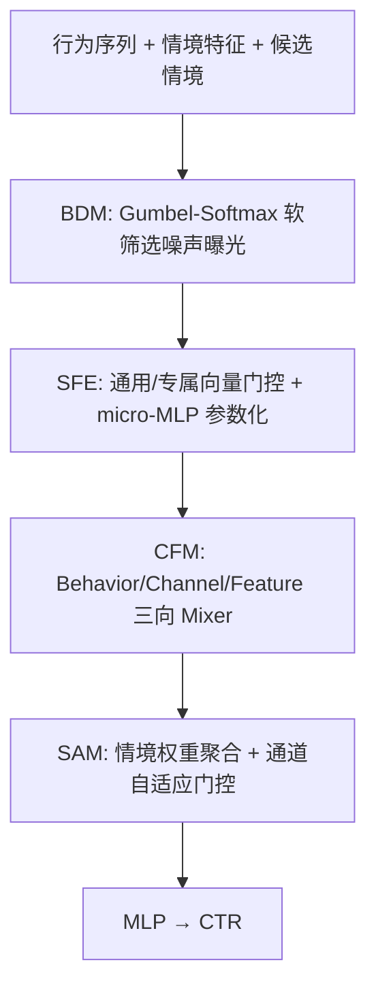

# Deep Situation-Aware Interaction Network for Click-Through Rate Prediction (深度情境感知交互网络)

- **会议/期刊**: RecSys 2023 (Full Paper)
- **作者与机构**: Yimin Lv, Beihong Jin 等（中科院软件所/国科大）；Shuli Wang, Yapeng Zhang 等（美团）
- **推荐链路定位**: 精排（CTR 预估，美团外卖列表广告线上主流量）
- **研究方向**: CTR/CVR 预估与特征交叉 / 序列推荐
- **论文原文**: [https://arxiv.org/abs/2604.12298v1](https://arxiv.org/abs/2604.12298v1)
- **开源代码**: [https://github.com/W-void/DSAIN](https://github.com/W-void/DSAIN)

## TL;DR (1分钟核心速览)

现有行为序列建模只分别利用“行为类型”或“时空信息”中的某一方面，且把情境特征当成普通特征过早拼接，造成信息浪费与纠缠。本文把行为类型+时间+空间统一定义为**情境 (situation)**，用 Gumbel-Softmax 重参数化对曝光噪声行为做软筛选（BDM），用“通用向量+专属向量+micro-MLP 参数化”为每个情境特征生成精炼嵌入（SFE），再用轻量 MLP-Mixer 捕获跨行为/跨通道/跨情境特征三向相关性（CFM）。在三份真实数据集上以 AUC/Logloss 全库排序评估，AUC 相对最优基线提升 1.23%–2.03%，线上 A/B 使 CTR +2.70%、CPM +2.62%、GMV +2.16%。

## Background & Motivation (背景与核心矛盾)

- **主流范式**: DIN/DIEN/DSIN/BST 做候选感知的注意力重加权，DIF-SR/NOVA/Trans2D 把行为侧信息以解耦注意力方式注入序列建模；多行为方向则有 DMT、FeedRec 用 MMoE 或强-弱反馈蒸馏。
- **前人局限**: ① 没有任何工作同时把**行为类型 + 时间 + 空间**三类情境信息纳入同一序列模型，边信息被碎片化利用；② 情境特征与 item ID 的交互要么在 attention 前硬拼接（DIF-SR 指出的信息纠缠），要么先池化再融合，丢失“同一类型情境的共性与差异”。
- **核心洞察 (Key Insight)**: 一条行为记录中，page（搜索页/推荐页）、是否广告位、餐段（早/午/晚）、工作日/周末共同刻画了“这次点击发生在什么情境下”，情境本身带独立语义；同时原始序列中**大量曝光未点击样本是平台强塞的噪声**，需要用可微方式筛除而非硬截断。
- **本文切入点**: 把情境作为一等公民，用“去噪 → 情境编码 → 三向相关融合 → 情境聚合”四段式流水线一次性解决噪声、纠缠与交互不足。

## Method (核心方法设计)

### 1. 整体框架 (Overall Architecture)

输入分四组：用户画像、候选物品画像、历史行为序列 $S=\{s_i\}_{i=1}^{L}$（$s_i=(v_i,B_i)$，$B_i=\{f_i^k\}_{k=1}^{n}$）、当前请求情境$C=\{f_c^k\}$。情境特征用维度$d_1$的独立表、其余特征用$d_2$表。序列先过 BDM 得到$\hat{v}_i=\hat{d}_i v_i$；SFE 以候选情境为门控生成精炼情境嵌入并参数化为 micro-MLP 作用于$\hat{v}_i$；CFM 堆叠$M$层共享参数的三个 Mixer 注入三向相关；SAM 先按情境聚合出行为向量$b_i$，再用**通道级**门控聚合出序列向量$e_s$；最后$\hat{y}=\mathrm{sigmoid}(\mathrm{MLP}(u\|e_s\|b_c\|e_o))$，以 LogLoss 端到端训练。

### 2. 关键设计拆解 (Key Designs)

1. **BDM：可微的曝光去噪**。硬截断 top-$k$或“保留前$x$条曝光”会丢信息且不可微。本文先用候选与历史情境的逐元素交互算保留概率$p_i=\sigma(\mathbf{W}_2(v_i+\mathbf{W}_1((f_c^k)\|_n\otimes(f_i^k)\|_n)+v_c))$，再以 Gumbel-Softmax 重参数化把离散采样变连续：
$\hat{d}_i=\frac{\exp((g_0+\log p_i)/\tau)}{\exp((g_0+\log p_i)/\tau)+\exp((g_1+\log(1-p_i))/\tau)}$，$g_0,g_1\sim G(0,1)$。直觉是让梯度穿过“丢弃/保留”决策，模型自己学该保留多少曝光。
2. **SFE + micro-MLP：把情境特征变成 item 的个性化算子**。同类情境既有共性（weekday/weekend 同属“周周期”）又有个性，故为每类特征设通用向量 $f^k$与专属向量$f_i^k$，用候选门控融合$\hat{f}_i^k=\mathrm{gate}_{i,k}f_i^k+(1-\mathrm{gate}_{i,k})f^k$；随后把$\hat{f}_i^k$直接**切分**为一个小 MLP 的权重与偏置（$\sum_j(|w_{i,j}^k|+|b_{i,j}^k|)=d_1$），以$v_{i,k}=\mathrm{MLP}_i^k(\hat{v}_i)$ 近似 item×情境的高阶交互。相比拼接，参数化避免了情境信息在表征层面污染 item 向量。
3. **CFM 与训练/推理开销**。将 $\{v_{i,k}\}$堆成$\mathbf{V}\in\mathbb{R}^{n\times L\times d_2}$，依次做 behavior-mixer（沿$L$轴 MLP，因 MLP 对位置敏感故无需位置编码；并进一步拆成 adjacent / dilated / shifted 三种切分互补捕获局部、长程与跨段相关，权重自适应加权$w_1,w_2,w_3$）、channel-mixer（沿$n$维内$d_2$通道）、feature-mixer（沿$n$个情境特征），$M=4$层参数共享。总损失即标准二分类交叉熵$\mathcal{L}=-\frac{1}{N}\sum_i[y_i\log\hat{y}_i+(1-y_i)\log(1-\hat{y}_i)]$；无负采样设计（CTR 天然二分类）；复杂度$O(Lnd_2^2+MLnd_2)$，序列计算完全并行，线上仅$O(|V|d_2+nd_2^2)$ 参数。

## Experimental Setup & Evaluation Protocol (实验设置与评估协议)

| 数据集 | #Users | #Items | #Interactions | 情境特征说明 |
| :--- | :---: | :---: | :---: | :--- |
| Taobao (公开) | 1,141,729 | 99,815 | 26,557,961 | 用 brand ID 代替 item ID；仅行为类型 + 时间戳衍生特征 |
| Eleme (公开) | 14,427,689 | 7,446,116 | 177,114,244 | 行为类型 + 小时/工作日等时间特征，无空间 |
| Meituan (工业) | 130,648,310 | 14,054,691 | 1,331,247,488 | 行为类型 + 餐段/工作日 + 触发页（搜索页/推荐页）、是否广告位 |

- **数据划分与防穿越**: 原文仅说明三个数据集窗口（Taobao/Eleme 各 8 天、Meituan 30 天），**未明确交代 Leave-One-Out 或全局时间戳切分比例**，属评估描述缺失。
- **排名评测协议**: 采用 CTR 任务标准的 **AUC + Logloss**；未披露候选集构造与负采样比例（无显式负采样策略说明）。
- **对比基线与超参**: 8 个基线分三组——通用侧信息（DIN/DIEN/CAN）、行为类型（DMT/FeedRec）、时空信息（CARCA/Trans2D/DIF-SR）；$d_2=8$、$d_1=144$、$n=5$、$L=300$、$L_w=30$、$\tau=1$、$M=4$；Adam，lr=0.001，跑 3 次报均值 ± 标准差（约 0.4‰–0.5‰）。

## Key Experimental Results (实验关键数据)

### 1. 主实验对比 (Main Results)

| 数据集 | 指标 | DIN | DIEN | CAN | DMT | FeedRec | Trans2D | DIF-SR | **DSAIN** | Improv. |
| :--- | :---: | :---: | :---: | :---: | :---: | :---: | :---: | :---: | :---: | :---: |
| Taobao | AUC | 0.6223 | 0.6241 | 0.6276 | 0.6268 | 0.6312 | 0.6303 | 0.6330 | **0.6452** | +1.93% |
| Taobao | Logloss | 0.2622 | 0.2618 | 0.2607 | 0.2611 | 0.2592 | 0.2599 | 0.2588 | **0.2571** | −0.66% |
| Eleme | AUC | 0.6368 | 0.6420 | 0.6450 | 0.6435 | 0.6477 | 0.6464 | 0.6502 | **0.6634** | +2.03% |
| Eleme | Logloss | 0.1245 | 0.1198 | 0.1157 | 0.1173 | 0.1143 | 0.1149 | 0.1135 | **0.1116** | −1.67% |
| Meituan | AUC | 0.6577 | 0.6612 | 0.6645 | 0.6635 | 0.6715 | 0.6709 | 0.6740 | **0.6823** | +1.23% |
| Meituan | Logloss | 0.1922 | 0.1884 | 0.1855 | 0.1861 | 0.1819 | 0.1825 | 0.1799 | **0.1763** | −2.00% |

### 2. 消融实验 (Ablation Study)

| 变体 (Meituan) | 移除/替换组件 | AUC | Logloss |
| :--- | :--- | :---: | :---: |
| DSAIN$^*_1$ | 去掉 BDM | 0.6808 | 0.1765 |
| DSAIN$^*_2(12)$ | 硬保留 12 条曝光（BDM 最优替代） | 0.6811 | 0.1764 |
| DSAIN$^\dagger_1$ | SFE 改为池化+拼接 | 0.6790 | 0.1766 |
| DSAIN$^\dagger_3$ | 去 micro-MLP，改直接拼接 | 0.6801 | 0.1765 |
| DSAIN$^\dagger_4$ | 仅专属向量，去通用向量 | 0.6810 | 0.1764 |
| DSAIN$^\ddagger_6$ | 去 behavior-mixer | 0.6770 | 0.1769 |
| DSAIN$^\ddagger_5$ | 去 channel-mixer | 0.6812 | 0.1764 |
| DSAIN$^\ddagger_3$ | 仅 feature-mixer | 0.6793 | 0.1767 |
| DSAIN$^\ddagger_7$ | Mixer 去 GELU | 0.6806 | 0.1765 |
| DSAIN$^\diamond_1$ | SAM 改平均池化 | 0.6805 | 0.1765 |
| DSAIN$^\diamond_3$ | 去通道自适应门控（退化为 DIN 式标量） | 0.6812 | 0.1764 |
| **DSAIN** | 完整模型 | **0.6823** | **0.1763** |

### 3. 关键实验发现 (Key Findings)

1. **行为 Mixer 是三向融合的命门，通道 Mixer 单独用反而有害**：去 behavior-mixer 掉 0.0053 AUC（约为去 channel-mixer 跌幅的 5 倍）；而“behavior+channel 两两组合”（0.6798）低于仅 behavior（0.6805），说明跨通道语义在缺少 feature-mixer 桥接时会与行为相关纠缠，只有三向齐备（0.6823）才收益最大。
2. **情境特征必须先“分而治之”再融合**：把 $n$个情境嵌入先池化再融合的 DSAIN$^\dagger_1$（0.6790）是最差变体，即便换成 micro-MLP 形式（$^\dagger_2$=0.6795）也几乎无改善——证明“逐情境独立参数化 + 后期融合”是必要设计，而非融合算子的复杂度问题。
3. **去噪收益小但稳定，且存在“曝光保留量”最优点**：BDM 相对无去噪仅 +0.0015 AUC，但硬截断保留 2 条曝光时跌至 0.6778（−0.0045），随 $x$增大回升至$x{=}12$ 的 0.6811 后再次下降，印证“曝光过多=噪声、过少=丢信息”，软筛选免调该超参。

## Highlights & Limitations (亮点、对比与审稿批判)

- **与代表作对比**: vs. **DIF-SR**（同样关注行为侧信息但用解耦注意力，仅处理时间/属性）；vs. **FeedRec**（多行为强弱反馈蒸馏，不涉及时空与空间 page 特征）；vs. **DIN**（标量级相似度加权，本文 SAM 升级为通道级向量门控 $g_i=\sigma(\mathbf{W}_g(b_i\|(b_i\otimes b_c)\|b_c))$，粒度更细）。
- **可迁移亮点**: ① 把情境嵌入切分成 micro-MLP 权重/偏置的“特征即算子”参数化技巧，可用极低参数量实现特征×item 高阶交互；② adjacent/dilated/shifted 三切分 + 可学习加权的 MLP-Mixer，是无位置编码的轻量长序列建模替代方案。
- **审稿级局限批判**: ① **评估协议描述严重不足**——未给出训练/测试划分方式、候选构造与负采样细节，AUC 绝对值（0.62–0.68）偏低且跨数据集不可比，复现门槛高；② 增益幅度有限（离线 AUC 约 +1%–2%，BDM 消融仅 +0.0015），且 $L{=}300$、$d_2{=}8$、$M{=}4$、$\tau$ 等超参均需按数据集调优，文中未给出敏感度对工业迁移成本的影响分析。

## Rating (四维评分)

- **方法创新性 (Novelty)**: ⭐⭐⭐⭐ （“情境”概念统一行为类型+时空+虚拟空间，Gumbel 软去噪与三向 MLP-Mixer 组合有新意，但各模块均为已有技术的情境化重组）
- **评估协议与实验扎实度 (Protocol & Experiments)**: ⭐⭐⭐ （三数据集+线上 A/B 与 8 基线较完整，但划分/负采样协议未披露、无显著性检验、消融仅单数据集）
- **写作与数学规范度 (Clarity & Rigor)**: ⭐⭐⭐⭐ （公式与模块职责清晰、附复杂度分析，但符号偏密、Mixer 三分支公式冗长且有排版符号乱码）
- **工业落地与复现价值 (Industrial & Practical Value)**: ⭐⭐⭐⭐⭐ （已上线美团外卖主流量，参数 $O(|V|d_2+nd_2^2)$ 且全并行，代码开源，CTR +2.70%/GMV +2.16% 商业价值明确）

