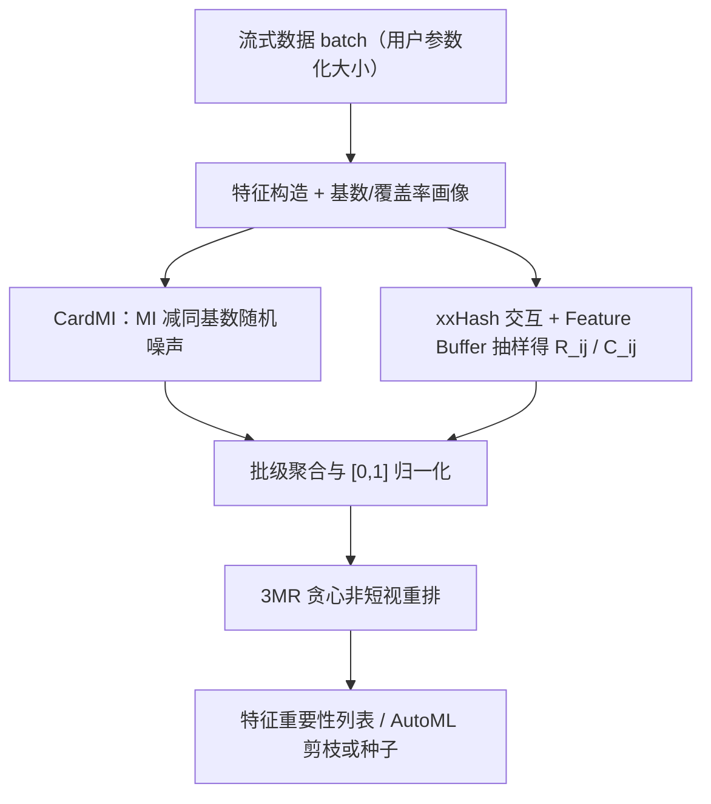
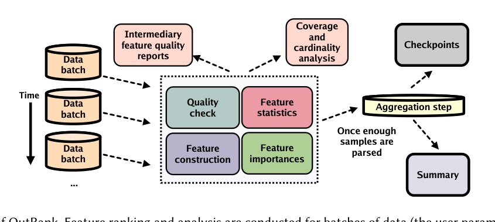

# OutRank: Speeding up AutoML-based Model Search for Large Sparse Data sets with Cardinality-aware Feature Ranking (面向大稀疏数据集的基数感知特征排序以加速 AutoML 模型搜索)

- **会议/期刊**: RecSys 2023 (ACM/IMS Journal of Data Science 投稿版)
- **作者与机构**: Blaž Škrlj, Blaž Mramor (Outbrain Inc.)
- **推荐链路定位**: 精排前置 —— 特征预选 / 数据质量筛查 / AutoML 搜索空间剪枝
- **研究方向**: CTR/CVR 预估与特征交叉 / 去偏公平与工业架构
- **论文原文**: [https://arxiv.org/abs/2309.01552v1](https://arxiv.org/abs/2309.01552v1)
- **开源代码**: [https://github.com/outbrain/outrank](https://github.com/outbrain/outrank)（原文标注需内部审核后发布）

## TL;DR (1分钟核心速览)

工业推荐系统的精排特征空间动辄上百列、上亿行、稀疏且高基数，AutoML（如 TPOT）直接在全空间搜索既慢又吃内存。本文提出 OutRank：用**基数归一化互信息 CardMI**（减去同基数随机变量的期望 MI 作为噪声基线）消除高基数特征打分虚高，再用哈希交互 + 特征缓冲（feature buffer）在流式 batch 上廉价估计特征冗余 $R_{ij}$与交互相关性$C_{ij}$，最后由 **3MR** 贪心重排实现非短视（non-myopic）特征排序。在 Madelon（4,400 样本 / 500 特征）超过 3,000 次 TPOT 运行中，剪枝 30% 特征可获约 30% 加速且 F1 无损；在 1.5M 行、100 特征的生产 CTR 数据上排序质量优于随机森林（RF）基线，并可在同等算力下探索最多 300% 更大的特征空间。

## Background & Motivation (背景与核心矛盾)

- **主流范式**: 工业 FM/FFM/DeepFM 类精排模型依赖 AutoML 在算法+配置+特征组合空间中搜索；另一支路线是特征排序（filter 类）先做廉价预选，为 AutoML 提供先验。
- **前人局限**: 其一，互信息 MI 对高基数类别特征存在系统性偏置——取值越多，MI 估计被"随机可分性"虚高，导致排序偏向高基数噪声列；其二，MI 是 myopic 的，无法反映特征间冗余与组合交互，而 FM 类模型的价值恰恰在交互项。
- **核心洞察 (Key Insight)**: 若把某特征与"同基数随机变量"的 MI 期望视为零假设噪声，则真实信号 = 观测 MI − 期望噪声；该差值可按 batch 聚合，从而在单遍流式遍历下即得到近似无偏的相关性度量。
- **本文切入点**: 以 CardMI 替代裸 MI 打分，并用 xxHash + 固定大小特征缓冲把 $O(|F|^2)$ 的交互/冗余估计摊薄到 batch 子空间采样上，最后用 3MR 递归重排融合"相关性 - 冗余 + 关系"三路信息。

## Method (核心方法设计)

### 1. 整体框架 (Overall Architecture)

数据以 batch 流式灌入引擎（用户可参数化 batch 大小），每批完成三件事：(a) 特征构造与时序统计（含基数/覆盖率画像）；(b) 计算各特征与目标的 CardMI 相关性 $S_i$、成对 CardMI 冗余$R_{ij}$、哈希交互对目标的 CardMI$C_{ij}$——后两者只在每批随机抽样的缓冲子空间上估计；(c) 中间分数按 checkpoint 聚合，最终归一化并交给 3MR 做全局重排，输出特征重要性列表与数据质量异常报告，供 AutoML 剪枝或作为种子模型。全流程无训练、无 GPU，仅单遍 CPU 流式扫描。

<figure class="paper-figure" markdown="span">
  <figcaption>图1. OutRank 概览。对数据批次进行特征排序与分析（批次大小由用户参数化设定）——一旦系统观测到足够数据，便由中间得分得到最终汇总，并用于生成最终特征得分。</figcaption>
</figure>

### 2. 关键设计拆解 (Key Designs)

1. **CardMI：基数感知的互信息零假设校准**：裸 MI 让高基数特征虚高。作者在每批 $b$内构造若干与$V$同基数的随机变量$S_b$，减去其期望 MI：
 $\mathrm{CardMI}(U,V)=\mathrm{Aggregate}_{b\in B}\big(\mathrm{MI}(U_b,V_b)-\mathbb{E}_{S_b\sim X_{|V_b|}}[\mathrm{MI}(U_b,S_b)]\big)$再 min-max 归一到$[0,1]$。直觉：随机同基数变量的 MI 即为"维度红利"的解析期望，减掉后不同基数特征才可同尺度比较，且噪声随批次变化、信号在聚合中留存。复杂度$O(|F|\cdot b\cdot s\cdot|B|)$（$s$ 为归一化采样数），配 sanity-check 噪声列可做单元测试回归监控。
2. **哈希交互 + 特征缓冲：把 $O(|F|^2)$变成可预算的近似**：交互值由$\mathrm{Comb}(F_1,\dots,F_n)=\mathrm{Hash}(\mathrm{struct}(F_1,\dots,F_n))$（xxHash）压成单列，直接复用 CardMI 计算。为控制成本，每批只随机填充固定大小 buffer（幂等抽样），跨批累积即可在极限下覆盖全部组合；buffer 越小近似越粗，但耗时恒定可预测，使二三阶组合在生产规模上可行。
3. **3MR 排序与推理开销**：在已排序集合上贪心扩展，
 $F^{(i)}=\arg\max_{j\notin F^{-1}\{1..i-1\}}\big(S_{F^{(j)}}-\alpha\cdot \mathrm{SF}(\{R_{j,k}\})+\beta\cdot \mathrm{SF}(\{C_{j,k}\})\big)$其中$\mathrm{SF}\in\{\text{mean},\text{median},q_{90}\}$。$\beta=0$退化为 MRMR，$\alpha=0$ 退化为纯关系排序。无总损失函数、无需负采样与训练；离线单遍产出排序，在线侧仅承担"特征列裁剪后模型重训"的一次性成本。

## Experimental Setup & Evaluation Protocol (实验设置与评估协议)

- **数据集与预处理**:

| 数据集 | #Users/实例 | #Items/特征 | #Interactions | 稀疏度/密度 | 特征/场景说明 |
| :--- | :---: | :---: | :---: | :---: | :--- |
| Madelon (合成) | 4,400 | 500 | — | 二分类，32 簇 / 5 维超立方体顶点，随机 ±1 标签 | 特征排序基准，batch=4,196 |
| 生产 CTR (Outbrain 内部) | 1.5 M | 100 | — | 约 10% 正例 | 按信号强度/基数/相关性/缺失率预选的多源异构特征 |

- **数据划分与防穿越 (Splitting Strategy)**: 非时序建模任务，未采用 Leave-One-Out 或时间戳切分；AutoML 实验使用不同随机种子（10 seeds）重复，用多次运行分布代替交叉验证口径。
- **排名评测协议 (Ranking Protocol)**: 非传统推荐评测——**不使用** Full-Ranking / Sampled Ranking / NDCG / HR。排序质量用"与基准排序的重合度"衡量：$R_i=\frac{|\mathcal{F}^{-1}(1..i)\cap\mathcal{G}^{-1}(1..i)|}{i}$（recall index@k），并累加$R=\sum_i R_i$；基准$\mathcal{G}$ 为"逐列加特征的全量 AutoML 轨迹排名"与"单代单特征 FM 排名"。下游评测为 TPOT 的 F1 与相对耗时。
- **对比基线与超参设置**: Logistic Regression、Random Forest（强基线）、随机打乱、CardMI、MRMR(CardMI/RF)、3MR(CardMI/RF, mean/median/q90)，$\beta>\alpha>0$；TPOT 设为 3 代、种群 10，共 3,000+ 次运行。

## Key Experimental Results (实验关键数据)

### 1. 主实验对比 (Main Results)

原文主结论以图表呈现，下表汇总文中报告的关键数值与相对次序（Madelon 上 TPOT 搜索）：

| 保留特征比例 | 搜索耗时（相对全特征） | 最佳模型 F1 | 结论 |
| :--- | :---: | :---: | :--- |
| 100% | 100%（内存开销最大，常需换硬件） | 基准 | 基线 |
| ~70% | **≈70%（−30%）** | **≈基准（Δ<0.5%）** | 无损加速 |
| ~50% | **≈50%（−50%）** | 基准 −≈0.5% F1 | 极小损失换大幅加速 |

特征排序质量（生产 CTR，1.5 M×100）：

| 排序器 | vs 全量 AutoML 轨迹 | vs 单代 FM | 备注 |
| :--- | :---: | :---: | :--- |
| Random | 最低 | 最低 | 下界 |
| Logistic Regression | 较低 | 较低 | 线性代理 |
| Random Forest | 中 | 中 | 强基线（前人 SOTA 类） |
| CardMI | 高于 RF | 高于 RF | 基数校准生效 |
| MRMR(CardMI) | 优于 CardMI | 略差于 CardMI | 仅冗余项 |
| **3MR($\beta>\alpha$, CardMI)** | **最优** | **最优** | 双项互补 |

### 2. 消融实验 (Ablation Study)

| 变体 | $\alpha$（冗余） |$\beta$（关系） | 全轨迹基准 | 单代基准 |
| :--- | :---: | :---: | :---: | :---: |
| CardMI（myopic 上界对照） | 0 | 0 | 基线 | 基线 |
| MRMR（$\beta=0$） | >0 | 0 | ↑ | ↓ |
| 纯关系（$\alpha=0$） | 0 | >0 | ↑ | ↑ |
| **3MR（$\alpha,\beta>0$，$\beta>\alpha$）** | >0 | >0 | **最优** | **最优** |

### 3. 关键实验发现 (Key Findings)

1. Madelon 上 3,000+ 次 TPOT 运行显示剪枝与加速近似线性：剪掉 30% 特征即换来约 30% 时间下降且 F1 掉幅 <0.5%，说明高基数稀疏列中相当比例是纯噪声，CardMI 的零假设减法确实在剔除"维度红利"型伪信号。
2. 生产 CTR 上 CardMI 的排序一致性优于 RF 与 LR，配合 3MR 后 top-20 特征可被稳定召回（原文图 4a），因此可直接作为 AutoML 的种子模型起点，跳过若干代昂贵搜索；同一算力预算下可探索最多 300% 更大特征空间。
3. 消融暴露了基准的 myopic 性：MRMR（仅冗余）在"单代 FM"基准上反而退化，而 3MR 在两类基准同时最优且 $\alpha,\beta$均非零——说明交互关系项$\beta$ 提供的是与冗余去重正交的增量信息，而非替代品。

## Highlights & Limitations (亮点、对比与审稿批判)

- **与代表作对比 (vs. Prior Work)**: 相较 RF/LR 类模型型特征重要性，CardMI 是 filter 式单遍流式统计，成本低 1–2 个数量级且显式校正基数偏置；相较经典 mRMR / fast-mRMR，本文首次把"交互关系项 $\beta$"引入重排并给出哈希+缓冲的可扩展实现；相较纯 TPOT 搜索，OutRank 提供先验把搜索空间先砍掉 30–50%。
- **可迁移亮点**: (1) "同基数随机变量期望 MI 作为零假设基线"的思路可直接迁移到 embedding 特征/召回通道的显著性筛查与去偏打分；(2) xxHash 组合列 + 固定 buffer 的批内子空间采样，是把 $O(|F|^2)$ 交互筛选搬到实时流上的通用工程套路。
- **审稿级局限批判**: (1) 评测口径与推荐社区惯例脱节——无公开数据集、无 NDCG/HR/AUC 与显著性检验，排序质量仅有 recall index 曲线，生产 CTR 数据不可复现；(2) 超参敏感且缺敏感性分析：$\alpha/\beta$、$\mathrm{SF}$、buffer 大小、归一化采样数$s$ 共同决定结果，单遍流式对稀有高阶交互的估计方差大，特征空间仅 100 列，扩展到千列稀疏场景的收益与延迟未验证；代码亦尚待内部审核发布。

## Rating (四维评分)

- **方法创新性 (Novelty)**: ⭐⭐⭐⭐ （CardMI 的"基数零假设校准"是简洁且有理论直觉的增量，3MR 把 mRMR 家族扩展到交互关系维度，但整体属工程化组合创新）
- **评估协议与实验扎实度 (Protocol & Experiments)**: ⭐⭐⭐ （3,000+ 次 AutoML 运行规模可观，但仅两个数据集、一个为不可复现内部数据，缺标准推荐指标与显著性检验）
- **写作与数学规范度 (Clarity & Rigor)**: ⭐⭐⭐⭐ （CardMI/3MR 公式与退化情形交代清楚，复杂度分析明确；但系统架构细节被有意略去，$\mathrm{SF}$ 选择与随机性方差未给理论界）
- **工业落地与复现价值 (Industrial & Practical Value)**: ⭐⭐⭐⭐⭐ （纯 CPU 单遍流式、可处理上亿实例，30–50% AutoML 加速与 300% 空间扩展直接对应算力成本，落地价值极高）

