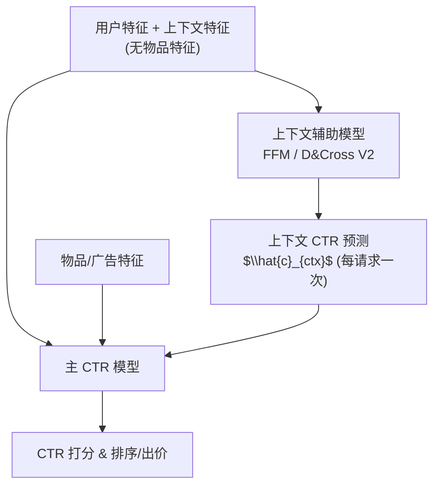

# Unleash the Power of Context: Enhancing Large-Scale Recommender Systems with Context-Based Prediction Models (释放上下文的威力：用基于上下文的预测模型增强大规模推荐系统)

- **会议/期刊**: RecSys 2023 (Industry Track, 5 pages)
- **作者与机构**: Jan Hartman, Assaf Klein, Davorin Kopič, Natalia Silberstein — Outbrain（内容推荐与原生广告）
- **推荐链路定位**: 精排（CTR 预估，广告推荐 + 实时竞价 RTB 两条栈）
- **研究方向**: CTR/CVR 预估与特征交叉 / 多任务与辅助学习
- **论文原文**: [https://arxiv.org/abs/2308.01231v1](https://arxiv.org/abs/2308.01231v1)
- **开源代码**: 暂未开源

## TL;DR (1分钟核心速览)

工业界 CTR 模型必须在「每秒数十亿次推理」的算力约束下提升精度，扩充网络容量不可行。本文提出 **Context-Based Prediction Model**：一个**完全不看物品特征**、只用用户与上下文特征预测点击概率的独立辅助模型，其输出 $\hat{c}_{ctx}$ 作为新特征喂入主模型。在 Outbrain 数十亿级曝光日志上，离线 RIG 提升最高 **+5.58%**；采用「替换冗余上下文特征」策略还能同时砍掉 **24%–38% FLOPs**；线上广告推荐 A/B 六天平均 **RPM +0.97%**，服务成本几乎不变。

## Background & Motivation (背景与核心矛盾)

- **主流范式**: Outbrain 主 CTR 模型采用 FM 家族（Field-aware FM、DeepFM、Deep&Cross V2），擅长稀疏高维特征交互，且需支持在线增量训练、万亿级预测。
- **前人局限**: ① 主模型虽**理论上已拥有全部上下文特征**，但在算力/延迟约束下无法为大模型分配独立子网络去专门拟合上下文分布（论文明确指出扩容不可行）；② 供给侧（页面位置、用户画像丰富度）对广告主吸引力差异极大，主模型难以显式量化这种「上下文先验」。
- **核心洞察 (Key Insight)**: 上下文 CTR 是**与具体候选物品无关、每次请求只算一次的可复用量**。把这一低维、稳定的先验单独建模并显式注入，等价于在**不增加主模型容量的前提下白送一个强先验特征**。
- **本文切入点**: 用「解耦 + 回灌」——独立训练轻量上下文模型，把它的预测当作主模型的一维特征。

## Method (核心方法设计)

### 1. 整体框架 (Overall Architecture)

整体是**双栈双模型**结构：上下文模型只在请求级特征上做前向，得到 $\hat{c}_{ctx}$；该标量随请求广播给所有候选广告，与用户/物品/上下文特征拼接后送入主 CTR 模型。两个模型完全独立、训练与部署解耦，可各自增量更新、各自替换。上下文预测还被复用于资源调度、供给分层与基于模型的探索。推理时上下文模型每请求仅算一次，主模型打分 N 个候选只增加 1 维特征，故服务成本增量极小。

### 2. 关键设计拆解 (Key Designs)

1. **物品无关的上下文预测算子**：痛点在于主模型必须把容量分摊到物品-上下文交叉项上，无法专注刻画上下文先验。定义为
$$\hat{c}_{ctx}=f_{ctx}(\mathbf{x}_{u},\mathbf{x}_{c}),\qquad \hat{y}=f_{main}(\mathbf{x}_{u},\mathbf{x}_{i},\mathbf{x}_{c},\hat{c}_{ctx})$$
其中 $\mathbf{x}_{c}$为上下文域（位置、版位、时段、供给源）。直觉：$\hat{c}_{ctx}$ 是「这个坑位×这个用户」的基线点击率，主模型只需学习物品相对此基线的**残差增益**，等价于给网络注入一个强偏置项，降低拟合难度。

2. **两种注入策略（冗余替换 vs. 叠加）**：策略 A「替换」——移除主模型中所有已被辅助模型使用的上下文特征，只保留 $\hat{c}_{ctx}$，形成信息压缩、显著降 FLOPs；策略 B「叠加」——保留原特征再追加$\hat{c}_{ctx}$，容忍冗余以换取更高精度。二者构成精度-算力的可调旋钮，是本文最实用的工程贡献。

3. **训练目标、负采样与推理效率**：两模型均以 log-loss（即 CTR 的交叉熵）独立训练，无额外负采样技巧（曝光即样本，点击为标签）。总开销由 FLOPs 代理评估：策略 A 使广告推荐 / RTB 的 FLOPs 分别 **-38.48% / -24.4%**，策略 B 仅 **+3.85% / +1.5%**；线上因每请求只算一次上下文模型，端到端延迟几乎无损。

## Experimental Setup & Evaluation Protocol (实验设置与评估协议)

- **数据集与预处理**: 全部为 Outbrain 生产日志，**无公开数据集**；离线实验使用**数亿级曝光（hundreds of millions of impressions）**，无 5-core 过滤（工业全量曝光，长尾天然存在）。统计量论文未披露，故不列表。

| 场景 | 主模型 | 数据规模 | 说明 |
| :--- | :---: | :---: | :--- |
| 广告推荐 (Ad Rec) | Field-aware FM (FFM) | 数亿曝光 | 站内推荐位排序 |
| 实时竞价 (RTB) | Deep & Cross V2 | 数亿曝光 | 出价侧点击率估计 |

- **数据划分与防穿越 (Splitting Strategy)**: 采用**时间序贯切分**（用「几个月的历史日志」训练后上线 A/B），属工业标准的时间戳切分，避免未来信息泄漏；论文未给出具体比例。
- **排名评测协议 (Ranking Protocol)**: **非 Top-N 排序评测**，而是 CTR 概率质量评测——使用 **RIG（Relative Information Gain，log-loss 的线性变换）**：
$$RIG=1-\frac{-c\log(p)-(1-c)\log(1-p)}{-\gamma\log\gamma-(1-\gamma)\log(1-\gamma)}$$
其中 $c$为真实点击、$p$为预测、$\gamma$ 为评测集基准 CTR。线上以 **RPM（千次曝光收入）** 做 A/B 检验。
- **对比基线与超参设置**: 基线均为**同一主模型的同构版本（不含 $\hat{c}_{ctx}$）**，即严格 A/B 消融式对照；无外部论文基线（工业论文特性）。算力以 FLOPs 近似；未报告显著性检验，线上以 6 天日均 lift 的稳定性作为证据。

## Key Experimental Results (实验关键数据)

### 1. 主实验对比 (Main Results)

| 上下文 CTR 用法 | Ad Rec RIG lift | Ad Rec FLOPs | RTB RIG lift | RTB FLOPs |
| :--- | :---: | :---: | :---: | :---: |
| Baseline（无 $\hat{c}_{ctx}$） | 0.00% | 0.00% | 0.00% | 0.00% |
| 替换冗余上下文特征 | +0.65% | **-38.48%** | +2.33% | **-24.4%** |
| 叠加于原特征之上 | **+1.78%** | +3.85% | **+5.58%** | +1.5% |

| 线上指标（Ad Rec A/B） | 数值 |
| :--- | :---: |
| 平均 RPM lift（6 天） | **+0.97%** |
| 逐日趋势 | 6 天内持续正 lift，无衰减 |

### 2. 消融实验 (Ablation Study)

| 变体 | RIG 相对变化 | 结论 |
| :--- | :---: | :--- |
| w/o 上下文模型 | 基准 | — |
| w/ 替换式注入 | +0.65% / +2.33% | 信息压缩，精度略增 |
| w/ 叠加式注入 | +1.78% / +5.58% | 精度最优，算力微增 |

### 3. 关键实验发现 (Key Findings)

1. **RTB 收益远大于广告推荐（+5.58% vs. +1.78%）**：Deep&Cross V2 的特征交叉容量在出价场景更受限，注入上下文先验带来的边际收益更高；说明**主模型容量越紧、辅助信号越值钱**。
2. **替换策略实现了「负成本」提效**：仅 +0.65% RIG 却省下 **38.48% FLOPs**，证明 $\hat{c}_{ctx}$ 高度浓缩了原上下文特征的信息，主模型对原始上下文域存在大量冗余参数。
3. **线上 +0.97% RPM 与离线 +1.78% RIG 同向但幅度收敛**：离线 RIG 的提升在真实竞价环境中被拍卖动态稀释，提示**离线 log-loss 增益不能线性外推为收入增益**。

## Highlights & Limitations (亮点、对比与审稿批判)

- **与代表作对比 (vs. Prior Work)**: 与 FM/DeepFM/Deep&Cross 等「扩大单模型容量 + 更强特征交叉」路线不同，本文不动主模型结构，而是**外挂一个物品无关的辅助任务**；与多任务学习（MMoE/PLE）的共享底层不同，本文两模型**完全解耦、无梯度共享**，工程上可独立发布与扩缩容。相较知识蒸馏类工作，此处传递的是**单一标量先验**而非软标签分布，成本极低。
- **可迁移亮点**: ① 「物品无关量」的思路可迁移到**用户活跃度先验、序列上下文基线 CTR、供给质量分**等任意请求级标量；② 「替换式注入 + FLOPs 核算」是工业降本增效应直接复用的实验范式。
- **审稿级局限批判**: ① **无公开数据集、无开源代码、无统计显著性检验**，基线仅为自家模型同构版本，缺乏与学术界 SOTA 的可比性；② 论文承认主模型理论上已含全部上下文特征，却**未给出「为何子网络学不出来」的定量证据**（如容量-收益曲线），核心论点仍偏经验性；③ 只报告 RIG 与 RPM，未讨论校准（calibration）与冷启动供给上的表现差异。

## Rating (四维评分)

- **方法创新性 (Novelty)**: ⭐⭐⭐ （概念朴素——「去掉物品特征做辅助模型」，胜在视角清晰，但缺乏理论或结构层面的新算子）
- **评估协议与实验扎实度 (Protocol & Experiments)**: ⭐⭐⭐ （离线数亿曝光 + 线上 6 天 A/B 的双重验证可信，但无公开数据、无显著性检验、基线单一，可复现性弱）
- **写作与数学规范度 (Clarity & Rigor)**: ⭐⭐⭐⭐ （5 页短文逻辑紧凑、RIG 与 FLOPs 定义清楚；代价是公式极少，未展开模型细节）
- **工业落地与复现价值 (Industrial & Practical Value)**: ⭐⭐⭐⭐⭐ （每请求一次计算即可复用给全部候选，叠加式仅 +1.5%~3.85% FLOPs，替换式还降本 38%，是极少见的「零风险、可回滚」上线方案）

