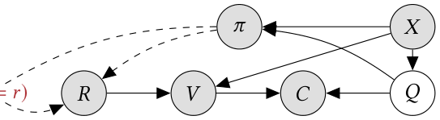
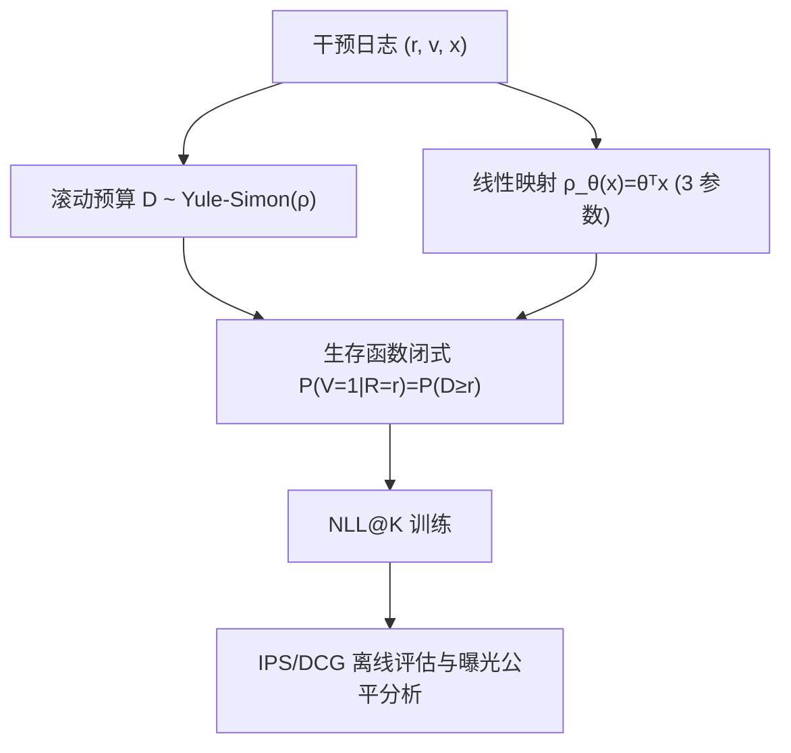
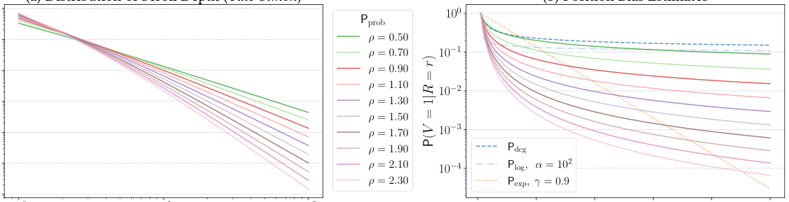

# A Probabilistic Position Bias Model for Short-Video Recommendation Feeds (短视频推荐流的概率化位置偏置模型)

- **会议/期刊**: RecSys 2023 (Short Paper / 10 pages)
- **作者与机构**: Olivier Jeunen（ShareChat，英国）
- **推荐链路定位**: 重排（排序策略评估）+ 离线评估/学习-to-rank 去偏
- **研究方向**: 去偏公平与工业架构 / 强化学习与离线策略评估
- **论文原文**: [论文原文链接](https://arxiv.org/abs/2307.14059v1)
- **开源代码**: [C-3PO-recsys-2023](https://github.com/olivierjeunen/C-3PO-recsys-2023)（仅复现曲线的 Notebook，无训练数据）

## TL;DR (1分钟核心速览)

短视频 Feed 与传统搜索/电商的交互范式不同：用户不会"点一次就走"，而是持续下滑，因此 DCG 的对数折扣、RBP 的指数折扣、乃至 DNN 位置偏置模型都无法刻画真实曝光。本文提出 **C-3PO**：假设用户携带一个服从 Yule-Simon 幂律分布的"滚动预算" $D$，则曝光概率恰为该分布的生存函数，可写成闭式；再用$\rho_\theta(x)=\theta^\top x$ 把预算参数个性化即可。在 100 万真实会话、80/20 划分的干预数据上，NLL@5–100 全面最优（仅 3 个参数），并使离线-在线相关性较 DCG 提升 **16%**。

## Background & Motivation (背景与核心矛盾)

- **主流范式**: 用位置偏置模型 $\hat{P}(V=1|R=r)$ 做 IPS 重加权，把带偏的点击/曝光日志还原为无偏质量估计，进而支持离线评估、去偏学习与曝光公平性分析；主流折扣函数是 DCG 对数、RBP 指数与 RR（倒排秩）。
- **前人局限**: ①这些折扣源自直觉而非用户行为模型，隐含假设"用户只交互一个物品就离开"；②DNN/GBDT 类模型（Fang 等的 CPBM、Wu 等的电商 Feed 模型）虽能建模 $P(V|R,X)$，但推理需前向传播、低数据区不稳、不保证对$r$ 单调，且黑盒难解释。
- **核心洞察 (Key Insight)**: Feed 场景中"看完才走"，曝光事件 $V=1$当且仅当用户滑到的深度$D\ge r$—— 于是位置偏置 **等价于滚动深度分布的生存函数**$P(D\ge r)$，天然单调、天然闭式。
- **本文切入点**: 用一个离散幂律（Yule-Simon）刻画滚动预算，只学形状参数 $\rho$，把"每条曲线的$K$个自由度"压缩成"1 个标量$\to$ 无穷多点"的参数化归纳偏置。

<figure class="paper-figure" markdown="span">
  <figcaption>图1. 概率图模型（PGM），说明通过移除已部署排序策略𝜋的入向因果边，干预性数据收集如何能够无偏估计排名𝑅与浏览事件𝑉之间的因果效应。</figcaption>
</figure>

## Method (核心方法设计)

### 1. 整体框架 (Overall Architecture)

先在 PGM 视角下把日志数据视为干预数据（对 $R$做 do 算子，切断排序策略$\pi$的入边），从而无偏地估计$P(V|do(R),X)$；再将其参数化为"滚动预算$D\sim\text{Yule-Simon}(\rho)$的生存函数"；最后由上下文$X$（用户历史平均滚动深度、时段平均滚动深度）经线性映射$\rho_\theta(x)=\theta^\top x$实现个性化，并以 NLL@K 为损失做梯度下降。推理时无需任何网络前向：给定$r,\rho$ 直接代闭式即可得到曝光概率，并代入 IPS/DCG 估计器完成离线策略评估。

<figure class="paper-figure" markdown="span">
  <figcaption>图2. 可视化我们提出的受概率启发的位置偏置模型所诱导的分布。左（a）：在不同滚动深度层级下，形状参数𝜌变化的离散Yule-Simon分布的概率质量函数（PMF）。通过个性化参数𝜌，我们可以表达广泛代表滚动行为的分布。右（b）：由我们受概率启发的位置偏置模型产生的、形状参数𝜌变化的位置偏置曲线，以及常见传统方法。我们提出的模型捕捉滚动行为</figcaption>
</figure>

### 2. 关键设计拆解 (Key Designs)

1. **滚动预算 $\to$生存函数闭式曝光**：痛点是把折扣函数当"调参直觉"。这里令$D$的 PMF 为$P(D=d)=\rho\,\mathrm{B}(d,\rho+1)$，则$r>1$ 时
$P_{\text{prob}}(V=1|R=r)=P(D\ge r)=(r-1)\,\mathrm{B}(r-1,\rho+1)$，$r=1$ 时为 1。
直觉：幂律长尾恰好刻画"多数会话在前几条就进入二级 Feed、少数一路下滑"，$\rho$越大衰减越快；该式对$r$ 严格单调递减，无需额外约束。
2. **MRR 是本文的特例（理论锚点）**：取 $\rho=1$并用$\mathrm{B}(r-1,2)=(r-1)!\cdot 1/r!$展开可得$P_{\text{prob}}=1/r=P_{\text{rr}}$，即电商场景经验上更优的倒数秩折扣，被解释为"滚动预算服从$\rho=1$的 Yule-Simon"。这既解释了 RR 的有效性，又给出可调参数族（$\rho\neq1$ 时可表达更宽的位置偏置曲线）。
3. **训练目标、个性化与推理开销**：最小化负对数似然 $\ell(\hat{P};\mathcal{D})=-\frac{1}{|\mathcal{D}|}\sum_{(v,r,x)}\log\hat{P}(V=v|R=r,X=x)$，并对高位置加权/截断为 NLL@$K$（底部低成本位置样本量大，会淹没头部精度）。$\rho_\theta(x)=\theta^\top x$仅 3 个参数（含 bias），与神经模型相比少 2–3 个数量级；估计只需$O(10^4)$样本即收敛，推理为$O(1)$ 闭式计算，无穷多秩位共享同一标量，天然适合大规模离线评测服务。

## Experimental Setup & Evaluation Protocol (实验设置与评估协议)

- **数据集与预处理**: 单一工业数据集（社交平台短视频一级 Feed，含 2 级 Feed 入口），5 天（2023-02）采样的 **100 万 session**、按 Fig.1 的随机秩干预采集，含 view 标签 $V$、秩$R$与上下文$X$；公开数据集中无同类干预数据，故无法使用公开 LTR 集。

| 数据集 | #Sessions | #Items | #Interactions | 稀疏度/密度 | 特征/场景说明 |
| :--- | :---: | :---: | :---: | :---: | :--- |
| 工业短视频 Feed | 1,000,000 | 未披露 | 1M session 级曝光 | 未披露 | 秩干预日志 + 2 维上下文（用户历史平均滚动深度、时段平均滚动深度） |

- **数据划分与防穿越 (Splitting Strategy)**: session 级随机 **80/20 比例划分**；离线-在线相关性实验则按 **5 天逐日**取在线期望奖励与离线估计，做跨日相关性（非时间戳切分训练）。
- **排名评测协议 (Ranking Protocol)**: 本文**不做** Recall@K/NDCG 的 Full-Ranking 或 Sampled Ranking 排序评测，而是两层协议：①**曝光概率校准**——以 NLL@$\{5,10,25,50,100\}$衡量$\hat{P}(V|R,X)$与真实曝光分布的拟合；②**离线策略评估**——用 IPS 式 DCG 估计$\frac{1}{N}\sum_i c_i\cdot\frac{\hat{P}(V=1|R=\pi(a_i|x_i),X=x_i)}{\hat{P}(V=1|R=r_i,X=x_i)}$，以与在线真值的 Pearson 相关系数衡量。
- **对比基线与超参设置**: $\hat{P}_{\text{dcg}}$（无参）、$\hat{P}_{\text{log}}(\alpha)$与$\hat{P}_{\text{exp}}(\gamma)$（单参，最小化 NLL@$K$学习）、$\hat{P}_{\text{prob}}(\rho)$（单参）、$\hat{P}_{\text{empirical}}$（非参、逐秩硬编码，上限参照）、以及三者加 3 参数线性上下文的版本；显著性在 99% 水平标注。

## Key Experimental Results (实验关键数据)

### 1. 主实验对比 (Main Results)

NLL@$K$（越低越好，粗体为该列最优）：

| 模型 | 参数量 | @5 | @10 | @25 | @50 | @100 |
| :--- | :---: | :---: | :---: | :---: | :---: | :---: |
| $\hat{P}_{\text{dcg}}$ | 0 | 0.5453 | 0.6320 | 0.5998 | 0.4973 | 0.3763 |
| $\hat{P}_{\text{log}}$ | 1 | 0.5159 | 0.6001 | 0.5900 | 0.5036 | 0.3833 |
| $\hat{P}_{\text{exp}}$ | 1 | 0.5202 | 0.6158 | 0.6089 | 0.5101 | 0.3673 |
| $\hat{P}_{\text{prob}}$ | 1 | 0.5162 | 0.6002 | **0.5873** | 0.4891 | 0.3495 |
| $\hat{P}_{\text{empirical}}$ | 逐秩 | 0.5157 | 0.5999 | 0.5843 | 0.4813 | 0.3369 |
| $\hat{P}_{\text{log}}(V\|R,X)$ | 3 | 0.4852 | 0.5620 | 0.5577 | 0.4806 | 0.3555 |
| $\hat{P}_{\text{exp}}(V\|R,X)$ | 3 | 0.4883 | 0.5761 | 0.5778 | 0.4959 | 0.3652 |
| **C-3PO $\hat{P}_{\text{prob}}(V\|R,X)$** | **3** | **0.4850** | **0.5620** | **0.5551** | **0.4651** | **0.3325** |

离线-在线一致性（相对 DCG 的相关性改进，越高越好）：

| 位置偏置模型 | $\hat{P}_{\text{dcg}}$|$\hat{P}_{\text{log}}$|$\hat{P}_{\text{exp}}$|$\hat{P}_{\text{prob}}$ |
| :--- | :---: | :---: | :---: | :---: |
| 相对提升 | 100% | −3% | −20% | **+16%** |

### 2. 消融实验 (Ablation Study)

| 变体 | @25 NLL | @100 NLL | 说明 |
| :--- | :---: | :---: | :--- |
| C-3PO（完整） | **0.5551** | **0.3325** | 概率形式 + 上下文 |
| w/o 上下文（$\hat{P}_{\text{prob}}(V\|R)$） | 0.5873 | 0.3495 | 去掉$X$，涨 0.032/0.017 |
| w/o 概率形式（$\hat{P}_{\text{log}}(V\|R,X)$） | 0.5577 | 0.3555 | 换成对数折扣+上下文 |
| w/o 概率形式（$\hat{P}_{\text{exp}}(V\|R,X)$） | 0.5778 | 0.3652 | 换成指数折扣+上下文 |
| w/o 参数化（$\hat{P}_{\text{empirical}}$） | 0.5843 | 0.3369 | 逐秩非参，无法用上下文 |
| w/o 概率+上下文（$\hat{P}_{\text{dcg}}$） | 0.5998 | 0.3763 | 经典折扣，最差组 |

### 3. 关键实验发现 (Key Findings)

1. **概率形式本身即是增益来源**：同为单参数，$\hat{P}_{\text{prob}}$在 @25/@100 取得 0.5873/0.3495，优于$\hat{P}_{\text{log}}$的 0.5900/0.3833 与$\hat{P}_{\text{exp}}$的 0.6089/0.3673；说明"用生存函数约束折扣形状"比"自由拟合折扣"更省样本，且$\hat{P}_{\text{prob}}$ 在 @100 已逼近逐秩非参的 0.3369。
2. **上下文优于非参上限**：C-3PO 仅 3 个参数，却在 @50/@100 反超硬编码逐秩均值的 $\hat{P}_{\text{empirical}}$（0.4651 vs 0.4813、0.3325 vs 0.3369），验证"低维结构 + 个性化"比"高自由度记忆"更能外推到长尾秩位。
3. **校准精度直接兑现为离线评估可信度**：以 NLL@100 训练的模型代入 IPS-DCG 后，$\hat{P}_{\text{prob}}$与在线真值的相关性较 DCG 提升 16%，而$\hat{P}_{\text{exp}}$ 反而下降 20%——错的位置偏置假设会让离线指标比"不做去偏"更糟。

## Highlights & Limitations (亮点、对比与审稿批判)

- **与代表作对比 (vs. Prior Work)**: 相较 DCG/RBP 的"直觉折扣"，本文给出可解释的生成式用户模型；相较 Fang 等的 CPBM 与 Wu 等的 GBDT Feed 模型，本文参数量少 2–3 个数量级、保证单调性、推理 O(1) 且可解释；相较经典 PBM/级联模型，本文专门刻画"可无限下滑 + 从任意条目进入二级 Feed"的层级结构。
- **可迁移亮点**: ①"曝光概率 = 某行为分布生存函数"的建模套路可迁移到会话深度、翻页预算、直播停留等任意"预算型"消费场景；②NLL@$K$ 的头部加权技巧，可直接复用到任何需要保证 top-K 精度的概率校准任务。
- **审稿级局限批判**: ①仅在一个平台、5 天、单场景验证，且数据不公开，外部可复现性弱；②模型仍是位置式（PBM）假设，隐含"曝光与条目内容无关"，且未建模级联/多物品同屏竞争；③只用了 Yule-Simon（广义 Waring 等更灵活分布留作未来工作），未引入 IPS 常用的 capping/控制变量降方差，相关性仅在 5 个日粒度点上计算，统计效力有限；④未报告选择偏置与曝光公平性下游任务的实际收益。

## Rating (四维评分)

- **方法创新性 (Novelty)**: ⭐⭐⭐⭐ （把位置偏置重述为滚动预算的生存函数，并用 $\rho=1$ 反推出 MRR 特例，简洁而漂亮）
- **评估协议与实验扎实度 (Protocol & Experiments)**: ⭐⭐⭐ （有干预数据 + 在线相关性验证，但仅单平台单数据集、无公开数据与显著性方差报告）
- **写作与数学规范度 (Clarity & Rigor)**: ⭐⭐⭐⭐⭐ （PGM 因果表述清晰，闭式推导与 MRR 特例证明完整，参数量/复杂度分析到位）
- **工业落地与复现价值 (Industrial & Practical Value)**: ⭐⭐⭐⭐ （O(1) 闭式、3 参数、可直接插入现有 IPS/DCG 评估链路；但缺少可复用训练数据与端到端去偏实验）

