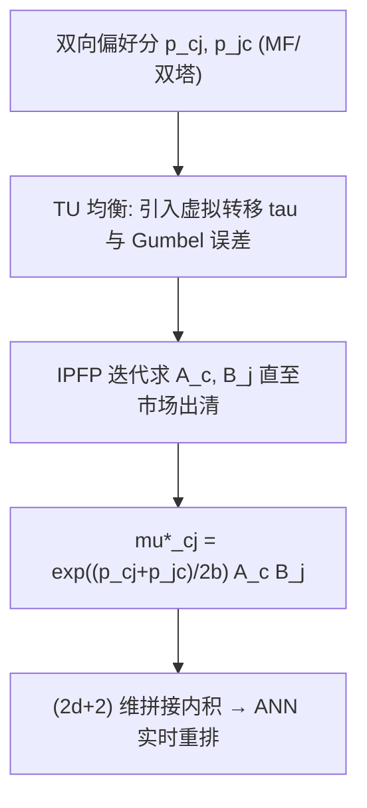

# Fast and Examination-agnostic Reciprocal Recommendation in Matching Markets (匹配市场中快速且与检查函数无关的互惠推荐)

- **会议/期刊**: RecSys 2023
- **作者与机构**: Yoji Tomita, Riku Togashi, Yuriko Hashizume, Naoto Ohsaka（CyberAgent, Inc.）
- **推荐链路定位**: 重排（对双边候选列表做互惠性重排序）
- **研究方向**: 去偏公平、可信隐私与工业架构 / 协同过滤与双塔召回
- **论文原文**: [https://arxiv.org/abs/2306.09060v2](https://arxiv.org/abs/2306.09060v2)
- **开源代码**: [https://github.com/CyberAgentAILab/tu-matching-](https://github.com/CyberAgentAILab/tu-matching-)（作者主页为 `tu-matching-recommendation`）

## TL;DR (1分钟核心速览)

在线约会与招聘等**匹配市场**中，推荐必须兼顾双向互惠与「曝光不集中于少数热门用户」两条约束。前人 SW 方法（Su et al.）以双随机矩阵 + Frank-Wolfe 近似最大化期望匹配数，但每用户 $O(|J|^2)$的双随机变量与 Birkhoff–von-Neumann 分解不可扩展，且目标函数**硬编码了 PBM 检查函数**$v(\cdot)$，$v$估错就直接失效。本文把 Choo–Siow 可转移效用（TU）匹配搬进排序推荐框架，用 IPFP 解市场出清方程，并把均衡匹配概率改写成 (2d+2) 维内积形式。在 n=100 合成数据上期望匹配数 152.39（较 Naive +43.2%、较 Reciprocal +17.4%），与使用正确$v$ 的 SW（152.27）持平，但在 n=500 与 1000×1000 真实约会数据上 SW 直接跑不动。

## Background & Motivation (背景与核心矛盾)

- **主流范式**: 互惠推荐（RRS）先由矩阵分解估计两侧单边偏好 $p_{c,j}$、$p_{j,c}$，再用算术/几何/调和均值等聚合函数拼成双边分数排序（如$p^{rec}_{c,j}=p_{c,j}\cdot p_{j,c}$）。
- **前人局限**: ① 聚合函数缺乏理论依据，且完全不感知「匹配机会向热门用户集中」导致的容量瓶颈；② 唯一带理论保证的 SW 方法虽优化社会福利，却把检查函数 $v(k)$同时写进目标与评估，$v$错配即失效，且双随机矩阵带来$O(|C||J|^2)$空间时间开销，$n=500$ 即不可算。
- **核心洞察 (Key Insight)**: 匹配市场的拥堵本质是**供需失衡**——热门一方被超额需求挤压，正如同类经济市场用「价格/转移量」出清；因此把推荐排序换成「市场均衡匹配概率」排序，既能内化互惠性，又能自动把过度曝光的一侧"涨价"、把冷门一侧"降价"。
- **本文切入点**: 用 Choo–Siow 的 TU 均衡匹配 $\mu^{*}_{c,j}$作为最终排序分，其闭式解中**不含$v(\cdot)$**，从而与检查函数解耦。

## Method (核心方法设计)

### 1. 整体框架 (Overall Architecture)

输入为任意现成模型（MF/双塔）给出的双向偏好分 $p_{c,j}$、$p_{j,c}$；将二者视为双方匹配可获得的"剩余 (surplus)"，引入虚拟转移量$\tau$与 Gumbel 偏好误差，求解使两侧随机需求相互一致的均衡匹配$\mu^{*}$；再用 IPFP 迭代求$\mu^{*}$的乘子$A_c=\sqrt{\mu^{*}_{c,0}}$、$B_j=\sqrt{\mu^{*}_{0,j}}$，按$\mu^{*}_{c,j}$降序生成推荐列表。最后把$\log\mu^{*}_{c,j}$化为拼接内积，交给 ANN 做在线召回式重排。整个流程**不含$v(\cdot)$**，也无需采样或双随机矩阵。

### 2. 关键设计拆解 (Key Designs)

1. **均衡匹配排序分（替代启发式聚合函数）**：聚合函数只看两人之间的分数，无法反映市场整体供需。TU 模型要求两侧随机需求在转移量 $\tau$ 调整下相等，在 Gumbel 假设下闭式解为
$\mu^{*}_{c,j}=\exp\left(\frac{p_{c,j}+p_{j,c}}{2\beta}\right)\sqrt{\mu^{*}_{c,0}}\sqrt{\mu^{*}_{0,j}}$。
直觉：$\sqrt{\mu^{*}_{c,0}}$是该候选人在市场上的"抢手程度"（越抢手越小，其匹配被压缩），$\sqrt{\mu^{*}_{0,j}}$ 同理约束热门雇主；两项相当于给内积叠加了**全局供需校准偏置**，把匹配从拥堵一侧推向冷门一侧。这也是它天然比几何均值更"公平"的原因。

2. **IPFP 求解与 (2d+2) 维内积化（工程可行性的关键）**：解 (12)(13) 式用迭代比例拟合，更新式形如 $A_c=\frac{\sqrt{1+\left(\frac{1}{2}\sum_{j}\exp\left(\frac{p_{c,j}+p_{j,c}}{2\beta}\right)B_j\right)^{2}}-1}{\frac{1}{2}\sum_{j}\exp\left(\frac{p_{c,j}+p_{j,c}}{2\beta}\right)B_j}$。进一步对$\log\mu^{*}_{c,j}$ 展开得
$\log\mu^{*}_{c,j}=\frac{1}{2\beta}\langle[\phi_1(c),\phi_2(c)],[\psi_1(j),\psi_2(j)]\rangle+\frac{1}{2}\log\mu^{*}_{c,0}+\frac{1}{2}\log\mu^{*}_{0,j}$，
即用 $\phi(c)=[\phi_1(c),\phi_2(c),\beta\log\mu^{*}_{c,0},1]$、$\psi(j)=[\psi_1(j),\psi_2(j),1,\beta\log\mu^{*}_{0,j}]$两个$(2d+2)$ 维向量内积即可排序。**排序分保持内积结构**意味着可直接接入 FAISS 类向量检索，彻底绕开 SW 需要预计算 Birkhoff–von Neumann 分解的死结。

3. **训练目标、负采样与推理效率**：本文**不训练新模型**，$p_{c,j}$、$p_{j,c}$由现成 MF 经 ALS 拟合提供，TU 只做一层确定性的重排后处理；因此无负采样、无 BPR/InfoNCE 损失，超参只有 Gumbel 尺度$\beta$与 IPFP 迭代步数。推理开销：离线 IPFP 每步$O(|C||J|)$（相对 SW 的每步$O(|C||J|^2)$降一阶），在线仅一次$(2d+2)$ 维 ANN 查询，开销与普通双塔召回同级。

## Experimental Setup & Evaluation Protocol (实验设置与评估协议)

- **数据集与预处理**:

| 数据集 | #Users | #Items | #Interactions | 稀疏度/密度 | 特征/场景说明 |
| :--- | :---: | :---: | :---: | :---: | :--- |
| Synthetic (n=100) | 150 candidates | 100 employers | 1.5×10⁴ 对（全稠密模拟） | 1.0 | $p=\lambda p^{pop}+(1-\lambda)\tilde p$，$\lambda$ 控拥挤度 |
| Real 200×200 | 200 男 + 200 女 | 同左 | 未披露原始数 | 经筛选后稠密 | 日本约会平台；居住地过滤 + $k$-core 抽稠密子图，ALS 补全缺失评价 |
| Real 1000×1000 | 1000 + 1000 | 同左 | 未披露 | 同上 | SW 在此规模因复杂度不可运行 |

- **数据划分与防穿越 (Splitting Strategy)**: 非传统训练/测试切分；而是用**全量估计偏好 + 蒙特卡洛模拟市场**（合成 10,000 次 × 10 轮重复；真实 200×200 跑 10,000 次、1000×1000 跑 1,000 次）。
- **排名评测协议 (Ranking Protocol)**: 无偏 `Full-Ranking`（对全部对侧用户排序，无负采样），但指标不是 HR/NDCG，而是 PBM 下的**期望匹配总数** $\mathrm{SW}(\pi)=\sum_{c}\sum_{j}P^{\pi}_{c,j}P^{\pi}_{j,c}$，其中$P(c\text{ applies to }j|\sigma(c))=v(\mathrm{rank}(j|\sigma(c)))\cdot p_{c,j}$。
- **对比基线与超参设置**: 基线仅 3 条（该子方向缺公开 SOTA 实现）：Naive（按单边偏好排序）、Reciprocal（$p_{c,j}\cdot p_{j,c}$）、SW（Frank-Wolfe，$\eta_t=0.2$，$T=50$）；TU 取$\beta=1.0$，IPFP 收敛阈值 1e-9。

## Key Experimental Results (实验关键数据)

### 1. 主实验对比 (Main Results)

合成数据 $n=100$、$\lambda=0.5$、$v(k)=1/k$（原文 Table 2 与 Fig. 1–3；原文仅 3 条基线，故按方法族展开）：

| 方法 | 期望匹配总数 SW | Improv. vs Naive | 备注 |
| :--- | :---: | :---: | :--- |
| Naive（单边偏好） | 106.450 | — | 完全忽略互惠性与拥堵 |
| Reciprocal（几何均值积） | 129.824 | +22.0% | 无市场出清机制 |
| SW（Frank-Wolfe） | 152.269 | +43.0% | 需正确 $v$；$n=500$ 不可计算 |
| TU ($\beta=0.1$) | 152.318 | +43.1% | 42 步收敛 |
| **TU ($\beta=1.0$，默认)** | 152.389 | **+43.2%** | 48–49 步收敛，与 SW 差 0.08% |
| TU ($\beta=10.0$) | **153.089** | **+43.8%** | 数值最优但 >10⁵ 步未收敛，不推荐 |

真实数据（Fig. 4）：200×200 下 TU 略逊于 SW（SW 用与模拟一致的 $v$，属"不可达上界"）、与 Reciprocal 持平；1000×1000 下 TU 明显优于 Naive 与 Reciprocal，而 SW 因复杂度根本无法运行。

### 2. 消融实验 (Ablation Study)

| 消融/敏感性项 | 设定 | 结果 | 归因 |
| :--- | :--- | :--- | :--- |
| $\beta$ 扫描 | 0.1 / 1.0 / 10.0 | 152.318 / 152.389 / 153.089 | 增益仅 +0.5%，迭代 42 → >10⁵ |
| SW_log（$v$ 错配，真值 exp） | log vs exp | 比 SW_exp 低 **17.7%** | 检查函数错配即崩 |
| SW_exp（$v$ 错配，真值 log） | exp vs log | 甚至劣于 Reciprocal | 错配下不如朴素聚合 |
| TU（不含 $v$） | log / inv 场景 | ≈ SW_正确 | 与$v$ 完全解耦 |
| 市场规模 $n=500$| — | SW 不可算，TU 正常 |$O(\|C\|\|J\|)$vs$O(\|C\|\|J\|^2)$ |
| 公平性 Gini（Fig. 5） | $\lambda=0.5$ | TU ≈ SW，明显低于 Naive/Reciprocal | 被动侧（雇主）均衡性改善最大 |

### 3. 关键实验发现 (Key Findings)

1. **TU 的收益主要是"可算"而非"更准"**：与 SW 的匹配数差距仅 0.08%（152.389 vs 152.269），但 SW 在 $n=500$与 1000×1000 上完全不可运行——复杂度从$O(|C||J|^2)$降到$O(|C||J|)$ 才是本文真实的工业价值。
2. **检查函数错配是 SW 的致命软肋**：SW 的目标依赖 $v$的凸性来推下界，$v$猜错时 SW_log 在 exp 真值下掉 17.7%，SW_exp 在 log 真值下甚至不如 Reciprocal；TU 均衡式 (11) 根本不含$v$，故在 log/inv 场景与"上帝视角"的 SW 持平。
3. **$\beta$是低性价比旋钮，且极端拥挤下 TU 会失守**：$\beta$从 0.1 提到 10.0 只换来 0.5% 增益却让迭代步数爆炸四个数量级；此外$\lambda=1.0$（偏好完全被流行度支配）时 TU 略逊于 SW，说明均衡匹配在偏好高度同质化的市场里优势不明显。

## Highlights & Limitations (亮点、对比与审稿批判)

- **与代表作对比 (vs. Prior Work)**: 相对 Reciprocal 类聚合方法（无理论依据、无视拥堵），TU 用一个凸出清问题同时解决互惠性与曝光集中；相对 SW（Su et al. 2023），本文去掉双随机矩阵与 $v$ 依赖，把随机策略降级为确定性排序，代价是失去 SW 的随机化探索；相对 Chen et al. 的 TU 约会实践（分组估计、非完全个性化、只关注不平等），本文做到逐用户完全个性化且以匹配总量为目标。
- **可迁移亮点**: ① 把 $\frac{1}{2}\log\mu^{*}_{c,0}$、$\frac{1}{2}\log\mu^{*}_{0,j}$ 两个"供需偏置项"作为**加性校准**塞进任意双塔内积，是一招轻量的流行度去偏；②「排序分保持内积结构」这一重写技巧，可让任何需要全局归一化的公平性重排保留 ANN 可检索性。
- **审稿级局限批判**: ① 评测只有 3 条基线、无 HR/NDCG 等常规排名指标、无显著性检验、无在线 A/B，全部结论建立在自建蒙特卡洛模拟上，说服力受限于模拟假设；② 真实数据仅到 1000×1000，IPFP 每步仍需遍历全部 $|C|\times|J|$对，十万级用户平台依旧不可行（作者自认）；③「虚拟转移量$\tau$」在约会/招聘场景并无真实经济学对应，Gumbel 误差假设也缺少实证校验，模型可解释性存疑。

## Rating (四维评分)

- **方法创新性 (Novelty)**: ⭐⭐⭐⭐ （把 Choo–Siow 均衡匹配迁移到排序推荐框架并给出内积化重写，公式链条完整，但核心经济模型本身为既有工作）
- **评估协议与实验扎实度 (Protocol & Experiments)**: ⭐⭐⭐ （仅 3 条基线、无标准排名指标与显著性检验、无在线验证，好在合成+真实双场景与 $\lambda$/$v$/$n$ 三维敏感性扫描较完整）
- **写作与数学规范度 (Clarity & Rigor)**: ⭐⭐⭐⭐ （从 PBM 到 SW 下界再到 IPFP 推导层层递进，附录 A.1 交代方程来源，复杂度对比清晰）
- **工业落地与复现价值 (Industrial & Practical Value)**: ⭐⭐⭐⭐ （代码开源，$(2d+2)$ 维内积可直接挂在现有双塔召回/重排链路，去除了 Birkhoff–von Neumann 预计算这一部署死结）

