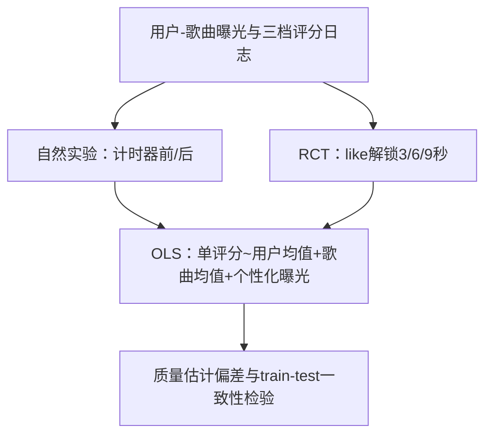

# Interface Design to Mitigate Inflation in Recommender Systems (缓解推荐系统评分通胀的界面设计)

- **会议/期刊**: RecSys 2023
- **作者与机构**: Rana Shahout, Yehonatan Peisakhovsky, Sasha Stoikov, Nikhil Garg（Cornell Tech 等）
- **推荐链路定位**: 数据采集与反馈 / 界面干预
- **研究方向**: 去偏公平、可信隐私与工业架构 / 冷启动与长尾推荐
- **论文原文**: [论文原文链接](https://arxiv.org/abs/2307.12424v2)
- **开源代码**: [开源代码仓库链接](https://github.com/sstoikov/piki-music-dataset)

## TL;DR (1分钟核心速览)

本文质疑“评分即质量”假设，用Piki音乐App自然实验与RCT检验评分通胀：用户异质与个性化曝光偏差。单个评分更受评分者均值影响（0.279）而非歌曲均值（0.114）；引入3/6/12秒解锁计时器后，全好评用户约从10%降至3%，歌曲信号增强。评估为OLS回归与RCT，不训练排序模型。

## Background & Motivation (背景与核心矛盾)

- **主流范式**: 平台将显式评分聚合为物品质量，再用矩阵分解或深度模型做个性化推荐，隐含假设是评分强指示质量。
- **前人局限**: 用户评分尺度高度异质，均值质量可能反映“谁评了”而非“物品多好”；个性化推荐又让某些物品获得更多曝光与更高评分，冷启动物品更易被少数用户左右。
- **核心洞察 (Key Insight)**: 单个评分与用户历史均值的相关强于与歌曲历史均值的相关；计时器通过增加评分等待成本，可平滑“全好评”等异质行为。
- **本文切入点**: 用Piki的评分日志、自然实验与RCT，把界面设计视为数据采集干预，并用回归一致性检验量化质量估计偏差。

## Method (核心方法设计)

### 1. 整体框架 (Overall Architecture)

本文不提出新的推荐排序模型，而是提出“界面干预—评分行为—质量估计”的实证框架。输入为Piki的用户-歌曲曝光与三档显式评分日志，并记录歌曲由随机还是个性化算法展示；利用2021年2月计时器上线的自然实验，以及进一步改变“like”解锁时长的RCT，比较评分分布、用户均值与歌曲均值。核心分析用标准化OLS回归：单条评分对用户均值、歌曲均值、个性化曝光与评分计数建模；再用按歌曲分层的数据划分做train-test一致性检验，判断歌曲质量估计更贴近歌曲历史评分还是评分者行为。

### 2. 关键设计拆解 (Key Designs)

1. **评分生成模型与一致性检验**：痛点是把评分均值当质量，但评分者尺度不同。本文用标准化回归 $r_{ui}=\alpha\bar r_u+\beta\bar r_i+\gamma\mathrm{pers}_i+\epsilon_{ui}$比较用户均值$\bar r_u$与歌曲均值$\bar r_i$的系数；若$\alpha\gg\beta$，评分更像“评人”而非“评物”。进一步在按歌曲分层的train-test中检验歌曲test均值更依赖train中评分者均值还是歌曲train均值。
2. **计时器界面干预**：痛点是用户可瞬时点“like”，导致通胀与全好评。Piki将选项顺序解锁：dislike约3秒、like约6秒、super-like约12秒；RCT把like解锁时长设为 $\tau_{\mathrm{like}}\in\{3,6,9\}$ 秒。等待成本让“like/super-like”成为更昂贵信号，减少无差别好评，并把部分like替代为super-like。
3. **个性化曝光偏差**：痛点是同一歌曲经个性化推荐展示时得分更高，且展示比例异质。本文在控制歌曲train均值与评分者均值后，加入test期个性化展示比例 $\mathrm{pers}_i^{\mathrm{test}}$，检验$q_i^{\mathrm{test}}=\theta_0+\theta_1\bar r_{U_i}^{\mathrm{train}}+\theta_2\bar r_i^{\mathrm{train}}+\theta_3\mathrm{pers}_i^{\mathrm{test}}+\epsilon_i$中$\theta_3$ 是否仍显著为正，以识别“曝光机制”本身对质量估计的抬升。

**训练目标、负采样与推理效率**：无神经网络训练、无负采样；统计模型为OLS，变量标准化，显著性取 $p<0.05$。推理阶段无额外模型开销，干预成本仅为界面计时器。

## Experimental Setup & Evaluation Protocol (实验设置与评估协议)

- **数据集与预处理**: Piki音乐发现App，30秒音乐视频，用户必须显式选择dislike/like/super-like；过滤用户与歌曲评分均少于10条者。自然实验取计时器上线前后各6个月；RCT按用户随机分组。密度按“评分/(用户×歌曲)”粗略估算。

| 数据集/组 | #Users | #Items | #Interactions | 稀疏度/密度 | 特征/场景说明 |
| :--- | :---: | :---: | :---: | :---: | :--- |
| Pre-timers | 396 | 8,592 | 141,096 | 约4.15% | 计时器前6个月，可即时评分 |
| Post-timers | 1,071 | 11,536 | 100,818 | 约0.82% | 计时器后6个月，3/6/12秒解锁 |
| RCT-a | 389 | 5,454 | 59,100 | 约2.79% | like解锁3秒 |
| RCT-b | 308 | 5,397 | 38,946 | 约2.34% | like解锁6秒 |
| RCT-c | 375 | 5,418 | 43,633 | 约2.15% | like解锁9秒 |

- **数据划分与防穿越 (Splitting Strategy)**: 自然实验为时间上的pre/post；RCT为用户随机分配（a/c各3/8，b为2/8）；一致性检验按歌曲分层随机分train/test，并保证每首歌在两段时期均有评分，避免歌曲层面泄漏。
- **排名评测协议 (Ranking Protocol)**: 不适用。本文不训练排序器，不做`Full-Ranking`或`Sampled Ranking`；主评估为OLS系数、RCT组间差异与train-test一致性，而非Recall/NDCG。
- **对比基线与超参设置**: 无SOTA排序基线；对照为pre/post、RCT三组、用户均值 vs 歌曲均值、随机 vs 个性化曝光。变量标准化；Table 2对任一用户/歌曲最多采样100条评分以降低单用户/单歌曲影响；显著性 $p<0.05$。

## Key Experimental Results (实验关键数据)

### 1. 主实验对比 (Main Results)

| 分析 | 时期/样本 | 用户均值系数 | 歌曲均值系数 | 其他关键系数 |
| :--- | :--- | :---: | :---: | :--- |
| 单条评分 $r_{ui}$ | Post-timers | **0.279*** | **0.114*** | 个性化曝光0.092*** |
| 单条评分 $r_{ui}$ | Pre-timers | **0.279*** | 0.064*** | 歌曲均值×pre交互-0.050*** |
| 歌曲test均值 | Post-timers | **0.478*** | **0.300*** | 歌曲train均值×评分计数0.198*** |

歌曲均值系数由pre的0.064升至post的0.114，约+78%，说明计时器提升了歌曲质量信号；但用户均值系数仍为0.279，远高于歌曲系数。test-set一致性检验中，歌曲test均值与评分者train均值的相关为0.478，仍高于歌曲自身train均值的0.300，说明多次评分后“评人”成分未消失。

### 2. 消融实验 (Ablation Study)

| 处理组 | like解锁 | 过滤后用户/评分/歌曲 | 行为变化 |
| :--- | :---: | :---: | :--- |
| RCT-a | 3秒 | 389 / 59,100 / 5,454 | like更易解锁，好评比例较高 |
| RCT-b | 6秒 | 308 / 38,946 / 5,397 | 接近自然实验post基线 |
| RCT-c | 9秒 | 375 / 43,633 / 5,418 | like比例下降，部分替代为super-like |
| 自然实验pre→post | 即时→3/6/12秒 | 396→1,071用户 | 全好评用户约10%→3%，评分分布更平滑 |

### 3. 关键实验发现 (Key Findings)

1. **评分更像“评人”而非“评物”**：post期单条评分对用户均值的系数为0.279，对歌曲均值的系数仅0.114；即使控制歌曲train均值，歌曲test均值与评分者均值相关0.478，仍高于歌曲自身0.300。
2. **界面等待成本能校准评分行为**：引入计时器后，全好评用户从约10%降至3%；RCT中like解锁从3秒延长到9秒会降低like比例，并出现向super-like的替代。
3. **个性化曝光本身抬升质量估计**：在控制歌曲train质量与评分者均值后，test期个性化展示比例仍与歌曲test均值正相关，说明“被个性化推荐得多”会反过来推高平台学到的歌曲质量。

## Highlights & Limitations (亮点、对比与审稿批判)

- **与代表作对比 (vs. Prior Work)**: 相比Garg & Johari (2021) 将数值评分改为正偏形容词，本文进一步拆出“用户异质+个性化曝光”两条机制，并用RCT验证计时器；相比Mansoury et al. (2021) 的事后数据平坦化，本文从事前界面采集端干预；相比Stoikov & Wen (2021) 的隐式/显式反馈比较，本文指出显式评分仍受评分者与曝光机制污染。
- **可迁移亮点**: 把“等待成本”设计成评分置信度信号，可直接迁移到电商、短视频与内容社区；日志中保留“推荐来源（随机/个性化）”对审计曝光偏差极有价值。
- **审稿级局限批判**: 缺少独立于界面的真实物品质量ground truth，train-test一致性只是内部一致性而非绝对正确；个性化曝光与评分的正相关仍可能受未观测歌曲质量或因果反向影响；单App、音乐发现场景的外部效度有限，RCT只改界面未联合算法去偏。

## Rating (四维评分)

- **方法创新性 (Novelty)**: ⭐⭐⭐ （以界面RCT与计量回归揭示评分通胀机制，问题视角新颖，但非新排序算法）
- **评估协议与实验扎实度 (Protocol & Experiments)**: ⭐⭐⭐⭐ （自然实验+RCT+分层一致性检验较扎实，然无排序指标与真实质量标签）
- **写作与数学规范度 (Clarity & Rigor)**: ⭐⭐⭐⭐ （回归设定、变量标准化与系数解释清晰，因果识别边界有讨论）
- **工业落地与复现价值 (Industrial & Practical Value)**: ⭐⭐⭐⭐ （数据集开源、计时器干预成本低、可直接用于评分采集与曝光审计）

