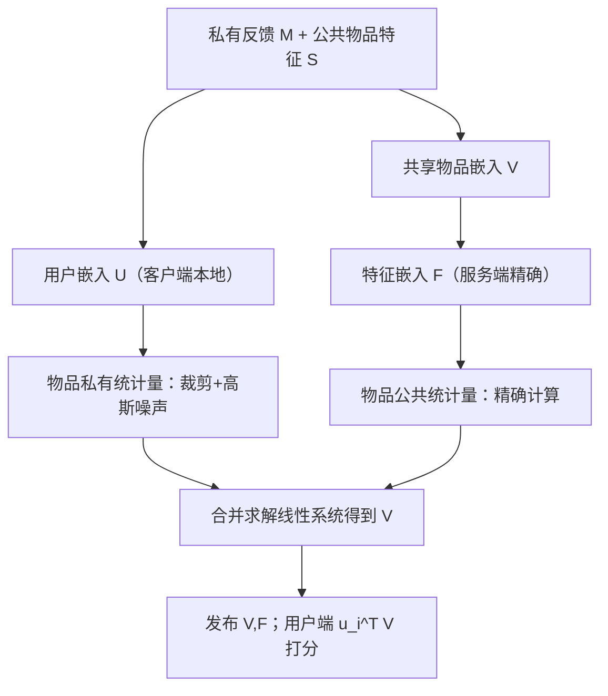

# Private Matrix Factorization with Public Item Features (带公共物品特征的隐私矩阵分解)

- **会议/期刊**: RecSys 2023
- **作者与机构**: Mihaela Curmei (UC Berkeley/Google), Walid Krichene (Google), Li Zhang (Microsoft/Google), Mukund Sundararajan (Google)
- **推荐链路定位**: 精排 / 评分预测（非Top-N排序）
- **研究方向**: 去偏公平、可信隐私与工业架构 / 协同过滤与双塔召回
- **论文原文**: [论文原文链接](https://arxiv.org/abs/2309.11516v1)
- **开源代码**: 暂未开源

## TL;DR (1分钟核心速览)

针对差分隐私推荐中噪声严重损害物品嵌入、长尾尤甚的痛点，本文提出DP-CMF：联合分解私有用户-物品矩阵与公共物品特征矩阵，共享物品嵌入；私有充分统计量裁剪加高斯噪声，公共统计量精确计算，不额外耗隐私预算。在ML10M评分预测、用户级DP $\varepsilon\in[1,20]$下，公共特征使RMSE最多降5.8%，低$\varepsilon$ 时闭合约60%与非私有ALS的差距。

## Background & Motivation (背景与核心矛盾)

- **主流范式**: DPALS/DP-MF 用交替最小二乘训练矩阵分解，用户端更新 $U$，服务端对物品充分统计量加噪后发布$V$。
- **前人局限**: DP噪声尤其破坏长尾物品表示；现有“公共数据助隐私”多在梯度法/预训练中，且常假设公私数据同分布，二阶ALS下如何融合公共物品特征缺乏系统研究。
- **核心洞察 (Key Insight)**: 物品嵌入求解的是线性系统 $Av=b$：私有$\hat{A},\hat{b}$含噪，公共$A',b'$精确。公共特征可稳定病态系统，$\alpha$ 控制CF与内容先验的权衡。
- **本文切入点**: 将集合矩阵分解 (CMF) 嵌入DPALS，物品嵌入在私有反馈与公共特征间共享；公共项仅依赖已发布DP量，按post-processing无需额外隐私预算。

## Method (核心方法设计)

### 1. 整体框架 (Overall Architecture)

输入私有用户-物品评分矩阵 $M$与公共物品特征矩阵$S$。模型学习用户嵌入$U$、共享物品嵌入$V$、特征嵌入$F$，通过ALS交替更新：用户端本地更新$U$，服务端精确更新$F$，再对物品更新中的私有统计量做裁剪与高斯加噪，与公共精确统计量合并后求解$V$。最终只发布$V,F$，用户用$u_i^\top V$ 打分，平台被视为可信聚合方。

### 2. 关键设计拆解 (Key Designs)

1. **共享物品嵌入的CMF目标**: 传统DPALS只用私有反馈，噪声下 $V$ 方差大。CMF将公共特征视为“虚构用户”，目标为
$\mathcal{L}=\sum_{(i,j)\in\Omega}W_{ij}(\langle u_i,v_j\rangle-M_{ij})^2+\alpha\sum_{(k,j)\in\Omega'}(\langle f_k,v_j\rangle-S_{kj})^2+\lambda\|U\|_F^2+\lambda\|V\|_F^2+\lambda'\|F\|_F^2$。
$\alpha$越大，$V$ 越依赖公共内容；公共项为物品表示提供精确先验，缓解噪声与长尾稀疏。

2. **DP-CMF的噪声/精确统计量分离**: 物品更新写成
$v_j=-(\hat{A}_j+\alpha A'_j)^{-1}(\hat{b}_j+\alpha b'_j)$，
其中 $\hat{A}_j=\Pi_{\mathrm{PSD}}[\sum_{i\in\Omega_{:j}}W_{ij}u_i\otimes u_i+G_j+\lambda I]$，$\hat{b}_j=\sum_{i\in\Omega_{:j}}W_{ij}M_{ij}u_i+g_j$含私有噪声；$A'_j=\sum_{k\in\Omega'_{:j}}f_k\otimes f_k+\lambda'I$，$b'_j=\sum_{k\in\Omega'_{:j}}S_{kj}f_k$ 仅用公共数据精确计算。隐私只由私有部分承担，故公共特征不消耗隐私预算。

3. **训练目标、负采样与推理效率**: 总损失即上述加权CMF；本文为显式评分回归，不使用BPR/InfoNCE负采样。用户级DP保证：若 $\sum_{j\in\Omega_i}W_{ij}^2\le \varepsilon^2/[4T(\log(1/\delta)+\varepsilon)]$，则算法满足$(\varepsilon,\delta)$-用户级DP。每步复杂度约$O((|\Omega|+|\Omega'|)d^2+(m+n+s)d^3)$，当$s$与$m+n$ 同量级时开销可控。

## Experimental Setup & Evaluation Protocol (实验设置与评估协议)

- **数据集与预处理**:

| 数据集/特征源 | #Users | #Items | #Interactions | 稀疏度/密度 | 特征/场景说明 |
| :--- | :---: | :---: | :---: | :---: | :--- |
| ML10M（私有） | 69,878 | 10,677 | 10,000,054 | ≈1.34% | 显式1–5分；Lee et al.划分 |
| Wikidata（公共） | - | 10,677 | 12,637 tokens | 0.13% | genre/topic/cast二值特征 |
| ML20M公开用户 | 70,152 | 10,677 | 子集 $s=100$–70,152 | - | 与ML10M用户不重叠；原始/二值评分 |
| 物品相似度 | - | 10,677 | $k=30/100$ | - | dot/cos；由公开ML20M变体MF导出 |

- **数据划分与防穿越 (Splitting Strategy)**: 按Lee et al. (2016) 留出验证/测试；未采用5-core过滤。私有评分不公开，公共特征与私有用户不重叠。
- **排名评测协议 (Ranking Protocol)**: 本文是评分预测，不是Top-N检索；不使用Full-Ranking或Sampled Ranking，指标为RMSE。隐私参数 $\delta=10^{-5}$，$\varepsilon\in\{1,5,10,20\}$，越小越私密。
- **对比基线与超参设置**: 主基线为DPALS无侧特征（SOTA）与非私有ALS参考；DP超参 $T,\lambda,\Gamma_U$沿用Krichene et al.，仅调公共特征权重$\alpha$与正则$\lambda'$。嵌入维度$d$ 正文未列具体值；原文未报告显著性检验。

## Key Experimental Results (实验关键数据)

### 1. 主实验对比 (Main Results)

| 方法 | $\varepsilon=1$|$\varepsilon=5$|$\varepsilon=10$|$\varepsilon=20$|$\varepsilon=1$ 相对DP-ALS |
| :--- | :---: | :---: | :---: | :---: | :---: |
| DP-ALS（无公共特征） | 0.885 | 0.862 | 0.850 | 0.842 | - |
| DP-CMF + Wiki元数据 | 0.865 | 0.846 | 0.837 | 0.830 | 2.3% |
| DP-CMF + 物品相似度 | 0.852 | 0.838 | 0.830 | 0.824 | 3.7% |
| DP-CMF + 公开用户评分 | 0.842 | 0.828 | 0.821 | 0.816 | 4.9% |
| **DP-CMF + 全部公共数据** | **0.834** | **0.822** | **0.816** | **0.811** | **5.8%** |
| 非私有ALS（参考） | 0.800 | 0.800 | 0.800 | 0.800 | - |

RMSE越低越好；加粗为最优私有模型。$\varepsilon=1$ 时全部公共数据将RMSE从0.885降至0.834，相对降5.8%，约闭合60%与非私有ALS的差距。

### 2. 消融实验 (Ablation Study)

| 配置（$\varepsilon=1$） | RMSE | Δ vs$\alpha=0$ | 备注 |
| :--- | :---: | :---: | :--- |
| DP-ALS（$\alpha=0$） | 0.885 | - | 无公共特征 |
| + Wiki全部 | 0.865 | -0.020 | 元数据有效 |
| + 仅Cast | 0.868 | -0.017 | 接近全部元数据 |
| + 仅Genre | 0.878 | -0.007 | 增益较弱 |
| + 仅Topic | 0.873 | -0.012 | 中等增益 |
| + Item-Item dot $k=30$ | 0.858 | -0.027 | 相似度有效 |
| + Item-Item dot $k=100$| 0.852 | -0.033 |$k$ 增大更好 |
| + 公开用户 $s=1k$ | 0.846 | -0.039 | 小规模已显著 |
| + 公开用户 $s=50k$ | 0.838 | -0.047 | 接近非私有 |
| + 全部公共数据 | 0.834 | -0.051 | 模态可组合 |

### 3. 关键实验发现 (Key Findings)

1. **隐私越强，公共特征越关键**：$\varepsilon=1$时DP-ALS 0.885→全部公共数据0.834，RMSE降5.8%、闭合约60%差距；$\varepsilon=20$ 时降幅收窄至3.7%，说明公共特征是噪声主导时的稳定先验。
2. **长尾出现“排序反转”**：$\varepsilon=1$ 按流行度四桶切分，头部桶排序与全局一致，尾部桶Wikidata增益最大；原因是ML20M公开用户约90%特征观测集中在热门物品，而Wikidata仅约37%，更能把热门信息迁移到长尾。
3. **公共数据规模与类型均有效**：公开用户从 $s=1k$增至$50k$持续提升，原始评分优于二值；item-item 的 dot$k=100$优于 cos/$k=30$，但dot的幅度带来流行度偏置，尾部弱于Wikidata；仅Cast即可拿到元数据的大部分增益。

## Highlights & Limitations (亮点、对比与审稿批判)

- **与代表作对比 (vs. Prior Work)**: DPALS只用私有反馈且噪声伤 $V$；传统CMF利用侧特征但非隐私场景；已有“公共数据助DP”多在梯度法/预训练且假设同分布。本文首次在用户级DP的二阶ALS中系统融合公共物品特征，公共统计量精确计算且不增隐私预算。
- **可迁移亮点**: 将公共特征视作“虚构用户”共享物品嵌入，天然适配元数据、物品相似度、公开评分三种模态；客户端更新 $U$、服务端只发布$V,F$ 的威胁模型也可迁移到联邦/隐私推荐。
- **审稿级局限批判**: (1) 依赖可信服务器持有原始评分，只防外部/恶意用户，不防平台本身；若平台不可信需安全聚合，成本上升。(2) 评估仅ML10M评分预测RMSE，未报告Top-N排序、显著性检验与线上A/B；公共特征质量强依赖领域，$\alpha,\lambda'$需调参，且$s$ 大时线性系统开销增加。

## Rating (四维评分)

- **方法创新性 (Novelty)**: ⭐⭐⭐⭐ （CMF与DPALS的结合不复杂，但系统研究了公共物品特征在用户级DP二阶ALS中的作用，机制清晰且有隐私预算分析。）
- **评估协议与实验扎实度 (Protocol & Experiments)**: ⭐⭐⭐ （单一ML10M评分预测、无显著性检验，但隐私区间、特征模态与流行度分桶较完整。）
- **写作与数学规范度 (Clarity & Rigor)**: ⭐⭐⭐⭐ （CMF损失、DP更新与隐私保证推导清楚，威胁模型和复杂度说明到位。）
- **工业落地与复现价值 (Industrial & Practical Value)**: ⭐⭐⭐⭐ （方法简单可扩展、只调两个侧特征超参；但可信服务器假设与公共特征获取成本限制落地。）

