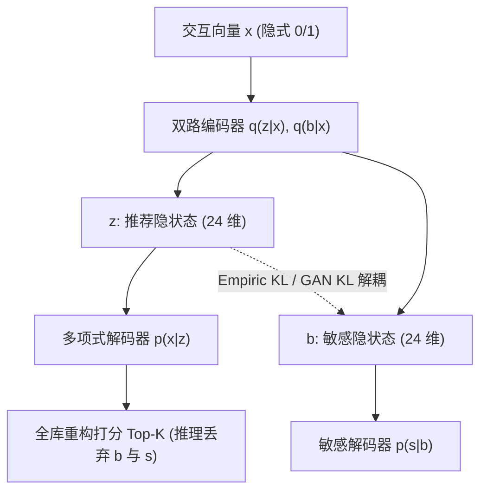
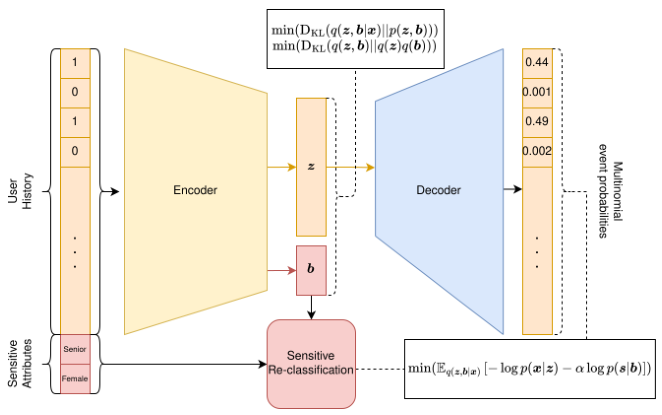

# Providing Previously Unseen Users Fair Recommendations Using Variational Autoencoders (用变分自编码器为从未出现过的用户提供公平推荐)

- **会议/期刊**: RecSys 2023
- **作者与机构**: Bjørnar Vassøy, Helge Langseth, Benjamin Kille（挪威科技大学 NTNU）
- **推荐链路定位**: 召回（端到端重构式 Top-K 生成）
- **研究方向**: 去偏公平与可信推荐 / 冷启动与新用户推荐
- **论文原文**: [https://arxiv.org/abs/2308.15230v1](https://arxiv.org/abs/2308.15230v1)
- **开源代码**: [https://github.com/BjornarVass/fair-vae-rec](https://github.com/BjornarVass/fair-vae-rec)

## TL;DR (1分钟核心速览)

现有公平推荐几乎都建立在**显式用户表征**（user embedding）之上，因而天然无法服务训练集中未出现的新用户。本文在 Mult-VAE 召回器上提出 **Split Latent** 架构：把隐状态切成推荐专用的 $z$与承载人口统计信息的$b$，用"敏感重分类 +$z\perp b$解耦项"阻止性别/年龄流入$z$，推理时只解码$z$ 且**不需要任何敏感标签**。在 MovieLens-1M 与 LFM-2B 的**用户不相交**划分下，Empiric-KL 变体把性别/年龄 AUC 从 0.804/0.859 压到 0.652/0.629（理想无偏值 0.5），NDCG@10 仅从 0.321 降至 0.286（−11%）。

## Background & Motivation (背景与核心矛盾)

- **主流范式**: 公平推荐主流做法是在矩阵分解/图嵌入/新闻推荐的隐因子或表征上叠加**对抗分类器**，惩罚"能从表征中判别敏感属性"的行为；另有正交化、重采样、因果隔离等路线。
- **前人局限**: ① 这些方法全部依赖训练期学到的显式用户向量，**无法对测试期新用户推理**（Li et al. 2023 需额外训练一个映射函数把新用户投影回旧空间，代价是二次建模误差）；② 对抗训练目标随判别器漂移，收敛不稳，AUC 往往只从 0.85 降到 0.68 量级，难以逼近 0.5。
- **核心洞察 (Key Insight)**: VAE 的**低维瓶颈 + 概率隐变量**本身就是天然的信息压缩器；且 VAE 只需一份交互列表即可通过 $q(z|x)$ 前向推断用户状态，**天生支持零交互历史之外无任何信息的冷启动用户**——这是显式 user ID 嵌入模型不具备的性质。
- **本文切入点**: 不做"消除敏感信息"，而是做**分流**——给敏感信息一条专属通道 $b$去容纳它，再显式惩罚$z$与$b$的统计相关性，使$z$ 保持中立。

## Method (核心方法设计)

### 1. 整体框架 (Overall Architecture)

输入是用户隐式交互向量 $x\in\{0,1\}^{|\mathcal{I}|}$。编码器实际实现为**两个独立编码器**，分别输出推荐隐状态$z$与敏感隐状态$b$；解码侧同样双路：多项式解码器$p(x|z)$重构交互历史用于推荐打分，敏感解码器$p(s|b)$从$b$反推敏感属性（性别/年龄）。训练时三股力量拉扯：重构保效用、$b$的分类保"敏感信息被吸走"、$z\perp b$的解耦项保中立。推理时**丢弃$b$、丢弃敏感标签$s$**，仅用$z$ 的均值（或采样）解码出全物品概率向量取 Top-K。整个流程无需用户 ID、无需在线更新，可直接充当新用户 onboarding 的 item-to-item 替代。

<figure class="paper-figure" markdown="span">
  <figcaption>图1：Split Latent 模型设置示意图。编码器采用动态设计，实际实现为两个独立编码器，分别用于 z 和 b。关键细节：推理过程中不提供也不需要显式的敏感信息 s，且潜在表示中的敏感部分 b 不用于推荐。</figcaption>
</figure>

### 2. 关键设计拆解 (Key Designs)

1. **Split Latent 双通道瓶颈（把敏感信息"引流"而非"抹除"）**：痛点是对抗式过滤会让模型把敏感信息挤进表征的任意角落，难以彻底清除。本文把隐状态显式二分，总目标为

$$\mathcal{L}_{\text{Split}} = \mathbb{E}_{q(z,b|x)}\big[\log p(x|z) + \alpha \log p(s|b)\big] - \beta D_{\mathrm{KL}}\big[q(z,b|x)\,\|\,p(z,b)\big] - \gamma D_{\mathrm{KL}}\big[q(z,b)\,\|\,q(z)q(b)\big]$$

其中第二项用交叉熵迫使 $b$承担全部敏感判别责任（$\alpha$越大越"贪心"地吸走敏感信息），第三项才真正约束$z$与$b$独立。直觉：给敏感信息一条"泄洪道"，$z$ 就没有动机再编码它。

2. **Empiric KL 解析解耦（用闭式高斯 KL 取代对抗近似）**：Creager 等的 GAN-KL 需在 minibatch 内整体打乱 $b$训练判别器，两模型互相追赶、难调。本文直接假设$q(z,b)$与$q(z)q(b)$均为高斯，用 minibatch 经验协方差$\hat{\Sigma}_1$（完整）与块对角$\hat{\Sigma}_2$（把$z$–$b$ 交叉协方差置零）代入闭式解：

$$D_{\mathrm{KL}}\big[q(z,b)\,\|\,q(z)q(b)\big] = \tfrac{1}{2}\Big[\log\tfrac{|\hat{\Sigma}_2|}{|\hat{\Sigma}_1|} - d + \mathrm{tr}\{\hat{\Sigma}_2^{-1}\hat{\Sigma}_1\}\Big],\quad \hat{\mu}_1=\hat{\mu}_2$$

块对角结构使逆矩阵可逐块求逆，代价近似 $O(d^2)$ 且**无判别器、无额外前向**，训练稳定性和公平性同时受益（AUC 降幅最大）。

3. **训练目标、负采样与推理效率**：似然采用 Multinomial 而非 Logistic/Gaussian——$p(x|z)$经 softmax 归一化，**未交互物品不产生显式惩罚**（避免"未交互=不喜欢"的强假设），等价于在全库上做 softmax 而无需构造负样本（免负采样）。超参：基线隐维 64、公平设置 24（原 Mult-VAE 为 200），公平设置统一$\beta=1$（原论文用 0.2），$\alpha,\gamma$调权重，SELU 替换 tanh 并去掉$\beta$-annealing。推理是单次前向 + 全库打分，$O(|\mathcal{I}|d)$，无用户侧在线更新。

## Experimental Setup & Evaluation Protocol (实验设置与评估协议)

| 数据集 | #Users | #Items | #Interactions | 敏感属性分布 | 说明 |
| :--- | :---: | :---: | :---: | :---: | :--- |
| MovieLens-1M | 6k | 3.5k | 575k | 女1.7k/男4.3k；≥35岁1.4k/<35岁4.6k | 评分≥4 记为 1，其余为 0（隐式化） |
| LFM-2B | 14.6k | 22k | 8750k | 女3k/男11.5k；senior 1.3k/young 13.3k | 取近两年、推荐对象为 artist，过滤 <110 次收听 |

- **数据划分与防穿越**: 采用**用户不相交划分（disjoint-user split）**，训练/验证/测试集用户集合互不重叠——这是本文最关键的协议设计，直接模拟"为从未出现过的用户推荐"，与常规按交互随机切分有本质区别；缺失性别或年龄的用户被过滤。
- **排名评测协议**: 隐式全库打分，**Full-Ranking**（对全部 3.5k / 22k 物品重构概率排序），报告 NDCG@10；训练端因 Multinomial 似然而**免负采样**。
- **公平性指标**: ① `AUC`（在隐状态上再训一个敏感属性分类器，**理想值 0.5**，越低越中立，衡量 Representation Neutrality）；② `χ²@100`（不同敏感群体 Top-100 曝光列联表统计量，越低越接近推荐一致性，衡量 Recommendation Parity）；③ `Kendall-Tau@100`（群体聚合推荐列表的序一致性，1 为完全一致，越高越公平）。
- **对比基线与超参**: SLIM（item-to-item，天然支持新用户）、VAErec（Mult-VAE 基线）、VAEadv（对抗过滤）、VAEgan（split + GAN-KL）、VAEemp（split + Empiric KL）；隐维 64/24，$\beta=1$（公平组），报告多次运行标准差。

## Key Experimental Results (实验关键数据)

### 1. 主实验对比 (Main Results)

| 数据集 | 模型 | NDCG@10 ↑ | AUC-G ↓ | AUC-A ↓ | χ²@100-G ↓ | K.T@100-G ↑ |
| :--- | :--- | :---: | :---: | :---: | :---: | :---: |
| ML-1M | SLIM | **0.328** | – | – | 2285 | 0.476 |
| ML-1M | VAErec | 0.321 | 0.804 | 0.859 | 2990 | 0.559 |
| ML-1M | VAEadv | 0.280 | 0.678 | 0.675 | 1121 | 0.820 |
| ML-1M | VAEgan | 0.277 | 0.687 | 0.695 | **1054** | **0.854** |
| ML-1M | VAEemp | 0.286 | **0.652** | **0.629** | 1355 | 0.804 |
| LFM-2B | SLIM | **0.572** | – | – | **2681** | 0.238 |
| LFM-2B | VAErec | 0.512 | 0.759 | 0.821 | 3693 | 0.608 |
| LFM-2B | VAEadv | 0.492 | 0.666 | **0.731** | **2441** | 0.757 |
| LFM-2B | VAEgan | 0.484 | 0.674 | 0.738 | 2596 | **0.775** |
| LFM-2B | VAEemp | 0.495 | **0.663** | 0.757 | 2924 | 0.725 |

相对 VAErec：ML-1M 上 VAEemp 的 AUC-G/AUC-A 分别下降 **18.9% / 26.8%**（0.804→0.652、0.859→0.629），代价 NDCG −10.9%；LFM-2B 上 AUC-G 下降 **12.6%**，NDCG 仅 −3.3%。χ² 上 VAEgan 在 ML-1M 相对 VAErec 降低 **64.7%**（2990→1054）。

### 2. 消融实验 (Ablation Study)

| 配置 | ML-1M NDCG@10 | ΔNDCG | ML-1M AUC-G | LFM NDCG@10 | LFM AUC-G |
| :--- | :---: | :---: | :---: | :---: | :---: |
| w/o 公平约束 (VAErec) | 0.321 | – | 0.804 | 0.512 | 0.759 |
| w/o split，仅对抗 (VAEadv) | 0.280 | −0.041 | 0.678 | 0.492 | 0.666 |
| split + GAN-KL (VAEgan) | 0.277 | −0.044 | 0.687 | 0.484 | 0.674 |
| split + Empiric-KL (VAEemp) | **0.286** | **−0.035** | **0.652** | **0.495** | **0.663** |
| Empiric-KL + 采样 ($\beta$=1.0) | 0.256 | −0.065 | 0.595 | – | – |
| Empiric-KL + 采样 ($\beta$=0.2) | 0.279 | −0.042 | 0.619 | – | – |

### 3. 关键实验发现 (Key Findings)

1. **解耦的"价格"高度依赖群体分布而非模型本身**：ML-1M 上用 −0.035 NDCG（−11%）换 AUC-G −0.152；LFM-2B 上同样机制只花 −0.017 NDCG（−3.3%）就换来 AUC-G −0.096。原因是 LFM 的 senior 仅约 10%、基线本就只编码了较弱的人口统计信号（0.759 vs 0.804），可压缩空间更小，说明**公平代价应随基线泄露程度标定**。
2. **表征中立 ≠ 结果一致，单指标会选错模型**：AUC 最优的 VAEemp（0.652/0.629）在 χ² 与 K.T 上反而是三个公平变体里最差的（1355 vs VAEgan 1054；K.T 0.804 vs 0.854）；反之 VAEgan 在结果级指标最好而 AUC 落后约 0.035–0.066。二者衡量的是"信息是否进入表征"与"曝光分布是否趋同"两个不同层面，工业评测必须双轨并行。
3. **隐状态采样是推理期的"公平旋钮"**：$\beta=1.0$时从确定性均值切到采样，NDCG 0.286→0.256（−10.5%），但 AUC-G 0.651→0.595、AUC-A 0.629→0.562，更接近 0.5；而$\beta=0.2$时采样反而使 AUC-G 回升至 0.619。说明$\beta$ 与采样策略必须联合调参，才能把"公平"做成用户可开关的在线选项而非硬编码牺牲。

## Highlights & Limitations (亮点、对比与审稿批判)

- **与代表作对比**: 相比 Creager et al. 2019（分类任务、把每个敏感属性锁到单一维度、需指定敏感标签），本文面向推荐、允许 $b$整块承载敏感信息并给各向同性高斯先验；相比 Li et al. 2023 的"迁移公平"需额外训练新用户映射函数，本文靠$q(z|x)$ 前向推断即可，无二次建模；相比 Wu et al. 2021 的图公平表征（依赖 user ID 图），本文完全免 user ID，故能做 unseen-user。
- **可迁移亮点**: ① 用 **minibatch 经验协方差的块对角 KL** 替代对抗解耦，可低成本移植到任何自编码器召回（Mult-VAE / RecVAE / 扩散召回的去偏），无判别器即无训练震荡；② 把 VAE 后验方差当作"推理期隐私/公平强度旋钮"，可做成线上 A/B 开关，按用户或场景动态切换。
- **审稿级局限批判**: ① 公平性只覆盖**二值化**性别与年龄（阈值 35 岁、丢弃 other/undefined），多值/交叉敏感属性未验证，且 LFM 的群体极端不均衡使结论外部效度受限；② 隐维从原论文 200 砍到 24/64，**缺少同维度纯 $\beta$-VAE 对照**，公平增益中"容量压缩"与"解耦项"的贡献无法完全剥离；③ χ²/K.T 仅报标准差、未做显著性检验，且 SLIM 的 χ² 受流行度集中度混淆（SLIM 约 60% 推荐落在 top-10% 热门，VAEemp 约 85%），跨模型比较存在偏倚。

## Rating (四维评分)

- **方法创新性 (Novelty)**: ⭐⭐⭐⭐ （Split Latent 引流式去偏 + 闭式经验协方差 KL 替代 GAN 解耦，思路干净且首次把"公平"与"unseen user"两个约束在同一 VAE 架构内统一，但组件均为已有技术的重新组合）
- **评估协议与实验扎实度 (Protocol & Experiments)**: ⭐⭐⭐⭐ （用户不相交划分精准对应研究问题，四类指标互补覆盖表征级与结果级公平，AUC/χ²/K.T 多角度互证；扣分在仅两个数据集、无显著性检验、缺同维 $\beta$-VAE 对照）
- **写作与数学规范度 (Clarity & Rigor)**: ⭐⭐⭐⭐ （Split 目标函数与 Empiric KL 闭式解推导清晰、$b$在推理期被丢弃的边界条件交代明确；但对$\alpha,\gamma$ 的敏感性分析与复杂度讨论偏薄）
- **工业落地与复现价值 (Industrial & Practical Value)**: ⭐⭐⭐ （代码已开源、免 user ID 免负采样使新用户 onboarding 成本极低，采样旋钮便于线上控损；但 NDCG 落后 SLIM 尤其在 LFM 上（0.495 vs 0.572），且 χ² 结果不总优于 SLIM，短期难直接替换成熟召回）

