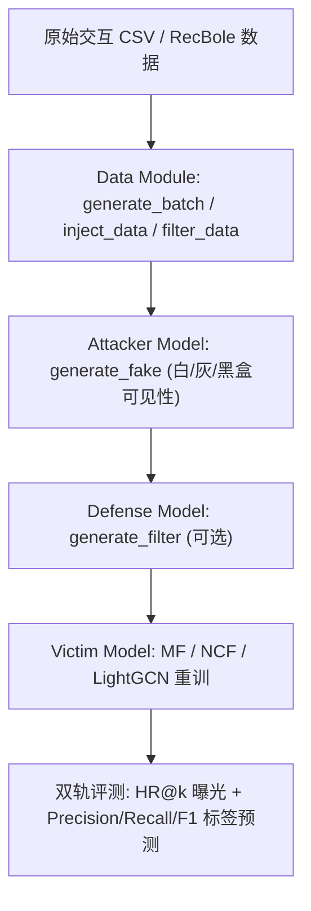
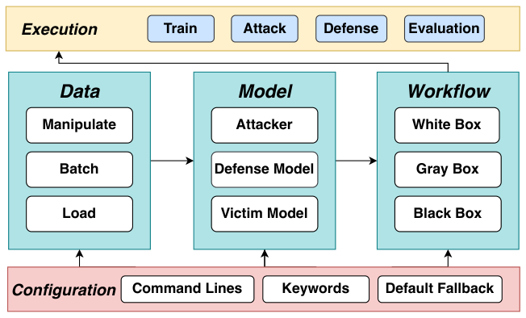

# RecAD: Towards A Unified Library for Recommender Attack and Defense (面向推荐系统攻击与防御的统一基准库)

- **会议/期刊**: RecSys 2023
- **作者与机构**: Changsheng Wang, Jianbai Ye, Wenjie Wang, Chongming Gao, Fuli Feng, Xiangnan He（中国科学技术大学、新加坡国立大学）
- **推荐链路定位**: 端到端（训练数据投毒 / 预处理去噪 / 推荐模型鲁棒性评测）
- **研究方向**: 去偏公平与工业架构 / 自监督与交互去噪
- **论文原文**: [https://arxiv.org/abs/2309.04884v1](https://arxiv.org/abs/2309.04884v1)
- **开源代码**: [https://github.com/gusye1234/recad](https://github.com/gusye1234/recad)

## TL;DR (1分钟核心速览)

推荐系统投毒（shilling attack）与防御方向长期缺乏统一基准：数据集切分、攻击预算、攻击者知识假设、评测指标各行其是，导致跨论文指标不可比。RecAD 以数据、模型、工作流三大模块 + `from_config` 惰性实例化抽象出可复现流水线，内置 7 个数据集、10 个推荐/攻击/防御模型，并提出"标签预测 + 端到端注入"双轨评估。在 ML-1M/Yelp/Amazon 上，灰盒 AIA/AUSH 于 ML-1M 的 HR@100 达 0.1007/0.0945（无攻击 0.0656），而现有多数防御仅对随机类攻击有效。

## Background & Motivation (背景与核心矛盾)

- **主流范式**: 攻击端沿"启发式（Random/Average/Bandwagon/Segment）→ 梯度（PGA）→ 神经（WGAN/AIA/AUSH/Legup）"演进；防御端沿"有监督（CoDetector/BayesDetector/DegreeSAD）→ 半监督（SemiSAD）→ 无监督（PCASelectUser/FAP）"演进。
- **前人局限一**: 数据集过滤口径（是否 k-core、如何切分）、注入假用户比例、攻击者知识假设（白/灰/黑盒）互不相同，同一方法在不同论文中可差数倍，跨工作数值直接比较失效。
- **前人局限二**: 既有开源（AUSH 代码、SDLib）只覆盖攻击或只覆盖部分防御，缺"生成假数据 → 注入 → 训练受害模型 → 检测 → 再测评"的闭环；SDLib 语言陈旧、攻击模型过时。
- **核心洞察 (Key Insight)**: 攻击/防御本质是**同一数据流水线在不同数据可见性下的不同切面**；只要把"数据暴露级别"作为一等公民参数化，就能用一套工作流覆盖白/灰/黑盒，并保证无信息穿越。
- **本文切入点**: 用"知识暴露比例 + 统一接口"替代各家自定义实验脚本，同时指出单一评估维度（只看检测 F1 或只看曝光）会给出互相矛盾的结论。

## Method (核心方法设计)

### 1. 整体框架 (Overall Architecture)

RecAD 自底向上分三层：全局哈希表维护各模块默认超参（命令行/配置文件/关键字三级覆盖）；其上为**数据模块**（`generate_batch`/`inject_data`/`filter_data` 统一批生成与假数据增删）、**模型模块**（`BaseModel` 派生 victim / attacker / defense，各自实现 `train_step`/`test_step`，攻击者额外实现 `generate_fake`、防御者实现 `generate_filter`）、**工作流模块**（依攻击知识编排数据可见性与模块依赖，托管训练循环与早停钩子）。用户仅需 `from_config` 声明组件，工作流在运行时补齐 user/item 规模等动态参数后自动实例化并 `execute`。

<figure class="paper-figure" markdown="span">
  <figcaption>图 1：RecAD 的整体框架。</figcaption>
</figure>

### 2. 关键设计拆解 (Key Designs)

1. **统一攻击目标与双层优化抽象**：把散落的攻击方法统一为"外层最大化目标物品曝光、内层最优推荐参数"的 bi-level 形式，使启发式/梯度/神经三类攻击可在同一接口下比较：

$$\max_{\mathcal{D}_f}\ \mathrm{HR@}k\!\left(\mathcal{I}_t \mid \theta^{*}\right),\quad \text{s.t.}\ \theta^{*}=\arg\min_{\theta}\mathcal{L}_{\text{rec}}\!\left(\mathcal{D}\cup\mathcal{D}_f;\theta\right)$$

其中 $\mathcal{D}_f$为注入假用户交互、$\mathcal{I}_t$ 为目标物品。该抽象的价值在于把"攻击预算（假用户数/交互数）"与"知识假设"从算法实现中剥离，成为可扫描的超参。

2. **攻击者知识可调（白盒→灰盒→黑盒）**：以往灰盒设定无统一口径。RecAD 用暴露比例 $p$ 参数化攻击者可见训练集：

$$\mathcal{D}_{\text{att}}=\text{Sample}\!\left(\mathcal{D},\ \lfloor p\,|\mathcal{D}|\rfloor\right),\quad p\in\{5\%,20\%,50\%,80\%,100\%\}$$

$p=1$退化为白盒、$p=0$ 且仅有 spy 反馈即黑盒。物理直觉：攻击效果应与知识单调正相关，作者用该旋钮验证了 AIA 的 HR@20 从 0.0552（5%）升至 0.0745（100%），而 Legup 从 0.0086 升至 0.0304，量化了"知识-攻击力"曲线。

3. **惰性实例化与训练目标**：由于注入/过滤会改变用户与物品数量，模型无法在 `from_config` 时确定 embedding 规模。RecAD 延迟实例化：先登记依赖，运行时由工作流拓扑排序后回填动态参数。攻击者与受害者共享 `train_step`，默认 BPR  pairwise 损失 + 均匀负采样；防御器则输出二分类掩码，损失为交叉熵 $\mathcal{L}_{\text{def}}=-\sum_{u}y_u\log \hat{y}_u+(1-y_u)\log(1-\hat{y}_u)$。推理开销集中在攻击者生成阶段（神经攻击需在线训练生成器），检测阶段为一次性前向。

## Experimental Setup & Evaluation Protocol (实验设置与评估协议)

- **数据集与预处理**（仅保留交互数 ≥ 10 的高频用户/物品，即 10-core 过滤）：

| 数据集 | #Users | #Items | #Interactions | 密度 | 说明 |
| :--- | :---: | :---: | :---: | :---: | :--- |
| MovieLens-1M | 5,950 | 3,702 | 567,533 | 0.257% | 电影评分，实验主集 |
| Yelp | 54,632 | 34,474 | 1,334,942 | 0.070% | 本地生活商户 |
| Amazon-Game | 3,179 | 5,600 | 38,596 | 0.216% | 稀疏电商子类 |
| Book-Crossing / Last.FM / Epinions / Gowalla | 105,284 / 1,892 / 116,260 / 107,092 | 340,557 / 17,632 / 41,269 / 1,280,969 | 1.15M / 92,834 / 188,478 / 6.44M | 0.003%–0.278% | 仅入库，未进实验 |

- **数据划分与防穿越**: 论文主文未明确切分方式（`leave-one-out` 或比例划分），这是本基准的可复现性缺口；但工作流模块被显式设计为防止攻击者意外看到受害模型测试数据（图 2 的数据可见性分级）。
- **排名评测协议 (Ranking Protocol)**: 攻击侧采用 **Full-Ranking**（目标物品在全体物品中的 HR@10/20/50/100）；防御侧采用**双轨协议**——(i) 标签预测 Precision/Recall/F1，且**对真实数据与假数据分别报告**（避免只靠"全判假"刷高指标）；(ii) 注入式端到端评估：检测后重训受害模型再测 HR@k。
- **对比基线与超参**: 攻击基线 8 个（Random/Segment/Bandwagon/Average 为白盒启发式，WGAN 为白盒神经，AIA/AUSH/Legup 为灰盒 20% 数据神经方法）；防御基线 6 个（DegreeSAD、CoDetector、BayesDetector、SemiSAD、PCASelectUser、FAP）。受害模型支持 MF/NCF/LightGCN。论文未报告显著性检验。

## Key Experimental Results (实验关键数据)

### 1. 主实验对比 (Main Results)

攻击侧 HR@k（越高越好，**加粗为最优**）：

| 攻击方法 | 知识 | ML-1M HR@10 | ML-1M HR@100 | Yelp HR@10 | Yelp HR@100 | Amazon HR@10 | Amazon HR@100 |
| :--- | :---: | :---: | :---: | :---: | :---: | :---: | :---: |
| No Attacker | — | 0.0050 | 0.0656 | 0.0114 | 0.0630 | 0.0000 | 0.0016 |
| Random | 白盒 | 0.0050 | 0.0457 | 0.0078 | 0.0362 | 0.0000 | 0.0000 |
| Average | 白盒 | 0.0016 | 0.0400 | 0.0053 | 0.0284 | 0.0085 | 0.0914 |
| Bandwagon | 白盒 | 0.0059 | 0.0592 | 0.0066 | 0.0431 | 0.0050 | 0.0854 |
| Segment | 白盒 | 0.0069 | 0.0630 | 0.0057 | 0.0258 | 0.0397 | 0.0832 |
| WGAN | 白盒 | 0.0023 | 0.0340 | 0.0143 | 0.0344 | 0.1646 | 0.2226 |
| AIA | 灰盒 20% | **0.0078** | **0.1007** | **0.0187** | **0.0686** | 0.0441 | **0.4839** |
| AUSH | 灰盒 20% | 0.0071 | 0.0945 | 0.0135 | 0.0617 | 0.0583 | 0.4805 |
| Legup | 灰盒 20% | **0.0094** | 0.0471 | 0.0068 | 0.0242 | **0.1847** | 0.2566 |
| **Improv.(AIA vs None)** | — | **+56.0%** | **+53.5%** | **+64.0%** | **+8.9%** | — | **>100×** |

防御侧（F1，True Data / Fake Data 分别报告）：

| 检测方法 | 监督类型 | AIA | Legup | WGAN | Random | Segment |
| :--- | :---: | :---: | :---: | :---: | :---: | :---: |
| DegreeSAD | 有监督 | 0.812 / 0.672 | 0.810 / 0.672 | 0.810 / 0.671 | 0.810 / 0.669 | 0.810 / 0.670 |
| CoDetector | 有监督 | 0.879 / 0.820 | 0.886 / 0.841 | 0.885 / 0.827 | 0.892 / 0.831 | 0.892 / 0.840 |
| BayesDetector | 有监督 | 0.945 / 0.912 | 0.945 / 0.913 | 0.940 / 0.904 | 0.940 / 0.902 | 0.940 / 0.905 |
| SemiSAD | 半监督 | 0.945 / 0.000 | 0.954 / 0.000 | 0.959 / 0.000 | 0.949 / 0.000 | 0.943 / 0.000 |
| PCASelectUser | 无监督 | **0.969** / 0.050 | 0.970 / 0.086 | 0.970 / 0.086 | 0.967 / 0.000 | 0.967 / 0.000 |
| FAP | 无监督 | 0.977 / 0.272 | **0.985 / 0.491** | **0.985 / 0.511** | 0.442 / **0.967** | 0.728 / **0.961** |

### 2. 消融/敏感度实验 (Sensitivity & Robustness)

本库论文无组件消融，代之以"数据可见性比例"敏感度与"检测前后"鲁棒性分析：

| 攻击者 | 指标 | 5% 数据 | 20% | 50% | 80% | 100% |
| :--- | :---: | :---: | :---: | :---: | :---: | :---: |
| AIA | HR@20 | 0.0552 | 0.0589 | 0.0594 | 0.0633 | **0.0745** |
| Legup | HR@20 | 0.0086 | 0.0073 | 0.0112 | 0.0152 | **0.0304** |

| 攻击者（ML-1M） | 检测前 HR@10 | 检测后 HR@10 | 变化 |
| :--- | :---: | :---: | :---: |
| Legup | 0.0094（最优） | 0.0023（最差） | 崩塌 |
| Bandwagon | 0.0059 | 显著下降 | 下降 |
| WGAN / Average | 0.0023 / 0.0016 | 反而上升 | 反向获益 |

### 3. 关键实验发现 (Key Findings)

1. **神经灰盒攻击是唯一稳定有效的一类**：AIA/AUSH 仅用 20% 数据即在三个数据集上全面领先，ML-1M HR@100 相对无攻击提升 53.5%；而 8 个基线中 Random 的 HR@100（0.0457）竟低于无攻击（0.0656），说明"随机填充"不仅无效还会反向拉低目标物品排名——这直接反驳了早期文献中把 Random 当作可靠下界的做法。
2. **防御侧存在严重的"真样本-假样本"非对称失效**：PCASelectUser 在真实数据上 F1 高达 0.969，但假数据 F1 仅 0.050（Random/Segment 上甚至为 0），即它几乎把攻击者全部放行；SemiSAD 因攻击预算小、标注样本稀缺，假数据 F1 全线归零。只有 BayesDetector 保持 0.90+ 的均衡双端表现，FAP 则在 WGAN/Legup 上假数据 F1 达 0.51/0.49 却在 Random 上真数据 F1 跌至 0.442——说明**不存在全域鲁棒的检测器**。
3. **单轨评估会给出互相矛盾的结论**：WGAN 与 Average 在经 PCASelectUser 检测后目标物品曝光反而升高，而标签预测指标却显示检测"很准"。作者据此论证必须同时报告注入式端到端 HR 与标签 F1；这解释了为何部分论文宣称的防御增益在实际系统中不可复现。

## Highlights & Limitations (亮点、对比与审稿批判)

- **与代表作对比 (vs. Prior Work)**: 相对 AUSH 附带代码（仅攻击、无数据处理脚本、扩展成本高）与 SDLib（攻击模型过时、语言陈旧、未打通注入-检测-重训闭环），RecAD 的差异在于把"攻击者知识"提升为一等配置项，并把防御评估做成标签级与曝光级双轨；相对 RecBole 等推荐库，它补齐了投毒与去噪环节。
- **可迁移亮点**: (i) 用"暴露比例 $p$"参数化知识假设，可直接迁移到联邦推荐投毒、LLM 推荐的数据污染鲁棒性评测；(ii) 惰性实例化 + 哈希默认参数的组合，是处理"数据规模在运行时才确定"的通用工程范式。
- **审稿级局限批判**: (i) 主文未披露切分方式、注入率、假用户预算等关键协议参数，且无显著性检验，基准的"标准化"承诺打了折扣；(ii) 实验仅在单一受害模型族（MF/NCF/LightGCN）与离线全排序下进行，缺图神经网络/序列/生成式受害模型的鲁棒性谱系，也未覆盖 2023 年后兴起的 LLM 推荐投毒（作者仅在结论中列为未来工作）；(iii) 数据集规模偏小（Amazon-Game 仅 3.8 万交互），神经攻击的生成器训练成本未量化，工业部署的时延结论缺失。

## Rating (四维评分)

- **方法创新性 (Novelty)**: ⭐⭐⭐ （非新算法，创新在于知识可调的工作流抽象与双轨评估协议，属系统级而非模型级贡献）
- **评估协议与实验扎实度 (Protocol & Experiments)**: ⭐⭐⭐⭐ （8 攻击 + 6 防御基线跨 3 数据集较全面，且坚持真假样本分别报告 F1，但缺切分细节与显著性检验）
- **写作与数学规范度 (Clarity & Rigor)**: ⭐⭐⭐ （模块接口与代码示例清晰，形式化仅停留在 bi-level 目标层面，缺复杂度与开销分析）
- **工业落地与复现价值 (Industrial & Practical Value)**: ⭐⭐⭐⭐⭐ （PyTorch 开源、7 数据集预置、`from_config` 一行切换模型，是风控与投毒评测的实用脚手架）

