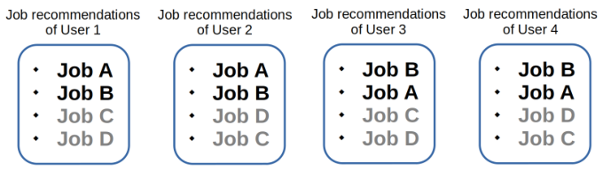
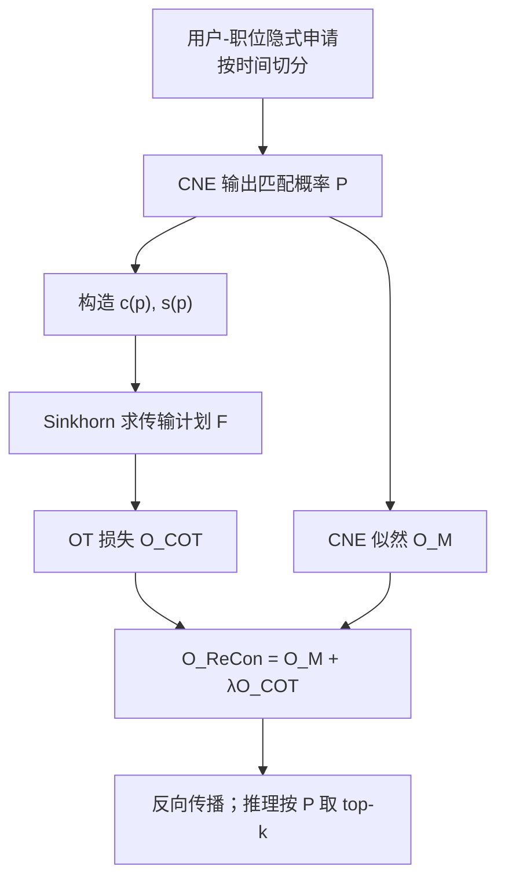
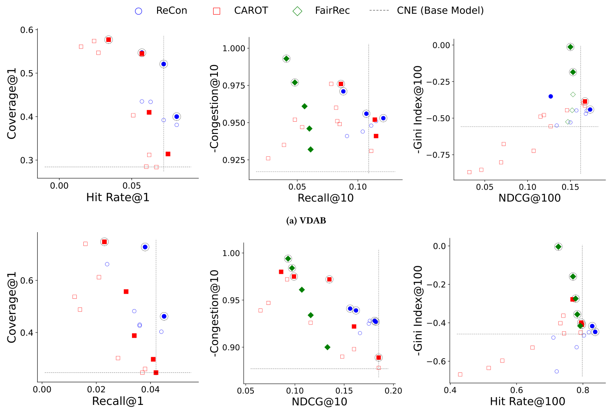

# ReCon: Reducing Congestion in Job Recommendation using Optimal Transport (ReCon：利用最优传输降低职位推荐中的拥堵)

- **会议/期刊**: RecSys 2023
- **作者与机构**: Yoosof Mashayekhi, Bo Kang, Jefrey Lijffijt, Tijl De Bie; Ghent University IDLAB
- **推荐链路定位**: 精排/重排（多目标联合训练）
- **研究方向**: 去偏公平、可信隐私与工业架构
- **论文原文**: [https://arxiv.org/abs/2308.09516v1](https://arxiv.org/abs/2308.09516v1)
- **开源代码**: [https://github.com/aida-ugent/ReCon](https://github.com/aida-ugent/ReCon)

## TL;DR (1分钟核心速览)

针对职位推荐中热门岗位被过度推荐、冷门岗位零曝光的拥堵问题，ReCon 将可微 Sinkhorn 最优传输作为正则项与 CNE 推荐模型联合训练，用分数感知的匹配代价/相似度做多目标优化。在 VDAB 与 CareerBuilder 的按时间切分、top-k 全库排序评测中，ReCon 在 NDCG/Recall/HitRate 与 -Congestion/Coverage/-Gini 间取得更优 Pareto 权衡；原文以图2呈现，未报告统一百分比提升。

## Background & Motivation (背景与核心矛盾)

- **主流范式**: 职位推荐通常用 CF/内容模型输出 top-k；为缓解公平与曝光问题，CAROT 用两阶段最优传输重分配，FairRec 用贪心公平分配保证双边曝光。
- **前人局限**: 后处理方法与推荐模型解耦，难以随新交互增量更新；热门偏置会让大量用户 top-k 集中到少数岗位，而岗位容量通常只有 1 人，造成申请者挫败与岗位空缺。
- **核心洞察 (Key Insight)**: 拥堵不是单用户排序问题，而是用户-岗位的集体分配问题；最优传输可在“用户偏好”与“岗位容量”之间做均衡匹配，但必须可微才能端到端训练。
- **本文切入点**: 把 OT 作为正则项加入推荐模型目标，用 Sinkhorn 近似求解并反向传播。

<figure class="paper-figure" markdown="span">
  <figcaption>图 1：职位推荐中拥堵现象的示意图。向四名用户推荐了四个职位，而所有用户的前 2 个推荐仅包含职位 A 和 B（例如，由于流行度偏差或其固有更高的相关性分数）。因此，如果用户只申请其前 2 个推荐，职位 A 和 B 会收到四份申请，而职位 C 和 D 则一份也收不到。</figcaption>
</figure>

## Method (核心方法设计)

### 1. 整体框架 (Overall Architecture)

输入用户-职位隐式申请，CNE 输出匹配概率 $P=[p_{ui}]$；每轮用$P$构造匹配代价与相似度，Sinkhorn 求传输计划$F$并得到 OT 损失；该损失与 CNE 似然$O_M$加权成$O_{\text{ReCon}}$联合反向传播。推理时仍按模型分数$p_{ui}$ 取 top-k，OT 只训练期使用，因此支持增量更新且不需要在线求解全量传输。

### 2. 关键设计拆解 (Key Designs)

1. **可微熵正则最优传输（缓解拥堵）**：普通 OT 对 $F$不可微且求解贵。ReCon 用熵正则线性规划 `$\min_F\sum_{u,i}f_{ui}d_{ui}+\epsilon\sum_{u,i}f_{ui}\log f_{ui}$`，约束行和$1/|U|$、列和$1/|I|$，由 Sinkhorn 迭代求解。均匀边缘强制岗位曝光更分散，避免所有用户 top-k 撞到同一批热门岗位；$\epsilon$ 控制分散强度与可微平滑度。

2. **分数感知的代价/相似度与多目标联合**：仅惩罚被传输对不够，因为同一用户下未匹配岗位也在竞争。作者令 `$c(p_{ui})=-\ln p_{ui}$`、`$s(p_{ui})=-\ln(1-p_{ui})$`，优化 `$\min_F\sum_{u,i}[f_{ui}c(p_{ui})+(1-f_{ui})s(p_{ui})]$`。直觉是：高概率对应低代价，匹配项奖励高$p$；未匹配项惩罚高$p$，等价于对传输计划做 BCE 式约束。最终 `$O_{\text{ReCon}}=O_M+\lambda O_{\text{COT}}+\lambda\sum_{u,i}s(p_{ui})$`，$\lambda$ 控制拥堵与相关性的权衡。

3. **训练目标、负采样与推理效率**：基座 CNE 的似然 $O_M$与 Sinkhorn 输出均可对$P$求导，故可梯度下降；无显式负采样，依赖 CNE 的图似然与 OT 全局约束。推理只做模型打分排序，成本低；训练需全量 Sinkhorn，每轮约$O(|U||I|)$，是主要规模瓶颈。

## Experimental Setup & Evaluation Protocol (实验设置与评估协议)

- **数据集与预处理**: 两个真实招聘数据集均保留至少 4 次交互的用户/岗位（4-core）；训练密度按训练交互计算。

| 数据集 | #Users | #Items | Train/Val/Test | 密度(训练) | 特征/场景说明 |
| :--- | :---: | :---: | :---: | :---: | :--- |
| VDAB | 1693 | 2931 | 9766/1428/2950 | 0.197% | 比利时 VDAB 职位申请，10 天 |
| CareerBuilder | 3876 | 4337 | 24316/1071/4557 | 0.145% | 美国招聘平台，10 天 |

- **数据划分与防穿越**: 前 6 天训练、第 7 天验证、后 3 天测试，属于全局时间戳切分，避免未来交互泄漏。
- **排名评测协议**: 对每个用户按模型分数做 top-k 推荐评估；原文未描述采样负例，按全库候选排序理解。指标含 NDCG、Recall、Hit Rate，以及 -Congestion、Coverage、-Gini（均越高越好；Congestion 最优为 -1）。
- **对比基线与超参**: 基座 CNE；CAROT 为两阶段 OT 后处理，$\epsilon\in\{1,10,100\}$且 4 种代价函数；FairRec 为公平贪心，$\alpha\in\{0.2,0.4,0.6,0.8,1.0\}$，$k=1$不适用。ReCon 设$\epsilon=10$、Sinkhorn 10 次迭代、$\lambda\in\{10^{-1},\dots,10^{-6}\}$；原文未报告 embedding 维度与显著性检验。

## Key Experimental Results (实验关键数据)

### 1. 主实验对比 (Main Results)

原文主实验以图2散点呈现，未给出可加粗的精确表值；下表为按图2的定性归纳，避免臆造数值。原文仅 3 个基线，故不凑 5–8 个。

| 方法 | NDCG@100 | Recall@10 | HitRate@100 | -Congestion@10 | Coverage@1 | -Gini@100 | 综合结论 |
| :--- | :---: | :---: | :---: | :---: | :---: | :---: | :--- |
| ReCon | 保持/部分优于 CNE | 保持/部分优于 CNE | 保持 | **多组 λ 居前** | **多组 λ 居前** | **多组 λ 居前** | **跨方法 Pareto 前沿** |
| CAROT | 可调后处理 | 可调 | 可调 | 受 CNE 分数限制 | 局部改善 | 局部改善 | 多为局部权衡 |
| FairRec | 公平约束 | — | — | 受 $k$约束 | 局部改善 | 局部改善 |$k=1$ 未评测 |
| CNE | 基线 | 基线 | 基线 | 基线 | 基线 | 基线 | 拥堵明显 |

<figure class="paper-figure" markdown="span">
  <figcaption>图 2：合意性与拥堵相关指标的对比（数值越高越好）。点表示不同的超参数组合。每种方法的 Pareto 最优点为实心（填充）点。跨方法的 Pareto 最优点外围有圆圈。</figcaption>
</figure>

### 2. 消融实验 (Ablation Study)

原文无模块消融；以下为超参敏感性与基线对比的替代归纳。

| 设置 | 拥堵相关 | 合意性 | 归因 |
| :--- | :---: | :---: | :--- |
| CNE（无 OT） | 基线最差 | 基线 | 无全局分配约束 |
| ReCon，$\lambda$ 偏小 | 接近 CNE | 接近 CNE | OT 项弱，退化为基座 |
| ReCon，$\lambda$ 适中 | 改善 | 保持/部分提升 | 拥堵-相关性 Pareto |
| ReCon，$\lambda$ 过大 | 可能过度分散 | 可能下降 | 相关性让位于均衡 |
| Sinkhorn $\epsilon=10$，10 iter | 可微近似 | — | 效率/精度折中 |

### 3. 关键实验发现 (Key Findings)

1. 图2 中 ReCon 在 VDAB/CareerBuilder 的 Recall@10 vs -Congestion@10、NDCG@100 vs -Gini@100 等组合出现跨方法 Pareto 前沿点（带圈），说明 OT 项不是单纯牺牲 NDCG 换拥堵，而是找到了更优权衡。
2. CAROT 虽也用 OT，但二阶段后处理无法改变 CNE 的原始打分排序；FairRec 以公平保证为主且 $k=1$ 不可用。ReCon 联合训练在增量交互场景更有优势。
3. 效率上图3 显示 ReCon 慢于 CNE/CAROT、快于 FairRec；全量 Sinkhorn 的 $|U|\times|I|$ 代价是规模瓶颈，作者也把 batch OT 列为未来工作。

## Highlights & Limitations (亮点、对比与审稿批判)

- **与代表作对比 (vs. Prior Work)**: 与 CAROT 的“先打分再 OT 重分配”不同，ReCon 把 OT 写进训练目标；与 FairRec 的 envy-free/最低曝光保证不同，ReCon 直接优化拥堵指标，不提供公平性理论保证；与 CNE 相比，ReCon 在不显著牺牲相关性的前提下改善曝光分布。
- **可迁移亮点**: 将“容量有限/曝光均衡”写成可微 OT 正则，可迁移到招聘、众包、限时库存等有限供给推荐；分数感知的 $c=-\ln p$、$s=-\ln(1-p)$ 可视为对传输计划做 BCE 式约束。
- **审稿级局限批判**: 全量 Sinkhorn 训练成本高，难以直接扩展到百万级用户-岗位；仅在 CNE/两个招聘数据集上验证，缺少内容特征、线上 A/B、显著性检验与精确结果表；拥堵指标可能被“把低相关岗位也分散曝光”所优化，$\lambda$ 过大时相关性下降，且无公平性保证。

## Rating (四维评分)

- **方法创新性 (Novelty)**: ⭐⭐⭐⭐ （把 Sinkhorn OT 嵌入推荐训练，OT 本身不新，但“可微拥堵正则 + 多目标”组合有针对性。）
- **评估协议与实验扎实度 (Protocol & Experiments)**: ⭐⭐⭐ （两个真实数据集、时间切分、6 类指标；但仅 3 个基线，无显著性检验与精确主表。）
- **写作与数学规范度 (Clarity & Rigor)**: ⭐⭐⭐⭐ （OT 与 c/s 函数推导清楚，BCE 直觉讲得透；复杂度与 embedding 细节略缺。）
- **工业落地与复现价值 (Industrial & Practical Value)**: ⭐⭐⭐ （代码开源、支持增量更新；全量 OT 训练成本高，需 batch 化后才更适合大规模部署。）

