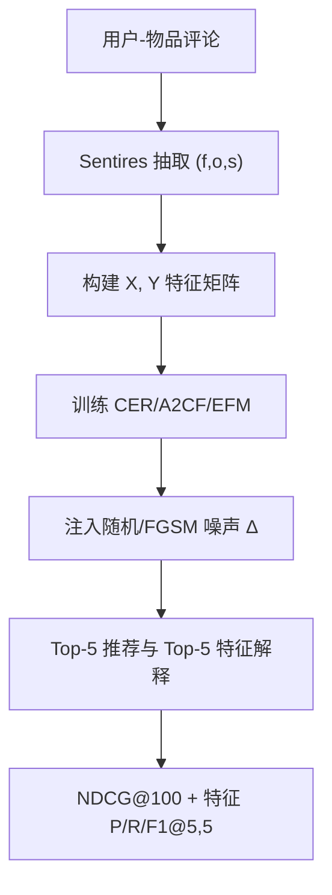

# Stability of Explainable Recommendation (可解释推荐的稳定性研究)

- **会议/期刊**: RecSys 2023 (17th ACM Conference on Recommender Systems)
- **作者与机构**: Sairamvinay Vijayaraghavan, Prasant Mohapatra; University of California, Davis
- **推荐链路定位**: 精排 + 解释生成/评估
- **研究方向**: 可信隐私与工业架构（主） / 可解释推荐（交叉）
- **论文原文**: [论文原文链接](https://arxiv.org/abs/2405.01849v1)
- **开源代码**: 暂未开源

## TL;DR (1分钟核心速览)

本文针对特征级可解释推荐器“解释可靠性未经验证”的痛点，提出白盒参数扰动审计：对 CER、A2CF、EFM 注入 Random Gaussian 与 FGSM 对抗噪声，在 Amazon Electronics/Yelp 上以 Per-user leave-last-5 + 100 负样本采样排序评估 NDCG@100 与特征 P/R/F1@5,5。结果显示对抗噪声使解释 F1 最多下降 80.2%，且 NDCG 稳定时解释仍可能崩塌。

## Background & Motivation (背景与核心矛盾)

- **主流范式**: 特征级可解释推荐先用 Sentires 从评论抽取 $(f,o,s)$ 三元组，构建 user-aspect、item-aspect 矩阵，再联合学习推荐打分与特征级解释。
- **前人局限**: 现有工作关注解释质量、个性化与反事实合理性，却缺少参数扰动、对抗攻击下的稳定性实证；同时，攻击者可篡改特征分数，诱导用户购买目标商品。
- **核心洞察 (Key Insight)**: 模型参数受小扰动后，用于解释的 Top 特征可能重排或错选，解释 F1 下降；FGSM 因沿损失梯度反向优化，破坏性显著强于随机噪声。
- **本文切入点**: 不提出新推荐器，而把可解释推荐器作为审计对象，系统扫描噪声强度 $\epsilon$，量化解释能力$Q$到$Q'$ 的衰减。

## Method (核心方法设计)

### 1. 整体框架 (Overall Architecture)

整体流程为：评论经 Sentires 抽取特征、观点与情感，构建 $X,Y$特征矩阵；分别训练 CER、A2CF、EFM 三个 SOTA 可解释推荐器；在模型参数$\Theta$ 上注入随机或 FGSM 对抗噪声；推理时输出 Top-5 推荐及 Top-5 特征解释；最后同时评估推荐排序与特征解释稳定性。

### 2. 关键设计拆解 (Key Designs)

1. **特征矩阵构建（解释的显式来源）**：痛点在于解释必须落到用户/物品特征上。本文令 $X_{u,f}=0$若用户未提及特征$f$，否则$X_{u,f}=1+(N-1)\frac{1-e^{-t_{u,f}}}{1+e^{-t_{u,f}}}$；$Y_{v,f}=0$若物品未被评论该特征，否则$Y_{v,f}=1+\frac{N-1}{1+e^{-t_{v,f}s_{v,f}}}$。这样特征提及频次与情感极性直接进入解释空间。

2. **白盒参数扰动（稳定性审计算子）**：随机噪声为 $N(0,1)$经 L2 归一化后缩放至$\epsilon$；对抗噪声采用 FGSM 思路：
   $\Delta^*=\arg\max_{\|\Delta\|\le\epsilon}\operatorname{Loss}(D;\hat{\Theta}+\Delta)$，
   $\Delta^*=\epsilon\frac{\Gamma}{\|\Gamma\|},\quad \Gamma=\frac{\partial \operatorname{Loss}(D;\hat{\Theta}+\Delta)}{\partial \Delta}$。
   其直觉是沿损失上升方向扰动参数，比随机扰动更精准地破坏推荐与解释共享的因子。

3. **训练目标、负采样与推理效率**：原文未展开统一损失公式，仅说明 Loss 兼顾推荐效用与可解释性；CER/A2CF 用 SGD、batch=32、lr=0.001，EFM 为闭式解，仅做随机噪声实验。测试为每用户最后 5 个正交互 + 100 个随机负样本，Top-$K=5$、解释特征数$E=5$。FGSM 需一次梯度反传，推理阶段与 vanilla 模型同阶。

## Experimental Setup & Evaluation Protocol (实验设置与评估协议)

- **数据集与预处理**: Amazon Electronics 保留至少 10 条评论用户；Yelp 保留至少 20 条评论用户。

| 数据集 | #Users | #Items | #Features | #Reviews | 稀疏度 | 特征/场景说明 |
| :--- | :---: | :---: | :---: | :---: | :---: | :--- |
| Electronics | 2,832 | 19,816 | 105 | 53,295 | 0.09497% | 电商电子产品评论 |
| Yelp | 12,163 | 20,256 | 107 | 510,396 | 0.2072% | 本地商户评论 |

- **数据划分与防穿越**: 按用户时间保留最后 5 个正交互作为测试正样本，再随机采 100 个未交互物品为负样本；非全局时间戳切分。
- **排名评测协议**: `Sampled Ranking`，正负比约 1:100；报告 NDCG@100 与特征级 Precision/Recall/F1@5,5，解释金标准为评论中正向情感提及的特征。
- **对比基线与超参设置**: 原文无传统推荐基线，审计 CER、A2CF、EFM 三个 SOTA 可解释模型；$\epsilon$在 Yelp 取$[0,1]$、Electronics 取$[0,2]$；未报告显著性检验与统一 embedding 维度。

## Key Experimental Results (实验关键数据)

### 1. 主实验对比 (Main Results)

下表覆盖 3 个模型 × 2 个数据集 × 代表性最强攻击，共 6 组；数值为 `Vanilla→Attacked`，F1↓ 为相对下降，加粗为同数据集下降最小。

| 数据集/模型 | 攻击 | NDCG@100 | Pr@5,5 | Re@5,5 | F1@5,5 | F1↓ |
| :--- | :--- | :---: | :---: | :---: | :---: | :---: |
| Electronics/CER | FGSM $\epsilon=2$ | 0.4889→0.3993 | 0.04115→0.02069 | 0.1331→0.08333 | 0.05928→0.03223 | -45.6% |
| Electronics/A2CF | FGSM $\epsilon=2$ | 0.4059→0.3603 | 0.02996→0.00619 | 0.1026→0.02002 | 0.04412→0.00874 | -80.2% |
| Electronics/EFM | Random $\epsilon=2$ | 0.4319→0.3800 | 0.05988→0.01913 | 0.2190→0.06937 | 0.08996→0.02839 | -68.4% |
| Yelp/CER | FGSM $\epsilon=1$ | 0.5365→0.3441 | 0.0139→0.00952 | 0.0695→0.04762 | 0.02317→0.01587 | -31.5% |
| Yelp/A2CF | FGSM $\epsilon=1$ | 0.6454→0.6361 | 0.01225→0.00901 | 0.06126→0.04503 | 0.02042→0.01501 | -26.5% |
| Yelp/EFM | Random $\epsilon=1$ | 0.3127→0.2878 | 0.01849→0.01420 | 0.09244→0.07101 | 0.03081→0.02367 | **-23.2%** |

### 2. 消融实验 (Ablation Study)

原文无模块消融；以下用 Electronics 上 F1@5,5 随噪声类型与强度的变化替代，拆解“随机 vs 对抗”的贡献。

| 模型 | 噪声 | $\epsilon=0$|$\epsilon=1$|$\epsilon=2$ |
| :--- | :--- | :---: | :---: | :---: |
| CER | Random | 0.05928 | 0.05796 | 0.06009 |
| CER | FGSM | 0.05928 | 0.02866 | 0.03223 |
| A2CF | Random | 0.04412 | 0.03225 | 0.02601 |
| A2CF | FGSM | 0.04412 | 0.02650 | 0.00874 |
| EFM | Random | 0.08996 | 0.04476 | 0.02839 |

### 3. 关键实验发现 (Key Findings)

1. **对抗噪声远强于随机噪声**：CER 在 Electronics 上 $\epsilon=0.5$时，随机噪声 F1 仅从 0.05928 降至 0.05805，而 FGSM 直接降至 0.02481，相对下降 58.1%；A2CF 在$\epsilon=2$ 时随机 F1 为 0.02601，FGSM 仅 0.00874。
2. **推荐指标稳定不代表解释稳定**：Yelp/A2CF 的 NDCG@100 仅从 0.6454 降至 0.6361（-1.4%），但 F1 从 0.02042 降至 0.01501（-26.5%），说明仅看排序会低估解释崩塌风险。
3. **显式/隐式因子共同放大脆弱性**：A2CF 同时扰动 user/item/aspect embedding 与打分投影，Electronics F1 下降 80.2%；EFM 仅扰动显式因子且仅随机噪声，仍下降 68.4%，表明解释依赖的特征因子本身即为攻击面。

## Highlights & Limitations (亮点、对比与审稿批判)

- **与代表作对比 (vs. Prior Work)**: CER 关注反事实解释、A2CF 关注 aspect-aware 缺失特征补全、EFM 关注显式因子矩阵分解；本文首次将三者置于统一参数扰动审计下，强调“解释稳定性”而非仅解释合理性。
- **可迁移亮点**: 可用“FGSM + 特征级 F1”作为可解释推荐器的压力测试；上线前同时报告 NDCG 与解释 P/R/F1，避免排序指标掩盖解释退化。
- **审稿级局限批判**: 仅覆盖 3 个特征级模型、2 个电商/本地评论数据集，且为 1:100 采样排序而非 Full-Ranking；无防御/鲁棒训练、无显著性检验、无在线用户研究，EFM 因闭式解仅做随机噪声，结论外推需谨慎。

## Rating (四维评分)

- **方法创新性 (Novelty)**: ⭐⭐⭐ （以实证审计为主，非新模型；但将参数扰动与解释稳定性结合的问题定义有价值）
- **评估协议与实验扎实度 (Protocol & Experiments)**: ⭐⭐⭐ （双数据集、双噪声、多 $\epsilon$ 扫描较系统；但采样排序、无显著性检验、基线仅 3 个）
- **写作与数学规范度 (Clarity & Rigor)**: ⭐⭐⭐⭐ （问题与公式简洁清晰；统一损失与部分实验细节未展开）
- **工业落地与复现价值 (Industrial & Practical Value)**: ⭐⭐ （无开源代码与防御方案；但审计思路可直接用于上线前可信性评估）

