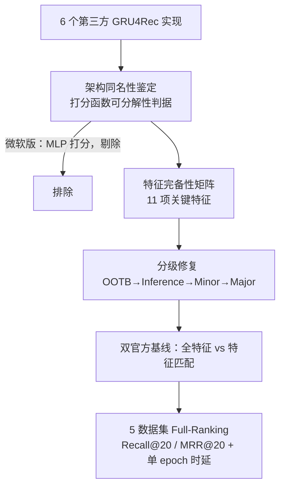

# The Effect of Third Party Implementations on Reproducibility (第三方实现如何侵蚀推荐系统可复现性)

- **会议/期刊**: RecSys 2023 (17th ACM Conference on Recommender Systems)
- **作者与机构**: Balázs Hidasi, Ádám Tibor Czapp (Gravity R&D, a Taboola company, Hungary) —— GRU4Rec 原作者团队亲自下场审计
- **推荐链路定位**: 召回（会话式 Next-Item 召回）+ 离线评测基准
- **研究方向**: 去偏公平、可信隐私与工业架构（评测基准与可复现性）/ 序列与会话推荐
- **论文原文**: [论文原文链接](https://arxiv.org/abs/2307.14956v1)
- **开源代码**: [gru4rec_third_party_comparison](https://github.com/hidasib/gru4rec_third_party_comparison)（另发布经官方校验的 [TensorFlow](https://github.com/hidasib/GRU4Rec_Tensorflow_Official) / [PyTorch](https://github.com/hidasib/GRU4Rec_PyTorch_Official) 完整复现）

## TL;DR (1分钟核心速览)

推荐系统可复现性讨论长期忽略了一个环节：**论文里当 baseline 用的"第三方非官方复现"是否真的实现了原算法**。本文以 GRU4Rec 为标本，对 6 个 GitHub 高星/框架内实现做特征完备性鉴定、分级 bug 修复，并在 5 个公开数据集上做全库排序对比。结论触目惊心：1 个"同名不同算法"被剔除，其余 5 个在修复后 recall@20 仍比官方低 6%–62%，未修复时最差低 **99.63%**，训练耗时最高达官方的 **336 倍**。

## Background & Motivation (背景与核心矛盾)

- **主流范式**: 推荐系统可复现性治理目前聚焦于公开数据集、开源官方代码、超参调优指南与标准化评测框架（Microsoft Recommenders、Recpack、RecBole 类）。
- **前人局限**: ①官方实现常因框架过时（GRU4Rec 官方版基于已停更的 Theano）或 API 不便而被研究者弃用；②基准框架把算法"重实现"以统一接口，但**重实现质量无人校验**——多数论文甚至不写明用了哪个 baseline 实现。
- **核心洞察 (Key Insight)**: 重实现错误具备**传染性**：一个高星仓库的错误 baseline 会被后续数十篇论文继承，从而系统性地抬高"新方法"的相对收益，且这种污染不可见于任何综述。
- **本文切入点**: 选一个"足够简单、有官方代码、被大量复用"的算法（GRU4Rec）做纵深切片，用**可量化的损失分解**而非主观吐槽来说明问题规模。

## Method (核心方法设计)

### 1. 整体框架 (Overall Architecture)

本文是一篇审计型（audit）研究，其"方法"是一套**可复用的第三方实现质量评估协议**：先用架构判据做同名性鉴定（RQ1）→ 用特征矩阵逐项核对功能完备性（RQ2）→ 逐仓库定位 bug（RQ3）→ 以"修复梯度"逐级修补并做五数据集全库排序（RQ4）→ 测量单 epoch 训练时间与扩展性（RQ5）。关键在于同时训练官方实现的**全特征版**与**特征匹配版**作为双基线，把第三方实现与官方的差距**拆成"功能缺失"与"代码 bug"两部分**，避免笼统归因。

### 2. 关键设计拆解 (Key Designs)

1. **架构同名性判据——打分函数必须可分解**：GRU4Rec 的排序本质是内积 $s_{t,i}=\boldsymbol{h}_t^{\top}\boldsymbol{e}_i$，隐状态与物品向量可分离，故推理时只需一次矩阵乘法即可在全库上排序。Microsoft Recommenders 版改为前馈网$s_{t,i}=f(\boldsymbol{h}_t,\boldsymbol{e}_i)$，**不可分解**，必须为每个候选复制一份隐状态，内存与时间随物品数线性爆炸（其官方示例仅排 50 个物品）。这一条判据把"实现有 bug"与"根本不是同一算法"清晰分开，是全文最锋利的工具。

2. **分级修复梯度（Fix Ladder）**：定义为 OOTB（仅修到能跑）→ Inference Fix（只修推理，如会话结束时未重置隐状态）→ Minor Fix（显性训练 bug、硬编码超参放开）→ Major Fix（隐蔽 bug：softmax 与采样顺序颠倒、双重 softmax、BPR-max 公式错误、dropout 语义变成 keep-prob）。四级递增且不补齐缺失特征。该设计度量的是"**一个负责任的使用者需要付出多少才能救回来**"，比单点 OOTB 对比更具政策含义。

3. **差距的二项分解与训练开销测量**：以官方全特征指标 $M_{\text{off}}^{\text{all}}$ 为分母，
$\Delta_{\text{feat}}=\dfrac{M_{\text{off}}^{\text{all}}-M_{\text{off}}^{\text{match}}}{M_{\text{off}}^{\text{all}}},\quad \Delta_{\text{bug}}=\dfrac{M_{\text{off}}^{\text{match}}-M_{\text{impl}}}{M_{\text{off}}^{\text{all}}}$
由此可判定某实现的损失是"缺功能"还是"写错了"。同时以单 epoch 秒数（NVIDIA A30）度量扩展性——GRU4Rec 的高效来源于 mini-batch 内目标物品作负样本 + 共享额外负采样，避免了对全物品打分；KerasGRU4Rec 与 Recpack 恰恰丢掉了负采样，训练时需对全部物品求 softmax，成为不可用的根源。

## Experimental Setup & Evaluation Protocol (实验设置与评估协议)

- **数据集与预处理**: 5 个公开会话数据集，仅保留 view/click/detail 事件；Rees46、RetailRocket 用 1 小时会话间隔重切会话；**过滤连续重复物品**（$(i,i,j)\to(i,j)$，但$(i,j,i)$ 保留）；迭代过滤长度 <2 的会话与出现 <5 次的物品（即 `5-core` 式迭代过滤，与原文一致）。

| 数据集 | #Items | 训练 Events | 训练 Sessions | 测试 Events | 测试 Sessions | 场景说明 |
| :--- | :---: | :---: | :---: | :---: | :---: | :--- |
| Yoochoose | 34,858 | 29,107,309 | 7,597,703 | 71,849 | 15,854 | 电商点击，预切会话 |
| Rees46 | 172,756 | 67,575,203 | 10,190,006 | 1,054,210 | 166,841 | 多品类电商 view |
| Coveo | 10,868 | 1,411,113 | 165,673 | 52,501 | 7,748 | 电商 detail 页 |
| RetailRocket | 36,824 | 750,832 | 196,234 | 29,148 | 8,036 | 电商 view，含 transaction |
| Diginetica | 40,351 | 833,113 | 177,266 | 70,164 | 15,040 | 搜索引擎日志 |

- **数据划分与防穿越 (Splitting Strategy)**: **全局时间戳切分**。Yoochoose/Rees46/Coveo 取最后事件前 1 天为切分点，RetailRocket/Diginetica 因流量稀疏取 7 天；跨切分点的会话在切分点截断，训练集中截断后长度 <1 的会话再被剔除。测试集中未在训练集出现的物品因 GRU4Rec 不支持物品冷启动而被跳过。
- **排名评测协议 (Ranking Protocol)**: **Full-Ranking（全库未交互排序）**。每个测试事件（会话首事件除外）仅依据该会话内此前事件生成一份覆盖全物品库的排序列表；指标为 Recall@N（本任务下等价于 HitRate@N）与 MRR@N，$N\in\{1,5,10,20\}$，正文仅报$N=20$，全量结果见论文官网。
- **对比基线与超参设置**: 基线为官方 GRU4Rec（全特征 + 特征匹配两个版本）；6 个第三方实现分别为 GRU4REC-pytorch、Torch-GRU4Rec、GRU4Rec_Tensorflow、KerasGRU4Rec、Microsoft Recommenders、Recpack。超参在独立验证集上用 Optuna **200 次试验**逐数据集搜索（官方全特征版），再以最优超参或其可行子集重训全训练集。隐层维度、dropout 等在各实现中默认取值不一，KerasGRU4Rec 甚至硬编码。

## Key Experimental Results (实验关键数据)

### 1. 主实验对比 (Main Results)

交叉熵损失、Recall@20（括号内为相对官方全特征版的差值；各第三方实现均取其最高修复级别）：

| 数据集 | 官方(全特征) | GRU4REC-pytorch | Torch-GRU4Rec | GRU4Rec_TF | KerasGRU4Rec | Recpack |
| :--- | :---: | :---: | :---: | :---: | :---: | :---: |
| Yoochoose | **0.6804** | 0.4271 (-37%) | 0.6671 (-2%) | 0.4606 (-32%) | 0.6768 (-1%) | 0.6382 (-6%) |
| Rees46 | **0.5291** | 0.1994 (-62%) | 0.4688 (-11%) | 0.2698 (-49%) | 0.4978 (-6%) | 0.4386 (-17%) |
| Coveo | **0.2947** | 0.1806 (-39%) | 0.2835 (-4%) | 0.1951 (-34%) | 0.2826 (-4%) | 0.2309 (-22%) |
| RetailRocket | **0.4953** | 0.2812 (-43%) | 0.3834 (-23%) | 0.3388 (-32%) | 0.3957 (-20%) | 0.2866 (-42%) |
| Diginetica | **0.4874** | 0.2862 (-41%) | 0.4245 (-13%) | 0.3014 (-38%) | 0.3869 (-21%) | 0.3296 (-32%) |

### 2. 消融实验 (Ablation Study)

以 GRU4REC-pytorch（唯一推理代码也有错、且含双重 softmax 等深层 bug 的实现）为例，逐级修复的 Recall@20：

| 配置 | Yoochoose | Rees46 | Coveo | RetailRocket | Diginetica |
| :--- | :---: | :---: | :---: | :---: | :---: |
| 官方（全特征） | **0.6804** | **0.5291** | **0.2947** | **0.4953** | **0.4874** |
| 官方（特征匹配） | 0.4583 (-33%) | 0.3059 (-42%) | 0.2061 (-30%) | 0.3378 (-32%) | 0.2973 (-39%) |
| 第三方 Out-of-the-box | 0.1169 (-83%) | 0.1028 (-81%) | 0.0628 (-79%) | 0.0616 (-88%) | 0.0457 (-91%) |
| + Inference fix | 0.1212 (-82%) | 0.1093 (-79%) | 0.0663 (-78%) | 0.0642 (-87%) | 0.0503 (-90%) |
| + Major fix | 0.4271 (-37%) | 0.1994 (-62%) | 0.1806 (-39%) | 0.2812 (-43%) | 0.2862 (-41%) |

### 3. 关键实验发现 (Key Findings)

1. **损失可干净分解，且"缺功能"与"写错"两个来源量级相当**：GRU4REC-pytorch 从 OOTB 到 Major fix 补回约 +30 个点（0.117→0.427，Yoochoose），但即便修完仍比"特征匹配"版官方低约 1–10 个点，比"全特征"版低 33%–62%——说明 **bug 只是表层，缺失 constrained/shared embedding、logQ 校正、Adagrad+Nesterov momentum、session-parallel mini-batch 才是复现失败的主体**。相反 KerasGRU4Rec 修完 bug 后几乎追平特征匹配版（Yoochoose 0.6784 vs 0.6392），证明"很多错误修起来并不难，只是没人修"。
2. **可扩展性是硬伤，且与是否使用负采样强绑定**：Rees46 单 epoch 官方仅 367 s，GRU4REC-pytorch 7,618 s（×20.8）、GRU4Rec_TF 2,382 s（×6.5），而 KerasGRU4Rec 123,266 s（**×335.9**）、Recpack 49,262 s（×134.2）——单 epoch 需 0.5–2 天，实际不可用。根因是二者训练时放弃负采样、对全物品求 softmax，同时 Recpack 的 session-parallel 批次实现错误（一个 batch 要等所有会话耗尽）。
3. **"最忠实"的实现也会系统性低估 baseline**：Torch-GRU4Rec 是唯一基本无功能错误的实现，仅因缺 shared/constrained embedding，在 RetailRocket 上 recall@20 低 14%–23%、Rees46 MRR 低 19%–20%。这意味着**用流行第三方实现当 baseline，等价于给自家方法凭空送出 10%–20% 的相对提升**——足以让一个平庸模型看起来达到 SOTA。

## Highlights & Limitations (亮点、对比与审稿批判)

- **与代表作对比 (vs. Prior Work)**: 相较 Dacrema 等（复现 18 篇仅 7 篇成功）与 Ferrari Dacrema / Rendle 关于"调参不当与评测设置污染"的批评，本文把矛头指向**更上游的一环——代码载体本身**：不是作者调不好参，而是他手里的 baseline 根本是另一个（更差的）算法。相较 BERT4Rec 复现争议，本文提供了可量化的"缺失 vs bug"归因工具。
- **可迁移亮点**: ①"双官方基线（全特征 / 特征匹配）"分解法可直接搬用到任何 baseline 复现审计；②"打分函数可分解性"是一秒识破伪实现的廉价判据；③论文给出的建议（论文中必须声明 baseline 所用实现及其 commit）应成为审稿 checklist。
- **审稿级局限批判**: ①**单算法样本**——只审 GRU4Rec 一个（虽论证其"简单且有官方码"具有下界意义），无法给出跨算法（如图卷积、Transformer 序列模型）的污染率估计；②**审计时点固定**，仓库后续可能已修复，结论存在时效性；③"Major fix"仍是作者主观判断的修复上限，未穷尽 bug，因此报告的是**下界差距**而非真实差距；④未量化"污染传播"，即到底有多少已发表论文引用了这些实现，缺少文献计量学证据；⑤评测仅报 $N=20$ 与两指标，长尾/稀疏分桶分析缺失。

## Rating (四维评分)

- **方法创新性 (Novelty)**: ⭐⭐⭐⭐ （非新算法，但"修复梯度 + 双基线损失分解 + 可分解性判据"构成了一套原创且可复用的复现审计方法论）
- **评估协议与实验扎实度 (Protocol & Experiments)**: ⭐⭐⭐⭐⭐ （5 个真实数据集、时间切分、Full-Ranking、Optuna 200 次调参、6 个实现 × 2 种损失 × 4 级修复的全矩阵实验，严谨度远超同类立场文章）
- **写作与数学规范度 (Clarity & Rigor)**: ⭐⭐⭐⭐ （特征矩阵与修复定义极清晰，公式克制；但差距分解仅以文字表述、表格排版密度过高，读者需反复对照）
- **工业落地与复现价值 (Industrial & Practical Value)**: ⭐⭐⭐⭐⭐ （全部脚本与经官方校验的 TF/PyTorch 完整复现已开源，可直接作为团队 baseline 验收标准与 CI 回归测试）

> 一句话总结：这不是一篇提出模型的论文，而是一记警钟——**当你在 baseline 上跑赢 15% 时，先确认你跑的不是一个坏掉的 GRU4Rec**。

