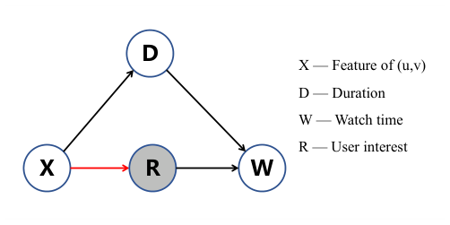
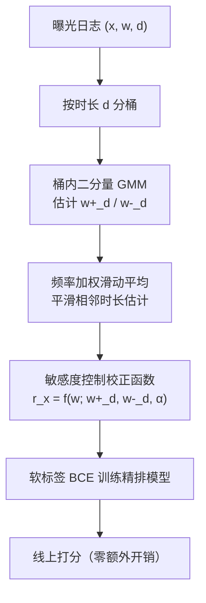

# Uncovering User Interest from Biased and Noised Watch Time in Video Recommendation (从带偏与带噪的观看时长中还原用户兴趣)

- **会议/期刊**: RecSys 2023
- **作者与机构**: Haiyuan Zhao, Lei Zhang, Jun Xu, Ji-Rong Wen (中国人民大学) ；Guohao Cai, Zhenhua Dong (华为诺亚方舟实验室)
- **推荐链路定位**: 精排（标签/监督信号修正，模型无关）
- **研究方向**: 去偏公平、可信隐私与工业架构 / CTR 预估与特征交叉
- **论文原文**: [https://arxiv.org/abs/2308.08120v1](https://arxiv.org/abs/2308.08120v1)
- **开源代码**: [https://github.com/hyz20/D2Co.git](https://github.com/hyz20/D2Co.git)

## TL;DR (1分钟核心速览)

短视频流式播放场景下，点击失效，观看时长成为兴趣代理标签；但时长既被**视频时长偏差**（长视频天然看得久）抬高，又被**噪声观看**（用户需若干秒才能判断"不喜欢"）污染。本文用因果图把期望观看时长分解为兴趣、时长偏差项与噪声项三者的混合 $w = pr_x w^+_d + (1-pr_x) w^-_d$，提出 D²Co：按视频时长分组拟合二分量 GMM 估计偏差/噪声均值，再做频率加权滑动平均平滑，最后用**敏感度控制的指数校正函数**反解兴趣概率作为新标签。在 KuaiRand、WeChat 两数据集上（FM/DeepFM/AutoInt 三种骨干）GAUC 相对原始时长监督提升约 10%，线上 A/B 有效观看量 +8.35%、CTR +2.92%。

## Background & Motivation (背景与核心矛盾)

- **主流范式**: 视频推荐把观看时长（或其缩放版本）当作兴趣标签，用 BCE/加权逻辑回归训练 CTR 类精排模型。
- **前人局限**: 现有去偏工作（PCR 除以时长、WTG 分组标准化、D2Q 分组分位数）只处理时长偏差，**忽略噪声观看**；且都依赖强分布假设——PCR 要求 $w^+_d/d$与$w^-_d/d$ 为常数，WTG 要求各时长组兴趣分布均值方差一致，D2Q 要求各桶兴趣排序函数相同，实际数据（图 2 曲线非线性）明显违反。
- **核心洞察 (Key Insight)**: 作者在 KuaiRand 上验证：有正反馈的样本平均时长随视频时长单调上升（偏差存在），有 `hate` 负反馈的样本观看时长仍显著非零且随时长增长（噪声存在）。理论上可将时长误差上界拆成"偏差误差 + 噪声误差"两项线性组合，故二者必须**联合**校正。
- **本文切入点**: 不做假设驱动的相对打分，而是把观测时长看作潜变量混合，**逐时长分组估计绝对偏差/噪声项后反解兴趣**。

<figure class="paper-figure" markdown="span">
  <figcaption>图3：视频推荐中用户观看时长的因果图。灰色节点表示未观测变量 R。红色箭头表示推荐模型需要估计的效应。</figcaption>
</figure>

## Method (核心方法设计)

### 1. 整体框架 (Overall Architecture)

D²Co 是一个**训练前的标签重写模块**，与骨干模型完全解耦：先按视频时长 $d$分桶，在每个桶内对观看时长拟合二分量 GMM（对应$R=1$与$R=0$两个潜高斯），取两分量均值作为该时长的偏差项$\hat{w}^+_d$与噪声项$\hat{w}^-_d$；再用双边频率加权滑动平均把相邻时长的估计序列平滑（短时长桶样本多、权重大）；最后逐样本用敏感度控制校正函数把原始时长映射成兴趣概率$r_x\in[0,1]$，裁剪后作为 BCE 的软标签训练 FM/DeepFM/AutoInt。推理阶段无任何额外开销。

### 2. 关键设计拆解 (Key Designs)

1. **分时长二分量 GMM 估计偏差与噪声（把个体级混合降维到时长级）**：个体级混合分布 $Pr(W=w|x)=\sum_{R}Pr(R|x)Pr(W=w|d,R)$无法逐用户拟合（样本不足）。作者证明对同一时长的样本做加权聚合后，两个潜分布形式不变，权重变为$\sum_{x\in X_d}Pr(x)Pr(R|x)$，即"该时长视频的平均兴趣度"，于是可在时长级稳定拟合 GMM；KuaiRand 上固定时长的观看时长直方图呈明显双峰、而时长区间内双峰消失，佐证该建模合理。

2. **敏感度控制的指数校正函数（对估计误差鲁棒）**：仿射解 $r^{A}_x=\frac{w-\tilde{w}^-_d}{\tilde{w}^+_d-\tilde{w}^-_d}$在估计精确时无偏，但敏感度$S_{w^+}=\frac{w-\tilde{w}^-_d}{(\tilde{w}^+_d-\tilde{w}^-_d)^2}|\delta_{w^+}|$随时长$w$增长、$S_{w^-}$随$w$ 下降，而两数据集的主导矛盾相反。故改用
$$r^{S}_x=\frac{\exp(\alpha w)-\exp(\alpha \tilde{w}^-_d)}{\exp(\alpha \tilde{w}^+_d)-\exp(\alpha \tilde{w}^-_d)}$$
当 $\alpha<0$时压低长时长样本对$w^+$的敏感度，$\alpha>0$时压低短时长样本对$w^-$ 的敏感度。**物理直觉**：指数变换在两端分别"压缩"误差放大区，用可控的微小无偏性换取显著的方差下降，类似用方差换偏差的正则化。

3. **训练目标、负采样与推理效率**：损失仍为标准 BCE，仅把硬标签换成校正值并裁剪到 $[0,1]$：$\mathcal{L}=\frac{1}{|D|}\sum_D -r_x\log\sigma(f(x))-(1-r_x)\log[1-\sigma(f(x))]$。训练样本即全部曝光日志，不引入额外负采样；校正完全离线计算，线上打分与骨干模型原耗时一致——这是最直接的工业卖点。

## Experimental Setup & Evaluation Protocol (实验设置与评估协议)

| 数据集 | #Users | #Items | #Interactions | 稀疏度/密度 | 特征/场景说明 |
| :--- | :---: | :---: | :---: | :---: | :--- |
| KuaiRand (pure) | 26,988 | 6,598 | 1,266,560 | 密度约 0.71% | 快手连续推荐日志，时长 5–240s，仅保留 ≤4min 缓解稀疏；含 like/follow/hate 等行为 |
| WeChat | 20,000 | 96,418 | 7,310,108 | 密度约 0.38% | 微信视频号两周日志，时长 5–60s，含 user/feed/device/author/bgm 等特征 |

- **数据划分**: 全局时间戳切分。KuaiRand 前 14 天训练 / 中 7 天验证 / 后 10 天测试；WeChat 前 10 天 / 中 2 天 / 后 2 天。
- **排名评测协议**: GAUC + nDCG@1/3/5，按用户分组计算（用户内排序），标签以 KuaiRand 官方 `long_view` 规则作为"真实兴趣"代理：$r_x=1$当$(d\le 18s \wedge w=d)$或$(d>18s \wedge w>18s)$，否则 0；该定义贴近线上 VV 指标。原文未报告候选集采样比例，属于需要复现者注意的空缺。
- **对比基线与超参**: 基线为 Watch Time、PCR、D2Q、WTG，以及作者补的"截断 5s 以下"版 PCR/D2Q/WTG-denoise；骨干取 FM / DeepFM / AutoInt，Embedding $d=10$、隐层 64、dropout 0.2、Adam lr 1e-3、batch 512；$T\in[1,5]$，$\alpha$在 KuaiRand 取$[-5e{-2},-1e{-2}]$、WeChat 取$[1e{-2},5e{-2}]$；最优值经单尾$t$检验$p<0.05$ 标注。

## Key Experimental Results (实验关键数据)

### 1. 主实验对比 (Main Results)

以 DeepFM 为主干（Improv. 相对最强基线 WTG-denoise）：

| 方法 | KuaiRand GAUC | KuaiRand nDCG@1 | WeChat GAUC | WeChat nDCG@1 |
| :--- | :---: | :---: | :---: | :---: |
| Watch Time (naive) | 0.593 | 0.402 | 0.506 | 0.554 |
| PCR | 0.628 | 0.435 | 0.531 | 0.559 |
| D2Q | 0.635 | 0.437 | 0.532 | 0.550 |
| WTG | 0.635 | 0.436 | 0.542 | 0.561 |
| WTG-denoise | 0.647 | 0.444 | 0.544 | 0.571 |
| D²Co(A)（仿射） | 0.653 | 0.447 | 0.551 | 0.574 |
| **D²Co(S)（本文）** | **0.656**† | **0.451**† | **0.555**† | **0.587**† |
| Oracle（真实 long_view 训练上限） | 0.666 | 0.459 | 0.556 | 0.583 |
| Improv.（vs. WTG-denoise / vs. WT） | +1.4% / +10.6% | +1.6% / +12.2% | +2.0% / +9.7% | +2.8% / +6.0% |

**骨干泛化性（GAUC，KuaiRand / WeChat）**：

| Backbone | Watch Time | WTG-denoise | D²Co(A) | D²Co(S) | Oracle |
| :--- | :---: | :---: | :---: | :---: | :---: |
| FM | 0.584 / 0.506 | 0.645 / 0.545 | 0.650 / 0.551 | **0.653 / 0.556** | 0.664 / 0.556 |
| DeepFM | 0.593 / 0.506 | 0.647 / 0.544 | 0.653 / 0.551 | **0.656 / 0.555** | 0.666 / 0.556 |
| AutoInt | 0.592 / 0.506 | 0.645 / 0.547 | 0.653 / 0.551 | **0.658 / 0.556** | 0.665 / 0.557 |

### 2. 消融实验 (Ablation Study)

DeepFM 骨干，逐步加回各组件（"w/o" 表示退化到对应简化版本）：

| 配置 | KuaiRand GAUC | KuaiRand nDCG@1 | WeChat GAUC | WeChat nDCG@1 |
| :--- | :---: | :---: | :---: | :---: |
| w/o 全部校正（Watch Time） | 0.593 | 0.402 | 0.506 | 0.554 |
| w/o 潜变量混合，仅线性缩放（PCR） | 0.628 | 0.435 | 0.531 | 0.559 |
| w/o 噪声项，仅时长偏差 + 阈值去噪（WTG-denoise） | 0.647 | 0.444 | 0.544 | 0.571 |
| w/o 敏感度控制，用仿射反解（D²Co(A)） | 0.653 | 0.447 | 0.551 | 0.574 |
| **完整 D²Co(S)** | **0.656** | **0.451** | **0.555** | **0.587** |

**按时长三等分桶的 nDCG@1（本文给出相对 Oracle 的归一化提升 Imp%）**：

| 数据集 / 时长桶 | Watch Time | PCR | D2Q | WTG | D²Co(A) | D²Co(S) | Oracle |
| :--- | :---: | :---: | :---: | :---: | :---: | :---: | :---: |
| KuaiRand (94,240] | 0.371 | 0.374 (+19.1%) | 0.373 (+10.0%) | 0.375 (+20.0%) | 0.382 (+58.6%) | **0.389 (+92.9%)** | 0.390 |
| WeChat (0,16] | 0.554 | 0.573 (+57.0%) | 0.565 (+31.6%) | 0.569 (+44.2%) | 0.579 (+74.3%) | **0.591 (+108.9%)** | 0.588 |
| WeChat (42,60] | 0.548 | 0.546 (−20.3%) | 0.544 (−35.4%) | 0.548 (−4.8%) | 0.556 (+61.5%) | **0.558 (+70.7%)** | 0.561 |

### 3. 关键实验发现 (Key Findings)

1. **两数据集的主导偏置完全不同，这解释了敏感度控制的必要性**：KuaiRand 的误差几乎全部来自时长偏差（图 5a 中噪声误差曲线贴近 0，故最优 $\alpha<0$压低长时长样本敏感度），WeChat 的长时长段则由噪声主导（图 5b 噪声误差随时长上升，故最优$\alpha>0$）；对应地 D²Co(S) 在 KuaiRand 的长时长桶 (+92.9% vs PCR +19.1%)、WeChat 的短时长桶 (+108.9%) 分别取得最大相对增益，说明校正方向与数据瓶颈对齐。

2. **只去偏不去噪会在长视频上反而掉点**：WeChat (42,60] 桶中 PCR/D2Q/WTG 相对原始时长分别退化 −20.3%/−35.4%/−4.8%，而 D²Co(S) 仍提升 +70.7%，是"联合建模"优于"分别建模 + 阈值截断"的直接证据；同时给基线加 5s 截断去噪（WTG-denoise）只带来 +1.2% GAUC（0.635→0.647），远小于 D²Co 的 +3.3%，说明硬阈值只削掉了噪声尾部。

3. **在线 A/B（华为浏览器，千万级 DAU，7 天）**: 曝光量 +5.41%、有效观看 VV +8.35%、PCR +4.81%、CTR +2.92%，但平均观看时长 MWT 仅 +1.31% 且单日出现 −4.00%。这正是去偏的预期行为——校正后模型不再追逐"长视频/长停留"，总时长不再单调上涨，而真实兴趣指标（VV/CTR）显著提升，提示工业侧不能再用 MWT 单独衡量收益。

## Highlights & Limitations (亮点、对比与审稿批判)

- **与代表作对比 (vs. Prior Work)**: PCR 只用 $w/d$ 做线性缩放、WTG 做组内标准化、D2Q 做组内分位排序，三者本质都是"组内相对化"，需要各时长组兴趣分布同质这一强假设；D²Co 改为**显式估计绝对偏差/噪声项并反解**，无需兴趣分布假设，且首次把噪声观看纳入统一因果框架。相较通用去噪工作（依赖 memorization effect / 小损失样本筛选），本文的噪声有明确的行为学定义（判断期观看），因此可被参数化估计而非启发式剔除。
- **可迁移亮点**: (1) "把偏差项当作潜混合分量、用分组 GMM 均值估计 + 相邻组平滑"这套流程可直接迁移到停留时长、播放进度、客单价等连续型代理标签的去偏；(2) 校正函数引入 $\alpha$ 控制敏感度，用少量偏差换方差下降，是一种通用的"估计误差鲁棒化"技巧，适用于任何两阶段（先估参数再反解）的标签修正管线。
- **审稿级局限批判**: (1) **估计依赖分桶样本量**：每个时长桶都要拟合二分量 GMM，短时长/冷门时长桶样本稀疏时参数不稳，滑动平均窗口 $T$只是缓解而非解决，且$T$与$\alpha$需逐骨干逐数据集调（FM 最优$\alpha=-0.07$、DeepFM/AutoInt 为$-0.05$，$T$在$T=2$与$T\in\{2,3,4\}$ 间变动），超参敏感度偏高。(2) **评估标签是代理而非真值**：离线用 `long_view` 规则做 ground truth，该规则本身由时长和观看时长构造，与 D²Co 的校正目标存在耦合，WeChat 上 D²Co(S) 的 nDCG@1（0.587）甚至超过 Oracle（0.583）即暗示该代理标签含噪；此外原文未披露候选集采样规模与 Full-Ranking 协议，GAUC 的可比性在其他工作复现时需重新校准。

## Rating (四维评分)

- **方法创新性 (Novelty)**: ⭐⭐⭐⭐ （把时长偏差与噪声观看统一进一个因果分解式，并用"分时长 GMM + 敏感度控制指数校正"给出可闭式反解的方案，理论上有无偏性与敏感度两条定理支撑）
- **评估协议与实验扎实度 (Protocol & Experiments)**: ⭐⭐⭐⭐ （两数据集 × 三骨干 × 时长分桶 + 7 天线上 A/B + 显著性检验齐全，扣分点在于离线标签为 `long_view` 代理且未说明候选采样协议）
- **写作与数学规范度 (Clarity & Rigor)**: ⭐⭐⭐⭐ （因果图到 Eq.(4) 的分解推导干净，附录逐一给出 PCR/WTG/D2Q 的成立条件，符号略有多套混用如 $w^+_d$与$\hat{w}^+_d$）
- **工业落地与复现价值 (Industrial & Practical Value)**: ⭐⭐⭐⭐⭐ （纯离线标签重写、推理零开销、与任意精排骨干解耦，代码已开源并有千万级 DAU 线上验证，落地成本极低）

