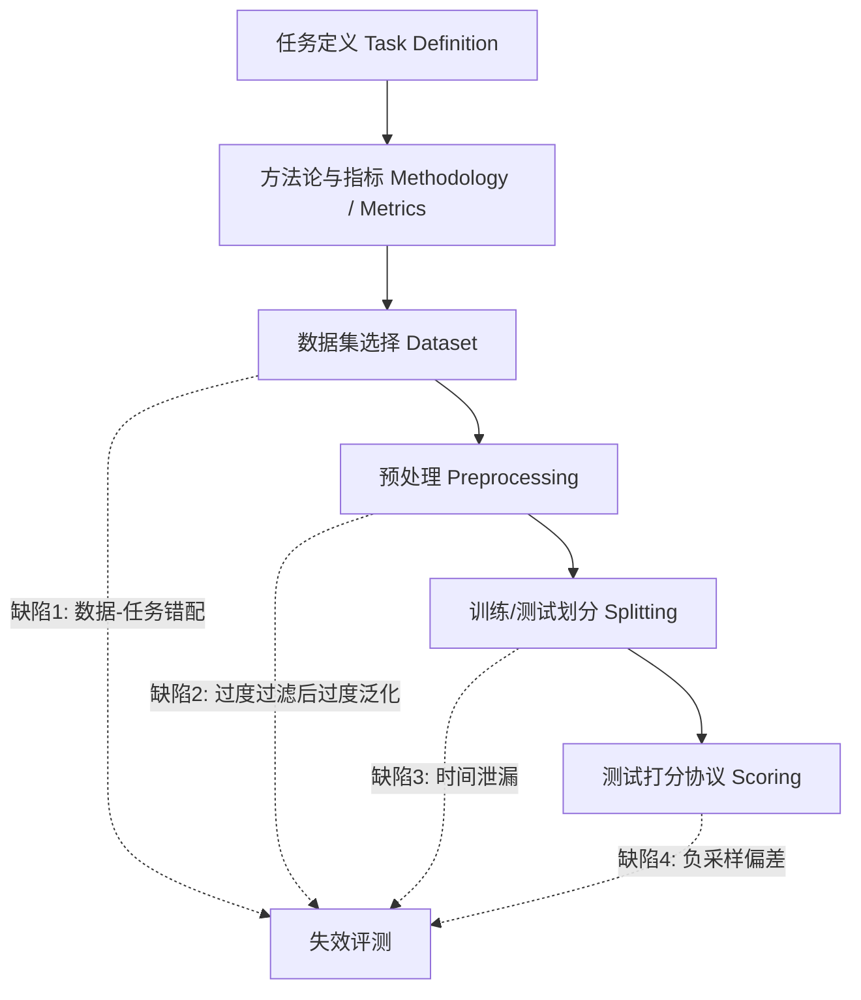

# Widespread Flaws in Offline Evaluation of Recommender Systems (推荐系统离线评测中的普遍缺陷)

- **会议/期刊**: RecSys 2023 (17th ACM Conference on Recommender Systems)
- **作者与机构**: Balázs Hidasi, Ádám Tibor Czapp (Gravity R&D, a Taboola company, Hungary)
- **推荐链路定位**: 评测协议 / 基准（跨召回-排序全链路的实验方法论）
- **研究方向**: 去偏公平、可信隐私与工业架构 / 序列推荐
- **论文原文**: [论文原文链接](https://arxiv.org/abs/2307.14951v1)
- **开源代码**: [开源代码仓库链接](https://github.com/hidasib/recsys_eval_flaws)

## TL;DR (1分钟核心速览)

本文是一篇"评测方法论批判"论文：指出近十年序列推荐论文普遍沿袭的四类评测缺陷——数据集与任务错配、过度预处理后仍作普适结论、随机/Leave-One-Out 划分造成时间信息泄漏、以及测试阶段负采样。作者以 GRU4Rec 官方实现在 7 个数据集（充值/会话数据）上做受控实验，证明这些缺陷可让指标虚高数十个百分点，甚至彻底反转模型优劣排序（Coveo 上 $+8.1\%$变为$-4.7\%$），并主张全库 Full-Ranking + 严格时间切分 + 最小化预处理。

## Background & Motivation (背景与核心矛盾)

- **主流范式**: 受生产系统闭源所限，离线评测仍是学术研究的主要验收方式；近十年主流做法是"沿用前人 setup"——从高被引论文继承数据集、划分方式与测试采样策略。
- **前人局限**: (1) 评价指标从 RMSE 转向 IR 指标后计算量激增，社区为省算力普遍引入负采样测试，导致指标失真；(2) 序列推荐大量借用评分数据集（MovieLens/Amazon/Steam/Yelp），而这些数据的"时间戳"与"真实交互时间"脱钩，序列性本身可疑。
- **核心洞察 (Key Insight)**: 缺陷会**代际传播**——后续工作复制错误 setup 而不校验其有效性；且在缺陷 setup 下，算法间的相对优劣与最优推荐列表长度 $N$ 强相关，故结论不可迁移。
- **本文切入点**: 不做新模型，而是把"评测设计"拆成可审计的流水线（任务定义 $\to$方法/指标$\to$数据$\to$预处理$\to$划分$\to$ 测试采样），逐环节定位失效点并给出定量证据。

## Method (核心方法设计)

### 1. 整体框架 (Overall Architecture)

论文将离线评测设计抽象为一条串行决策链，每一环都可能引入偏差并向后续环节传播：先由任务定义决定评测方法论（behavior prediction 用行为预测、interaction prediction 用 CTR 与反事实评估）与指标族（Ranking/IR vs Classification），再选数据、做预处理、定划分、定测试打分协议。作者的贡献在于对第 3–6 环设置"审计闸门"，并以 session-based next-item prediction 为统一实验载体（GRU4Rec + 全库排序）逐条验证闸门失效的代价。

### 2. 关键设计拆解 (Key Designs)

1. **缺陷一：数据集–任务错配（以"事件碰撞率"为可量化诊断量）**：评分数据集的时间戳分辨率常为"天"，同一天内同一用户的多个事件时间戳相同，顺序不可判定；若数据又默认按 item ID 预排序（MovieLens10M），不同用户会被"压"成同一条伪序列。作者给出量化证据：Amazon(Beauty) 有 $33.03\%$的事件处于时间戳碰撞中，MovieLens10M 为$27.33\%$，而真会话数据 Coveo 为$0.00\%$。诊断手段极为朴素有效——把 GRU 换成前馈层重训，若性能几乎不变，说明该数据不存在可利用的序列模式。
2. **缺陷二：时间泄漏（Leave-One-Out / 随机划分）**：LOO 把每条序列末位事件移入测试集，序列终点时刻各异，训练集与测试集在时间轴上必然重叠，模型可"看到未来"。可用"训练/测试共享的 $i\to j$物品转移比例"度量概念漂移泄漏：Rees46 上 LOO 为$0.5254$、时间切分为$0.4222$；RetailRocket 为$0.3644$vs$0.2428$；Coveo 因仅 18 天数据两者接近（$0.3701$vs$0.3812$），反证泄漏随数据跨度放大。
3. **缺陷三：测试期负采样与训练/推理协议**：目标物品在 $N$个候选中真实排名$R$，对$S$个均匀负样本仍进入长度$C$推荐列表的概率为$\sum_{i=0}^{C-1}\binom{R-1}{i}\binom{N-R}{S-i}\big/\binom{N-1}{S}$——即排名第 1,490/10,000 或第 14,878/100,000 的物品，用 100 个均匀样本仍有$>90\%$ 概率挤进 top-20，指标被系统性高估。作者进一步指出"强负样本"（最相似/最近邻/最热门）虽优于均匀采样，但计算量不低于全库排序且仍无法稳定复现真实排名，故推荐**全库 Full-Ranking**；若必须省算力，应采样"测试用例（用户/序列）"而非"候选物品"。开销上，Rees46 一次全库评测需 887,369 个长度 172,756 的推荐列表，A30 GPU 上仅 205.1 秒。

## Experimental Setup & Evaluation Protocol (实验设置与评估协议)

- **数据集与预处理**: 统一流程为：仅保留 item-view 事件；序列按用户历史/Coveo 预计算会话/Rees46、RetailRocket 的 1 小时间隔切分；去除相邻重复物品（$(i,i,j)\to(i,j)$，$(i,j,i)$保留）；迭代过滤长度$<2$的序列与出现$<5$ 次的物品（弱 5-core）；时间切分点至少早于数据集最后事件 1 天，跨越切分点的序列被截断。

| 数据集 | #Items | 训练事件 | 测试事件 | 事件碰撞占比 | 场景说明 |
| :--- | :---: | :---: | :---: | :---: | :--- |
| Amazon (Beauty) | 4,907 | 724,440 | 38,606 | 33.03% | 评分数据，天级时间戳 |
| MovieLens10M | 5,054 | 9,861,612 | 10,066 | 27.33% | 评分数据，按 item ID 预排序 |
| Steam | 2,582 | 4,856,479 | 12,229 | 13.49% | 评分数据，天级时间戳 |
| Yelp | 6,091 | 5,583,947 | 132,895 | 0.06% | 评分/签到数据 |
| Rees46 | 60 | 67,575,203 | 172,756 | 0.04% | 电商真会话，仅 1 天测试跨度 |
| Coveo | 17 | 1,411,113 | 10,868 | 0.00% | 电商真会话，共 18 天 |
| RetailRocket | 131 | 750,832 | 36,824 | 0.05% | 电商真会话，7 天 |

- **数据划分与防穿越**: 对比 `Leave-One-Out`（易泄漏）与**严格时间戳切分**（不重叠）；验证集用同一时间切分流程从训练集尾部生成，超参在各算法、各训练窗口下**分别**优化后，再用全训练集重训并测于测试集。
- **排名评测协议**: 主实验一律 **Full-Ranking（全库未交互物品排序）**，指标 Recall@N、MRR@N（N=1/5/10/20）；负采样实验作为"反面协议"对照组，采样比例 100%/10%/1%/0.1% 与固定 #100。
- **对比基线与超参设置**: 以 GRU4Rec（model-based）与 V-SkNN（neighbor-based）为代表，另有论文中匿名化的 model A/B/C 用于展示排序反转；统计口径为单次受控重训，不涉及显著性检验（作者强调离线指标的小差异不具线上等价性）。

## Key Experimental Results (实验关键数据)

### 1. 主实验对比 (Main Results)

序列建模 vs. 去序列建模（同一算法，GRU 层换前馈层，各自调参）的相对变化，直接检验"数据是否真有序列性"：

| 数据集 | 有序列建模 Recall@5 / @20 | 无序列建模 Recall@5 / @20 | 相对变化 (R@5 / R@20) |
| :--- | :---: | :---: | :---: |
| Rees46 | 0.3010 / 0.5293 | 0.2594 / 0.4785 | **-13.80% / -9.58%** |
| Coveo | 0.1496 / 0.3135 | 0.1289 / 0.2678 | **-13.83% / -14.59%** |
| RetailRocket | 0.3237 / 0.5186 | 0.2747 / 0.4652 | **-15.13% / -10.30%** |
| Amazon (Beauty) | 0.0784 / 0.1319 | 0.0779 / 0.1271 | **-0.71% / -3.61%** |
| MovieLens10M | 0.1728 / 0.3264 | 0.1276 / 0.2440 | **-26.18% / -25.23%** |
| Steam | 0.1117 / 0.2371 | 0.1035 / 0.2208 | **-7.38% / -6.87%** |
| Yelp | 0.0702 / 0.1627 | 0.0657 / 0.1625 | **-6.46% / -0.12%** |

负采样对"模型相对排序"的破坏（全库 vs 100 负样本）：

| 数据集 / 模型对 | Full-Ranking 结论 | 100 负样本结论 | 结论变化 |
| :--- | :---: | :---: | :---: |
| Coveo (A vs B), Recall@20 | A 优于 B **+8.1%** | A 落后 B **-4.7%** | 排序反转 |
| RetailRocket (A vs B), Recall@20 | A 优于 B **+14.3%** | 仅 **+1.5%** | 优势近乎消失 |
| Rees46 (A vs B), Recall@1 | A 优于 B **+49.5%** | **-1.6%** | 排序反转 |
| Rees46 (A/B/C), MRR@N | $A > C \gg B$|$B > A \gg C$ | 排序完全错乱 |

### 2. 消融实验 (Ablation Study)

以"训练窗口长度"为消融变量（模型自身超参逐窗口重调），考察预处理强度对算法公平性的影响：

| 训练窗口 | GRU4Rec Recall@5 / @20 | V-SkNN Recall@5 / @20 | 相对差距 |
| :--- | :---: | :---: | :---: |
| 全训练集 | 优于 V-SkNN | — | **+5.7% / +8.9%** |
| 最近 91 天 | 逐窗口优化 | 逐窗口优化 | 优势收窄 |
| 最近 14 天 | — | — | **-29.6% / -25.1%（被反超）** |
| 负采样策略 | 最相似/最近邻 | 最热门/流行度采样 | 均匀采样 | 弱基线（逆流行度/最不相似） |
| 强度对比 | 最相似 $\approx$最近邻（算力$\ge$全库）> 最热门 > 流行度 > 均匀$\gg$ 弱基线 | | 无一能稳定复现真实排名 |

### 3. 关键实验发现 (Key Findings)

- **"序列增益"本身即可判定数据集是否合格**：真会话数据去掉序列建模掉 $9.58\%\sim15.13\%$（Recall@20），而 Amazon(Beauty) 仅$3.61\%$、Yelp 仅$0.12\%$ ——说明序列模型在 MMs 上主要拟合了用户静态偏好，把它们当成序列推荐 benchmark 会严重失真。
- **负采样不是"效率折衷"而是"结论改写器"**：Coveo 上 $8.1\%$的优势在 100 负样本下变成$-4.7\%$的劣势；Rees46 上$49.5\%$的 Recall@1 提升塌缩为$-1.6\%$，MRR 下三模型排序完全颠倒；且采样越小，模型排序翻转点越向小$N$ 偏移。
- **预处理强度会系统性偏向邻居类方法**：训练窗口从全量缩至 14 天，GRU4Rec 相对 V-SkNN 从 $+8.9\%$变为$-25.1\%$（Recall@20）；时间泄漏侧，LOO 相比严格时间切分使 Rees46 训练/测试共享转移比例从$0.4222$升到$0.5254$，即把任务"变简单"了。

## Highlights & Limitations (亮点、对比与审稿批判)

- **与代表作对比 (vs. Prior Work)**: 相较 [20]（理论分析采样偏差如何进入指标）与 [3,5]（仅展示排序可变），本文给出**可操作的诊断探针**（去序列层重训、事件碰撞率、$i\to j$ 共享转移比）并把四类缺陷统一到一条评测设计流水线上；相较 [33] 仅一句"Amazon 序列信号弱"的观察，本文用 7 数据集定量坐实。
- **可迁移亮点**: (1) "去关键模块重训看掉点"是判断数据-任务匹配度的通用体检法；(2) 用"共享转移比例"量化概念漂移泄漏，可移植到 cross-domain、CTR 时间切分的泄漏审计；(3) 省算力应采样测试用例而非候选物品。
- **审稿级局限批判**: (1) 全库排序成本随物品数平方级增长的论断有 GPU 实测支撑，但对千万级工业目录仍缺可行折衷（candidate generation 会牺牲结论普适性，作者亦承认无公认候选生成器）；(2) 实验以单一序列任务与 GRU4Rec/V-SkNN 为载体，对图模型、生成式推荐的可迁移性仅作定性外推；(3) 未给出统计显著性检验与多种子方差，部分 $<1\%$的差异（如 Amazon 的$+0.86\%$）被作者自行解释为噪声，结论稳健性依赖阈值判断。

## Rating (四维评分)

- **方法创新性 (Novelty)**: ⭐⭐⭐ （非新算法，但"评测缺陷流水线 + 三个可量化诊断探针"的框架化提炼在方法论层面具有原创价值）
- **评估协议与实验扎实度 (Protocol & Experiments)**: ⭐⭐⭐⭐⭐ （7 数据集、逐窗口/逐采样率重调超参、全库排序对照，并刻意匹配测试集规模以消除混杂，实证密度远超一般 position paper）
- **写作与数学规范度 (Clarity & Rigor)**: ⭐⭐⭐⭐⭐ （四缺陷与设计步骤一一对应，采样入选概率公式给出闭式表达，图 2/图 4 直接支撑时间泄漏与排序反转两类核心论断）
- **工业落地与复现价值 (Industrial & Practical Value)**: ⭐⭐⭐⭐ （代码与超参全开源，A30 上 205 秒完成 Rees46 全库评测，为工业离线-线上相关性审计提供了低成本可直接照抄的 checklist；扣分在于未覆盖超大规模目录场景）

