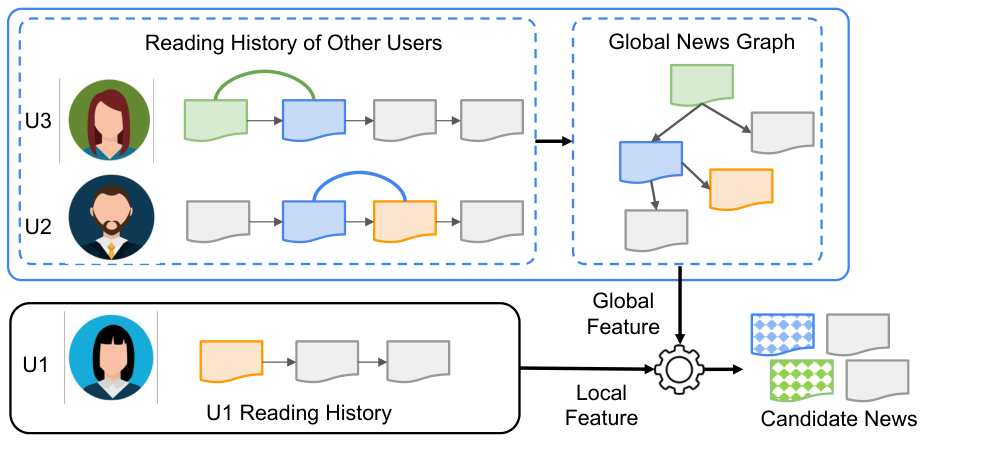
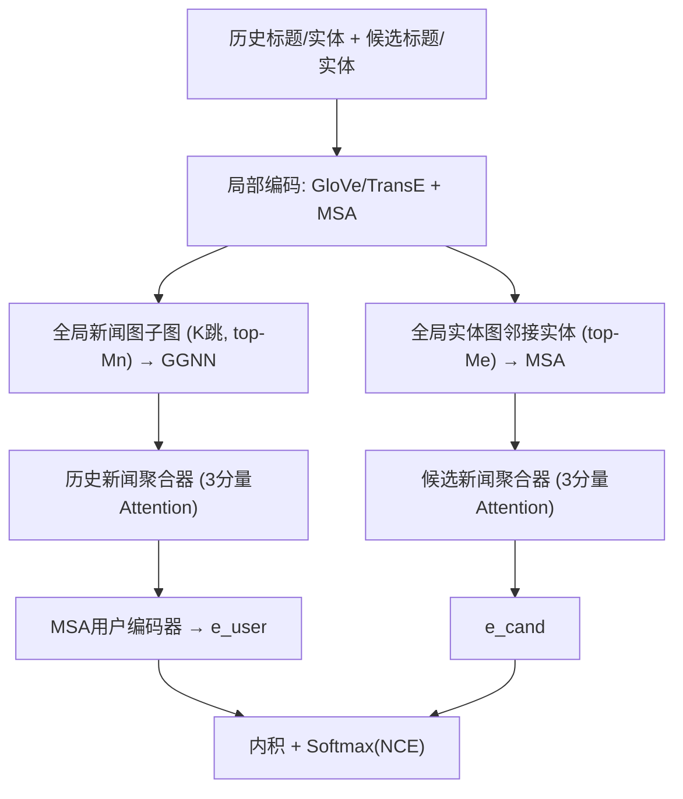
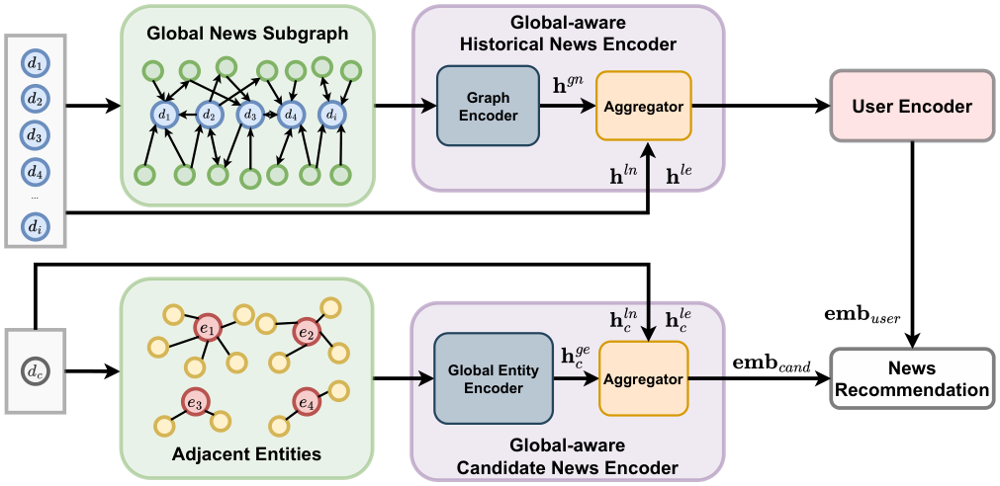

# Going Beyond Local: Global Graph-Enhanced Personalized News Recommendations (超越局部：全局图增强的个性化新闻推荐)

- **会议/期刊**: RecSys 2023 (Best Student Paper)
- **作者与机构**: Boming Yang, Dairui Liu, Toyotaro Suzumura, Ruihai Dong, Irene Li (东京大学 / 都柏林大学)
- **推荐链路定位**: 召回 (候选新闻打分)
- **研究方向**: 图神经网络与知识图谱推荐 / 冷启动与长尾推荐
- **论文原文**: [https://arxiv.org/abs/2307.06576v5](https://arxiv.org/abs/2307.06576v5)
- **开源代码**: [https://github.com/tinyrolls/GLORY](https://github.com/tinyrolls/GLORY)

## TL;DR (1分钟核心速览)

新闻推荐主流做法只看**单个用户自己的历史标题语义**，当用户仅读过 1–3 条新闻、且候选与历史无语义重叠时彻底失效。GLORY 把全体用户阅读序列压成**全局有向新闻图**（GGNN 编码子图）与**全局无向实体图**（邻接实体 MSA），再与局部文本/实体表示做三分量注意力融合。在 MIND-small/large 的 impression 级排序协议下，AUC 达 68.15/69.54，MIND-large nDCG@10 相对最强基线提升 2.67%，且 ILMD@10 多样性从 0.1486 升至 0.1848。

## Background & Motivation (背景与核心矛盾)

- **主流范式**: 内容驱动——用 MSA/CNN/GRU 从标题与实体抽取新闻表示，再用 MSA+Attention Pooling 聚合用户历史（NRMS、NAML、LSTUR、HieRec、MINER）；图方法则多在**单用户历史**或**语义相似度**上建图（GERL、GNewsRec、User-as-Graph、DIGAT）。
- **前人局限**: ① 仅用单用户点击序列，用户历史极稀疏时（图 1 中 U1 只有一条橙色新闻）无法覆盖候选话题；② 候选新闻天生无交互，LibFM/DeepFM 类特征方法无法学到表示；③ 已有图方法（DIGAT 的语义增强图）仍建立在**语义相关性**上，未挖掘跨用户的**隐含行为关联**。
- **核心洞察 (Key Insight)**: 协同阅读路径本身携带超越语义的信号——若 U2/U3 的序列中橙色新闻与蓝/绿新闻相邻出现，则蓝/绿候选对 U1 也是合理推荐，这条链路文本相似度完全给不出。

<figure class="paper-figure" markdown="span">
  <figcaption>图1：全局特征如何帮助预测候选新闻的一个示例。图中描绘了三个用户 U1、U2 和 U3，以及用绿色、蓝色和橙色表示的三个不同历史新闻文章。虚线蓝色和绿色候选新闻文章分别与蓝色和绿色新闻文章的内容相关。</figcaption>
</figure>

- **本文切入点**: 把"全体用户阅读序列"物化为两张全局图，分别补强**历史侧**（新闻共现序列）与**候选侧**（实体跨新闻共现），从而在纯内容模型上叠加协同信号而不引入 item-ID 嵌入。

## Method (核心方法设计)

### 1. 整体框架 (Overall Architecture)

输入为用户最近 $L_{his}=50$条历史新闻标题（截断 30 词）与每条新闻至多 5 个 WikiData 实体。先由 GloVe+MSA+词级 Attention 得局部新闻表示$\mathbf{h}^{ln}$、TransE+MSA 得局部实体表示$\mathbf{h}^{le}$；历史侧从全局新闻图抽取$K$跳、每跳 top-$M_n$邻居的子图，用 GGNN 得$\mathbf{h}^{gn}$；候选侧从全局实体图取 top-$M_e$邻接实体做 MSA 得$\mathbf{h}^{ge}_c$。两侧各用注意力池化把「局部新闻 + 局部实体 + 全局」三向量融合为新闻向量，用户编码器（MSA+Attention Pooling）聚合历史得到$\mathbf{e}_{user}$，与候选向量内积后 softmax 排序。训练端到端，仅用 NCE 负采样损失。

<figure class="paper-figure" markdown="span">
  <figcaption>图2：所提出的 GLORY 模型概览。蓝色节点 𝑑𝑖 表示用户行为中的历史新闻，灰色节点 𝑑𝑐 表示候选新闻 𝑑𝑐。相邻实体中的红色节点 𝑒𝑖 表示属于 𝑑𝑐 的一个实体。嵌入 h𝑙𝑛 和 h𝑙𝑛 𝑐 表示局部新闻表示，嵌入 h𝑙𝑒 和 h𝑙𝑒𝑐 表示局部实体表示。emb𝑢𝑠𝑒𝑟 和 emb𝑐𝑎𝑛𝑑 分别是用户表示和候选新闻表示，均用于新闻推荐。</figcaption>
</figure>

### 2. 关键设计拆解 (Key Designs)

1. **全局新闻图 + GGNN 子图编码**：痛点是无交互的候选与稀疏历史之间缺桥。构图：对每条阅读序列按时间加**有向边** $(v_i,v_j)$，边权为全体用户中该相邻对的出现频次；对目标用户每条历史取$K=2$跳、每跳 top-$M_n=8$ 邻居构成个性化子图。编码用 GGNN（GRU 门控而非均值聚合）：
$\mathbf{m}_i^{(l+1)}=\sum_{j\in\mathcal{N}(i)}\mathbf{W}_g\mathbf{h}_j^{(l)},\quad \mathbf{h}_i^{(l+1)}=\mathrm{GRU}(\mathbf{m}_i^{(l+1)},\mathbf{h}_i^{(l)})$
直觉：新闻点击是**序列性**行为，GRU 的隐状态能保留"读完 A 才读 B"的路径方向，比 GCN/GAT 的对称聚合更贴合阅读流（图 4 中 GGNN 全面优于 GCN/GAT/GraphSAGE）。

2. **全局实体图 + 邻接实体增强（候选侧）**：候选新闻无历史，只能借实体桥接。构图只保留**跨新闻**实体连接且取**无向**（同一新闻内实体在 KG 中本就语义相近，加 intra-news 边反而只带来语义冗余，见表 5）。因实体节点平均度远高于新闻节点，无需抽子图，直接对每条候选的 top-$M_e=10$邻接实体做 MSA + Attention 聚合得$\mathbf{h}^{ge}_c$，成本可控。

3. **三分量注意力聚合与训练目标**：对每条新闻拼接 $\mathbf{h}_k=[\mathbf{h}^{ln};\mathbf{h}^{le};\mathbf{h}^{gn}]$，用 query 向量自适应加权，使模型能按场景在"文本语义 / 实体语义 / 协同行为"间切换：
$\mathbf{n}_k=\sum_{i=1}^{3}\alpha_i^h\mathbf{h}_i^k,\ \ \alpha_i^h=\frac{\exp(\mathbf{q}_h^{\top}\tanh(\mathbf{W}_h\mathbf{h}_i^k))}{\sum_{j=1}^{3}\exp(\mathbf{q}_h^{\top}\tanh(\mathbf{W}_h\mathbf{h}_j^k))}$训练在同会话内随机采$K_{neg}=4$ 个未点击新闻做 softmax 负采样（**非** in-batch、非 hard negative）：
$\mathcal{L}_{NCE}=-\sum_{i}\log\frac{\exp(\hat{y}_i^{+})}{\exp(\hat{y}_i^{+})+\sum_{j=1}^{K_{neg}}\exp(\hat{y}_{ij})}$
推理时图结构离线预建、子图检索为查表操作，在线仅前向编码，但每样本需实时取子图与邻接实体，训练显存/耗时显著高于纯局部模型（作者自承）。

## Experimental Setup & Evaluation Protocol (实验设置与评估协议)

| 数据集 | #Users | #Items | #Interactions | 稀疏度/密度 | 特征/场景说明 |
| :--- | :---: | :---: | :---: | :---: | :--- |
| MIND-small | 50,000 | 65,238 | 347,727 | 1.07e-4 | 英文，标题+实体+类别，6 周日志 |
| MIND-large | 1,000,000 | 161,013 | 24,155,470 | 1.50e-4 | 同上，全量版本 |
| Adressa (light) | 537,627 | 14,732 | 2,527,571 | 3.19e-4 | 挪威语，**仅标题**、无实体，1 周日志 |

- **数据划分与防穿越**: MIND 沿用官方按时间切分的 train/valid/test impression 日志；Adressa 划分细节论文未明示（沿用基线设置），存在轻微可复现风险。全局图**仅由训练集**阅读序列构建，避免测试期信息泄漏。
- **排名评测协议**: **Impression 级候选排序**（每个 impression 内 1 个正样本 + 日志内少量负样本），**非**全库 Full-Ranking；训练负采样为同会话随机 4 负。指标 AUC / MRR / nDCG@5 / nDCG@10。
- **对比基线与超参**: 三类基线——特征类 (LibFM, DeepFM)、神经类 (DKN, NPA, NAML, LSTUR, NRMS, FIM, HieRec, MINER w/o PLM)、图类 (GERL, GNewsRec, User-as-Graph, DIGAT w/o PLM)；为公平起见均取**无预训练语言模型**版本。$d_{word}=300$、$d_{entity}=100$、新闻表示 400 维、GGNN 3 层、Adam lr=$2e^{-4}$、10% warm-up。未报告显著性检验。

## Key Experimental Results (实验关键数据)

### 1. 主实验对比 (Main Results)

| Method | MIND-small AUC | MRR | nDCG@5 | nDCG@10 | MIND-large AUC | MRR | nDCG@5 | nDCG@10 |
| :--- | :---: | :---: | :---: | :---: | :---: | :---: | :---: | :---: |
| LibFM | 59.74 | 26.33 | 27.95 | 34.29 | 61.85 | 29.45 | 31.45 | 37.13 |
| NAML | 66.12 | 31.53 | 34.88 | 41.09 | 66.46 | 32.75 | 35.66 | 41.40 |
| LSTUR | 65.87 | 30.78 | 35.15 | 40.15 | 67.08 | 32.36 | 35.15 | 40.93 |
| NRMS | 65.63 | 30.96 | 34.13 | 40.52 | 67.66 | 33.25 | 36.28 | 41.98 |
| HieRec | 67.95 | 32.87 | 36.36 | 42.53 | 69.03 | 33.89 | 37.08 | 43.01 |
| MINER w/o PLM | 68.07 | 32.93 | – | 42.62 | – | – | – | – |
| DIGAT w/o PLM | 67.82 | 32.65 | 36.25 | 42.49 | – | – | – | – |
| User-as-Graph | – | – | – | – | 69.23 | **34.14** | 37.21 | 43.04 |
| **GLORY (ours)** | **68.15** | **32.97** | **36.47** | **42.78** | **69.54** | 34.03 | **37.92** | **44.19** |
| Improv.% (vs best baseline) | +0.12% | +0.12% | +0.30% | +0.38% | +0.45% | −0.32% | +1.91% | +2.67% |

Adressa（仅标题）：GLORY AUC 74.31 / MRR 42.29 / nDCG@5 43.37 / nDCG@10 49.51，相对 LSTUR (73.17) AUC +1.56%，相对 NRMS (48.57) nDCG@10 +1.94%。

### 2. 消融实验 (Ablation Study)

| 变体 (MIND-small) | AUC | MRR | nDCG@5 | nDCG@10 |
| :--- | :---: | :---: | :---: | :---: |
| full model | **68.15** | **32.97** | **36.47** | **42.78** |
| w/o g-news | 67.53 | 32.39 | 35.89 | 42.10 |
| w/o g-entity | 67.77 | 32.57 | 36.09 | 42.38 |
| w/o g-news/entity | 67.28 | 32.00 | 35.38 | 41.77 |

图构建方式消融（同一 backbone）：新闻图 **Dir-Seq 68.15** > Co-oc 67.76 > Undir-Seq 67.73，说明**方向性阅读顺序**是关键；实体图 **Inter-news Undirected 68.15** > Intra+Inter Directed 67.86，说明 intra-news 边只贡献语义冗余。

### 3. 关键实验发现 (Key Findings)

1. **全局新闻图是主贡献，实体图是次贡献且二者近似可叠加**：单独去掉新闻图 AUC 掉 0.62（68.15→67.53），去掉实体图掉 0.38，两者同去仅掉 0.87，说明二者捕捉的信号高度互补但重叠有限；新闻图权重更大，因其直接改写用户历史表示。
2. **有向序列性优于共现**：Co-oc 构图把同序列任意两新闻连边，AUC 反降 0.39（68.15→67.76），证明收益不是"更多边=更多信息"，而是 GRU 沿阅读方向传播带来的时序隐状态，这也解释了 GGNN 显著优于 GCN/GAT（图 4）。
3. **增益集中在稀疏/长尾侧但整体幅度有限**：MIND-large 上 nDCG@10 提升 2.67%（43.04→44.19）明显大于 MIND-small 的 0.38%，且 MIND-large MRR 反被 User-as-Graph 以 34.14 略微反超（GLORY 34.03），说明全局图对长历史大规模用户收益更稳，对首位命中率并不占优；同时多样性 ILMD@10 由 0.1486 提升至 0.1848（+24%），表明协同信号确实跳出了语义近邻的"信息茧房"。

## Highlights & Limitations (亮点、对比与审稿批判)

- **与代表作对比**: vs **NRMS**——同为 MSA 用户编码器，GLORY 只改新闻表示侧（加全局图），MIND-large nDCG@10 +2.21%，证明瓶颈在 item 表示而非用户聚合；vs **DIGAT**——同样"图增强"，但 DIGAT 的语义增强图仍由文本相似度构建，GLORY 用**真实跨用户点击序列**，AUC 高出 0.33；vs **User-as-Graph**——后者为每个用户单独建异构图，GLORY 复用**一张全局图 + 个性化子图**，参数与构图开销更低且 nDCG@10 更高。
- **可迁移亮点**: ① "全体用户序列 → 有向加权全局转移图 + 个性化子图" 可直接搬到电商 next-item、POI 序列推荐，替代昂贵的 per-user 图；② 用**跨新闻实体无向图邻接扩展**替代 item-ID 嵌入来缓解候选冷启动，是新闻/短视频这类高时效 item 的通用低成本方案。
- **审稿级局限批判**: ① **效率与动态性**：每样本需检索子图与邻接实体，训练显存/时间随全局图规模线性增长；且图是**静态**的，无法建模新闻时效衰减与实时新增新闻，与新闻场景强动态性冲突（作者列为 future work）；② **评测强度不足**：仅 impression 内候选排序，缺全库 Full-Ranking 与冷启动分桶实验，未做显著性检验；MIND-large 提升仅 +0.45% AUC 且 MRR 落后，Adressa 划分与实体缺失下的实现细节披露不足，复现门槛偏高。

## Rating (四维评分)

- **方法创新性 (Novelty)**: ⭐⭐⭐⭐ （首次把"跨用户全局新闻图 + 全局实体图"双图范式引入新闻推荐，思路干净；但 GGNN/注意力聚合本身属成熟组件拼接）
- **评估协议与实验扎实度 (Protocol & Experiments)**: ⭐⭐⭐ （三数据集 + 构图/编码器/超参消融较全，但仅 impression 级排序、无全库排序与显著性检验，Adressa 划分未披露）
- **写作与数学规范度 (Clarity & Rigor)**: ⭐⭐⭐⭐ （公式与符号清晰、图例直观，动机案例（图 1）与 case study（图 7）说服力强；缺复杂度与图规模定量分析）
- **工业落地与复现价值 (Industrial & Practical Value)**: ⭐⭐⭐⭐ （代码开源、全局图离线可预建、候选侧仅需实体邻接查表；但静态图与训练开销需工程侧增量更新改造）

