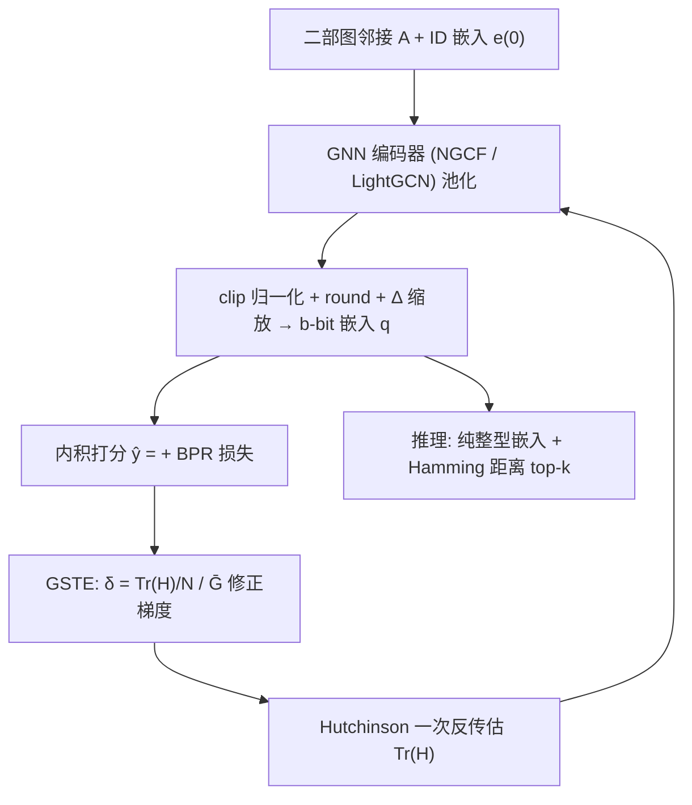

# Hessian-aware Quantized Node Embeddings for Recommendation (面向推荐的 Hessian 感知量化节点嵌入)

- **会议/期刊**: RecSys 2023 (Seventeenth ACM Conference on Recommender Systems)
- **作者与机构**: Huiyuan Chen, Kaixiong Zhou, Kwei-Herng Lai, Chin-Chia Michael Yeh, Yan Zheng, Xia Hu, Hao Yang（Visa Research / Rice University）
- **推荐链路定位**: 召回（向量化检索阶段，压缩 item 侧嵌入以降低内存与检索延迟）
- **研究方向**: 图神经网络与知识图谱推荐 / 协同过滤与双塔召回
- **论文原文**: [arXiv:2309.01032v1](https://arxiv.org/abs/2309.01032v1)
- **开源代码**: [huangtinglin/MixGCF](https://github.com/huangtinglin/MixGCF) （检测到的链接为 MixGCF 仓库，仅提供 Alibaba 数据集，**非本文官方实现**）

## TL;DR (1分钟核心速览)

GNN 推荐模型把用户/物品嵌入存成 FP32，十亿级物品库的存储与 top-$k$检索延迟难以承受；现有 binary hashing 方案用 STE 反传，但前向 `round` 与反向 identity 的梯度失配导致训练不稳、精度塌陷。本文提出 HQ-GNN：GNN 编码器产出连续嵌入后接一个任意比特（非仅 1-bit）均匀量化模块，并用 **Generalized STE** 在梯度上乘一个由量化误差与二阶导数（Hessian）共同决定的缩放因子$\delta$。在 Gowalla / Yelp-2018 / Amazon-Book / Alibaba 四个数据集、每用户 80/20 随机划分、Recall@50 与 NDCG@50 协议下，1-bit HQ-GNN 相对 SOTA HashGNN 在 Recall@50 上平均提升约 16.3%（LightGCN 主干）/ 15.3%（NGCF 主干），且推理约 3.6 倍加速。

## Background & Motivation (背景与核心矛盾)

- **主流范式**: LightGCN / NGCF 等消息传递 GNN 在用户-物品二部图上学习节点嵌入，配合 BPR 与内积打分做 top-$k$ 召回；工业侧为降本，把嵌入压到 1-bit 二值空间，用 Hamming 距离替代浮点内积（HashNet、CIGAR、HashGNN）。
- **前人局限 (1)**: 极端低比特（1–2 bit）量化精度退化严重，而现有方案多为固定 1-bit，无法在"延迟 vs 精度"之间连续调档；且被量化的只是 embedding activation，本质仍是 hash 而非可调档量化。
- **前人局限 (2)**: 量化函数 `round(·)` 几乎处处导数为 0，主流用 STE 以 identity 作代理梯度，前后向函数不一致 → **梯度失配**：$x_n=0.51$与$x_n=1.49$同样$round$到 1，但量化误差$\epsilon$ 不同，STE 却给二者相同梯度；且 0.51 减 0.2 会跨桶变 0，1.49 减 0.2 仍是 1，误差累积使训练震荡。
- **核心洞察 (Key Insight)**: 量化误差有严格界 $|\epsilon_i| \le \frac{0.5}{2^b-1}$，可对"梯度关于量化值"做一阶 Taylor 展开，把 STE 缺失的那一项还原为二阶信息项，其最优缩放因子正比于 Hessian 与梯度绝对值的比。
- **本文切入点**: 用 Hutchinson 方法以**一次额外反向传播**估计 Hessian 迹，直接给出闭式 $\delta$，得到可调比特、训练稳定的 GSTE。

## Method (核心方法设计)

### 1. 整体框架 (Overall Architecture)

输入用户-物品二部图邻接矩阵与 ID 嵌入 $\boldsymbol{e}^{(0)}$，GNN 编码器（可选 NGCF 或 LightGCN）做$L$层消息传递并池化得到全精度节点表示$\boldsymbol{e}_u,\boldsymbol{e}_i\in\mathbb{R}^d$；量化模块先按指数滑动平均维护的上下界$(l,u)$做 clip 归一化，再 `round` 取整、乘回步长$\Delta=\frac{u-l}{2^b-1}$得到$b$-bit 表示$\boldsymbol{q}_u,\boldsymbol{q}_i$；打分用$\hat{y}_{ui}=\langle \boldsymbol{q}_u,\boldsymbol{q}_i\rangle$，以 BPR 损失训练。反向时用 GSTE 修正梯度，并周期性用 Hutchinson 估计 Hessian 迹得到$\delta$。采用**混合精度策略**：只压激活（节点嵌入），GNN 权重保持 FP32（因 GNN 层数 ≤3、权重少）。推理阶段丢弃 post-scaling，直接用纯整型嵌入算 Hamming 距离检索。

### 2. 关键设计拆解 (Key Designs)

1. **任意比特均匀量化模块（把 hash 变成可调档压缩）**：痛点是把 1-bit 固定死导致精度不可挽回；本文对每个元素做 $x_n=\frac{\mathrm{clip}(x,l,u)-l}{\Delta}$、$x_b=\mathrm{round}(x_n)\cdot\Delta$，令$b\in\{1,2,3,4\}$可调，从而显式控制"延迟–精度"折中；$\Delta$ 只在上/下界与比特数上依赖数据分布，硬件侧可用定点乘加与 TensorRT 量化算子高效执行。

2. **Generalized STE（用二阶项补回梯度失配）**：设量化误差 $\epsilon=x_n-x_q$，对梯度做展开$\nabla_{x_n}=\nabla_{x_q}+\frac{\nabla_{x_n}-\nabla_{x_q}}{x_n-x_q}\odot(x_n-x_q)\approx \nabla_{x_q}+\nabla'_{x_q}\odot(x_n-x_q)$，重排后得到
$$\nabla_{x_n}=\nabla_{x_q}\odot\Big(1+\delta\cdot \mathrm{sign}(\nabla_{x_q})\odot(x_n-x_q)\Big),\quad \delta=\frac{\mathrm{Tr}(\mathbf{H})/N}{\bar{G}},\ \bar{G}=\mathbb{E}\big[|\nabla_{x_q}|\big]$$
其中 $\mathrm{sign}$项保证"梯度越小、越接近桶边界"的维度获得更大修正，$\delta=0$即退化为原版 STE。直觉：量化误差大的维度需要更激进的步长补偿跨桶翻转风险，而$\bar{G}$ 做归一化避免梯度尺度敏感。

3. **Hessian 迹的廉价估计与训练目标**：显式构造 $\mathbf{H}$不可行，故用 Hutchinson：$\mathrm{Tr}(\mathbf{H})\approx\frac{1}{m}\sum_i \boldsymbol{v}_i^{\top}\mathbf{H}\boldsymbol{v}_i$，$\boldsymbol{v}_i$取 Rademacher 向量，而$\mathbf{H}\boldsymbol{v}=\frac{\partial(\nabla_{x_q}^{\top}\boldsymbol{v})}{\partial x_q}$可用一次反向传播得到，因此**训练复杂度与骨干 GNN 同阶**。总损失为$\mathcal{L}_{BPR}=\sum_{(u,i)\in\mathcal{O}^+,(u,j)\notin\mathcal{O}^+}-\ln\sigma(\hat{y}_{ui}-\hat{y}_{uj})+\alpha\|\Theta\|_F^2$，负样本为训练集内均匀采样的未交互物品；推理无额外开销。

## Experimental Setup & Evaluation Protocol (实验设置与评估协议)

- **数据集与预处理**: 四个公开大规模数据集，未做 $k$-core 过滤（沿用 LightGCN/NGCF 公开版本）：

| 数据集 | #Users | #Items | #Interactions | 稀疏度/密度 | 特征/场景说明 |
| :--- | :---: | :---: | :---: | :---: | :--- |
| Gowalla | 29,858 | 40,981 | 1,027,370 | 密度 ≈ 8.4e-4 | LBSN 签到隐式反馈 |
| Yelp-2018 | 31,668 | 38,048 | 1,561,406 | 密度 ≈ 1.3e-3 | 本地生活商户评论 |
| Amazon-Book | 52,643 | 91,599 | 2,984,108 | 密度 ≈ 6.2e-4 | 图书电商 |
| Alibaba | 106,042 | 53,591 | 907,407 | 密度 ≈ 1.6e-4 | 阿里广告/行为数据（最稀疏） |

- **数据划分与防穿越 (Splitting Strategy)**: 对每个用户随机取 80% 历史交互作训练集，其余 20% 作测试集；再从训练集中随机抽 10% 作验证集调超参。注意这是**按用户随机比例划分**，非全局时间戳切分，因此不存在严格的时间穿越防护。
- **排名评测协议 (Ranking Protocol)**: 采用 $k=50$ 的 Recall@50 与 NDCG@50；原文未显式说明候选集构造，按 LightGCN 系列惯例应为**全库未交互物品 Full-Ranking**（非采样排序），但这一点论文表述缺失，属于可复现性瑕疵。
- **对比基线与超参设置**: 基线为 NGCF、LightGCN、HashNet、HashGNN；HQ-GNN 可挂载任一 GNN 编码器。嵌入维度 $d$在$\{16,32,64,128\}$中搜索，$\alpha\in\{10^{-5},\dots,10^{-1}\}$，量化阈值用指数滑动平均确定；为公平比较 1-bit 哈希基线，主实验统一设$b=1$。原文未报告显著性检验。

## Key Experimental Results (实验关键数据)

### 1. 主实验对比 (Main Results)

| 方法 (主干 + 量化) | Gowalla R@50 | Gowalla N@50 | Yelp R@50 | Yelp N@50 | Amazon R@50 | Amazon N@50 | Alibaba R@50 | Alibaba N@50 | Improv.(R@50, vs HashGNN) |
| :--- | :---: | :---: | :---: | :---: | :---: | :---: | :---: | :---: | :---: |
| NGCF (FP32) | 0.159 | 0.130 | 0.114 | 0.054 | 0.092 | 0.065 | 0.071 | 0.033 | — |
| NGCF + HashNet | 0.104 | 0.082 | 0.071 | 0.030 | 0.057 | 0.038 | 0.047 | 0.021 | — |
| NGCF + HashGNN | 0.122 | 0.098 | 0.091 | 0.042 | 0.073 | 0.043 | 0.054 | 0.023 | — |
| **NGCF + HQ-GNN** | **0.145** | **0.112** | **0.101** | **0.048** | **0.081** | **0.054** | **0.065** | **0.029** | **+15.3%** (avg) |
| LightGCN (FP32) | 0.163 | 0.134 | 0.118 | 0.059 | 0.098 | 0.072 | 0.076 | 0.036 | — |
| LightGCN + HashNet | 0.113 | 0.088 | 0.074 | 0.036 | 0.064 | 0.041 | 0.052 | 0.024 | — |
| LightGCN + HashGNN | 0.128 | 0.112 | 0.094 | 0.047 | 0.075 | 0.053 | 0.062 | 0.029 | — |
| **LightGCN + HQ-GNN** | **0.152** | **0.122** | **0.108** | **0.051** | **0.089** | **0.062** | **0.070** | **0.032** | **+16.3%** (avg) |

（加粗为 1-bit 量化组最优；FP32 组最优为 LightGCN，全表仅作精度上界参照。）

### 2. 消融实验 (Ablation Study)

| 配置 | Gowalla R@50 | 相对变化 | 说明 |
| :--- | :---: | :---: | :--- |
| LightGCN (FP32, 上界) | 0.163 | — | 无量化 |
| HQ-GNN, $b=4$ | ≈0.160 | 恢复 98.5% 全精度性能 | 高位宽几乎无损（原文仅给比例） |
| HQ-GNN, $b=1$, GSTE | 0.152 | −6.7% vs FP32 | 本文默认配置 |
| HQ-GNN, $b=1$, STE ($\delta=0$) | — | GSTE 比 STE 高 14.7%~24.5% | 原文仅给区间，未列表 |
| HQ-GNN, $b=2/3$| — | 单调介于$b=1$与$b=4$ 之间 | 图 1 右曲线 |
| 训练耗时 (GSTE vs STE) | — | 略慢（$<1$ 个反传） | Hutchinson 迹估计代价可忽略 |
| 推理效率 | — | 3.6× 加速、32× 内存压缩（1-bit vs FP32） | 训练/推理同构于 Hamming 检索 |

### 3. 关键实验发现 (Key Findings)

1. **梯度修正是性能提升的唯一来源，且与编码器无关**：在 NGCF 与 LightGCN 两种主干上，HQ-GNN 相对同主干 HashGNN 的 Recall@50 提升分别为 15.3% 与 16.3%，说明 GSTE 是可插拔的量化层改进，而非依赖某个特定图卷积结构。
2. **量化损失主要发生在"跨桶"而非"信息丢失"**：Gowalla 上 1-bit HQ-GNN 保留全精度 93.3%（0.152 / 0.163）的 Recall@50，而 HashGNN 仅 78.5%（0.128 / 0.163）；$b=4$时恢复到 98.5%，验证误差界$\frac{0.5}{2^b-1}$ 随比特数收缩的推断，也说明 STE 的失配在低比特下被放大得最厉害。
3. **增益最显著的是最稀疏数据集**：Alibaba（密度 1.6e-4）上 Recall@50 由 0.062 提到 0.070（+12.9%），NDCG@50 由 0.029 到 0.032；稀疏图节点度数低、梯度噪声大，Hessian 归一化的 $\delta$ 起到自适应步长作用，收益比稠密的 Yelp（+14.9%）在 NDCG 上更明显（+8.5%→相对提升较小，说明排序质量改善难度高于召回覆盖）。

## Highlights & Limitations (亮点、对比与审稿批判)

- **与代表作对比 (vs. Prior Work)**: 相较 **HashGNN**（1-bit + identity STE），本文把比特数解耦为超参并补上二阶误差项，属"同框架内的正交增强"；相较 **HashNet**（continuation 法逐步锐化 tanh 逼近符号函数），GSTE 不依赖退火调度、无需多阶段训练；相较 **LightGCN/NGCF**，本文不改进图卷积本身，而是把量化视为检索侧压缩问题，因此与谱域改进（如 SGL/LightGCN-II）完全可叠加。
- **可迁移亮点**: (i) Hutchinson 迹估计只需一次 Hessian-vector 乘，可无痛插入任何"前向取整、反向代理"的离散化训练（如 semantic ID 的 RQ-VAE 码本训练、二值化双塔召回）；(ii) 混合精度（只量化激活、保留权重 FP32）在浅层 GNN 上是性价比极高的工程折中，可直接搬到线上 ANN 索引构建流程。
- **审稿级局限批判**: (i) 评估协议表述不完整——未明确候选集是全库排序还是采样排序、无显著性检验、指标仅报 @50，且 80/20 随机划分对时序推荐存在信息泄漏，工业读者难以对齐真实线上效果；(ii) 效率论证只有相对倍数（3.6×），缺少实际 QPS-延迟曲线、与乘积量化（PQ/OPQ）及 HNSW 类 ANN 索引的直接对比，也未量化 $\delta$的估计方差$m$与更新频率的敏感性，而$\delta$依赖$\bar{G}$ 的 batch 级估计，训练早期梯度噪声大时可能不稳定。

## Rating (四维评分)

- **方法创新性 (Novelty)**: ⭐⭐⭐⭐ （把"量化误差 + 二阶 Taylor 展开"这一清晰推导落到 STE 上，给出闭式 $\delta$ 与 Hutchinson 可实现方案，思路干净但非颠覆式）
- **评估协议与实验扎实度 (Protocol & Experiments)**: ⭐⭐⭐ （四数据集 × 两主干 × 四基线的覆盖度不错，但划分方式偏宽松、未报告显著性检验、消融仅给相对区间而非完整数值表）
- **写作与数学规范度 (Clarity & Rigor)**: ⭐⭐⭐⭐ （从 $\epsilon$有界到$\delta=\mathrm{Tr}(\mathbf{H})/N\bar{G}$ 的推导链条完整，算法伪码清楚；扣分在 Eq.(6)(7) 与 Eq.(8) 符号混用及评估细节缺失）
- **工业落地与复现价值 (Industrial & Practical Value)**: ⭐⭐⭐⭐ （1-bit 下 32× 内存压缩 + 3.6× 推理加速、训练开销仅多一次反传，工程吸引力强；但官方代码缺失、依赖自实现 Hutchinson 与阈值 EMA，复现成本中等）

