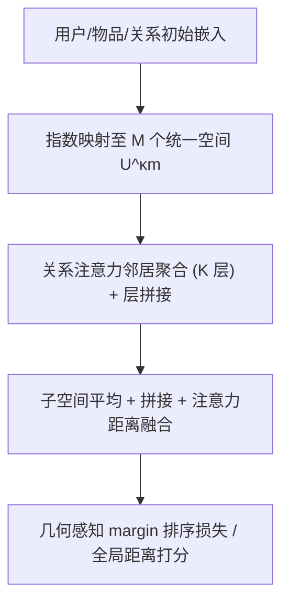

# Knowledge-based Multiple Adaptive Spaces Fusion for Recommendation (基于知识图谱的多自适应空间融合推荐)

- **会议/期刊**: RecSys 2023
- **作者与机构**: Meng Yuan, Fuzhen Zhuang, Zhao Zhang, Deqing Wang, Jin Dong（北航人工智能研究院、中科院计算所、北航软件学院、北京区块链与边缘计算研究院）
- **推荐链路定位**: 召回（KG 增强的 user-item 表征学习与距离打分）
- **研究方向**: 图神经网络与知识图谱推荐 / 协同过滤
- **论文原文**: [https://arxiv.org/abs/2308.15244v1](https://arxiv.org/abs/2308.15244v1)
- **开源代码**: 暂未开源

## TL;DR (1分钟核心速览)

KG 中树状与环状结构混杂，单一曲率空间（纯双曲或纯欧氏）建模必然产生几何失真，而现有混合曲率方案靠人工枚举流形组合或把曲率当自由参数训练（曲率跨正负跳变会破坏流形内部结构）。MCKG 用 κ-Stereographic 统一空间平滑插值三种常曲率几何，注意力加权融合 $M$ 个子空间的测地距离，并按「点到原点距离比」自适应设定 margin。在 ML-1M/LastFM/Book-Crossing 上以 1:100 采样排序评测，HR@20 相对最优基线最高提升 1.9%，NDCG@20 提升 3.3%。

## Background & Motivation (背景与核心矛盾)

- **主流范式**: KG 增强推荐（RippleNet / KGAT）在欧氏空间做高阶邻居聚合；非欧方法（HGCF / KBHP / LKGR）把用户-物品-实体图整体投到单一双曲空间，利用其指数膨胀特性刻画层次。
- **前人局限**: ① 常曲率单空间只能匹配一种几何——双曲适合树状、球面适合环状，真实 KG 二者耦合，单一空间必然扭曲；② 混合曲率方法（如产品流形）需人工枚举组合，而把 κ 设为可训练标量时，参数约束随 κ 变化（负→正），流形内部结构被破坏；③ 不同流形间存在异质性，直接对各自距离求和忽略了子空间重要性差异。
- **核心洞察 (Key Insight)**: 论文指出一个关键几何性质——双曲空间中两点远离原点时，比值 $\frac{dist(x,y)}{dist(x,o)+dist(y,o)}$ 单调增大（距离增长快于半径），球面空间恰好相反。该比值的走势正好可充当「该给多大 margin」的先验信号。
- **本文切入点**: 用可微插值的统一空间替代离散流形选择，再用注意力融合多子空间，并把 margin 变成几何位置的函数。

## Method (核心方法设计)

### 1. 整体框架 (Overall Architecture)

初始 user/item/relation 欧氏嵌入先经指数映射投到 $M$个统一空间$\mathcal{U}^{\kappa_m}$；每个空间内做带关系注意力的$K$层邻居聚合，层间嵌入拼接得子空间表征；随后对子空间取平均得全局表征并与之拼接，用实体级注意力加权各子空间测地距离得到全局距离$dist(u,v)$；训练采用几何感知 margin 的 pairwise ranking loss，推理时按该全局距离对候选物品排序。

### 2. 关键设计拆解 (Key Designs)

1. **κ-Stereographic 统一空间（让曲率可训练而不破结构）**：痛点是 κ 变化会导致参数约束失效。统一空间定义为 $\mathcal{U}^\kappa_n=\{x\in\mathbb{R}^n:\|x\|_2<1/\sqrt{-\kappa}\}$（$\kappa<0$）并配共形度量因子$\lambda^\kappa_x=\frac{2}{1+\kappa\|x\|_2^2}$，其加法/乘法/测地距离均可微，且能在$\kappa<0,\kappa=0,\kappa>0$间平滑插值，因此训练中曲率漂移不会破坏流形内部结构。测地距离为$d_\kappa(x,y)=2\tan^{-1}_\kappa(\|-x\oplus_\kappa y\|_2)$。

2. **多子空间注意力融合（解决流形异质性）**：痛点是不同流形距离量纲/重要性不可直接相加。先求全局均值 $e^{*,g}_v=\frac{1}{M}\sum_m e^{*,m}_v$，将各子空间表征改写为$e^{*,m}_v \ominus_\kappa e^{*,g}_v$（注入全局信息），再以实体级 softmax 权重$w'(e^{*,m}_u)=\frac{\exp(\alpha^m_u)}{\sum_i \exp(\alpha^i_u)}$融合：$dist(u,v)=\sum_{m=1}^{M}\big(w'(e^{*,m}_u)+w'(e^{*,m}_v)\big)d_\kappa(e^{*,m}_u,e^{*,m}_v)$，即 pair 重要性为用户与物品两侧注意力之和。

3. **几何感知 margin 与训练目标**：痛点是 HGCF 用常数 margin 无视双曲指数膨胀，HICF 反向地在原点附近设大 margin（与几何容量相悖）。MCKG 令 $m_g=\sigma\!\left(\frac{dist(u,i)}{dist(u,o)+dist(i,o)}\right)+c$，损失为$\mathcal{L}=\max\big(dist^2(u,i)-dist^2(u,j)+m_g,\,0\big)$。直觉：双曲空间原点附近容量窄→小 margin 区分高度相似正负样本，远端空间宽敞→大 margin 容忍误差；球面则自动反转。负采样为每用户 1 正 1 负的 pair 采样。

## Experimental Setup & Evaluation Protocol (实验设置与评估协议)

- **数据集与预处理**:

| 数据集 | #Users | #Items | #Interactions | 稀疏度/密度 | 特征/场景说明 |
| :--- | :---: | :---: | :---: | :---: | :--- |
| Movielens-1M | 6,036 | 2,347 | 753,772 | 5.3e-2 | KG 实体 16,954 / 关系 32，电影 |
| LastFM | 1,872 | 3,846 | 42,346 | 5.9e-3 | KG 实体 9,366 / 关系 60，音乐 |
| Book-Crossing | 17,860 | 14,910 | 139,746 | 5.2e-4 | KG 实体 25,787 / 关系 18，图书 |

- **数据划分与防穿越 (Splitting Strategy)**: 每个数据集随机 70% 训练 / 30% 测试（比例划分，未做全局时间戳切分）；未显式报告 `5-core` 过滤，ML-1M 沿用每用户 ≥20 评分版本。
- **排名评测协议 (Ranking Protocol)**: **Sampled Ranking**——每用户随机留 1 个正样本 + 采样 100 个未交互负样本（正负比 1:100）构造测试集，报告 HR@{10,20} 与 NDCG@{10,20}；**未使用 Full-Ranking 全库排序**。
- **对比基线与超参设置**: 基线含欧氏 KG 方法（RippleNet、KGAT）、双曲协同过滤（HGCF）与双曲 KG 方法（KBHP、LKGR）；采样邻居数 8（LastFM 为 4）、跳数 3、流形数默认 3、早停 20 epoch；未报告显著性检验。

## Key Experimental Results (实验关键数据)

### 1. 主实验对比 (Main Results)

| 数据集 | 方法 | HR@10 | HR@20 | NDCG@10 | NDCG@20 |
| :--- | :--- | :---: | :---: | :---: | :---: |
| Movielens-1M | HGCF | 0.602 | 0.763 | 0.376 | 0.392 |
| | RippleNet | 0.596 | 0.752 | 0.372 | 0.391 |
| | KGAT | 0.615 | 0.778 | 0.394 | 0.407 |
| | KBHP | 0.628 | 0.781 | 0.391 | 0.408 |
| | LKGR | 0.640 | 0.791 | 0.395 | 0.411 |
| | **MCKG** | **0.645** | **0.802** | **0.401** | **0.418** |
| | Improv. | +0.7% | +1.3% | +1.5% | +1.7% |
| LastFM | HGCF | 0.544 | 0.596 | 0.350 | 0.361 |
| | RippleNet | 0.562 | 0.611 | 0.361 | 0.372 |
| | KGAT | 0.571 | 0.614 | 0.364 | 0.377 |
| | KBHP | 0.612 | 0.645 | 0.387 | 0.406 |
| | LKGR | 0.628 | 0.678 | 0.396 | 0.418 |
| | **MCKG** | **0.635** | **0.691** | **0.405** | **0.432** |
| | Improv. | +1.1% | +1.9% | +2.2% | +3.3% |
| Book-Crossing | HGCF | 0.336 | 0.528 | 0.251 | 0.340 |
| | RippleNet | 0.368 | 0.547 | 0.281 | 0.359 |
| | KGAT | 0.379 | 0.551 | 0.309 | 0.356 |
| | KBHP | **0.398** | **0.609** | 0.344 | 0.390 |
| | LKGR | 0.380 | 0.582 | 0.324 | 0.364 |
| | **MCKG** | **0.402** | 0.603 | **0.348** | **0.392** |
| | Improv. | +1.0% | −1.0% | +1.1% | +0.5% |

### 2. 消融实验 (Ablation Study)

| 变体（HR@20 / NDCG@20） | ML-1M | LastFM | Book-Crossing |
| :--- | :---: | :---: | :---: |
| GCN + 常数 margin (c) | 0.783 / 0.402 | 0.682 / 0.411 | 0.534 / 0.356 |
| GCN + HICF margin (h) | 0.770 / 0.393 | 0.675 / 0.401 | 0.503 / 0.332 |
| GCN + 几何感知 (g) | **0.802 / 0.418** | **0.691 / 0.432** | 0.579 / 0.374 |
| GraphSage + (g) | 0.771 / 0.392 | 0.642 / 0.415 | **0.609 / 0.392** |
| Neighbor + (g) | 0.767 / 0.365 | 0.602 / 0.362 | 0.566 / 0.366 |
| 流形数 $M=1$（无融合） | 0.778 / 0.409 | 0.663 / 0.401 | 0.573 / 0.356 |
| $M=2$/$M=3$/$M=4$ | 0.793 / **0.802** / 0.800 | 0.685 / **0.691** / 0.688 | **0.609 / 0.608 / 0.609** |
| 传播深度 $d=1$/$2$/$3$ | 0.783 / **0.802** / 0.787 | **0.691** / 0.684 / 0.662 | 0.534 / **0.609** / 0.601 |

### 3. 关键实验发现 (Key Findings)

1. **margin 设计比聚合器选择更关键**：固定 GCN 聚合器，仅把常数 margin 换成几何感知 margin，ML-1M HR@20 从 0.783→0.802（+2.4%）、LastFM NDCG@20 从 0.411→0.432（+5.1%）；而 HICF 的 margin 反而低于常数 margin（0.770 < 0.783），证实「原点附近设大 margin」在双曲几何容量下是方向性错误。
2. **多空间融合有效但边际收益快速饱和**：$M=1\to3$在 ML-1M 带来 0.778→0.802（+3.1%）HR@20，但$M=3\to4$ 无增益（0.802→0.800），说明稀疏数据集的几何结构复杂度有限，盲目加流形只增开销。
3. **深度不单调、稀疏鲁棒性优于欧氏**：$d=3$ 时全部指标显著下滑（LastFM HR@20 0.691→0.662），长关系链引入噪声；训练比例 10%→90% 时 HR@20 降幅 MCKG 仅 3.2%，低于 HGCF 6.2% 与 KGAT 4.4%，且 10% 比例下 0.7805 已超过多数基线 90% 时的水平。

## Highlights & Limitations (亮点、对比与审稿批判)

- **与代表作对比 (vs. Prior Work)**: 相比 HGCF（纯双曲 + 常数 margin）与 KBHP/LKGR（双曲 + KG，但曲率单一或固定），MCKG 的差别在于把「空间选择」变为可微可学的连续插值并做多子空间注意力融合；相比 HICF 的 tail-aware margin，本文的 margin 由几何距离比驱动，方向与之相反且实验证明更优。
- **可迁移亮点**: ① 用 $\frac{dist(x,y)}{dist(x,o)+dist(y,o)}$ 这一无量纲比值驱动 margin/温度系数，可直接迁移到双曲序列推荐或球面聚类的对比学习温度设定；② 「子空间表征减均值再拼接」是一种轻量的跨空间信息共享 trick，可套用到任意多视图/多兴趣表征融合。
- **审稿级局限批判**: ① 评测仅为 1:100 采样排序，未做 Full-Ranking，且增益普遍在 0.5%–3.3% 区间、未报告显著性检验，Book-Crossing 的 HR@20 甚至低于 KBHP，结论稳健性偏弱；② 复杂度为 $O(\sum_m\sum_k N\cdot|s(v)|\cdot d_k)$，$M$个流形 ×$K$层聚合意味着$M$倍邻域采样与测地距离计算（含$\tan^{-1}_\kappa$ 三角运算），线上召回开销与显存占用未量化，工程落地性存疑。

## Rating (四维评分)

- **方法创新性 (Novelty)**: ⭐⭐⭐⭐ （首次将统一曲率空间 + 多子空间注意力融合引入 KG 推荐，几何感知 margin 由距离比推导，几何直觉清晰）
- **评估协议与实验扎实度 (Protocol & Experiments)**: ⭐⭐⭐ （仅 1:100 采样排序、无 Full-Ranking 与显著性检验，消融覆盖聚合器/深度/流形数较全但缺冷启动与线上验证）
- **写作与数学规范度 (Clarity & Rigor)**: ⭐⭐⭐⭐ （统一空间算子表与复杂度分析齐备，但 margin 公式括号与部分符号排版有瑕疵，缺少曲率 κ 学到的具体取值分析）
- **工业落地与复现价值 (Industrial & Practical Value)**: ⭐⭐⭐ （思路可复用，但未开源、多流形带来成倍采样与测地运算开销，需先做蒸馏或单流形近似才能上线）

