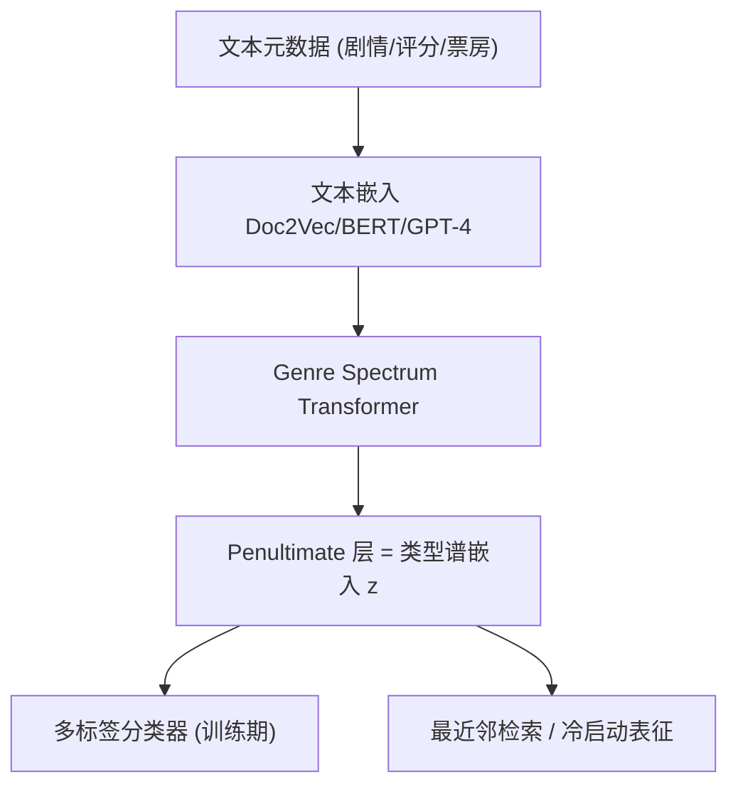
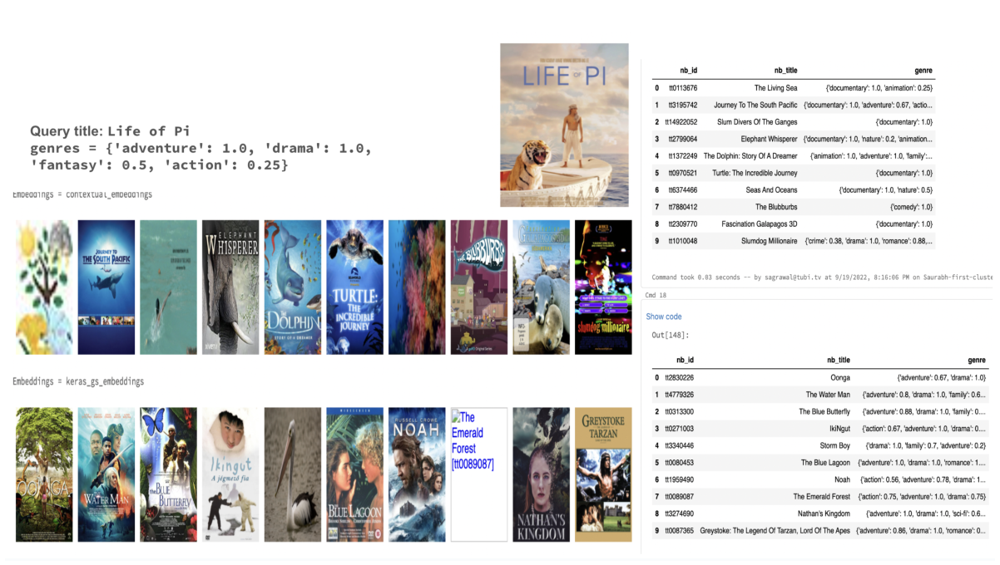

# Beyond Labels: Leveraging Deep Learning and LLMs for Content Metadata (超越标签：利用深度学习与大模型增强内容元数据)

- **会议/期刊**: RecSys 2023 (Industry Talk, 6 页短文)
- **作者与机构**: Saurabh Agrawal, John Trenkle, Jaya Kawale (Tubi, USA)
- **推荐链路定位**: 召回（基于观影历史的近邻检索模型，已上线）
- **研究方向**: 大语言模型推荐 / 冷启动与长尾推荐
- **论文原文**: [arXiv:2309.08787v1](https://arxiv.org/abs/2309.08787v1)
- **开源代码**: 暂未开源

## TL;DR (1分钟核心速览)

针对电影类型标签离散、噪声大、无法表达类型强度与混合风味的痛点，本文提出 **Genre Spectrum**：把文本元数据经多标签监督分类，取倒数第二层作为连续"类型谱"嵌入，并用特征+标签联合 Mixup 做 10 倍增广。在 1.1M 影视数据（60-20-20 划分）上按 IMDb 票数分桶评估 top-100 邻居类型相似度，低热度桶相对纯 Doc2Vec 提升约 12.9 个百分点；线上 A/B 在 tvt-capped 指标上取得 0.6% 统计显著提升。本质是把类型标签从"输入特征"变成"监督信号"，用稠密语义空间替代 one-hot。

## Background & Motivation (背景与核心矛盾)

- **主流范式**: 工业 VOD 平台直接把 genre 作为 one-hot/binary 类别特征喂入召回与排序模型，作为冷启动与内容表征的核心信号。
- **前人局限**: (1) 类型定义无统一共识，多源标注（IMDb/Rotten Tomatoes/Gracenote）互相矛盾、噪声大；(2) 离散标签丢失"强度"与"混合"——*Jurassic Park* 同时带有 sci-fi、adventure、horror、thriller 味道，纯标签无法刻画。
- **核心洞察 (Key Insight)**: 同一主类型下内容可天差地别（*Gladiator* 与 *Die Hard* 都是 action，但一个是古罗马史诗、一个是现代摩天楼恐袭），说明标签粒度不足以表达内容语义，需要把类型映射到连续谱空间。
- **本文切入点**: 以类型标签作为 *监督信号*（而非输入特征）学习一个连续隐空间，让每个类型表现为该空间中由多维组合定义的子空间。

## Method (核心方法设计)

### 1. 整体框架 (Overall Architecture)

先从 IMDb/Rotten Tomatoes/Gracenote 汇集约 110 万部影视的文本元数据（剧情简介、评分、票房、语言、年份等），用语言模型得到文本嵌入 $\boldsymbol{e}_{\text{text}}$；随后训练一个"文本→类型谱 transformer + 多标签分类器"的稠密前馈网络，两段联合端到端优化多标签交叉熵。训练完成后**只对 transformer 段做一次前向**，取倒数第二层输出$boldsymbol{z}$ 即为 Genre Spectrum 嵌入，在线用最近邻检索下线生成推荐与冷启动表征。

<figure class="paper-figure" markdown="span">
  <figcaption>图3. 电影 Life of Pi 在文本嵌入（Doc2Vec）空间（上图）与类型频谱嵌入空间（基于 Doc2Vec 训练，下图）中前10个近邻的比较。</figcaption>
</figure>

### 2. 关键设计拆解 (Key Designs)

1. **Genre Spectrum 监督嵌入（把离散标签变连续谱）**: 痛点在于 one-hot 无法表达强度与混合。做法是用多标签交叉熵把文本嵌入映射到隐空间，每个维度视为一种抽象内容概念，类型则由多维组合的子空间刻画：
$$\mathcal{L} = -\frac{1}{|\mathcal{G}|}\sum_{g\in\mathcal{G}}\left[y_g\log\hat{p}_g + (1-y_g)\log(1-\hat{p}_g)\right]$$
其中 $\hat{p}_g$为分类器对类型$g$ 的输出概率。直觉是：要同时预测多个相关但异质的类型，网络被迫在隐空间中学到有区分度的连续语义轴，从而泛化到低热度、元数据稀疏的影片。

2. **特征+标签联合 Mixup 增广（强化长尾）**: 低热度影片元数据短、标签少，纯监督仍易过拟合。作者采样两个样本做随机凸组合，同时作用于输入与标签：
$$\tilde{\boldsymbol{e}} = \lambda\boldsymbol{e}_i + (1-\lambda)\boldsymbol{e}_j,\quad \tilde{\boldsymbol{y}} = \lambda\boldsymbol{y}_i + (1-\lambda)\boldsymbol{y}_j$$
并对稀有类型加权以提升其表示，训练集扩增 10 倍。该做法在多标签场景下平滑了决策边界，显著改善冷门类型的覆盖。

3. **训练目标、负采样与推理效率**: 损失即上述多标签交叉熵，无显式负采样；推理只需一次前向取 penultimate 层，检索侧与常规双塔嵌入等价的近邻检索开销，无额外在线延迟。

## Experimental Setup & Evaluation Protocol (实验设置与评估协议)

- **数据集与预处理**: 从 IMDb / Rotten Tomatoes / Gracenote 三源汇总约 110 万电影与剧集。

| 数据集 | #Users | #Items | #Interactions | 稀疏度/密度 | 特征/场景说明 |
| :--- | :---: | :---: | :---: | :---: | :--- |
| Tubi 内容库 | N/A（内容侧） | ~1.1M | N/A | N/A | 电影+剧集文本元数据与类型标签，三源合并 |

- **数据划分与防穿越 (Splitting Strategy)**: `比例划分`，60% / 20% / 20%（train/val/test）。
- **排名评测协议 (Ranking Protocol)**: 非 CTR/Recall 类指标，而是**内容侧近邻评估**——对每部影片在嵌入空间取 top-$k=100$近邻中"共享至少一个主类型（multi-source 多数投票判定）"的比例作为类型相似度$\text{Sim@}100$；并进一步按 IMDb 票数分 7 个热度桶分别统计，以观察长尾行为。
- **对比基线与超参设置**: 基线为 Doc2Vec(96d)、预训练 BERT(768d)、GPT-4(1536d) 三种文本嵌入，及其各自加监督后的 GS 变体；另加 GS-Augmented。在线用 A/B 测试 tvt-capped（每日观看时长 4h 封顶）主参与度指标。

## Key Experimental Results (实验关键数据)

### 1. 主实验对比 (Main Results)

top-100 邻居类型相似度 (%)，按 IMDb 票数分桶（摘录原文 Table 1）：

| 嵌入方法 | [0,10] | [10,100] | [100,1k] | [1k,10⁴] | [10⁴,10⁵] | [10⁵,10⁶] | [10⁶,10⁷] |
| :--- | :---: | :---: | :---: | :---: | :---: | :---: | :---: |
| Doc2Vec (textual) | 65.60 | 68.96 | 76.66 | 84.07 | 88.08 | 88.54 | 92.30 |
| BERT (textual) | 40.27 | 44.64 | 53.07 | 60.89 | 65.26 | 64.74 | 72.44 |
| GPT-4 (textual) | 56.46 | 63.03 | 67.23 | 74.28 | 77.68 | 77.36 | 85.33 |
| **GS on Doc2Vec** | **78.50** | **83.28** | **89.84** | **94.43** | **96.48** | **96.45** | **97.89** |
| GS on BERT | 60.00 | 63.03 | 67.23 | 74.28 | 77.68 | 77.36 | 85.33 |
| GS on GPT-4 | 78.80 | 80.60 | 83.61 | 87.55 | 90.32 | 92.29 | 96.11 |
| **GS-Aug. on Doc2Vec** | **80.94** | **84.82** | **91.34** | **95.51** | **97.34** | **97.30** | **98.17** |
| *Improv. (GS-Aug vs Doc2Vec)* | *+15.34* | *+15.86* | *+14.68* | *+11.44* | *+9.26* | *+8.76* | *+5.87* |

### 2. 消融实验 (Ablation Study)

以 Doc2Vec 为底座，逐项剥离核心组件（同一数据集、同一协议）：

| 变体 | [0,10] | [100,1k] | [10⁴,10⁵] | [10⁶,10⁷] | 说明 |
| :--- | :---: | :---: | :---: | :---: | :--- |
| Doc2Vec (无监督) | 65.60 | 76.66 | 88.08 | 92.30 | 基线 |
| + GS 监督 (w/o aug) | 78.50 | 89.84 | 96.48 | 97.89 | 仅加多标签监督 |
| + GS + Mixup (完整) | **80.94** | **91.34** | **97.34** | **98.17** | 完整模型 |

### 3. 关键实验发现 (Key Findings)

1. **类型监督在所有热度桶全面增强文本嵌入**：GS on Doc2Vec 低热度桶相对无监督 Doc2Vec 提升 **+12.90** pts（78.50 vs 65.60），高热度桶仍提升 **+5.59** pts；说明隐空间被类型信号"拉紧"，而非仅对稀疏样本生效。
2. **收益随流行度递减，正好补足长尾**：$[0,10]$桶提升 12.9 pts 而$[10^6,10^7]$ 桶仅 5.59 pts，作者归因于低热度影片元数据差、文本嵌入不可靠，而类型监督相当于隐式去噪——这正是冷启动场景最需要的增益。
3. **Mixup 在低热度段收益最高**：GS-Augmented 相对 GS 在 $[0,10]$桶 +2.44 pts、在$[10^6,10^7]$ 桶仅 +0.28 pts，验证了稀有类型样本合成对长尾的有效性；线上 A/B 亦带来 tvt-capped **+0.6%** 的统计显著参与度提升，说明内容侧语义改善可传导至用户行为。需注意 **GS on BERT 全桶与 BERT 完全相同**，暗示强预训练语义上该监督并未提供额外增益，方法存在底座依赖性。

## Highlights & Limitations (亮点、对比与审稿批判)

- **与代表作对比 (vs. Prior Work)**: 相较于传统 one-hot genre 特征与纯无监督文本嵌入（Doc2Vec/BERT/GPT-4），本文的关键差异是把类型标签从"输入"转为"监督目标"，学习连续谱子空间；与仅用 LLM embedding 做内容表征的做法相比，其特征+标签联合 Mixup 在冷门内容上更有优势。
- **可迁移亮点**: (1) 取 penultimate 层作为可复用内容嵌入的"监督嵌入"套路，可低成本迁移到短视频、电商图文等其它内容域；(2) 多标签场景下的特征-标签联合 Mixup + 稀有类加权，是缓解长尾与冷启动的通用增广配方。
- **审稿级局限批判**: (1) **评估指标单一**——仅用 top-100 邻居的类型相似度衡量，未报告下游召回/排序的 CTR、Recall 等任务指标，与论文"推荐系统"定位存在脱节；线上仅 0.6% 提升且未披露检验细节。(2) **方法学薄弱且报告不完整**：GS on BERT 结果与 BERT 完全一致，疑似训练失败或直接复用，作者未作解释；无超参敏感性、无复杂度分析，作为 6 页 industry talk 更接近工程经验总结而非可复现研究。

## Rating (四维评分)

- **方法创新性 (Novelty)**: ⭐⭐⭐ （把类型标签转为多标签监督学连续谱的工程洞察实用，但 Mixup 与 penultimate 提取均为通用技巧，缺乏理论支撑）
- **评估协议与实验扎实度 (Protocol & Experiments)**: ⭐⭐⭐ （1.1M 数据 + 线上 A/B 是亮点，但仅有类型相似度指标、GS-on-BERT 异常未解释、无下游任务评估）
- **写作与数学规范度 (Clarity & Rigor)**: ⭐⭐⭐⭐ （工业案例叙述清晰、动机丰富，公式简洁，但技术细节与超参披露不足）
- **工业落地与复现价值 (Industrial & Practical Value)**: ⭐⭐⭐⭐ （已上线并产生真实参与度增益，配方可直接迁移到内容侧召回与冷启动，可惜未开源）

