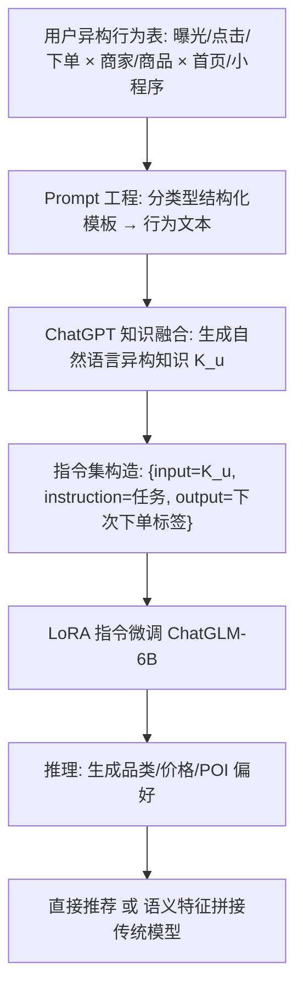

# Heterogeneous Knowledge Fusion: A Novel Approach for Personalized Recommendation via LLM (异构知识融合：基于大语言模型的个性化推荐新范式)

- **会议/期刊**: RecSys 2023 (Short Paper, 5 pages)
- **作者与机构**: Bin Yin, Junjie Xie, Yu Qin, Zixiang Ding, Zhichao Feng, Xiang Li, Wei Lin（美团外卖 / 独立研究者）
- **推荐链路定位**: 特征增强与召回侧语义补充（LLM 侧车，非端到端替换现有 DLRM）
- **研究方向**: 大语言模型推荐 / 冷启动与长尾推荐
- **论文原文**: [arXiv:2308.03333v2](https://arxiv.org/abs/2308.03333v2)
- **开源代码**: 暂未开源

## TL;DR (1分钟核心速览)

针对工业推荐中"多主体-多行为-多场景"异构行为直接拼接导致的**特征稀疏与知识割裂**（用户、商家、商品行为分开建模），本文提出 HKFR：先用 ChatGPT 把结构化异构行为改写成一段"自然语言异构知识"（如"该用户居住在沈阳，是学生，2 月浏览麦当劳，可能偏好尝试不同快餐品牌"），再用 20 类推荐任务指令以 LoRA 微调 ChatGLM-6B，使其直接生成用户对品类/价格/POI 的偏好。美团外卖离线（10k 测试指令，HR@5/NDCG@5/10）类别任务 HR@5 由 P5 的 0.1416 提至 0.2160（+52.5%），冷启动用户在线 A/B CTR +2.45%、GMV +3.61%。

## Background & Motivation (背景与核心矛盾)

- **主流范式**: 工业界把曝光/点击/下单、商家/商品、首页/小程序等异构行为不断"加宽"输入到 Caser/BERT4Rec 类序列模型或 DLRM 特征体系中，靠手工特征交叉挖掘兴趣。
- **前人局限**: ① 行为主体过多导致特征极度稀疏，长尾主体几乎学不到有效 embedding；② 用户、商家、商品行为**分开建模**，异构知识之间的语义关联被切断，无法做跨主体推理。
- **核心洞察 (Key Insight)**: 异构行为本身含丰富语义，用"自然语言语义"作为统一表示与推理媒介，可把稀疏 ID 交互升维为稠密语义知识，从而天然完成知识融合——这正是 LLM 的强项；而 P5 等工作只建模单一用户行为，忽略异构融合。
- **本文切入点**: 三阶段流水线：异构知识融合（ChatGPT 改写）→ 指令微调（ChatGLM-6B + LoRA）→ 推理输出推荐结果或语义特征。

## Method (核心方法设计)

### 1. 整体框架 (Overall Architecture)

系统以用户为中心从数据库抽取行为表，经 Prompt 工程按不同行为类型套入不同结构化模板转为"行为文本"；再由 ChatGPT 做知识融合，得到一段可读的异构知识画像 $\mathcal{K}_u$。随后把$\mathcal{K}_u$ 作为 input、推荐任务描述作为 instruction、用户下一次真实下单标签作为 output 构造指令集，对 ChatGLM-6B 做 LoRA 指令微调。线上推理时，取用户前一日搜索/行为知识 + 当日任务指令输入微调后 LLM，输出"用户偏好品类/价格/POI"的自然语言结果；该结果既可直接作为推荐答案，也可经编码后与传统推荐模型特征拼接做增强。最终以天级异步方式预计算知识、实时侧只做轻量前向，规避 LLM 在线延迟问题。

### 2. 关键设计拆解 (Key Designs)

1. **异构知识融合 (Heterogeneous Knowledge Fusion)**：解决"多主体稀疏 + 分体建模割裂"。做法是把原始行为 $\mathcal{B}_u$经模板渲染为文本$\mathcal{T}(\mathcal{B}_u)$，再由通用大模型生成融合知识：
$$\mathcal{K}_u=\mathrm{LLM}_{\text{fuse}}\big(\mathcal{T}(\mathcal{B}_u)\big),\quad \mathcal{K}_u=\text{"该用户为学生，常住沈阳，2/11 浏览麦当劳，或偏好尝试不同快餐品牌…"}$$
有效性直觉：LLM 把孤立 ID 行为"翻译"为带推断的语义句子，等价于对稀疏特征做**跨主体、跨场景的软补全与去噪**，且同一段文本可复用于多任务。

2. **推荐任务指令微调 (Instruction Tuning with LoRA)**：解决"LLM 预训练目标 ≠ 推荐目标"的语义鸿沟（表 1 中零样本 ChatGLM-6B 甚至弱于 BERT4Rec）。构建 20 类指令（品类/价格/商家偏好、下一次点击），以自回归负对数似然优化，仅更新低秩旁路：
$$\mathcal{L}=-\sum_{t}\log p_{\theta_0+\Delta\theta}\big(y_t\mid y_{<t},\mathcal{K}_u,\text{ins}\big),\qquad \Delta\theta=BA,\ B\in\mathbb{R}^{d\times r},\ A\in\mathbb{R}^{r\times k},\ r\ll d$$
直觉：低秩约束在保留通用语义能力的同时，把输出分布对齐到"外卖领域标签空间"，避免全参微调的灾难性遗忘与高成本。

3. **训练目标、负采样与推理效率**：总目标即上述 NLL（生成式范式，**无需负采样**、无显式 pairwise 排序损失）；数据侧 100k 用户构造 100 万条指令，序列截断 300，用户与 POI 输入前匿名化。推理侧采用"离线预计算知识 + 当日实时调用"的异步架构，LLM 只在特征/答案生成环节承担一次前向，避免进入高 QPS 精排主链路。

## Experimental Setup & Evaluation Protocol (实验设置与评估协议)

- **数据集与预处理**: 美团外卖 2023 年 3–4 月真实日志，构建 20 类指令；用户与 POI 均匿名化，序列截断 300。

| 数据集 | #Users | #Items | #Interactions | 稀疏度/密度 | 特征/场景说明 |
| :--- | :---: | :---: | :---: | :---: | :--- |
| Waimai-M (train) | 100,000 | 未披露 | 1,000,000 条指令 | 未披露 | 曝光/点击/下单 × 商家/商品 × 首页/小程序 |
| Waimai-M (test) | 10,000 条指令 | 未披露 | 10,000 | — | 2023-05-09 单日样本，含品类与 POI 两个任务 |

- **数据划分与防穿越 (Splitting Strategy)**: 采用**全局时间戳切分**（训练 3–4 月，测试 5 月 9 日），在线实验取 5/9–5/19；符合工业时序防泄漏要求，但测试仅单日，季节/促销波动敏感。
- **排名评测协议 (Ranking Protocol)**: 报告 HR@{5,10} 与 NDCG@{5,10}；论文**未明确候选集规模、未说明是全库 Full-Ranking 还是采样排序，也未报告训练负采样策略与显著性检验**，属于生成式评估口径（模型直接生成答案/排序），复现时需谨慎对齐。
- **对比基线与超参设置**: 序列模型 Caser、BERT4Rec；LLM 类 P5、零样本 ChatGLM-6B。基座 ChatGLM-6B + LoRA，学习率、rank $r$、batch 等关键超参未给出。

## Key Experimental Results (实验关键数据)

### 1. 主实验对比 (Main Results)

| 方法 | Cat HR@5 | Cat NDCG@5 | Cat HR@10 | Cat NDCG@10 | POI HR@5 | POI NDCG@5 | POI HR@10 | POI NDCG@10 |
| :--- | :---: | :---: | :---: | :---: | :---: | :---: | :---: | :---: |
| Caser | 0.1152 | 0.1063 | 0.2147 | 0.1320 | 0.0897 | 0.0770 | 0.1842 | 0.1012 |
| BERT4Rec | 0.1217 | 0.1140 | 0.2196 | 0.1440 | 0.0875 | 0.0744 | 0.1811 | 0.0995 |
| P5 | 0.1416 | 0.1384 | 0.2477 | 0.1589 | 0.1218 | 0.1159 | 0.2187 | 0.1260 |
| ChatGLM-6B (zero-shot) | 0.1074 | 0.1019 | 0.2038 | 0.1254 | 0.0785 | 0.0720 | 0.1702 | 0.0872 |
| **HKFR (ours)** | **0.2160** | **0.1586** | **0.3007** | **0.1840** | **0.1726** | **0.1243** | **0.2610** | **0.1525** |
| Improv. vs best baseline (P5) | +52.5% | +14.6% | +21.4% | +15.8% | +41.7% | +7.2% | +19.3% | +21.0% |

### 2. 消融实验 (Ablation Study)

| 变体 | Cat HR@5 | Cat NDCG@10 | POI HR@5 | POI NDCG@10 | ΔHR@5 (Cat) |
| :--- | :---: | :---: | :---: | :---: | :---: |
| HKFR$_{no-IT}$（去指令微调） | 0.1241 | 0.1415 | 0.1014 | 0.1165 | −42.5% |
| HKFR$_{no-HKF}$（去知识融合） | 0.1813 | 0.1580 | 0.1421 | 0.1270 | −16.1% |
| **HKFR (full)** | **0.2160** | **0.1840** | **0.1726** | **0.1525** | — |

### 3. 关键实验发现 (Key Findings)

1. **指令微调是主贡献，知识融合是增益放大器，两者强协同**：去掉指令微调后 Cat HR@5 从 0.2160 掉到 0.1241（仅略高于 BERT4Rec 0.1217），说明未对齐的 LLM 即使拿到优质异构知识也无法输出可比排序；而单独去掉知识融合仍保有 0.1813，表明二者非简单叠加，而是"知识提供信息、微调提供输出接口"的互补。
2. **零样本 LLM 在推荐上会显著劣于小模型**：ChatGLM-6B 零样本 HR@5 仅 0.1074/0.0785，低于 Caser 与 BERT4Rec，量化印证了"通用语义能力不等于推荐能力"，领域指令集是必要前置，而非可选调优。
3. **线上收益集中在冷启动用户**：5/9–5/19 A/B 中冷启动用户 CTR +2.45%、GMV +3.61%，其余用户无显著差异——异构知识对交互稀疏用户的语义补全价值最大；作者也坦言 LLM 缺乏餐饮领域专业知识，限制了在成熟用户上的进一步增益，需继续领域预训练。

## Highlights & Limitations (亮点、对比与审稿批判)

- **与代表作对比 (vs. Prior Work)**: 相较 Caser/BERT4Rec 等把异构行为当作**并列 ID 特征**喂入，HKFR 把行为升维为**统一自然语言知识**做跨主体推理；相较 P5 的单一行为 prompt 建模，本文显式引入"异构知识融合"阶段；相较零样本 ChatGLM，本文通过领域指令微调补齐任务错配。本质差异在于：知识融合模块把"特征工程"外包给通用 LLM 的语义先验，工程可插拔性远高于重训序列模型。
- **可迁移亮点**: ① "离线 LLM 生成自然语言画像 → 在线作为稠密语义特征拼接"这一侧车范式，可在不改动主模型结构的前提下低风险上线；② 用 20 类任务指令共享同一份知识文本，实现"一次融合、多任务复用"，显著摊薄 LLM 调用成本。
- **审稿级局限批判**: ① **评估协议严重欠规范**：未说明候选集构造（全库 or 采样）、未报告显著性检验、测试集仅单日 10k 条，且 HR/NDCG 在生成式输出下如何定义排名模糊，横向对比 P5/Caser 的可比性存疑；② **可复现性与成本**：无开源代码、超参与 LoRA rank 未披露，依赖 ChatGPT 做数据标注、ChatGLM-6B 做推理，离线 100 万指令的构造与微调成本高；③ 增益仅覆盖冷启动、对成熟用户无效，说明语义知识尚未真正替代协同信号，方法更像"冷启动补丁"。

## Rating (四维评分)

- **方法创新性 (Novelty)**: ⭐⭐⭐ （"异构行为→自然语言知识→指令微调"的范式转换清晰且有工业洞察，但三个模块均为既有技术（ChatGPT 改写 + LoRA + 指令集）的组合，缺少新的学习机制或理论支撑）
- **评估协议与实验扎实度 (Protocol & Experiments)**: ⭐⭐ （有离线双任务 + 消融 + 真实线上 A/B 值得肯定，但候选集/负采样/显著性检验全缺，测试集仅单日 10k 条，基线与本方法输入信息不对等）
- **写作与数学规范度 (Clarity & Rigor)**: ⭐⭐⭐ （5 页短文流水线叙述清楚、工业动机有说服力，但全文无形式化定义、无复杂度分析、超参与 Prompt 模板未给出）
- **工业落地与复现价值 (Industrial & Practical Value)**: ⭐⭐⭐⭐ （异步预计算知识 + 特征拼接的部署方式对高 QPS 场景友好，冷启动 CTR +2.45%/GMV +3.61% 的可观线上收益对业务极具参考价值，唯缺代码与细节）

