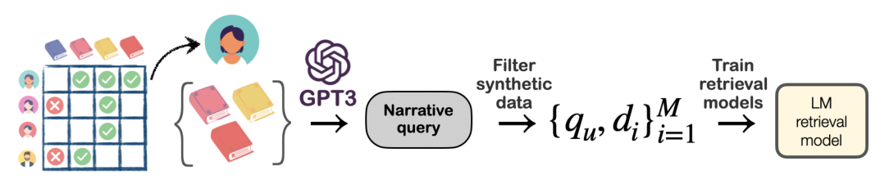
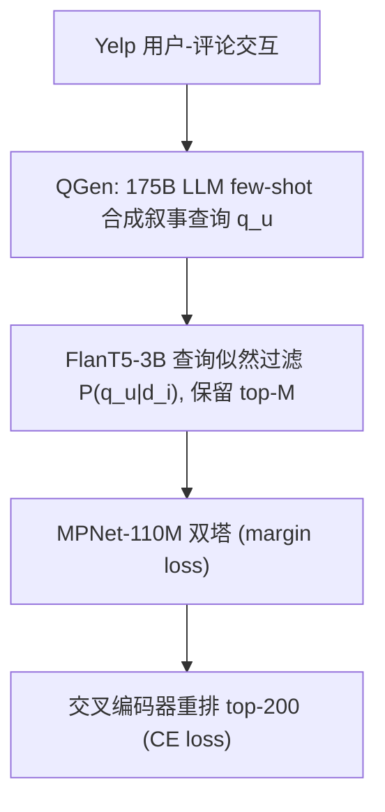

# Large Language Model Augmented Narrative Driven Recommendations (大语言模型增强的叙事驱动推荐)

- **会议/期刊**: RecSys 2023 (Camera-ready)
- **作者与机构**: Sheshera Mysore, Andrew McCallum, Hamed Zamani (UMass Amherst, CIIR)
- **推荐链路定位**: 召回（一阶段双塔）+ 重排（交叉编码器）
- **研究方向**: 大语言模型推荐 (LLM4Rec) / 冷启动与少样本适应
- **论文原文**: [https://arxiv.org/abs/2306.02250v2](https://arxiv.org/abs/2306.02250v2)
- **开源代码**: [https://github.com/iesl/narrative-driven-rec-mint](https://github.com/iesl/narrative-driven-rec-mint)

## TL;DR (1分钟核心速览)

叙事驱动推荐 (NDR) 要求系统依据用户上百字的长篇偏好叙述（而非历史 ID 交互）返回排序列表，但该任务**极度缺乏训练数据**：公开标注集仅 112 条查询。本文提出 Mint，用 175B InstructGPT 以 few-shot 方式把 Yelp 的「用户—评论」交互**反向合成**为叙事查询，再用 FlanT5-3B 的查询似然过滤噪声物品，最终训练 110M 的 MPNet 双塔与交叉编码器。在 Pointrec 候选池排序协议下，CrEnc-Mint 的 NDCG@10 达 0.3489、MAP 0.2192，超越 175B Grounded LLM 基线，且推理成本降低三个数量级。

## Background & Motivation (背景与核心矛盾)

- **主流范式**: 工业推荐依赖历史交互推断兴趣（协同过滤 / 双塔 ID 召回）；而论坛、对话式界面中用户实际发出的是包含偏好与场景的长篇叙述，当前平台普遍不支持此类查询。
- **前人局限**: 其一，NDR 标注数据稀缺（Bogers & Koolen 仅约 25k 条论坛帖，Pointrec 仅 112 条查询），无法监督训练；其二，直接用 LLM 生成推荐（Grounded LLM）虽有效，但 175B 自回归推理延迟与成本不可接受。
- **核心洞察 (Key Insight)**: 传统 CF 数据集（Yelp、Goodreads）中蕴含海量评论文本，本身就是"用户偏好 + 场景"的书面表达；可让 LLM 做**多文档摘要**，把一组已交互物品"倒推"成一条叙事查询，从而零人工地把 CF 数据转成 NDR 的检索训练对。
- **本文切入点**: 用大模型造数据、用小模型做检索——把昂贵 LLM 成本一次性摊销到离线数据合成上。

<figure class="paper-figure" markdown="span">
  <figcaption>图3. Mint 将常用于训练协同过滤模型的现成用户-物品交互数据集重新用于叙述驱动的推荐。其做法是借助大语言模型为用户喜欢的物品集合编写叙述式查询。数据经较小语言模型过滤，并在合成查询和用户物品上训练检索模型。</figcaption>
</figure>

## Method (核心方法设计)

### 1. 整体框架 (Overall Architecture)

Mint 是一条"离线造数 → 轻量检索"的流水线：从用户-物品交互集 $\mathcal{I}=\{(u,\{d_i\}_{i=1}^{N_u})\}$出发，取用户 10 条评论各 1 句送入 QGen（InstructGPT 175B，附 3 个手工 few-shot 叙事样例）生成叙事查询$q_u$；随后用 FlanT5-3B 计算$P_{LM}(q_u\mid d_i)$做物品过滤，保留 top-$M$构造合成训练集$\mathcal{D}=\{(q_u,d_i)\}$；最后在此数据上微调 MPNet-110M 的双塔（一阶段召回）与交叉编码器（二阶段重排），推理时双塔取 top-200 交由交叉编码器重排。

### 2. 关键设计拆解 (Key Designs)

1. **多物品条件化的叙事查询合成 (QGen)**：痛点在于 NDR 无查询-物品对；本文让 LLM 以**用户喜欢的一组物品文本**为条件（而非单物品）生成查询，等价于生成自然语言用户画像。这一步是全文性能的关键杠杆：换成 6B 模型生成同类查询，双塔 NDCG@5 从 0.3489 崩至 0.2336（甚至低于 BM25 的 0.2682），说明复杂长文本摘要必须依赖极大模型容量。

2. **查询似然物品过滤 (Query-Likelihood Filtering)**：一条叙事查询只覆盖用户兴趣的一个子集，未覆盖的物品会成为"假负样本"。作者沿用 ad-hoc 检索中的查询似然模型，仅保留
$$\mathcal{D}=\{(q_u,d_i)\mid d_i\in \mathrm{TopM}_{j}\,P_{LM}(q_u\mid d_j)\}$$
此处剔除每用户约 40% 的低分物品。直觉是：让监督信号与合成查询的语义跨度对齐，避免把"查询没提到"误判为"用户不喜欢"。

3. **训练目标、负采样与推理效率**：双塔以 L2 距离排序，采用 margin ranking loss
$$\mathcal{L}_{Bi}=\sum_u\sum_{i=1}^{M}\max\left[\lVert \mathbf{q}_u-\mathbf{d}_i\rVert_2-\lVert \mathbf{q}_u-\mathbf{d}'_i\rVert_2+\delta,0\right],\ \delta=1$$
负例 $d'$随机采样；交叉编码器以交叉熵$\mathcal{L}_{Cr}=\sum_u\sum_i \log\frac{e^{s}}{\sum_{d'}e^{s'}}$ 训练，负例**从双塔排名 100–300 的物品中采样**（硬负例）。总成本：合成查询约 USD 230 一次性支出，线上仅需 110M 双塔 ANN 检索 + 2×110M 重排，相比 175B 自回归方案延迟下降数个量级。

## Experimental Setup & Evaluation Protocol (实验设置与评估协议)

- **数据集与预处理**: 测试用 Pointrec（NDR 唯一公开人工标注集）；训练数据来自 Yelp，过滤评论数 <10 的用户与 POI，并要求平均评分 >3/5、10–30 条高于均分的评论，最终保留 45,193 用户，随机取 10,000 人生成查询，约 6 万训练样本。

| 数据 | 规模 | 说明 |
| :--- | :---: | :--- |
| Pointrec 查询 | 112 条 | 来自 Reddit 论坛，平均 130 词，分级相关度标注 |
| Pointrec 物品库 | 700k POI | 类别、城市元数据 + Bing 噪声文本片段 |
| Yelp 训练用户 | 45,193 / 采样 10,000 | 每用户 10 条评论各取 1 句入 prompt |
| 合成训练对 | ≈60,000 | 过滤掉 40% 低似然物品后 |

- **数据划分与防穿越**: 训练集（Yelp 合成）与测试集（Pointrec）**用户与物品集合完全不重叠**，仅要求同域（POI）；属于严格的 zero-shot 跨数据集泛化设定。
- **排名评测协议 (Ranking Protocol)**: 非全库排序，而是沿用 Pointrec 的**候选池约束排序**——只对查询指定城市与请求类别（如"餐厅"）内的候选 POI 排序，以剔除明显无关项；指标为 NDCG@5/10、MAP、MRR、Recall@100/200；作者明确说明因 @10 处约 70% 文档未被标注，报告值为**性能下界**。
- **对比基线与超参设置**: 无监督稀疏 BM25；零监督双塔 Contriver；大规模监督双塔 MPNet-1B（10 亿对）；BERT-MSM；无监督"交叉编码器"UPR（Contriver + FlanT5-3B 似然重排）；175B Grounded LLM（生成 10 个伪相关物品再近邻检索，跑 3 次取均值）。骨干统一 MPNet-base 110M（768 维），显著性用双侧 t 检验 $p<0.05$。

## Key Experimental Results (实验关键数据)

### 1. 主实验对比 (Main Results)

| 模型 | 参数量 | NDCG@5 | NDCG@10 | MAP | MRR | R@100 | R@200 |
| :--- | :---: | :---: | :---: | :---: | :---: | :---: | :---: |
| BM25 | - | 0.2682 | 0.2464 | 0.1182 | 0.2685 | 0.4194 | 0.5429 |
| Contriver | 110M | 0.2924 | 0.2776 | 0.1660 | 0.3355 | 0.4455 | 0.5552 |
| MPNet-1B | 110M | 0.3038 | 0.2842 | 0.1621 | 0.3566 | 0.4439 | 0.5657 |
| BERT-MSM | 110M | 0.3117 | 0.2886 | 0.1528 | 0.3320 | 0.4679 | 0.5816 |
| Grounded LLM | 175B+110M | 0.3558 | 0.3251 | 0.1808 | 0.3861 | 0.4797 | 0.5797 |
| UPR | 110M+3B | 0.3586 | 0.3242 | 0.1712 | 0.4013 | 0.4489 | 0.5552 |
| **BiEnc-Mint** | 110M | 0.3489 | 0.3263 | 0.1890 | 0.3982 | 0.4914 | **0.6221** |
| **CrEnc-Mint** | 2×110M | **0.3725** | **0.3489** | **0.2192** | **0.4317** | **0.5448** | **0.6221** |

CrEnc-Mint 相对最强基线 UPR：NDCG@5 +3.9%、MAP +28.1%、Recall@100 +21.4%；相对 BiEnc-Mint 自身，重排带来 NDCG@10 +6.9%、MAP +16.0%。

### 2. 消融实验 (Ablation Study)

| 配置 | NDCG@5 | NDCG@10 | MAP | MRR | R@100 |
| :--- | :---: | :---: | :---: | :---: | :---: |
| BiEnc-Mint | 0.3489 | 0.3263 | 0.1890 | 0.3982 | 0.5263 |
| − 无物品过滤 | 0.2949 | 0.2766 | 0.1634 | 0.3505 | 0.4979 |
| − QGen 换 6B | 0.2336 | 0.2293 | 0.1125 | 0.2287 | 0.4260 |
| − 6B 逐物品生成查询 | 0.3012 | 0.2875 | 0.1721 | 0.3384 | 0.4800 |
| CrEnc-Mint | 0.3725 | 0.3489 | 0.2192 | 0.4317 | 0.5448 |
| − 无物品过滤 | 0.3570 | 0.3379 | 0.2071 | 0.4063 | 0.5366 |
| − QGen 换 6B | 0.2618 | 0.2421 | 0.1341 | 0.3118 | 0.4841 |
| − 6B 逐物品生成查询 | 0.3792 | 0.3451 | 0.2128 | 0.4098 | 0.5546 |

### 3. 关键实验发现 (Key Findings)

1. **合成数据的"质"压倒"量"**：BiEnc-Mint 训练样本比 MPNet-1B 少 5 个数量级，却在 NDCG@5 上高出 0.0451（0.3489 vs 0.3038），说明基于真实用户兴趣分布条件化生成的查询，比通用弱监督/QA 对更贴合 NDR 语义。
2. **物品过滤是不可省的正则**：去掉似然过滤后，双塔 NDCG@5 掉 0.0540（−15.5%）、交叉编码器掉 0.0155，验证"查询未覆盖 ≠ 负例"的假负样本假设，过滤实为标签噪声清洗。
3. **QGen 规模存在硬阈值**：6B 模型生成查询使 CrEnc NDCG@5 跌至 0.2618（−29.7%）；而把任务简化为"逐物品生成查询"（45k 用户全用）虽在 CrEnc 的 NDCG@5 上微升至 0.3792，但 MAP/MRR 均下降（0.2128/0.4098），说明多物品条件化才是复现真实叙事偏好的关键。

## Highlights & Limitations (亮点、对比与审稿批判)

- **与代表作对比 (vs. Prior Work)**: 相较 UPR（3B 似然模型在线逐候选重排）与 Grounded LLM（175B 在线自回归生成伪相关物品），Mint 把大模型**完全移出推理链路**，仅留 110M 双塔 + 交叉编码器；相较 Leszczynski 等的对话搜索合成数据工作，本文任务从短对话检索升级为长叙事个性化推荐，且强调"一组文档 → 一条查询"的多文档摘要式生成。
- **可迁移亮点**: (1) 用"用户已交互文档集合"反推自然语言画像，可迁移到冷启动用户画像补全、跨域偏好迁移；(2) 用中等规模 LM 的查询似然做合成数据去噪，成本远低于人工标注或 LLM 自评。
- **审稿级局限批判**: 其一，评估面过窄——仅 112 条查询、单域 POI、且候选集被城市+类别先验裁剪，@10 处约 70% 未标注，实际指标是下界，结论稳健性受限；其二，合成数据沿袭 Yelp 热门偏好，长尾兴趣几乎不会被生成，且 LLM 产出查询结构高度同质，模型可能过拟合到"模板化叙事"，对真实论坛中风格迥异的长查询泛化存疑；其三，方法对 175B 模型有硬依赖（约 USD 230 合成成本 + 无法本地复现），并且需假定测试域与合成域同属一大类，跨域迁移边界未做量化。

## Rating (四维评分)

- **方法创新性 (Novelty)**: ⭐⭐⭐⭐ （首次将"LLM 多文档摘要式造查询"系统化用于 NDR，把 CF 数据集零成本转成检索监督信号，思路清晰但组件多为已有技术的组合）
- **评估协议与实验扎实度 (Protocol & Experiments)**: ⭐⭐⭐ （基线覆盖稀疏/稠密/LLM 四类且做显著性检验，但仅有单一 112 查询测试集、无大规模全库排序，且作者自认结果只是下界）
- **写作与数学规范度 (Clarity & Rigor)**: ⭐⭐⭐⭐ （任务定义与损失函数简洁明确，过滤与负采样动机交代充分；但缺少合成查询质量与真实查询分布差异的定量分析）
- **工业落地与复现价值 (Industrial & Practical Value)**: ⭐⭐⭐⭐ （代码与合成数据全开源，推理端仅 110M 双塔 + 重排即可上线，性价比极高；扣分在于离线造数依赖闭源 175B 接口）

