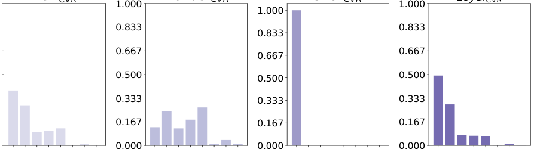
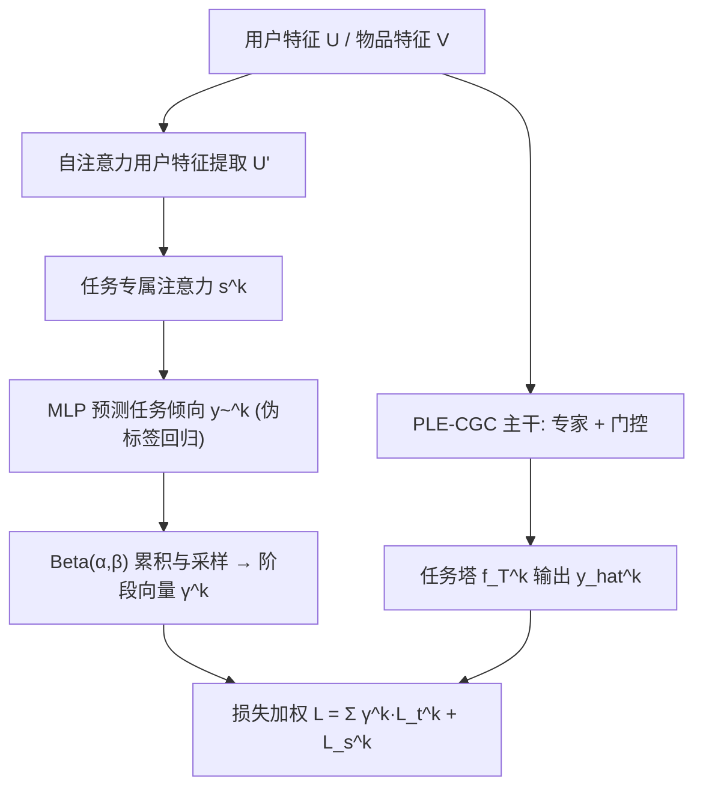
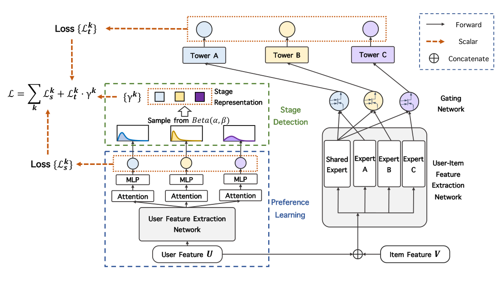

# STAN: Stage-Adaptive Network for Multi-Task Recommendation by Learning User Lifecycle-Based Representation (基于用户生命周期表征学习的阶段自适应多任务推荐网络)

- **会议/期刊**: RecSys 2023
- **作者与机构**: Wanda Li (清华大学，实习于 Shopee)、Wenhao Zheng / Xuanji Xiao (Shopee)、Suhang Wang (Penn State)
- **推荐链路定位**: 精排 (多任务多目标预估)
- **研究方向**: 多任务学习与列表级重排 / 序列与会话推荐
- **论文原文**: [https://arxiv.org/abs/2306.12232v1](https://arxiv.org/abs/2306.12232v1)
- **开源代码**: 暂未开源

## TL;DR (1分钟核心速览)

现有多任务推荐（MMoE/PLE）用**全局固定的损失权重** $\eta_k$聚合 CTR/停留时长/CVR 等目标，忽视了同一用户在不同生命周期阶段对各任务的偏好会漂移，也忽视了不同用户在同一阶段任务优先级本就不同。STAN 先用自注意力+任务专属注意力从用户历史行为中学出连续偏好表征，再把它喂入以 Beta 分布采样得到的阶段向量$\gamma^k$，用$\gamma^k$ 逐用户、逐阶段地缩放各任务损失。在 Wechat-Video 与 Shopee 直播电商工业集上，AUC 相对 MLPSingle 最高提升 18.47%，线上 A/B 停留时长 +3.05%、CVR +0.88%。

## Background & Motivation (背景与核心矛盾)

- **主流范式**: 以 MMoE / PLE / AITM 为代表，通过共享专家 + 门控网络缓解任务间参数冲突，把 CTR、CVR、停留时长等目标联合优化，最终以固定超参 $\eta_k$ 线性加权总损失。
- **前人局限**: (1) 固定 $\eta_k$ 对所有用户一视同仁——同一平台上"只想逛"的用户与"随时下单"的用户被同等对待；(2) 即便权重在训练集上拟合得当，用户偏好随时间迁移后权重即失效，导致 seesaw（跷跷板）现象——某个任务的 AUC 提升却以另一个任务 NDCG 下降为代价。
- **核心洞察 (Key Insight)**: 作者在 5 万真实用户的行为数据上按各指标中位数粗略划分出 New / Wander / Stick / Loyal 四个阶段，发现不同阶段的三项指标分布形状显著不同：New 阶段 CTR 集中在低值高斯区，Wander 阶段停留时长短但 CTR/CVR 偏高，Stick 阶段高 CTR、高停留、极低 CVR（只逛不买），Loyal 阶段三指标均稳定偏高。可见"阶段"是可从行为统计中辨识的隐变量。
- **本文切入点**: 不预设离散阶段标签，而是把阶段建模为**连续向量**（Beta 分布采样），并把该向量直接接入损失函数作为任务权重，让模型自动学出"该用户在当下最该被优化哪个目标"。

<figure class="paper-figure" markdown="span">
  <figcaption>图3. 不同阶段用户行为分布的比较。每行展示一个指标（即 CTR、Staytime 和 CVR），每列展示一个阶段。x 轴表示指标值。y 轴表示该阶段下该 x 值的百分比。</figcaption>
</figure>

## Method (核心方法设计)

### 1. 整体框架 (Overall Architecture)

STAN 由左右两支构成：左侧是**多任务预测主干**——沿用 PLE 的 CGC 结构（任务专属专家 + 共享专家 + 门控），输入 $\boldsymbol{x}_{ij}=[\mathrm{vec}(\mathbf{U}_i)^\top,\mathrm{vec}(\mathbf{V}_j)^\top]^\top$，门控权重$w_B^k=\mathrm{Softmax}(\mathbf{W}_B^k\boldsymbol{x}_{ij})$与专家组合$H^k=[\mathrm{Exp}_{sp}^k,\mathrm{Exp}_{sh}]^\top$做 Hadamard 积后送入任务塔$f_T^k$得到$\hat{y}_i^k$。右侧是**阶段检测支路**：先用自注意力对用户特征矩阵做特征重排得到$\mathbf{U}_i'$，再用任务专属注意力抽出各任务的用户偏好嵌入$s_i^k$，经 MLP 预测出与物品无关的"用户对任务 k 的倾向"$\tilde{y}_i^k$；$\tilde{y}_i^k$经 Beta 分布累积后采样出阶段向量$\gamma^k$，回传去缩放主干的各任务损失。两支联合端到端训练。

<figure class="paper-figure" markdown="span">
  <figcaption>图4. 所提出的生命周期自适应学习框架的架构。阶段检测网络用于学习基于用户阶段的任务偏好，以进行最终预测。</figcaption>
</figure>

### 2. 关键设计拆解 (Key Designs)

1. **用户偏好学习支路（无显式监督的软标签回归）**：痛点是阶段无标签、且单个样本的点击/购买行为随机性极大。做法是先做自注意力 $\mathbf{U}_i'=\mathrm{Softmax}\big(\tfrac{1}{\sqrt{d_1}}\mathbf{W}_Q\mathbf{U}_i(\mathbf{W}_K\mathbf{U}_i)^\top\big)\mathbf{W}_V\mathbf{U}_i$建模用户特征间长程依赖，再按任务做特征加权$s_i^k=\mathbf{U}_i'\odot\mathrm{Softmax}(\mathbf{W}^k\mathbf{U}_i')$，最后用历史滑动均值构造伪标签$l_i^k=\frac{1}{|\mathcal{D}_i|}\sum_{y_j^k\in\mathcal{D}_i}y_j^k$（$\mathcal{D}_i$为当前样本之前的全部历史）并以 MSE 回归：$\mathcal{L}_s^k=\sum_i(l_i^k-\tilde{y}_i^k)^2$。直觉是：单条行为噪声大，但"历史均值"是用户对该任务偏好的低方差估计，用它当软标签既稳定又无需人工标注。

2. **潜在阶段检测（Beta 分布刻画行为不确定性）**：痛点是多数用户历史行为稀疏，直接拿 $\tilde{y}^k$当权重会剧烈震荡。作者把$\tilde{y}^k$视为服从$\mathrm{Beta}(\alpha^k,\beta^k)$的随机变量，$\alpha^k$对应"做该动作的次数"、$\beta^k$对应"未做的次数"，并按时间序累积$\alpha_u^k\!\leftarrow\!\alpha_u^k+\tilde{y}_i^k c_u$、$\beta_u^k\!\leftarrow\!\beta_u^k+(1-\tilde{y}_i^k)c_u$（$c_u$为样本序号，越近的样本权重越大），再采样$\gamma_u^k\sim\mathrm{Beta}(\alpha_u^k,\beta_u^k)$。Beta 分布的方差随伪计数增大而收缩，天然实现了"样本越多、阶段判断越可信"的自动置信度调节，这正是稀疏用户所需的正则。

3. **训练目标与推理开销**：总损失 $\mathcal{L}=\sum_{k=1}^{K}\big(\gamma^k\cdot\mathcal{L}_t^k(\hat{y}^k,y^k)+\mathcal{L}_s^k(\tilde{y}^k,l^k)\big)$，其中$\mathcal{L}_t^k$为任务 k 的交叉熵（停留时长先做等频分桶转分类）。两支同时优化，阶段表征随$\mathcal{L}$ 下降而自我改进。无负采样设计（多任务精排为 pointwise 二分类），推理时阶段支路需按用户聚合历史伪标签并采样，线上限定 30 天窗口以控制存储与计算开销。

## Experimental Setup & Evaluation Protocol (实验设置与评估协议)

- **数据集与预处理**:

| 数据集 | #Users | #Train | #Valid | #Test | 特征/场景说明 |
| :--- | :---: | :---: | :---: | :---: | :--- |
| Wechat-Video (公开) | 0.02M | 6.71M | 0.61M | 0.43M | 微信视频号；任务为 like / click_avatar / forward |
| Industrial (工业) | 75.42M | 612.88M | 82.47M | 407.95M | Shopee 直播电商某场景；任务为 CTR / Staytime(等频分桶) / CVR |

- **数据划分与防穿越 (Splitting Strategy)**: 工业集按**全局时间戳切分**为 train/valid/test；偏好伪标签严格只使用**当前样本之前**的历史计算（式 10 的 $\mathcal{D}_i$定义为$i'<i$），避免未来信息泄漏。
- **排名评测协议 (Ranking Protocol)**: 离线为**全量曝光日志上的 pointwise 排序评估**，主指标 AUC + NDCG（公开集 NDCG@5，工业集因单用户曝光数极短而用 NDCG@1）；同时报告 RelaImpr，以 MLPSingle 为基准，AUC 版为 $\big(\frac{\text{AUC}_{m}-0.5}{\text{AUC}_{b}-0.5}-1\big)\times100\%$。
- **对比基线与超参设置**: MLPSingle（单任务）、MLPShared（共享底层）、MMoE、PLEvanilla、AITM、PLEstage（人工规则阶段特征 + PLE）以及消融版 STAN w/o Beta。所有模型隐藏单元上限统一 1024、Embedding 维度 $d=128$、batch 2048、Adam (lr=1e-3)，显著性用配对样本 t 检验$p<0.01$。

## Key Experimental Results (实验关键数据)

### 1. 主实验对比 (Main Results)

**Wechat-Video（AUC / NDCG@5）**

| 任务 | MLPSingle | MLPShared | MMoE | PLEvanilla | AITM | PLEstage | **STAN** | Improv.(AUC) |
| :--- | :---: | :---: | :---: | :---: | :---: | :---: | :---: | :---: |
| Like | 0.8233 | 0.8241 | 0.8260 | 0.8317 | 0.8312 | 0.8313 | **0.8419** | +5.76% |
| Like (NDCG) | 0.5652 | 0.5793 | 0.6042 | 0.6049 | 0.6437 | 0.6418 | **0.6737** | +10.85% |
| Click_avatar | 0.8230 | 0.8279 | 0.8286 | 0.8317 | 0.8442 | 0.8471 | **0.8530** | +9.30% |
| Click_avatar (NDCG) | 0.2129 | 0.2261 | 0.2295 | 0.2371 | 0.1993 | 0.2371 | **0.2499** | +3.70% |
| Forward | 0.8692 | 0.8751 | 0.8803 | 0.8805 | 0.8698 | 0.8837 | **0.8856** | +4.42% |
| Forward (NDCG) | 0.1317 | 0.1536 | 0.1515 | 0.1405 | 0.1392 | 0.1483 | **0.1581** | +2.64% |

**Industrial（AUC / NDCG@1）**

| 任务 | MLPSingle | MLPShared | MMoE | PLEvanilla | AITM | PLEstage | **STAN** | Improv.(AUC) |
| :--- | :---: | :---: | :---: | :---: | :---: | :---: | :---: | :---: |
| CTR | 0.7891 | 0.7938 | 0.8066 | 0.8056 | 0.8071 | 0.8089 | **0.8141** | +8.65% |
| CTR (NDCG) | 0.5727 | 0.5945 | 0.5895 | 0.5825 | 0.6440 | 0.6421 | **0.6737** | +10.10% |
| Staytime | 0.6635 | 0.6721 | 0.6770 | 0.6835 | 0.6801 | 0.6879 | **0.6937** | +18.47% |
| Staytime (NDCG) | 0.8029 | 0.8186 | 0.8270 | 0.8170 | 0.7993 | 0.8273 | **0.8399** | +3.70% |
| CVR | 0.7934 | 0.7998 | 0.8090 | 0.8217 | 0.8131 | 0.8192 | **0.8304** | +12.62% |
| CVR (NDCG) | 0.5617 | 0.6125 | 0.6198 | 0.6284 | 0.6026 | 0.6250 | **0.6601** | +9.84% |

### 2. 消融实验 (Ablation Study)

| 变体 | Wechat Like AUC | Wechat Click_avt NDCG | Wechat Forward AUC | Ind. CTR AUC / NDCG@1 | Ind. Staytime AUC | Ind. CVR AUC / NDCG@1 |
| :--- | :---: | :---: | :---: | :---: | :---: | :---: |
| STAN w/o Beta | 0.8413 | 0.2474 | 0.8846 | 0.8140 / 0.6739 | 0.6925 | 0.8267 / 0.6578 |
| **STAN (Full)** | **0.8419** | **0.2499** | **0.8856** | **0.8141** / 0.6737 | **0.6937** | **0.8304** / **0.6601** |

### 3. 关键实验发现 (Key Findings)

1. **阶段加权对稀疏/连续目标收益最大**：工业集上 Staytime 的 AUC 相对提升 18.47%、CVR 12.62%，远高于 CTR 的 8.65%。这与"停留时长是弱监督连续信号、其样本噪声最大"一致——越是标签噪声大的任务，越需要阶段向量去抑制无关样本的反向传播。
2. **Beta 模块主要修复稳定性而非均值**：消融显示去掉 Beta 后 CTR AUC 仅降 0.0001、NDCG@1 反而微升 0.0002，但 CVR AUC 从 0.8304 掉到 0.8267（$-0.37\%$），且原文明确报告 STAN w/o Beta 的多次运行波动更大。说明 Beta 的方差收缩效应在**转化类长尾稀疏任务**上才真正兑现价值。
3. **规则阶段特征远不如可学习阶段向量**：PLEstage（人工中位数切分阶段 + PLE）在工业集 CVR AUC 仅 0.8192，低于 PLEvanilla 的 0.8217，而 STAN 达 0.8304。规则阶段在阶段边界附近引入硬切分噪声，连续向量则能刻画阶段间的平滑过渡；图 7 的 t-SNE 也验证同一批 Day-1 处于 New 的用户在一个月后分别漂移到 Wander / Stick。

## Highlights & Limitations (亮点、对比与审稿批判)

- **与代表作对比 (vs. Prior Work)**: 与 PLE/AITM 的本质区别在于——PLE 通过**结构调整**（专家分离）解决任务冲突，AITM 通过**任务间信息传递**建模转化依赖，二者都是"全局共享同一套任务权重"；STAN 则是**样本级/用户级重加权**，把任务权重变成由用户历史决定的隐变量。相比同期的损失加权类工作（如 GradNorm、不确定性加权），STAN 的权重不是全局标量而是 per-user 的分布采样，且可解释为"生命周期阶段"。
- **可迁移亮点**: (1) Beta 伪计数累积 $\alpha\!+\!=\!\tilde{y}c,\ \beta\!+\!=(1-\tilde{y})c$ 是一套轻量的"置信度自适应"机制，可直接搬到 CTR/CVR 多目标、甚至对比学习的温度/权重调节上；(2) 用历史滑动均值构造软伪标签替代单样本硬标签，对任何 pointwise 多任务精排都是零成本降噪。
- **审稿级局限批判**: (1) **评估存在循环论证风险**——实验中的"真实阶段标签"由图 2/3 的中位数规则硬切分得到，而该方法恰恰是论文批评的对象，图 6 的 t-SNE 分离度只能证明 STAN 学到了与规则一致的结构，不能证明该结构就是真实生命周期；(2) **缺少强序列基线**（DIN/DIEN/SIM、MTL+序列建模），无法排除"性能增益其实来自用户行为序列信息而非阶段建模"这一替代解释；(3) 工业集仅用 NDCG@1 评估、用户曝光数极短，排名结论偏弱；(4) 训练时需为每个用户累积全历史 $\alpha/\beta$ 并按样本序加权，在线推理的存储与聚合开销论文只用"30 天窗口"一句带过，缺乏延迟量化；(5) 阶段采样引入随机性，多次运行方差在 STAN 全模型上反而比 w/o Beta 更大（如 Wechat Like AUC ±0.0006 vs ±0.0023，方向不一），复现稳定性存疑。

## Rating (四维评分)

- **方法创新性 (Novelty)**: ⭐⭐⭐⭐ （首次把"用户生命周期"引入多任务精排，Beta 采样做阶段表征并直连损失权重，机制简洁且有行为分布分析支撑，但本质仍是样本级损失重加权）
- **评估协议与实验扎实度 (Protocol & Experiments)**: ⭐⭐⭐ （公开+工业+线上 A/B 三线验证、$p<0.01$ 显著性检验到位，但阶段标签来自规则切分造成循环验证，且缺序列强基线）
- **写作与数学规范度 (Clarity & Rigor)**: ⭐⭐⭐⭐ （公式链条完整、算法 1 给出 $\alpha/\beta$更新伪代码，但符号$\mathcal{D}_i$ 定义与式 10 的时间索引表述含混，Beta 参数的梯度路径未展开）
- **工业落地与复现价值 (Industrial & Practical Value)**: ⭐⭐⭐⭐ （已在 Shopee 主流量全量部署，线上 CTR +3.94%/停留 +3.05%/CVR +0.88%，30 天窗口的工程折中务实；但未开源，复现需自行补齐数据管线）

