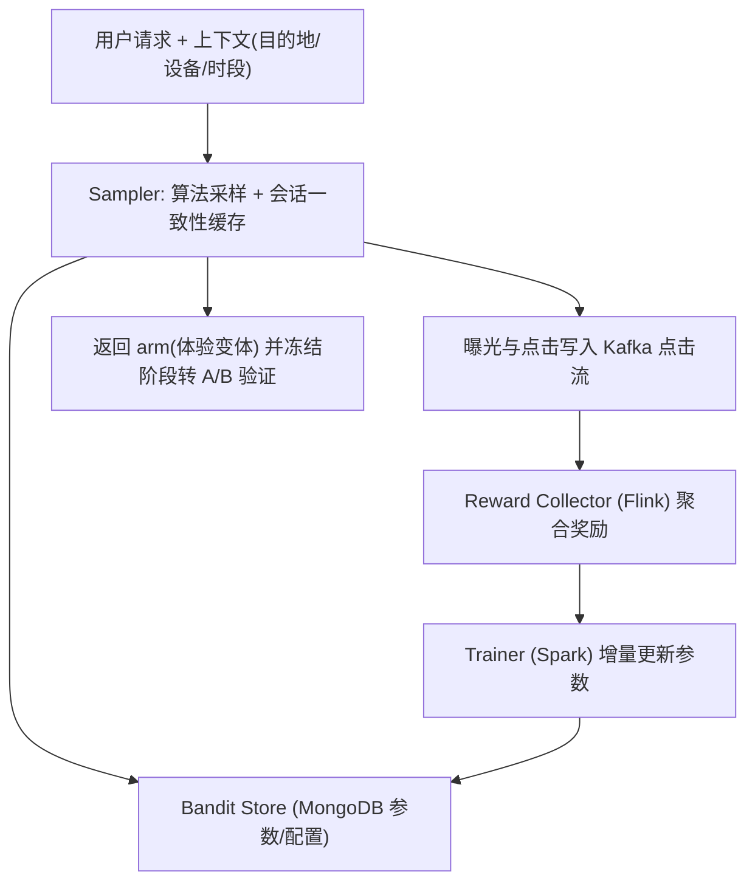

# AdaptEx: A Self-Service Contextual Bandit Platform (AdaptEx：一个自服务的上下文多臂老虎机平台)

- **会议/期刊**: RecSys 2023（17th ACM Conference on Recommender Systems，Industry/系统短文，4 页）
- **作者与机构**: William Black, Ercument Ilhan, Andrea Marchini, Vilda Markeviciute（Expedia Group，四位作者同等贡献）
- **推荐链路定位**: 重排 / 线上实验层（页面模块内容、Hero 图、列表排序的在线决策）
- **研究方向**: 强化学习与动态探索推荐 / 去偏公平与工业架构
- **论文原文**: [https://arxiv.org/abs/2308.08650v1](https://arxiv.org/abs/2308.08650v1)
- **开源代码**: 暂未开源

## TL;DR (1分钟核心速览)

本文针对旅游电商“变体组合爆炸、A/B 测试周期长、内容持续更新导致永久冷启动”的痛点，提出 Expedia 内部落地的自服务平台 AdaptEx：以 Sampler（在线采样）–Kafka 点击流–Flink 奖励聚合–Spark 参数训练–MongoDB Bandit Store 构成实时闭环，把 MAB 从“算法代码”产品化为一次 API 调用即可实例化的服务。平台内置 EG/TS/Exp3、上下文 TS、BLR/RLS、IGW、级联 Bandit、Gini 多目标聚合与低延迟 Greedy Search。该文为工业系统论文，**不含离线基准表与显著性检验**；报告的收益为业务侧量化：~10 个候选的模块选优从“约 10 次 A/B 测试”压缩到 1 周内出结论，100+ 变体 × 1000+ 客群的个性化从不可能变为 2–4 周。

## Background & Motivation (背景与核心矛盾)

- **主流范式**: 旅游 OTA 的体验优化依赖固定变体的 A/B 测试，配合离线训练的排序/推荐模型；MAB 在学术界已是成熟工具，但工程上仍是“每个团队各写一份脚本”。
- **前人局限**: 其一，传统 A/B 需要对**每个**变体累积足够样本才达统计显著，变体数 $K$增大时总成本近似线性膨胀，而这正是“模块内容 × 设计 × 位置”组合（可达$10^5$ 量级臂-上下文组合）的常态；其二，酒店图片、促销内容高频刷新，历史模型迅速失效，形成持续“冷启动”，离线重训跟不上内容变化节奏。
- **核心洞察 (Key Insight)**: 在产品迭代场景里，“**尽快丢掉明显次优解**”比“精确估计每个臂的期望收益”更有价值——探索-利用能把这部分试错成本从均匀分配变为自适应分配；而阻碍落地的不是算法，是**没有自服务化的实时反馈闭环**。
- **本文切入点**: 把 Bandit 做成平台能力：客户只调 API 配置臂/上下文/奖励并打点，无需部署模型，平台侧完成采样、奖励回传、增量训练与参数热更新。

## Method (核心方法设计)

### 1. 整体框架 (Overall Architecture)

一次请求进入 Sampler（Spring Boot 水平自动扩缩容服务），Sampler 周期性从 MongoDB 支撑的 Bandit Store 拉取最新参数，按配置算法采样一个 arm 并返回；同会话机制由 consistency cache 保证用户在一次 session 内看到的体验不抖动（避免同类实验内部自相矛盾）。用户交互写入 Kafka 点击流，Reward Collector 用 Flink 作业抽取与 bandit 相关的曝光/点击事件并聚合成 reward，经第二个 Kafka topic 批量送入 Trainer，Trainer 以 Spark 作业按所选算法做增量参数更新，回写 Bandit Store，闭环完成。学习阶段结束后可冻结最优 arm，再与原对照组做严格 A/B 验证，从而与既有实验体系兼容。

### 2. 关键设计拆解 (Key Designs)

1. **上下文 Bandit 的线性后验体系（BLR / RLS 双通道）**：痛点是非线性模型推理贵且需要独立部署；本文对不同奖励类型给两条线性增量更新路径——二值奖励用贝叶斯逻辑回归的拉普拉斯近似维护每个臂的精度矩阵，连续奖励用递归最小二乘：
   $\boldsymbol{\Sigma}_a^{-1}\!\leftarrow\!\boldsymbol{\Sigma}_a^{-1}+\boldsymbol{x}\boldsymbol{x}^{\top},\quad p(y=1\mid\boldsymbol{x},a)=\sigma(\boldsymbol{x}^{\top}\boldsymbol{\theta}_a)$；
   $\boldsymbol{\theta}_a\!\leftarrow\!\boldsymbol{\theta}_a+\frac{\boldsymbol{\Sigma}_a\boldsymbol{x}}{1+\boldsymbol{x}^{\top}\boldsymbol{\Sigma}_a\boldsymbol{x}}\big(r-\boldsymbol{x}^{\top}\boldsymbol{\theta}_a\big)$。
   直觉：$O(d^2)$的单样本闭式更新可在 Spark 微批内完成，无需反向传播与模型发布，天然适配秒级参数热更。TS 采样$\tilde{\mu}_a\sim p(\mu_a\mid\mathcal{D}_{t-1})$后取$a_t=\arg\max_a \tilde{\mu}_a$，后验收缩即自动退火探索。
2. **减少无效探索的三类算子（IGW / 级联 / Gini 标量化）**：均匀探索在“臂很多但差距很大”时浪费曝光，IGW 按期望收益 gap 赋采样概率 $p_t(a)\propto\hat{\Delta}_t(a)=\max_{a'}\hat{\mu}_t(a')-\hat{\mu}_t(a)$，把预算集中到接近最优的候选；需要排序时用级联 Bandit 逐位建模点击概率$P(\text{click}_i)=\theta_{a_i}\prod_{j<i}(1-\theta_{a_j})$，把“列表曝光”转成序列决策；多目标（点击/忠诚/预订）用广义 Gini 聚合把向量奖励标量化到帕累托前沿，避免手调线性权重。
3. **训练目标、奖励与推理延迟**：平台不存在单一损失函数，等价目标是逐步最小化累积 regret（TS/EG/Exp3 等经典算法被选中恰因其对**延迟反馈**鲁棒，适合预订这种长转化链路）；推理端每个请求需遍历 $K$个臂，故引入 Greedy Search 在时延预算内求精确或近似的$\arg\max$，以极小的最优性损失换取硬性 SLA；无负采样概念，学习信号完全来自曝光打点后的隐式奖励。

## Experimental Setup & Evaluation Protocol (实验设置与评估协议)

- **数据集与预处理**: 本文为**工业系统论文，未使用公开数据集、未报告离线指标**；评估载体是 Expedia Group 多品牌线上流量。为避免渲染不存在的基准，此处改为汇总论文给出的平台能力/规模表：

| 场景（论文用例） | 臂空间规模 | 上下文/客群 | 论文报告周期 |
| :--- | :---: | :---: | :---: |
| 单模块内容选优（非上下文） | ~10 个候选 | 全局 | 最快 1 周 |
| 多模块内容/设计/位置联合个性化 | ~100 种组合 | >1000 客群（行程类型、POS） | 2–4 周 |
| 臂-上下文组合总量 | — | — | >100,000 组合 |
| Hero 图选优 / 页面模块排序 | 数十项，百万级排列 | 房源/页面维度 | 论文未量化 |

- **数据划分与防穿越 (Splitting Strategy)**: 不使用离线划分；采用**在线时间序贯（online / streaming）**评估，奖励按事件时间由 Flink 窗口聚合，训练仅使用已发生交互，天然无穿越风险。
- **排名评测协议 (Ranking Protocol)**: 非 `Full-Ranking` 亦非 `Sampled Ranking`。两段式协议：(i) **学习阶段**在线探索并按业务指标累积奖励；(ii) **冻结阶段**固定 Bandit 认定的最优 arm，与原对照做固定分流 A/B 测试以获取统计显著性——这是本文最值得借鉴的“Bandit 找候选、A/B 做裁决”双轨协议。
- **对比基线与超参设置**: 基线是**传统 A/B 测试 / 对照组体验**（非算法基线）；未报告上下文维度 $d$、折扣因子、批量窗口大小等超参，也未做显著性检验（仅声明 A/B 阶段用于确保显著）。

## Key Experimental Results (实验关键数据)

### 1. 主实验对比 (Main Results)

原文没有主实验表格与百分比提升，只能给出**效率对比的定性/业务量化结论**（下表整理自第 4 节叙述，非实测指标）：

| 对比对象 | 达成同等结论所需成本 | 变体规模可扩展性 |
| :--- | :--- | :--- |
| 传统 A/B（逐变体测试） | 约 10 次串行 A/B，≈10 倍时长 | 每个变体单独测试，组合爆炸不可行 |
| AdaptEx（非上下文 MAB） | 1 周内锁定胜出变体 | ~10 候选 |
| AdaptEx（上下文 MAB） | 2–4 周完成 100+ 变体 × 1000+ 客群 | >10^5 臂-上下文组合 |

### 2. 消融实验 (Ablation Study)

论文**未提供消融实验**。可据方法描述整理“组件—作用”替代表：

| 组件 | 去除后的预期后果 |
| :--- | :--- |
| consistency cache | 同会话内 arm 抖动，用户体验不一致、奖励信号被污染 |
| Greedy Search | 大臂空间下逐臂遍历超时，无法满足在线 SLA |
| IGW / gap 加权 | 探索预算被明显次优臂摊薄，收敛变慢 |
| 冻结 + A/B 复核 | 只有在线收益、缺少统计显著的因果证据 |
| Flink 奖励聚合 | 延迟反馈无法对齐到具体 arm，训练样本错配 |

### 3. 关键实验发现 (Key Findings)

1. **平台化带来的收益是非线性的**：变体从 ~10 扩展到 100+ 时，A/B 的测试成本线性上升而 MAB 近似不变，因此“100 变体 × 1000 客群 = 10^5 组合”这一档从“不可行”变为“2–4 周可解”，这是平台价值最集中的区间。
2. **经典 TS/EG/Exp3 被选中是因为延迟反馈鲁棒性而非精度**：OTA 预订转化链路长、奖励稀疏且延迟，能在 Spark 微批上稳定增量更新比追求更强函数逼近更关键——这也解释了作者把非线性模型列为首要 Future Work。
3. **自服务化是核心增量**：客户零模型部署、仅需打点，即可按业务指标（互动、忠诚、预订）自定义奖励；平台的能力边界由“算法清单 + API”而非“某个模型”决定，这是与单点 Bandit 论文的本质差异。

## Highlights & Limitations (亮点、对比与审稿批判)

- **与代表作对比 (vs. Prior Work)**: 相对 Li 等 LinUCB 类上下文 Bandit 工作，本文不追求 regret 界更紧或表征更强（仍停留在线性模型），而把贡献放在**系统闭环与算法可选性**；相对 Netflix/Spotify 的在线实验平台类工作，其差异是把“实验配置权”下放给产品团队，用 consistency cache 与冻结-A/B 双轨解决工业可用性；相对通用 MAB 库（如 Vowpal Wabbit 风格的算法工具箱），本文补上了奖励回流、参数热更与低延迟采样三段工程链路。
- **可迁移亮点**: (i) “一致性缓存 + 会话级锁定”可迁移到任何在线探索系统，显著降低探索对体验的伤害；(ii) “Bandit 学习期 → 冻结 → A/B 裁决”的双轨评估协议，是把在线学习结果纳入严格实验体系的可复制范式；(iii) 用 gap 加权采样（IGW）替代均匀探索，在多候选、差距大的场景可直接复用。
- **审稿级局限批判**: (i) **证据强度不足**：4 页短文无离线基准、无显著性数值、无线上 A/B 的具体提升百分比，所有收益均为定性叙述，无法复现或横向比较；(ii) **表达力与延迟的两难**：线性 BLR/RLS 难以刻画复杂奖励动态，而 Greedy Search 只保证近似最优，二者的精度损失未做量化；同时多算法并存但缺少“何时选哪个算法”的选型准则与超参敏感性分析。

## Rating (四维评分)

- **方法创新性 (Novelty)**: ⭐⭐⭐ （算法本身均为经典组合，创新在自服务化平台与冻结-A/B 双轨协议的系统设计，而非理论贡献）
- **评估协议与实验扎实度 (Protocol & Experiments)**: ⭐⭐ （无离线基准、无消融、无显著性数值与提升幅度，仅有业务周期与规模描述）
- **写作与数学规范度 (Clarity & Rigor)**: ⭐⭐⭐ （架构与算法清单清晰、公式与复杂度未展开，作为系统短文尚可但严谨度有限）
- **工业落地与复现价值 (Industrial & Practical Value)**: ⭐⭐⭐⭐⭐ （真实大规模上线、闭环组件与延迟优化明确，对自建在线探索平台的团队具有高参考价值，但因未开源复现成本中等）

