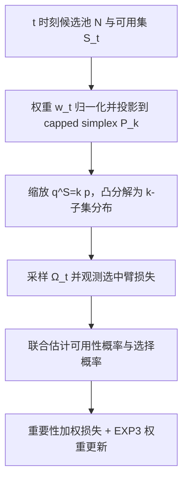

# Adversarial Sleeping Bandit Problems with Multiple Plays: Algorithm and Ranking Application (面向在线候选生成的对抗睡眠多臂老虎机算法)

- **会议/期刊**: RecSys 2023
- **作者与机构**: Jianjun Yuan, Wei Lee Woon, Ludovik Coba (Expedia Group)
- **推荐链路定位**: 召回 / 在线候选生成（后续交精排）
- **研究方向**: 强化学习与动态探索推荐
- **论文原文**: [arXiv:2307.14549v1](https://arxiv.org/abs/2307.14549v1)
- **开源代码**: 暂未开源

## TL;DR (1分钟核心速览)

针对电商推荐中候选池动态缺货且每次需选多个候选的在线召回问题，本文将对抗损失、未知 i.i.d. 可用性与多臂选择统一为 Sleeping Bandit with Multiple Plays，扩展 Sleeping EXP3，用 capped simplex 投影与可用性联合概率估计处理多选和缺臂，理论上证明 $R_T\le O(kN^2\sqrt{T\log T})$。但原文无离线/线上实验，排序应用仅停留在问题建模。

## Background & Motivation (背景与核心矛盾)

- **主流范式**: 召回常用离线双塔/ANN 或 bandit 在线探索；bandit 适合偏好漂移、曝光偏差与冷启探索。
- **前人局限**: 单臂 sleeping bandit 每步只选一个臂；multiple-play bandit 不支持候选缺臂。二者同时存在时，若损失和可用性均对抗则问题 NP-hard；实际电商库存频繁不可用，却需一次选 $k$ 个候选。
- **核心洞察 (Key Insight)**: 在损失有界对抗、可用性为未知 i.i.d. Bernoulli 且与损失独立时，可把多选策略限制在 capped simplex，并用 $k$-corner 凸分解恢复 EXP3 的遗憾分析。
- **本文切入点**: 将单臂 Sleeping EXP3 扩展到 $k$ 臂，联合估计“算法随机性 + 可用性随机性”。

## Method (核心方法设计)

### 1. 整体框架 (Overall Architecture)

每轮 $t$输入候选池$[N]$、可用集$S_t$与权重$w_t$。先在可用臂上归一化得到$p$，若$p\notin\mathcal{P}_k$则投影到 capped simplex；再缩放为$q^S=k p$，并凸分解为若干$k$-子集分布，采样$\Omega_t$。仅观测$\Omega_t$ 内损失后，联合估计可用性分布与选择概率，构造重要性加权损失，最后用 EXP3 乘性权重更新。整体是“投影—分解—采样—估计—更新”的在线闭环。

### 2. 关键设计拆解 (Key Designs)

1. **Capped Simplex 投影与 $k$-子集凸分解**：经典 EXP3 在概率单纯形上工作，但多选要求单臂概率不超过$1/k$。本文定义$\mathcal{P}_k=\{q:\sum_i q_i=1,0\le q_i\le1/k\}$，将$p$投影后缩放为$q^S(i)=k\hat p(i)$；任意$q^S/k\in\mathcal{P}_k$可写成$q^S=\sum_\Omega q_\Omega\mathbf{1}_\Omega$，其中每个$\Omega$含$k$个臂。这样无需把$\binom{N}{k}$个动作显式当臂，仍可按$q_\Omega$采样，使期望损失与$k$ 倍遗憾对齐。

2. **Sleeping 可用性联合概率估计**：缺臂使“被选中概率”不再只由算法决定，还受可用性影响。本文估计 $\hat a_t(i)=\frac{1}{t}\sum_{j=1}^t\mathbb{I}(i\in S_j)$，并构造$\hat P_a(S)=\prod_i\hat a_t(i)^{\mathbb{I}(i\in S)}(1-\hat a_t(i))^{1-\mathbb{I}(i\in S)}$，再得$\hat q_t(i)=\sum_S\hat P_a(S)q_t^S(i)$。损失估计为$\hat\ell_t(i)=\ell_t(i)/(\hat q_t(i)+\lambda_t)$（仅选中臂非零），$\lambda_t$ 用于压低重要性权重方差。

3. **训练目标、负采样与推理效率**：目标是最小化累计损失 $\sum_t\sum_{i\in\Omega_t}\ell_t(i)$，无负采样，bandit 仅反馈被选臂损失。权重更新为$w_{t+1}(i)=w_t(i)\exp(-\eta\hat\ell_t(i))$，取$\eta=\sqrt{\ln(N/k)/(NT)}$、$\delta=N/T^2$。精确联合估计需枚举可用子集，每轮$O(2^k)$；用$\tilde q_t(i)=\frac{1}{t}\sum_{\tau=1}^t q_{S_t^{(\tau)}}(i)$的经验估计可降至$O(tK)$，并保持同阶遗憾界。

## Experimental Setup & Evaluation Protocol (实验设置与评估协议)

- **数据集与预处理**: 原文未提供任何数据集、过滤方式或统计表，属于纯理论算法论文。

| 数据集 | #Users | #Items | #Interactions | 稀疏度/密度 | 特征/场景说明 |
| :--- | :---: | :---: | :---: | :---: | :--- |
| 无（原文未报告） | — | — | — | — | 仅以 $N,k,T$ 抽象符号建模 |

- **数据划分与防穿越 (Splitting Strategy)**: 无 `Leave-One-Out`、比例划分、全局时间戳切分或冷启动划分；未做离线评估。
- **排名评测协议 (Ranking Protocol)**: 无 `Full-Ranking` 或 `Sampled Ranking`；未报告 Recall/NDCG/CTR 等排序指标。
- **对比基线与超参设置**: 仅理论对比单臂 Sleeping EXP3 与 multiple-play EXP3；无 Embedding 维度、负采样比例或显著性检验。理论超参为 $\delta=N/T^2$、$\eta=\sqrt{\ln(N/k)/(NT)}$、$\lambda_t=\min\{1,2kN\sqrt{2\log(N/\delta)/t}+8kN\log(N/\delta)/(3t)\}$。

## Key Experimental Results (实验关键数据)

### 1. 主实验对比 (Main Results)

原文未提供主实验表，无法给出真实指标数值与 `Improv.%`。下表仅汇总理论设定对比：

| 方法 | 支持缺臂 | 每次选臂 | 损失假设 | 遗憾界/说明 |
| :--- | :---: | :---: | :--- | :--- |
| Sleeping EXP3 [22] | 是 | 1 | 对抗有界 | 单臂 sleeping 基础 |
| Multiple-play EXP3 [17,18] | 否 | $k$ | 对抗有界 | 不支持动态缺臂 |
| **本文 Algorithm 1** | **是** | **$k$** | **对抗有界 + i.i.d. 可用性** | **$O(kN^2\sqrt{T\log T})$** |

### 2. 消融实验 (Ablation Study)

原文无实证消融；以下为理论替换/复杂度分析：

| 变体 | 每轮复杂度 | 遗憾界 | 说明 |
| :--- | :---: | :---: | :--- |
| 精确联合概率 Eq.(2) | $O(2^k)$|$O(kN^2\sqrt{T\log T})$| 需枚举可用子集，$k$ 大时昂贵 |
| 经验估计 Eq.(5) | $O(tK)$ | 同阶 | 用历史可用集采样近似，更可落地 |
| 去掉 capped 投影 | 动作空间指数 | 分析失效 | 多选动作无法直接套 EXP3 |
| 去掉 $\lambda_t$ | 方差增大 | 证明不成立 | 重要性权重不稳定 |

### 3. 关键实验发现 (Key Findings)

1. 遗憾界对 $N$是平方级、对$k$线性：候选池规模是主要理论瓶颈，扩大$N$ 会显著抬高 regret，这为工业召回限制候选池提供理论注脚。
2. 高效估计 Eq.(5) 将每轮 $O(2^k)$降到$O(tK)$且保持同阶界，说明大$N$下可避免枚举；但$t$ 累积使后期更新成本上升。
3. 原文没有任何离线/AB 数据，无法验证相对基线的点击或转化收益；理论保证依赖可用性 i.i.d. 且独立于损失，真实库存缺货若具季节性/对抗性则假设易失效。

## Highlights & Limitations (亮点、对比与审稿批判)

- **与代表作对比 (vs. Prior Work)**: 相比单臂 Sleeping EXP3，本文首次把缺臂与多臂选择放入同一对抗 bandit 框架；相比 multiple-play EXP3，额外处理动态不可用候选。核心增量是 capped simplex 与可用性联合估计，而非新网络结构。
- **可迁移亮点**: capped simplex 凸分解可用于多槽位曝光、多样化重排等“一次选多个”的在线决策；可用性联合估计可迁移到缺货商品召回、库存受限广告分配。
- **审稿级局限批判**: 其一，纯理论无实验、无代码，无法判断实际 regret 与业务收益；其二，精确估计 $O(2^k)$、高效估计$O(tK)$仍有部署成本，且 i.i.d. Bernoulli 独立可用性假设较强；$N^2$ 界偏松，未与 LinUCB/Thompson Sampling 等工程基线对比。

## Rating (四维评分)

- **方法创新性 (Novelty)**: ⭐⭐⭐⭐ （首次统一对抗损失、未知 i.i.d. 缺臂与多臂选择，capped simplex 分解有理论新意）
- **评估协议与实验扎实度 (Protocol & Experiments)**: ⭐ （无数据集、无划分、无 ranking 协议、无消融与显著性检验）
- **写作与数学规范度 (Clarity & Rigor)**: ⭐⭐⭐⭐ （问题定义、遗憾界与复杂度分析较清晰，证明链条完整）
- **工业落地与复现价值 (Industrial & Practical Value)**: ⭐⭐ （问题来自 Expedia 召回场景，但无开源代码与线上验证，落地风险高）

