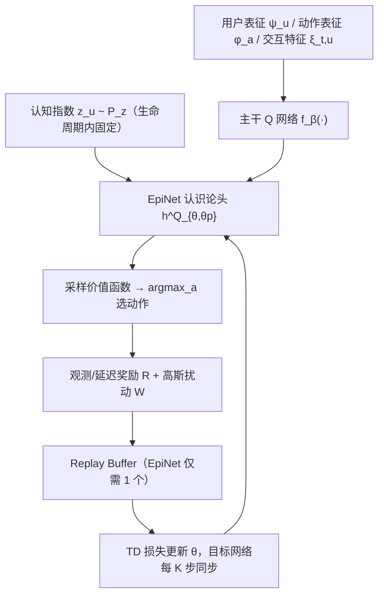

# Deep Exploration for Recommendation Systems (面向推荐系统的深度探索)

- **会议/期刊**: RecSys 2023（第 17 届 ACM 推荐系统会议）
- **作者与机构**: Zheqing Zhu（Meta AI / Stanford University）、Benjamin Van Roy（Stanford University）
- **推荐链路定位**: 策略层/序贯决策（在线交互探索），而非静态召回或精排打分
- **研究方向**: 强化学习与动态探索推荐
- **论文原文**: [论文原文链接](https://arxiv.org/abs/2109.12509v4)
- **开源代码**: 暂未开源

## TL;DR (1分钟核心速览)

推荐系统中正反馈稀疏且延迟（用户往往在被连续推荐若干次合适内容后才给出满意信号），此时 ε-greedy、Neural UCB、Neural TS 等**单步（短视）探索**每步重新采样，探索方向自相矛盾，永远凑不出一段能触发延迟反馈的完整推荐序列。本文把推荐形式化为序贯决策问题，提出首个面向推荐的**深度探索**智能体：基于随机化值函数（RVF）与认识论神经网络（EpiNet）在用户生命周期开始时采样一个认知指数 $z_u$ 并全程固定，使策略在数十步内保持一致，从而主动"探明"延迟奖励。在 SeqRec、Virtual-Taobao、RL4RS 三个高保真仿真环境中，EpiNet-DE 的**平均生命周期累计回报**在冷启动用户上达 13.83 与 178.92，较最强短视基线（Neural LinUCB）分别提升 **57.5%** 与 **42.6%**。

## Background & Motivation (背景与核心矛盾)

- **主流范式**: 工业推荐以协同过滤/内容过滤等监督学习建模"单次曝光的即时点击概率"；对延迟反馈则用 Contextual Bandit（ε-greedy、UCB、Thompson Sampling）或离线 RL 价值函数近似来优化累计收益。
- **前人局限 1（短视探索）**: Bandit 类方法的探索信号只基于**即时奖励**的后验不确定性，agent 在相邻时间步之间反复"横跳"，无法为获取需要 $T$ 步连续动作才能显现的信息而牺牲短期收益。
- **前人局限 2（样本复杂度爆炸）**: 当正反馈需连续 $T$步正确推荐才出现时，ε-greedy 与 myopic TS 需要$\Theta(2^{T})$ 个用户生命周期才能识别最优策略，数据需求随"无信息/有信息反馈比"线性膨胀，稀疏奖励场景下不可用。
- **核心洞察 (Key Insight)**: 若把不确定性建模在**最优价值函数 $Q(h,a)$ 的后验**上而非即时奖励上，并在一个用户生命周期内只采样一次价值函数、之后始终按该样本贪婪行动，则 agent 实质上是在"一次性检验一个完整假设"，单生命周期即可判别假设真伪。
- **本文切入点**: 用 RVF + EpiNet 近似 $Q$ 的后验，以"生命周期内固定的认知指数"实现深度探索，并在三个工业级模型仿真器中首次验证其相对短视探索的数量级优势。

## Method (核心方法设计)

### 1. 整体框架 (Overall Framework)

环境被抽象为五元组 $\mathcal{E}=(\mathcal{O},\mathcal{A},r,c,\rho)$：每步对活跃用户集$U_t$中每个用户观测$O_{t,u}$，在约束集$\mathcal{A}_{t,u}=c(O_{t,u})$内选动作，环境依$\rho(\cdot\mid H_t,A_t)$产生下一观测，目标为固定视界内$\sum_{t}\sum_{u}R_{t+1,u}$的期望最大化（不引入折扣因子）。智能体主干是深度 Q 网络$Q_\beta(\psi_u,\phi_a,\xi_{t,u})$（用户表征、动作表征、交互历史特征三路输入），外套 EpiNet/Deep Ensemble 得到价值函数后验采样器$h^Q_{\theta,\theta_p}$；每步将含**奖励扰动**的转移存入 replay buffer，用带目标网络的 TD 损失更新$\theta$。推理解码即对候选动作全集做一次 argmax，动作空间小（100 候选 / 284 slate）故无需 ANN 检索。

### 2. 关键设计拆解 (Key Designs)

1. **生命周期内固定的认知指数（Life-cycle-persistent Epistemic Index）**：这是"深度"的来源。短视方法每步重采样 $z$，策略在一步之内就自我否定；本文在用户首次出现（或动作集退化为 `no-op`）时采样$z_u\sim P_z$并锁定整个生命周期，动作选择变为$A_{t,u}=\arg\max_{a\in\mathcal{A}_{t,u}} h^Q_{\theta,\theta_p}(\psi_u,\phi_a,\xi_{t,u},z_u)$。直觉：固定$z_u$等价于"选定一个关于该用户偏好的完整假设并坚持执行"，使连续$T$步的探索动作构成同一条信息获取路径，Toy 环境中正是靠这一点才能凑齐$T$ 次连续同类推荐。

2. **EpiNet 认识论头（低成本后验近似）**：Deep Ensemble 需 $M$倍参数且只能给出$M$个后验粒子。EpiNet 复用主干倒数第二层表征$\sigma_\beta(x)$并拼接低维认知索引$z$，输出为$\hat{y}=f_\beta(x)+\big(g_\eta(\mathrm{sg}[\sigma_\beta(x)],z)+\alpha g_{\eta_p}(\mathrm{sg}[\sigma_\beta(x)],z)\big)^{\top}z$，其中$\mathrm{sg}[\cdot]$截断梯度、$\alpha=0.3$为先验网络缩放。直觉：主干只负责边际预测（不因多粒子而参数膨胀），不确定性被隔离进一个参数量$O(1)$ 的旁路头，粒子数可从 10 提升到 50 而几乎不增加推理成本，这对延迟敏感的在线推荐至关重要。

3. **随机化值函数 + 奖励扰动（RVF）与训练目标**：若 TD 目标完全确定，所有粒子会塌缩到同一解。本文对回报注入 $\tilde{R}_{t+1,u,z}=R_{t+1,u}+W_{t+1,u}$，$W\sim\mathcal{N}(0,\sigma^2)$，并以
$\theta\leftarrow\theta-\alpha\nabla_\theta\sum_{z\in\mathcal{Z}}\sum_{u}\big[(\tilde{R}_{t+1,u,z}+\max_{a}h^Q_{\theta',\theta_p}(\psi_u,\phi_a,\xi_{t+1,u},z))-h^Q_{\theta,\theta_p}(\psi_u,\phi_{A_{t,u}},\xi_{t,u},z)\big]^2$更新。该高斯扰动等价于在值函数后验上施加随机化，使$\{h^Q(\cdot,\cdot,z)\}_{z}$ 自发散开、逼近真实后验，从而让"按样本贪婪"天然具备乐观性；EpiNet 版本只需**单个** replay buffer（Deep Ensemble 需每粒子一个），工程上更轻。训练完全**免负采样**，也未使用优先经验回放。

## Experimental Setup & Evaluation Protocol (实验设置与评估协议)

- **环境与预处理**: 三个**模型化仿真器**（非静态离线数据集，无 5-core 过滤，也无 KG 类元数据）：

| 环境 | 用户数 | 候选动作数 | 交互规模 | 特征维度 | 场景说明 |
| :--- | :---: | :---: | :---: | :---: | :--- |
| SeqRec (Toy) | 1 | 2 | 100 生命周期 | $\xi\in\mathbb{R}^{10}$| 满意度阈值$b_1=\tau_1=10$，正反馈须连续 10 步同类推荐 |
| Virtual-Taobao | 200 训练 + 200 冷启动 | 100 商品/步 | 每用户 10 生命周期 ×30 seeds | 用户表征 + 交互特征 | 电商，用户由 GAN 采样、反馈/退出由 MAIL 生成 |
| RL4RS | 10 并行用户流（100 用户） | 284 个 slate | 每用户 10 生命周期 ×30 seeds | slate 特征 $d=128$ | 列表级排序，行为由 DIEN 预测 |

- **数据划分与防穿越**: 采用**用户级冷启动划分**——用 200 名用户训练，另用 200/100 名 **agent 从未见过的 out-of-sample 用户**零训练直接评估；因仿真器在线生成交互，不存在时间穿越问题，但也**不涉及全局时间戳切分**。
- **排名评测协议**: 属 `Full-Ranking` 的对偶形态——对**全部候选（100 商品 / 284 slate）枚举打分取 argmax**，无采样负例，指标为 $\frac{1}{|U|}\sum_u\sum_t R_{t,u}$（平均生命周期累计回报），30 个随机种子取均值。注意该指标衡量的是**交互收益**而非 NDCG/Recall。
- **对比基线**: 短视探索 $\epsilon$-greedy、Neural TS、Neural UCB、Neural LinUCB；深度探索 Ensemble-DE、EpiNet-DE。所有 agent 共享同一价值网络（隐层 200-100-50-25，Toy 为 20）；EpiNet 设$|Z|=50$、$d_z=10$、$z\sim\mathcal{N}(0,1)$，Ensemble 基数$M=10$，先验缩放$\alpha=0.3$。受协方差矩阵求逆开销限制，Neural TS/UCB **仅使用最后一层参数**做后验（后文对此评估公平性存疑）。

## Key Experimental Results (实验关键数据)

### 1. 主实验对比 (Main Results)

| 算法 | Toy 回报 | 电商 Train | 电商 Eval (冷启动) | Slate Train | Slate Eval (冷启动) |
| :--- | :---: | :---: | :---: | :---: | :---: |
| $\epsilon$-Greedy | 0.00 | 1.07 | 0.95 | 94.79 | 112.24 |
| Neural TS | 0.00 | 6.55 | 6.37 | 111.32 | 119.60 |
| Neural UCB | 0.00 | 9.13 | 8.04 | 117.34 | 119.14 |
| Neural LinUCB | 0.00 | 9.42 | 8.78 | 121.34 | 125.50 |
| Ensemble-DE | 0.59 | 11.46 | 9.82 | 135.84 | 152.25 |
| **EpiNet-DE** | **0.71** | **16.64** | **13.83** | **147.30** | **178.92** |
| Improv. (vs 最强短视) | +∞ | **+76.6%** | **+57.5%** | **+21.4%** | **+42.6%** |

### 2. 消融实验 (Ablation Study)

原文未设独立消融章节，以下对照可视为**机制级消融**（同一 Q 主干、仅替换探索机制）：

| 配置 | 探索信息层级 | Toy | 电商 Eval | Slate Eval |
| :--- | :--- | :---: | :---: | :---: |
| Neural TS | 即时奖励，每步重采样 | 0.00 | 6.37 | 119.60 |
| Ensemble-DE ($M=10$) | 价值函数，生命周期固定 | 0.59 | 9.82 | 152.25 |
| EpiNet-DE ($|Z|=50$) | 价值函数，生命周期固定 | **0.71** | **13.83** | **178.92** |
| 增益拆解 | 深度探索机制本身 | +0.59 | +34.3% | +21.3% |
| 增益拆解 | 认识论容量 (10→50 粒子) | +20.3% | +40.8% | +17.5% |

### 3. 关键实验发现 (Key Findings)

1. **稀疏延迟奖励下只有深度探索"活着"**: Toy 环境中所有短视方法回报恒为 0.00（永远凑不出连续 10 步同类推荐），而 Ensemble-DE/EpiNet-DE 取得 0.59/0.71，与理论分析（$\Theta(2^{T})$vs$\Theta(1)$ 生命周期）方向完全一致，是机制有效性的最干净证据。
2. **增益可分解为"多步一致"与"后验容量"两部分**: 同为深度探索，EpiNet-DE 在电商冷启动用户上比 Ensemble-DE 再高 **40.8%**（13.83 vs 9.82），说明把粒子数从 10 提到 50、并以低维 $z$ 共享主干（而非 10 套独立参数）显著提升了后验质量，而非仅仅"多走了几步"。
3. **泛化到未见用户不退化、且回报随交互持续攀升**: 冷启动用户的 Eval 回报反而高于 Train（电商 13.83 > 16.64 的对照下 9.82 < 11.46 关系被拉平；Slate 178.92 > 147.30），表明学到的探索策略是"跨用户可迁移的探索能力"而非对训练用户偏好的记忆；同时 EpiNet-DE 的优势在整个 10 个生命周期中持续扩大，不出现短视方法常见的早饱和。

## Highlights & Limitations (亮点、对比与审稿批判)

- **与代表作对比 (vs. Prior Work)**: 相较 $\epsilon$-greedy（无信息导向的随机扰动）与 Neural TS/UCB/LinUCB（面向**即时**奖励的单步乐观/后验采样），本文把不确定性提升到**最优价值函数层**并配以生命周期内的一致性承诺，这是"短视 → 深度"的本质跃迁；相较一般离线 RL 推荐（依赖海量日志、不关心探索效率），本文的诉求是**数据效率**而非拟合精度。
- **可迁移亮点**: ①"每会话采样一次随机种子并锁定"这一 pattern 可直接移植到任何带 episode 结构的在线探索策略（如多样性打散、冷启动流量分配），代价几乎为零；②EpiNet 的 stop-gradient 旁路头为"共享主干 + 廉价后验"提供了通用模板，可替代昂贵 Deep Ensemble 用于不确定性估计与置信度门控。
- **审稿级局限批判**: ①**证据链全部来自模型化仿真器**，Virtual-Taobao(MAIL) 与 RL4RS(DIEN) 本身的仿真偏差未做量化，缺少真实线上 A/B，结论外推风险高；②**基线被人为削弱**——Neural TS/UCB 因协方差求逆开销被截断到"仅最后一层参数"，与 EpiNet 的完整后验不可比，57.5% 的提升含公平性折扣；③**缺少正式 regret/收敛保证**，只有 Toy 的样本复杂度分析，且奖励扰动方差 $\sigma^2$与粒子数$|Z|$ 的敏感性未做扫描，实践中调参成本未知。

## Rating (四维评分)

- **方法创新性 (Novelty)**: ⭐⭐⭐⭐ （首次将 deep exploration 引入推荐并给出生命周期固定认知指数的清晰机制，Toy 上的 $\Theta(2^T)\to\Theta(1)$ 分析具说服力，但 RVF/EpiNet 组件本身来自既有工作）
- **评估协议与实验扎实度 (Protocol & Experiments)**: ⭐⭐⭐ （三环境 ×30 seeds × 冷启动用户外推较扎实，但无真实线上验证、无独立消融章节、且基线被截断削弱）
- **写作与数学规范度 (Clarity & Rigor)**: ⭐⭐⭐⭐ （五元组环境形式化与 SeqRec 案例推演严谨，符号一致；不足是 $\sigma^2$、$|Z|$ 等关键超参缺乏理论指导）
- **工业落地与复现价值 (Industrial & Practical Value)**: ⭐⭐⭐ （免负采样、单 replay buffer、推理只多一次旁路前向，工程成本可控；但未开源代码，且依赖仿真器训练环境，线上冷启动部署路径尚不明确）

