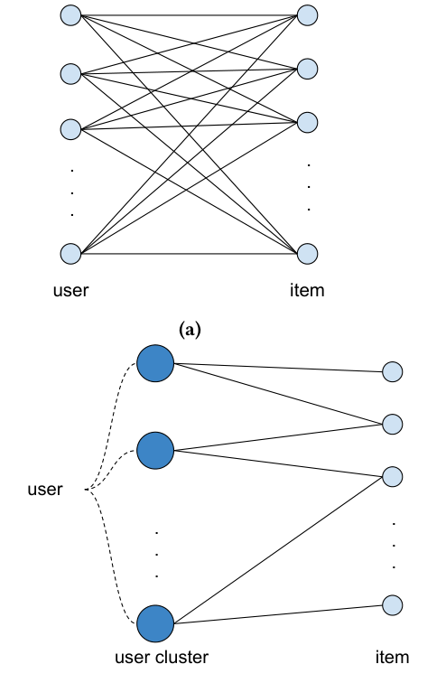
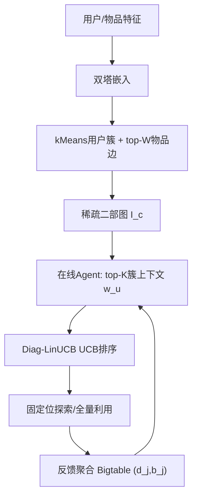
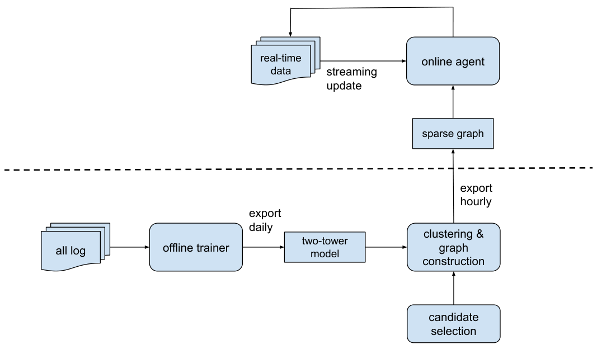

# Online Matching: A Real-time Bandit System for Large-scale Recommendations (在线匹配：面向大规模推荐的实时Bandit系统)

- **会议/期刊**: RecSys 2023
- **作者与机构**: Xinyang Yi, Shao-Chuan Wang, Ruining He 等；Google DeepMind / Google
- **推荐链路定位**: 召回/候选生成（探索源）
- **研究方向**: 强化学习与动态探索推荐 / 冷启动与长尾推荐
- **论文原文**: [https://arxiv.org/abs/2307.15893v1](https://arxiv.org/abs/2307.15893v1)
- **开源代码**: 暂未开源

## TL;DR (1分钟核心速览)

针对批量深度推荐更新滞后、反馈回路偏置与鲜内容/长尾探索不足，本文提出 Online Matching：离线双塔+聚类构建“用户簇-物品”稀疏二部图以剪枝动作空间，在线 Diag-LinUCB 以边为参数做分布式实时更新。YouTube 线上 A/B 中，鲜内容互动提升 **+8.33%**、整体满意度 **+0.15%**，语料探索仅约 **-0.05%** 满意度损失。

## Background & Motivation (背景与核心矛盾)

- **主流范式**: 工业推荐以双塔召回+多级排序为主，依赖离线批量训练，在线参数基本固定。
- **前人局限**: 批量学习更新延迟长、易受系统偏置影响，难以快速适应分布漂移；反馈回路放大历史高互动物品，鲜内容与长尾探索不足。经典 LinUCB 又受百万级动作空间、$d\times d$ 协方差求逆和 item 级同步更新制约。
- **核心洞察 (Key Insight)**: 用户-物品稠密匹配图可按用户簇稀疏化，只保留簇中心 top-$W$ 物品边；Bandit 无需学习“用户-物品”全量参数，而只需学习“簇-物品”边参数。
- **本文切入点**: 用离线嵌入学习做动作空间剪枝，再用在线 Diag-LinUCB 做边级闭环探索。

<figure class="paper-figure" markdown="span">
  <figcaption>图 2：用户-物品匹配问题示意图：(a) 用户与物品之间的稠密二部图；(b) 用户簇与物品之间的稀疏二部图。</figcaption>
</figure>

## Method (核心方法设计)

### 1. 整体框架 (Overall Architecture)

离线侧训练用户/物品双塔，kMeans 将用户嵌入离散为 $C$个簇；每簇取中心点积 top-$W$物品建稀疏二部图，批/实时图构建器小时级刷新。在线侧将请求用户映射到 top-$K$簇，得到稀疏上下文$w_u$；仅对触发簇对应边候选算 UCB，少量流量在固定 UI 位探索，其余流量按期望奖励利用；反馈经日志处理写入 Bigtable，增量更新$(d,b)$，新边以无限置信度优先探索。

<figure class="paper-figure" markdown="span">
  <figcaption>图 3：端到端 Online Matching 系统概览。虚线以下的组件是负责生成稀疏二部图的离线流水线；虚线以上的组件表示负责在闭环中进行实时学习的在线系统。</figcaption>
</figure>

### 2. 关键设计拆解 (Key Designs)

1. **稀疏二部图与上下文剪枝**：朴素 per-user bandit 在百万物品下无法收敛。本文先用 batch softmax 训练双塔：$\mathcal{L}(f,g)=-\sum_{i\in[B]}\log \frac{\exp(\langle f(x_i),g(y_i)\rangle/\tau)}{\sum_{j\in[B]}\exp(\langle f(x_i),g(y_j)\rangle/\tau)}$，再对用户嵌入聚类，每簇仅保留 top-$W$ 物品边。直觉是“簇中心附近物品才是高概率可探索臂”，把全库动作空间压到触发簇的并集。
2. **Diag-LinUCB**：LinUCB 的协方差求逆与同步更新难以支撑十亿用户。本文只维护协方差对角 $d_j$，把更新拆到簇-物品边上：$d_{j,c}\leftarrow d_{j,c}+w_{u,c}^2,\ b_{j,c}\leftarrow b_{j,c}+w_{u,c}r_{u,j}$；打分为$UCB_j=\sum_{c\in\mathrm{supp}(w_u)} w_{u,c}b_{j,c}/d_{j,c}+\alpha\sqrt{\sum_{c\in\mathrm{supp}(w_u)} w_{u,c}^2/d_{j,c}}$。这类似 Adam 只用 Hessian 对角，牺牲部分二阶相关性换取完全分布式、无 item 级锁的高吞吐。
3. **上下文、训练目标与推理效率**：用户簇权重用 $w_{u,c}=\exp(\langle u,c_c\rangle/\tau')/\sum_{c'}\exp(\langle u,c_c'\rangle/\tau')$生成，top-$K=10$簇；在线探索用 top-$k=5$随机化缓解反馈延迟造成的过度探索，利用模式用$\hat{r}_{u,j}=\sum_c w_{u,c}b_{j,c}/d_{j,c}$。离线双塔用 in-batch softmax 负样本，Bandit 无需负采样；线上可达 O(1M) 参数更新/秒。

## Experimental Setup & Evaluation Protocol (实验设置与评估协议)

- **数据集与预处理**: 无公开离线数据集，评估为 YouTube 线上系统。官方未披露用户/物品统计，仅给出以下线上配置：

| 场景 | 语料/过滤 | 探索流量 | 图规模 | 评估方式 |
| :--- | :--- | :---: | :---: | :--- |
| Type-I Fresh Content | $\le O(1M)$近$X$ 天新视频，安全/质量过滤 | 1%–2% 打散流量，固定 UI 位 | 15k/30k 簇，约 4M/20M 边 | 7 天用户分流 A/B + 数周 holdback |
| Type-II Corpus | $O(10M)$ 新视频，10 个切片 | 每片 6% 用户 | 共享双塔/簇配置 | user-corpus co-diverted，按曝光阈值统计可发现语料 |

- **数据划分与防穿越**: 无离线 train/test 划分；双塔按时间顺序日更，线上 A/B 实时分流。Type-II 采用用户-语料共同分流，避免控制组共享语料造成泄漏。
- **排名评测协议**: 不是 Full-Ranking 或 Sampled Ranking；探索候选绕过排序层、固定 UI 位展示以取无偏反馈；利用模式将 top 候选交给排序层。离线双塔采用 in-batch 负采样，在线 Bandit 不使用负采样。
- **对比基线与超参**: 对比 Production（无 Online Matching）、Equal-weight Bandit、Diag-LinUCB、Diag-LinUCB+更大图；$K=10$，top-$k=5$，$\alpha,\tau,\tau'$ 未完整披露，未报告显著性检验。

## Key Experimental Results (实验关键数据)

### 1. 主实验对比 (Main Results)

| 系统/变体 | 探索流量 | 整体满意度 | 鲜内容互动 | 探索槽成本 | 簇数/图规模 |
| :--- | :---: | :---: | :---: | :---: | :---: |
| Production（无 OM） | - | 0.00% | 0.00% | - | - |
| Equal-weight Bandit | 1% | +0.03% | +3.61% | - | 15k / ~4M |
| Diag-LinUCB | 1% | +0.08% | +5.25% | -0.16% | 15k / ~4M |
| Diag-LinUCB（Larger Graph） | 2% | **+0.15%** | **+8.33%** | -0.19% | 30k / ~20M |

### 2. 消融与实时性实验 (Ablation & Latency)

| 变体/实验 | 整体满意度 | 鲜内容互动 | CTR | Total Rewards |
| :--- | :---: | :---: | :---: | :---: |
| w/o 上下文（Equal-weight） | +0.03% | +3.61% | - | - |
| w/ 上下文（Diag-LinUCB） | +0.08% | +5.25% | - | - |
| 更大图/更多簇 | **+0.15%** | **+8.33%** | - | - |
| 人为延迟 20 min | - | - | -2.82% | -11.82% |
| 人为延迟 40 min | - | - | -4.40% | -22.84% |

### 3. 关键实验发现 (Key Findings)

- **上下文建模是主要增量**：同等图规模下，从 Equal-weight 到 Diag-LinUCB，鲜内容互动由 +3.61% 升至 +5.25%，整体满意度由 +0.03% 升至 +0.08%，说明簇权重而非单纯 UCB 带来有效区分。
- **图容量存在正向 scaling，但探索成本上升**：簇数 15k→30k、边 4M→20M 后鲜内容互动 +5.25%→+8.33%，探索流量需 1%→2%，探索槽满意度损失 -0.16%→-0.19%。
- **实时闭环价值可量化**：人为延迟 20/40 分钟使 CTR 降 2.82%/4.40%、总奖励降 11.82%/22.84%；Type-II 在可发现语料增长同时仅 -0.05% 整体满意度损失，holdback 中 DAU +0.04%。

## Highlights & Limitations (亮点、对比与审稿批判)

- **与代表作对比 (vs. Prior Work)**: 相比批量双塔/离线 RL，本文真正把 Bandit 放进线上闭环；相比经典 LinUCB，Diag-LinUCB 用对角协方差+边级参数解决扩展性；相比多数 bandit 仿真论文，本文给出工业系统与线上 A/B 证据。
- **可迁移亮点**: “聚类稀疏图=动作空间剪枝”可迁移到大规模 cold-start/长尾探索；“对角 Hessian+边级异步更新”适合高吞吐实时 Bandit。
- **审稿级局限批判**: 对角近似忽略簇间协方差，缺少遗憾界或校准分析；评估依赖 YouTube 私有线上流量，无公开数据/代码，$\alpha,\tau$ 与图构建细节披露不足，且策略更新 P50 仍达 45 分钟，并非亚秒级实时。

## Rating (四维评分)

- **方法创新性 (Novelty)**: ⭐⭐⭐⭐ （算法-系统协同设计扎实，Diag-LinUCB 虽为近似但切中大规模部署瓶颈）
- **评估协议与实验扎实度 (Protocol & Experiments)**: ⭐⭐⭐⭐ （YouTube 线上 A/B、holdback 与 co-diverted 设计有说服力，但缺公开基准与显著性检验）
- **写作与数学规范度 (Clarity & Rigor)**: ⭐⭐⭐⭐ （系统链路与公式清晰，稀疏 bandit 框定简洁；对角近似的理论保证不足）
- **工业落地与复现价值 (Industrial & Practical Value)**: ⭐⭐⭐⭐⭐ （已部署 YouTube，给出吞吐、延迟与两类线上场景，工程参考价值高）

