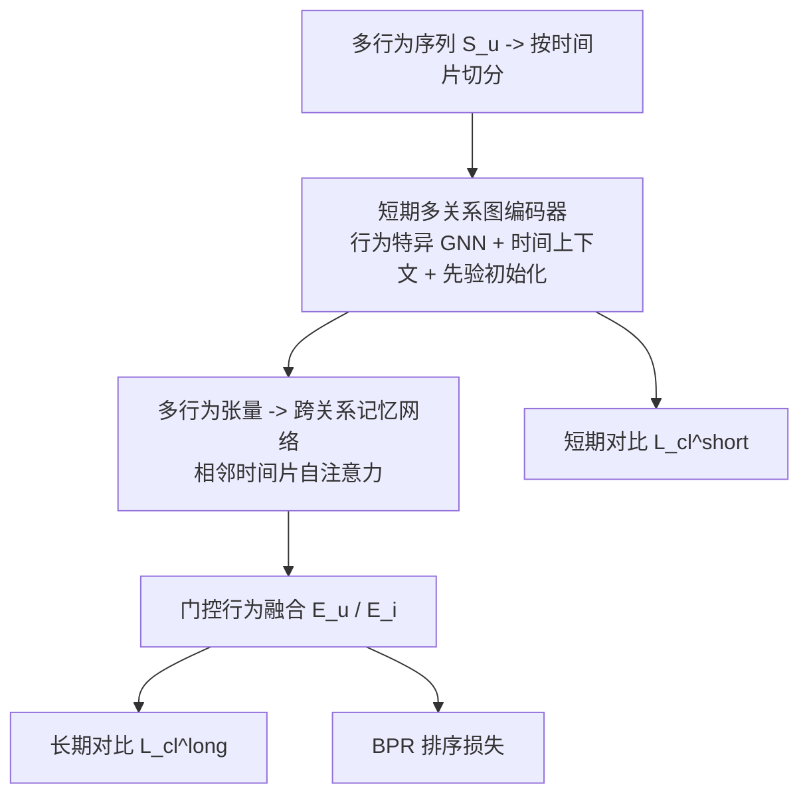

# Multi-Relational Contrastive Learning for Recommendation (面向推荐的多关系对比学习)

- **会议/期刊**: RecSys 2023 (Full Paper)
- **作者与机构**: Wei Wei, Lianghao Xia, Chao Huang（香港大学 HKUDS）
- **推荐链路定位**: 召回（多行为序列 Next-Item 预测）
- **研究方向**: 自监督对比学习与交互去噪 / 序列与会话推荐
- **论文原文**: [https://arxiv.org/abs/2309.01103v3](https://arxiv.org/abs/2309.01103v3)
- **开源代码**: [https://github.com/HKUDS/RCL](https://github.com/HKUDS/RCL)

## TL;DR (1分钟核心速览)

多行为推荐的主流做法把 click / favorite / cart 混在一起学习单一用户向量，既丢失了各行为的专属语义，也无法刻画「先浏览、隔天才下单」的跨类型时变依赖。RCL 提出三段式框架：关系感知短期图编码器保留行为特异语义，跨关系记忆网络用自注意力学习相邻时间片的行为依赖权重，再用行为级 InfoNCE 同时对齐「行为特异视图 ↔ 融合视图」以兼顾共性与差异性。在 Tmall / IJCAI / E-Commerce 三数据集、Leave-One-Out + 99 负采样的排序协议下，HR@10 相对最强基线 CML 分别提升 9.94% / 24.39% / 6.12%，NDCG@10 提升 11.01% / 32.77% / 10.07%（$p<10^{-2}$）。

## Background & Motivation (背景与核心矛盾)

- **主流范式**: 序列推荐从 GRU4Rec/Caser 演进到 SASRec、BERT4Rec 的自注意力，以及 MA-GNN、HyperRec 的图/超图消息传递；多行为方向则用 NMTR/DIPN 的多任务分头、MBGCN/KHGT/MBGMN 的多行为图传播来区分行为语义。
- **前人局限**: ① 多数模型只建模单一行为类型，或把辅助行为当作静态上下文特征拼接，行为语义被平均化；② 即使做了多种行为的图传播，也缺少**跨时间片的行为依赖建模**——而 View→Cart→Purchase 的转化本质上是跨时段发生的；③ 只用目标行为（Purchase）监督时数据极稀疏，图模型堆深即过平滑。
- **核心洞察 (Key Insight)**: 同一用户在不同行为视图下的表征应共享「共性」（同一偏好内核）而彼此「可区分」（不同行为反映不同意图）；把「行为特异向量 vs. 行为融合向量」构造成正对、不同用户之间构造负对，即可同时获得共性保持与跨用户判别力。
- **本文切入点**: 用短期多关系图 + 跨关系记忆 + 多关系对比三件套，在统一框架内联合压缩短期异质性与长期跨类型演化。

## Method (核心方法设计)

### 1. 整体框架 (Overall Architecture)

输入为行为感知交互序列 $S_u=\{(i_1,b_1),\dots\}$，按时间粒度$\Lambda$（天/周/月）切分为多个时间片。每个时间片$t$、每种行为$b$构建短期多行为二部图$\mathcal{G}^b_t$，经关系感知消息传递（含时间上下文注入与先验感知初始化）得到短期表征$\mathbf{E}^b_{t,u},\mathbf{E}^b_{t,i}$；堆叠为三阶张量后送入跨关系记忆网络，用相邻时间片之间的自注意力学习$|\mathcal{B}|\times|\mathcal{B}|$的行为依赖矩阵，输出长期表征$\tilde{\mathbf{E}}^b_{t,u}$。门控融合得到单用户向量后，同时以短期（逐时间片）与长期（逐行为）两路 InfoNCE 做自监督，联合 BPR 端到端训练，推理时按内积排序下一个目标行为物品。

### 2. 关键设计拆解 (Key Designs)

1. **关系感知消息传递 + 先验感知初始化**：普通 GCN 归一化在异质多行为图上会让热门物品度爆炸、且各时间片独立训练易过拟合。RCL 用不对称双侧归一化 $\Gamma(\mathbf{M}^b_t(\mathbf{M}^b_t)^\top)=(\mathbf{D}^b_t)^{-\frac12}\mathbf{M}^b_t(\mathbf{B}^b_t)^{-1}(\mathbf{M}^b_t)^\top(\mathbf{D}^b_t)^{-\frac12}$抑制递归传播中的数值膨胀；并把上一时间片编码结果软注入当前初始化：$\mathbf{E}^{b,0}_{t,i}=(\zeta\mathbf{E}^{b,0}_{t,i}+(1-\zeta)\mathbf{E}^b_{t-1,i})\mathbf{W}^b_\zeta$，让时间片之间形成连续表征流而非重新冷启。

2. **跨关系动态记忆网络**：痛点是要显式量化「上一时刻行为 $b'$对当前行为$b$的影响」。以当前张量$\hat{\mathbf{E}}_t$为 Query、前一时刻$\hat{\mathbf{E}}_{t-1}$ 为 Key/Value 做多头缩放点积：
$\mathbf{Z}_{t,t-1}=\mathrm{softmax}\!\left(\frac{\mathbf{Q}_t\mathbf{K}_{t-1}^{\top}}{\sqrt{d/h}}\right)\mathbf{V}_{t-1},\ \ \Phi=\mathbf{Q}_t\mathbf{K}_{t-1}^{\top}\in\mathbb{R}^{|\mathcal{B}|\times|\mathcal{B}|}$其中$\phi_{b,b'}$即跨类型依赖强度；相比 GRU 把所有行为压进同一隐状态，$\Phi$ 保留了行为维度的可解释结构（论文可视化显示对角占优，且交互量大的行为主导权重）。

3. **多关系对比目标与训练**：以门控权重 $\omega^b_u=\frac{\exp(\mathbf{E}^b_u\mathbf{w}_f)}{\sum_{b'}\exp(\mathbf{E}^{b'}_u\mathbf{w}_f)}$融合出$\mathbf{E}_u=\sum_b\omega^b_u\mathbf{E}^b_u$，随后
$\mathcal{L}^b_{cl}=-\log\frac{\exp(s(\mathbf{e}^b_u,\mathbf{e}_u)/\tau)}{\exp(s(\mathbf{e}^b_u,\mathbf{e}_u)/\tau)+\sum_{u'\neq u}[\exp(s(\mathbf{e}^b_u,\mathbf{e}_{u'})/\tau)+\exp(s(\mathbf{e}^b_u,\mathbf{e}^b_{u'})/\tau)]}$负样本为 batch 内其他用户（两类：跨用户融合向量与跨用户同行为向量）。总损失$\mathcal{L}=\sum_b\mathcal{L}_{BPR}+\alpha\sum_b\mathcal{L}^{long}_{cl}+\beta\sum_t\sum_b\mathcal{L}^{short}_{cl}$，即 BPR + 行为级对比 + 时间片级对比；负采样免额外采样器（In-batch），复杂度$O(|\mathcal{B}|\Lambda L|\mathbf{E}|\cdot d)$，瓶颈在$O(\Lambda|\mathcal{V}||\mathcal{B}|^2 d)$ 的注意力。

## Experimental Setup & Evaluation Protocol (实验设置与评估协议)

- **数据集与预处理**: 目标行为统一为 Purchase，其余为辅助行为；稀疏度 99.35%–99.98%。

| 数据集 | #Users | #Items | #Interactions | 稀疏度 | 行为类型 |
| :--- | :---: | :---: | :---: | :---: | :--- |
| Tmall (Taobao) | 31,882 | 31,232 | 167,862 | 99.98% | View, Favorite, Cart, Purchase |
| IJCAI | 22,438 | 35,573 | 199,654 | 99.98% | View, Favorite, Cart, Purchase |
| E-Commerce | 31,021 | 1,827 | 370,386 | 99.35% | Browse, Review, Purchase |

- **数据划分与防穿越**: 采用序列推荐标准的 `Leave-One-Out`——每用户最后一次**目标行为**交互为测试正样本，倒数第二次为验证，其余为训练。
- **排名评测协议**: `Sampled Ranking`，每用户随机抽取 **99 个未交互物品**作负例与 1 个正例共同排序；指标 HR@10、NDCG@10。
- **对比基线与超参**: 基线覆盖四类——CNN/注意力序列（Caser, AttRec, SASRec, TiSASRec, BERT4Rec）、混合序列（HGN, Chorus）、GNN 序列（SR-GNN, MA-GNN, HyperRec, COTREC, DHCN）、多行为（NMTR, DIPN, MBGCN, KHGT, MBGMN, EHCF, CML）。GNN 层数在 $\{1,2,3,4\}$内调优，温度$\tau\in\{0.02,\dots,0.7\}$，Xavier 初始化 + AdamW + 循环学习率，报告$p$ 值显著性。

## Key Experimental Results (实验关键数据)

### 1. 主实验对比 (Main Results)

| 模型 | Tmall H@10 | Tmall N@10 | IJCAI H@10 | IJCAI N@10 | E-Com H@10 | E-Com N@10 |
| :--- | :---: | :---: | :---: | :---: | :---: | :---: |
| SASRec | 0.319 | 0.184 | 0.263 | 0.148 | 0.599 | 0.368 |
| BERT4Rec | 0.329 | 0.197 | 0.281 | 0.155 | 0.641 | 0.392 |
| MA-GNN | 0.331 | 0.202 | 0.259 | 0.149 | 0.644 | 0.411 |
| HyperRec | 0.333 | 0.204 | 0.265 | 0.151 | 0.648 | 0.413 |
| KHGT | 0.391 | 0.232 | 0.278 | 0.145 | 0.689 | 0.434 |
| MBGMN | 0.419 | 0.246 | 0.329 | 0.176 | 0.690 | 0.432 |
| EHCF | 0.433 | 0.260 | 0.362 | 0.207 | 0.611 | 0.413 |
| CML | 0.543 | 0.327 | 0.410 | 0.235 | 0.719 | 0.427 |
| **RCL** | **0.597** | **0.363** | **0.510** | **0.312** | **0.763** | **0.470** |
| Improv.% | +9.94% | +11.01% | +24.39% | +32.77% | +6.12% | +10.07% |
| $p$-value |$5.2e^{-5}$|$4.9e^{-6}$|$9.6e^{-6}$|$2.3e^{-5}$|$8.7e^{-3}$|$3.4e^{-4}$ |

### 2. 消融实验 (Ablation Study)

| 变体 | Tmall H@10 | Tmall N@10 | IJCAI H@10 | IJCAI N@10 | E-Com H@10 | E-Com N@10 |
| :--- | :---: | :---: | :---: | :---: | :---: | :---: |
| w/o-MBG（去多行为图编码器） | 0.338 | 0.219 | 0.261 | 0.139 | 0.630 | 0.372 |
| r/w-GRU（记忆网络换 GRU） | 0.361 | 0.210 | 0.276 | 0.148 | 0.675 | 0.417 |
| w/o-CL（去对比学习） | 0.391 | 0.231 | 0.300 | 0.166 | 0.734 | 0.461 |
| w/o-JBL（辅助行为仅作特征不联合学习） | 0.473 | 0.291 | 0.367 | 0.205 | 0.747 | 0.469 |
| **RCL（完整）** | **0.597** | **0.363** | **0.510** | **0.312** | **0.763** | **0.470** |

### 3. 关键实验发现 (Key Findings)

1. **对比学习是最大增益源，短期图次之**：移除 CL 使 Tmall HR@10 从 0.597 跌至 0.391（-34.5%），跌幅大于移除多行为图编码器（0.338，-43.4%）之外的其余组件；而 w/o-JBL（只用单目标行为的表征）也仅 0.473，说明「辅助行为监督信号 + 对比正则」必须联合才能兑现增益。
2. **行为覆盖度单调贡献，View/Browse 最关键**：Tmall 仅用 Purchase 时 HR@10=0.370；补 View 后 0.463→ 全行为 0.597。移除 Favorite 或 Cart 反而降到 0.547/0.534，证明 cart/favorite 虽量少但携带高价值偏好信息；E-Commerce 上移除 Review 掉到 0.732 亦印证。
3. **对比学习对极度稀疏用户增益最大**：IJCAI 上交互数 <5 的用户，w/o-JBL(+CL) HR@5=0.181 vs. KHGT 0.114 / HyperRec 0.093（相对提升约 59%）；随交互数增至 <60，优势收窄至 0.364 vs 0.409，说明 InfoNCE 的硬负例梯度（$c(x)\propto\sqrt{1-x^2}\exp(x/\tau)$，$\tau$ 越小硬负例梯度越大）主要在冷区兜底。

## Highlights & Limitations (亮点、对比与审稿批判)

- **与代表作对比 (vs. Prior Work)**: 对比 MBGMN/KHGT，RCL 不只在空间维度做多行为图传播，还引入**时间轴上的跨类型依赖矩阵** $\Phi$；对比 EHCF/CML 这类「辅助行为 → 额外监督」的做法，RCL 的监督信号是**行为视图级对比**而非跨行为的多任务预测，因而显式约束了「共性 + 差异」两个方向；对比 DHCN/COTREC 的图增广对比，RCL 的增广来自真实行为语义而非随机边扰动，避免了噪声增广对协同信号的破坏。
- **可迁移亮点**: ① 「行为特异视图 ↔ 门控融合视图」构造正对、batch 内跨用户构造负对的范式，可直接移植到多场景/多模态推荐的视图对齐；② 先验感知初始化（上一时间片表征软注入）是增量式序列建模的低成本稳定器。
- **审稿级局限批判**: ① 评测采用 99 负采样的 Sampled Ranking，正负比极低，与真实全库排序分布差距大，且仅报告 HR/NDCG@10，缺少全库排序与 MRR 对照；② 跨关系记忆的注意力复杂度关于行为数 $|\mathcal{B}|^2$二次增长，若行为类型扩展到数十种（曝光/点击/加购/收藏/下单/退款/分享…）工程上需近似；③ 需要人工设定时间粒度$\Lambda$（Tmall 按天、IJCAI 按月），论文显示粒度过细会过拟合，属强超参敏感项；④ 温度$\tau$ 过小会梯度爆炸，实际调参窗口窄。

## Rating (四维评分)

- **方法创新性 (Novelty)**: ⭐⭐⭐⭐ （首次把「跨时间片 × 跨行为类型」的依赖矩阵与行为级对比学习耦合，并给出互信息下界与硬负例梯度 $c(x)$ 的理论解释，机制扎实但属组合式创新）
- **评估协议与实验扎实度 (Protocol & Experiments)**: ⭐⭐⭐ （三数据集 + 17 个基线 + 稀疏分桶 + 行为子集 + $p$ 值俱全，但仅 99 负采样半排序、无全库排序与线上验证）
- **写作与数学规范度 (Clarity & Rigor)**: ⭐⭐⭐⭐ （消息传递、记忆网络、对比目标公式完整，附录含维度变换表与梯度推导；但 Eq.6 先验初始化自我引用的写法略含混）
- **工业落地与复现价值 (Industrial & Practical Value)**: ⭐⭐⭐⭐ （HKUDS 官方开源、纯 PyTorch 轻量 GNN、多行为张量可用 Broadcast 高效实现，适合作为多行为召回基线）

