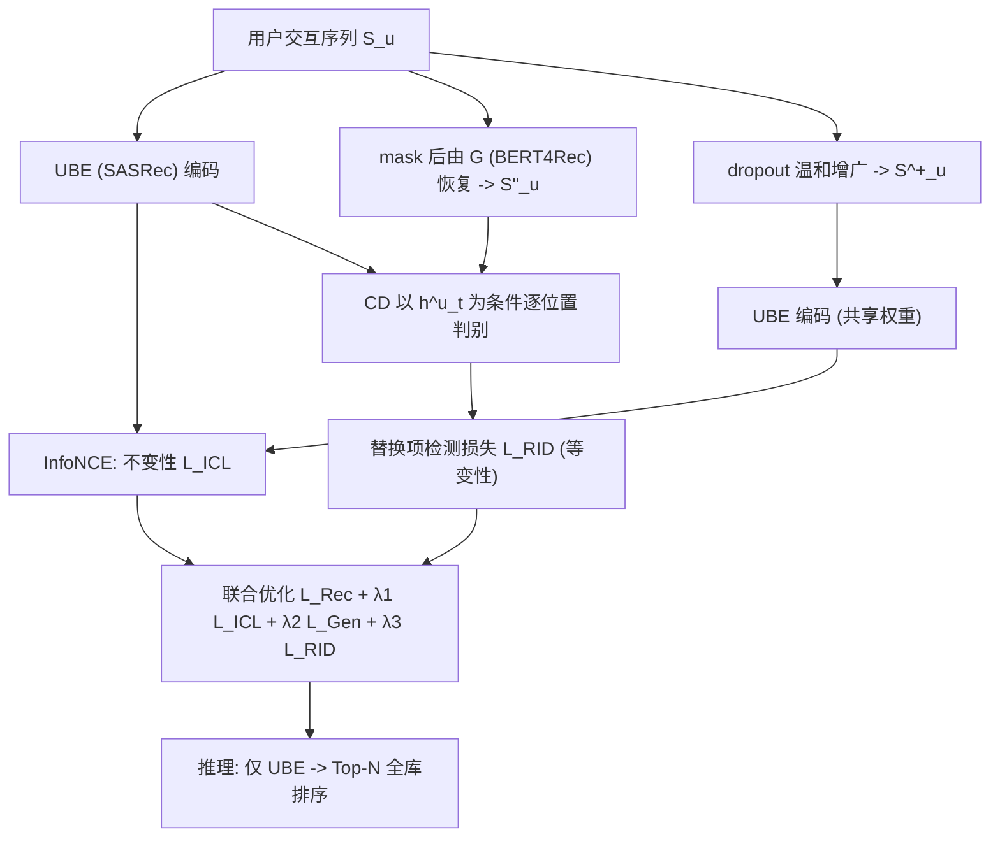
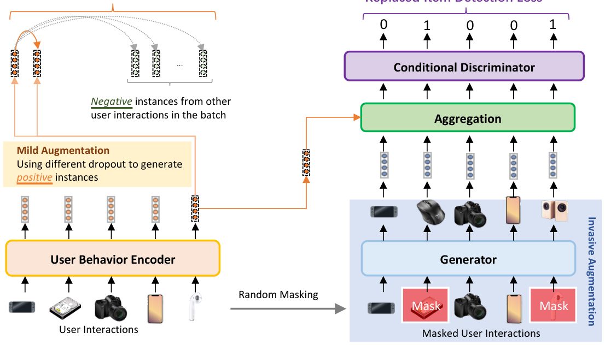

# Equivariant Contrastive Learning for Sequential Recommendation (面向序列推荐的等变对比学习)

- **会议/期刊**: RecSys 2023
- **作者与机构**: Peilin Zhou, Jingqi Gao, Yueqi Xie, Qichen Ye 等（HKUST(GZ)/HKUST、Upstage、PKU、Harvard、UTS）
- **推荐链路定位**: 召回（序列编码器 + Next-Item 全库排序）
- **研究方向**: 序列与会话推荐 / 自监督对比学习与交互去噪
- **论文原文**: [https://arxiv.org/abs/2211.05290v4](https://arxiv.org/abs/2211.05290v4)
- **开源代码**: [https://github.com/Tokkiu/ECL](https://github.com/Tokkiu/ECL)

## TL;DR (1分钟核心速览)

现有序列推荐对比学习（CL4SRec/CoSeRec/DuoRec/ICLRec）对**所有**增广统一施加"不变性"约束，但序列级增广（裁剪、插入、替换）会真实改变用户意图，强行拉近反而抹平判别性信息。ECL-SR 提出**等变对比学习**：特征级温和增广（dropout）走 InfoNCE 学不变性；序列级侵入增广由 BERT4Rec 生成"难"替换序列，再用条件判别器做逐位置**替换项检测（RIDL）**，逼编码器对意图改变敏感。在 4 个基准、`Leave-One-Out` + `Full-Ranking` 协议下，ML-1m/Yelp Recall@10 相对 SASRec 提升 19.5%/10.8%，相对最强 ICL 基线提升 7.1%/5.4%。

## Background & Motivation (背景与核心矛盾)

- **主流范式**: 以 SASRec 为骨干，用 S3Rec/CL4SRec/CoSeRec/DuoRec/ICLRec 引入自监督对比损失缓解交互稀疏，通过序列级增广（crop/insert/delete/substitute/reorder）或特征级增广（dropout/norm/perturbation）构造正视图并拉近表征。
- **前人局限①**: 序列级增广易生语义漂移。作者举例：`smartphone, headset, lipstick, blouse, socks, sneakers` 裁剪后两视图分别聚焦数码与服饰，被 InfoNCE 强行拉近即把"用户意图差异"当作噪声抹除，短序列尤甚。
- **前人局限②**: 图 1(c) 的 Yelp 实证显示，CL4SRec 叠加特征级 dropout（黄柱）稳定优于基线，替换为序列级增广（绿柱）则波动甚至掉点——说明"一刀切不变性"的前提假设不成立。
- **核心洞察 (Key Insight)**: 增广应分两类——温和增广只改变"量"（应不变），侵入增广改变"义"（应可被**预测/识别**）。信息论上，对可识别变化保留等变性比强行不变性保留更多互信息。
- **本文切入点**: 把不变对比学习视为等变学习的特例（$T'_g$ 取恒等映射），在一个框架内同时优化不变性与等变性。

## Method (核心方法设计)

### 1. 整体框架 (Overall Architecture)

ECL-SR 由三部分组成并共享同一 item embedding 表：**用户行为编码器 UBE**（SASRec，主任务 + 不变 CL）、**生成器 G**（BERT4Rec，按掩码率 $\gamma$恢复被 mask 的物品，产出语义扰动极小的"硬"替换序列$\mathbb{S}''_u$）、**条件判别器 CD**（SASRec 块 + MLP，以 UBE 的逐时刻表征$\mathbf{h}^u_t$ 为条件做逐位置二分类）。三者端到端联合训练，梯度经 CD 回流至 UBE 以强化判别性；推理阶段仅保留 UBE，因此在线开销与 SASRec 同级。

<figure class="paper-figure" markdown="span">
  <figcaption>图3：所提出的ECL-SR框架概览。</figcaption>
</figure>

### 2. 关键设计拆解 (Key Designs)

1. **温和增广上的不变性（ICL 分支）**：为避免末位表征偶然性，先用末 $k$个时刻表征均值聚合$\mathbf{h}_u=\mathrm{Average}([\mathbf{h}^u_{L-k+1},\dots,\mathbf{h}^u_L])$，正视图$\mathbb{S}^+_u$同法得$\mathbf{h}^+_u$，batch 内其他用户序列作负样本，最小化
$\mathcal{L}_{ICL}=-\log\frac{\exp(\mathrm{sim}(\mathbf{h}_u,\mathbf{h}^+_u)/\tau)}{\exp(\mathrm{sim}(\mathbf{h}_u,\mathbf{h}^+_u)/\tau)+\sum_{i\neq u}\exp(\mathrm{sim}(\mathbf{h}_u,\mathbf{h}_i)/\tau)}$。
   直觉：dropout 仅在特征空间扰动幅度，语义不变，故拉近是"去噪"而非"抹信息"。

2. **侵入增广上的等变性（RIDL 分支）**：随机替换样本太"假"，判别器可凭分布先验轻易识破，无法逼编码器捕捉细粒度意图变化；故改用生成器产出**上下文合理但错误**的替换项。等变性定义沿用 $f_\theta(T_g(\mathbb{S}_u))=T'_g(f_\theta(\mathbb{S}_u))$，本文不显式指定$T'_g$，而用"预测增广类型/位置"的借口任务隐式实现：CD 以 UBE 表征为条件输出逐位置替换概率，损失为
$\mathcal{L}_{RID}=\sum_{u}\sum_{t}-\mathbb{I}(v''_{u,t}=v_{u,t})\log\sigma(\mathbf{w}^{\top}f_D(\mathbb{S}''_u,\mathbf{h}^u_t))-\mathbb{I}(v''_{u,t}\neq v_{u,t})\log\big(1-\sigma(\mathbf{w}^{\top}f_D(\mathbb{S}''_u,\mathbf{h}^u_t))\big)$。
   直觉：若编码器对"哪一步意图被篡改"无感则无法完成检测，梯度必然迫使表征对侵入式变化敏感，从而避免 ICL 的语义塌缩。

3. **训练目标、负采样与推理效率**：总损失 $\mathcal{L}=\mathcal{L}_{Rec}+\lambda_1\mathcal{L}_{ICL}+\lambda_2\mathcal{L}_{Gen}+\lambda_3\mathcal{L}_{RID}$，其中$\mathcal{L}_{Gen}$ 为掩码物品复原的交叉熵。负采样为 **In-batch 负样本（免显式采样器）**，未使用 hard negative。参数量 1.3995M（DuoRec 1.3877M），单 epoch 训练 163s、推理 1827.60 seq/s（CL4SRec 1850.75/s），开销几乎无损。

## Experimental Setup & Evaluation Protocol (实验设置与评估协议)

- **数据集与预处理**（按 `5-core` 过滤，遵循 SASRec/CL4SRec 设定）：

| 数据集 | #Users | #Items | #Interactions | 稀疏度 | 特征/场景说明 |
| :--- | :---: | :---: | :---: | :---: | :--- |
| Sports | 35,598 | 18,357 | 296,337 | 99.95% | Amazon 评论，极稀疏短序列（人均 8.3） |
| Toys | 19,412 | 11,924 | 167,597 | 99.93% | Amazon 评论，极稀疏短序列（人均 8.6） |
| Yelp | 30,499 | 20,068 | 317,182 | 99.95% | 本地商户 POI 签到 |
| ML-1m | 6,041 | 3,417 | 999,611 | 95.15% | 电影评分，稠密长序列（人均 165.5） |

- **数据划分与防穿越**: `Leave-One-Out`——每用户最后两个交互分别作验证/测试，其余训练。
- **排名评测协议**: 无偏 `Full-Ranking`（对全物品集打分排序，非采样），指标 Recall@{10,20} 与 NDCG@{10,20}。
- **对比基线与超参**: 12 个基线，含通用（PopRec/BPR）、基础 SR（Caser/GRU4Rec/SASRec/BERT4Rec/ELECRec）、ICL 系（S3Rec-MIP/CL4SRec/CoSeRec/DuoRec-UCL/ICLRec）；统一 RecBole 实现，Adam、200 epoch、batch 256、lr 1e-4、hidden 256、2 层 2 头，$\tau=0.05$，$\lambda_{ICL}=0.3,\lambda_{Gen}=0.2,\lambda_{RID}=0.1$；显著性用 paired t-test（$p<0.01$）。

## Key Experimental Results (实验关键数据)

### 1. 主实验对比 (Main Results)

| 模型 | Sports R@10 | Sports N@10 | Toys R@10 | Toys N@10 | Yelp R@10 | Yelp N@10 | ML-1m R@10 | ML-1m N@10 |
| :--- | :---: | :---: | :---: | :---: | :---: | :---: | :---: | :---: |
| GRU4Rec | 0.0386 | 0.0195 | 0.0449 | 0.0221 | 0.0418 | 0.0206 | 0.1781 | 0.0886 |
| BERT4Rec | 0.0295 | 0.0135 | 0.0533 | 0.0234 | 0.0524 | 0.0327 | 0.1275 | 0.0584 |
| SASRec | 0.0511 | 0.0226 | 0.0796 | 0.0360 | 0.0667 | 0.0405 | 0.2145 | 0.1074 |
| CL4SRec | 0.0497 | 0.0248 | 0.0808 | 0.0372 | 0.0640 | 0.0387 | 0.2200 | 0.1120 |
| CoSeRec | 0.0514 | 0.0223 | 0.0789 | 0.0368 | 0.0648 | 0.0379 | 0.2214 | 0.1032 |
| DuoRec | 0.0479 | 0.0246 | 0.0805 | 0.0363 | 0.0635 | 0.0336 | 0.2392 | 0.1271 |
| ICLRec | 0.0527 | 0.0236 | 0.0826 | 0.0377 | 0.0701 | 0.0422 | 0.2291 | 0.1140 |
| **ECL-SR** | **0.0547** | **0.0272** | **0.0843** | **0.0379** | **0.0739** | **0.0430** | **0.2563** | **0.1311** |
| **Improv.** | +3.8% | +10.6% | +2.1% | +0.5% | +5.4% | +1.9% | +7.1% | +3.1% |

（`Improv.` 相对最强 ICL 基线；相对 SASRec，Yelp/ML-1m 的 R@10 分别 +10.8%/+19.5%；@20 结论一致。）

### 2. 消融与增广策略分析 (Ablation & Augmentation)

| 变体 / 设置 | ML-1m R@10 | Yelp R@10 | 结论 |
| :--- | :---: | :---: | :--- |
| SASRec（去 $\mathcal{L}_{ICL}$与$\mathcal{L}_{RID}$） | 0.2145 | 0.0667 | 纯监督基线 |
| RIDL-SR（仅 $\mathcal{L}_{RID}$） | 高于 SASRec | 高于 SASRec | 仅等变已有增益 |
| ICL-SR（仅 $\mathcal{L}_{ICL}$） | 高于 RIDL-SR | 高于 RIDL-SR | 仅不变增益更大 |
| ICL-SR + pos.（生成序列当正样本） | 低于 ICL-SR | 低于 ICL-SR | 侵入增广作正样本有害 |
| ICL-SR + neg.（生成序列当负样本） | 低于 ICL-SR | 低于 ICL-SR | 换用法仍不及等变建模 |
| **ECL-SR（本文）** | **0.2563** | **0.0739** | 二者互补最优 |

**增广类型选择**（Table 5，固定另一侧）：温和侧 dropout（ML-1m 0.2563 / Yelp 0.0739）> norm（0.2502 / 0.0730）> perturbation（0.2520 / 0.0715）；侵入侧 masked substitution（0.2563 / 0.0739）> crop（0.2464 / 0.0701）≈ reorder（0.2460）> delete（0.2454）> random substitution（0.2474 / 0.0705）> insert（0.2435）。

### 3. 关键实验发现 (Key Findings)

1. **不变性不是万能药**：主实验里 CoSeRec/CL4SRec/DuoRec 在 Yelp 上（0.0640/0.0648/0.0635）**全部低于**精调后的 SASRec（0.0667），定量复现了"序列级增广 + 不变损失 = 抹掉意图信息"的判断。
2. **两类性质互补而非替代**：RIDL-SR 与 ICL-SR 均单独超过 SASRec，但只有合并后的 ECL-SR 在 4 数据集 8 指标全部最优；反证实验显示把生成器产物塞进 InfoNCE（+pos./+neg.）反而**低于**纯 dropout 版 ICL-SR，说明增益来自"检测借口任务"而非 BERT4Rec 的生成能力本身。
3. **替换质量决定等变效果**：masked substitution 比 random substitution 在 ML-1m 高 3.6%（0.2563 vs 0.2474），因为上下文一致的伪替换保留了物品共现结构，判别器必须依赖细粒度意图表征才能识破；而 Yelp 的掩码率需调至 0.6（短签到序列更需强扰动）才能触发同样效果。

## Highlights & Limitations (亮点、对比与审稿批判)

- **与代表作对比 (vs. Prior Work)**: CL4SRec/CoSeRec 用启发式序列操作造正对并统一求不变，DuoRec 转向 dropout 但仍把所有增广视为噪声，ICLRec 用意图簇原型缓解语义漂移却未改变"不变性"范式。ECL-SR 的本质差异是把增广分为"该忽略的"与"该识别的"两类，并把 ELECTRA 式替换检测引入 SR，是首次将等变对比学习用于序列推荐。
- **可迁移亮点**: ①"难替换 + 逐位置检测"可作通用自监督借口任务，迁移到跨域序列或图推荐的边扰动检测；②生成器训练 10 epoch 后冻结、与判别器共享 embedding 的做法，能低成本给任意 SASRec 骨架挂上辅助任务。
- **审稿级局限批判**: ①**评估偏弱**——仅 `Leave-One-Out` 单目标协议，缺少时间戳切分与冷启动/长尾分桶，序列级增广在短序列上的收益未按序列长度分层验证；②等变性仅通过借口任务隐式实现，未给出本文语境下的收敛或不变性-等变性权衡理论界（仅引 CV 文献 [11] 的 Proposition 1）；③超参敏感：ML-1m 与 Yelp 的最优 $k$（20 vs 5）、$\gamma$（0.2 vs 0.6）、dropout（0.2 vs 0.5）差异极大，需逐数据集网格搜索，工程上不算"免调参"；④未报告方差/多次运行，$p<0.01$ 的具体检验统计量缺失。

## Rating (四维评分)

- **方法创新性 (Novelty)**: ⭐⭐⭐⭐ （把不变/等变二分引入序列增广，视角清晰且有实证动机支撑，但等变性为隐式近似、缺自证理论）
- **评估协议与实验扎实度 (Protocol & Experiments)**: ⭐⭐⭐⭐ （4 数据集 + Full-Ranking 无偏排序 + 12 基线 + 增广组合/超参/复杂度分析齐全，扣分在单一切分与缺方差报告）
- **写作与数学规范度 (Clarity & Rigor)**: ⭐⭐⭐⭐ （三支路损失与符号表定义清楚，"为何等变"有专门讨论；但 $T'_g$ 定义略含糊、式(15) 指标书写稍显冗长）
- **工业落地与复现价值 (Industrial & Practical Value)**: ⭐⭐⭐⭐⭐ （代码开源，参数量与推理速度几乎等同 SASRec，G/CD 推理期可整体剥离，落地成本极低）

