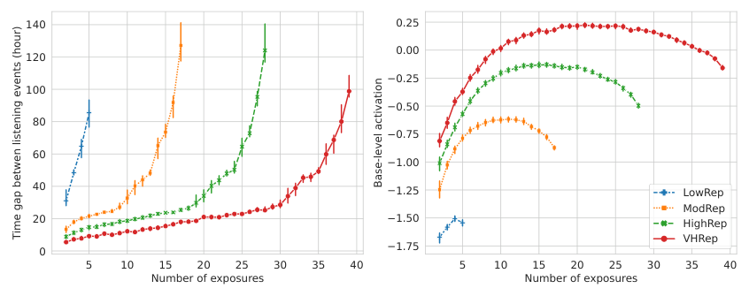
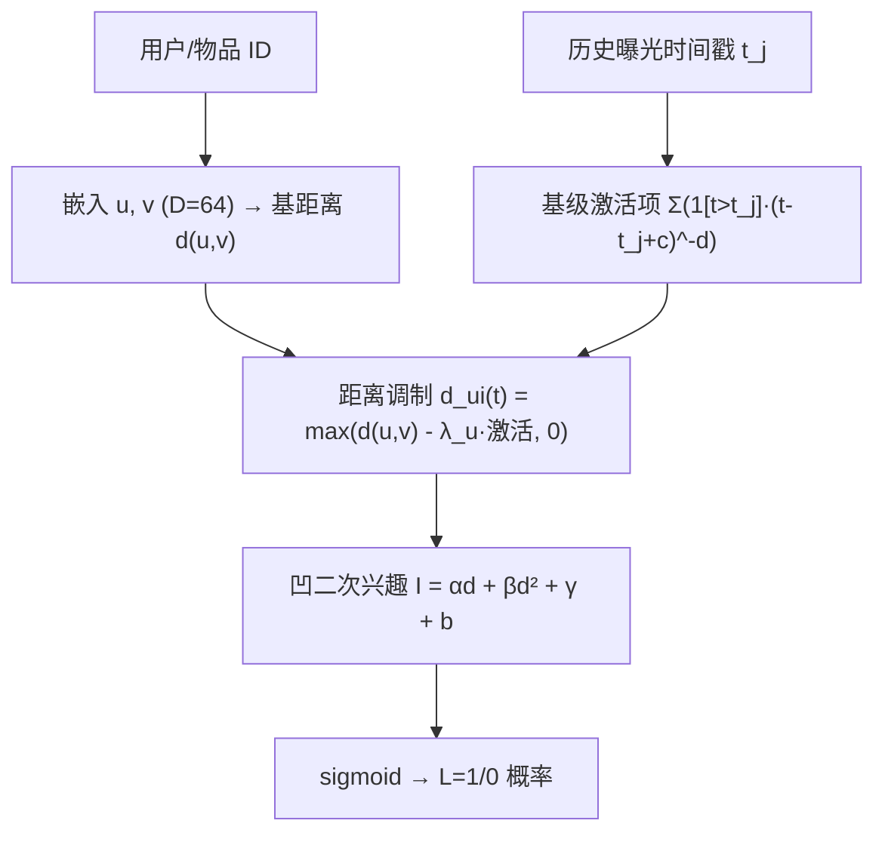
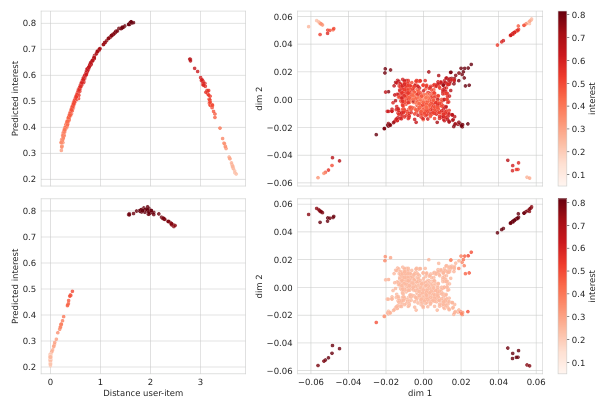

# Ex2Vec: Characterizing Users and Items from the Mere Exposure Effect (基于单纯曝光效应的用户与物品表征)

- **会议/期刊**: RecSys 2023 (ACM RecSys, Singapore)
- **作者与机构**: Bruno Sguerra, Viet-Anh Tran, Romain Hennequin（Deezer Research, France）
- **推荐链路定位**: 精排/打分（重复消费场景的兴趣演化打分，不涉及召回索引）
- **研究方向**: 序列与会话推荐 / 协同过滤（距离式隐空间）
- **论文原文**: [论文原文链接](https://arxiv.org/abs/2311.10635v1)
- **开源代码**: [ex2vec](https://github.com/deezer/ex2vec)（含数据）

## TL;DR (1分钟核心速览)

传统推荐假设"过去喜欢的将来也喜欢"，但重复曝光会先抬升后消磨兴趣（单纯曝光效应 MEE 的倒 U 曲线）。Ex2Vec 把用户-物品的欧氏距离视为"感知不确定性"，用 ACT-R 基级激活（重复次数 × 频率 × 近因）对该距离做**个性化负向调制**（学习=距离缩小、遗忘=距离回弹），再套一个凹二次函数把距离映成兴趣，从而同时获得"是否会重复收听"的预测与可解释的用户/物品表征。在 Deezer 新歌收听日志上，按逐曝光的二分类协议（非排序协议），Balanced Accuracy 64.27%、Weighted F1 64.30%，较最强基线 `Prev` 相对提升 7.3%/7.5%。

## Background & Motivation (背景与核心矛盾)

- **主流范式**: 用协同过滤/序列模型把用户与内容按历史交互"拉近"，兴趣被建模为静态或单调漂移的偏好向量（如 Curmei 等人把 MEE 实现为把用户向量线性推向交互物品）。
- **前人局限①**: 线性"推向物品"意味着喜欢新歌就要牺牲旧偏好（不能同时爱 Beatles 与 Stones），且缺乏饱和机制，无法表达倒 U 形。
- **前人局限②**: ACT-R 基级激活类模型（`BL` / `BL_fit`）只把记忆激活值直接当兴趣代理，缺少"激活 → 兴趣"的非线性映射，无法刻画峰值与过曝后的厌倦。
- **核心洞察 (Key Insight)**: 作者在 Deezer 2022 年 8 月新歌数据上验证：按重复次数分桶（LowRep 5–16 / ModRep 17–27 / HighRep 28–38 / VHRep 39–50），完整收听比例随曝光先升后降（除 LowRep 外均呈倒 U），且重复事件的时间间隔先稳后拉长——与"学习→习惯化→厌倦"两因子模型一致。
- **本文切入点**: 只调制 **该用户与该物品之间的相对距离**（而非搬动用户向量），并把距离经凹二次函数映射为兴趣，让"距离太近/太远都不好"的环形最优结构自然浮现。

<figure class="paper-figure" markdown="span">
  <figcaption>图2. 左：每类重复行为的收听事件间时间间隔中位数随曝光次数的变化，带0.95置信区间。右：每类的基础水平激活值中位数随曝光次数的变化，带0.95置信区间。</figcaption>
</figure>

## Method (核心方法设计)

### 1. 整体框架 (Overall Architecture)

用户/物品 one-hot 经嵌入层得到 $\mathbf{u},\mathbf{v}\in\mathbb{R}^{64}$，计算基距离$d(\mathbf{u},\mathbf{v})$（论文实测欧氏距离最优）；随后从该用户对该曲的历史曝光时间戳$\{t_j\}$计算 ACT-R 基级激活式的变体，作为"学习量"从基距离中扣除，得到时间相关的距离$d_{u,i}(t)$；该距离再经凹二次函数映射为兴趣$I$，最后 sigmoid 得到"本次曝光是否完整收听（$L=1$）"的概率。训练端用 log loss 联合学习嵌入与全部标量参数；推理端对任意$(u,i,t)$ 只需 O(1) 计算，可直接用于播放列表的"何时加入/何时撤下"决策。

### 2. 关键设计拆解 (Key Designs)

1. **相对距离调制（Learning-as-Distance-Shrinkage）**：为规避"拉向物品即破坏旧偏好"，只改 $\mathbf{u}$与$\mathbf{v}_i$ 的距离，且用量按用户个性化缩放：
$$d_{u,i}(t)=\max\Big(d(\mathbf{u},\mathbf{v})-\lambda_u\sum_{j=1}^{n}\mathbb{1}[t>t_j]\,(t-t_j+c)^{-d},\,0\Big),\quad \lambda_u=\lambda+\lambda_u^{b}$$
   去掉 ACT-R 原式的 $\ln$、加入截断$c=3$使单次曝光的学习量有界、以$\max(\cdot,0)$封底；$d=0.5$沿用 ACT-R 默认衰减。直觉：重复=熟悉度上升→距离收缩，久不接触则$(t-t_j+c)^{-d}$ 衰减、距离回弹至基距离（遗忘）。

2. **凹二次兴趣映射（Inverted-U by Construction）**：直接令"兴趣=距离"只能单调，作者令 $\beta<0$（初始$\alpha=1.0,\beta=-0.0065,\gamma=0.5$）：
$$I(\mathbf{v},\mathbf{u},t)=\alpha\,d_{u,i}(t)+\beta\,d_{u,i}(t)^{2}+\gamma+b,\qquad b=b_u+b_i$$
   由 $\beta<0$保证曲线开口向下、顶点$d^{*}=-\alpha/(2\beta)$，即"过近（太简单/太熟）与过远（太陌生）都低兴趣"，与 Berlyne 的 collative variable 假设同构；用户/物品偏置$b_u,b_i$ 吸收个体与曲目层面的差异。这解释了图 3 中高兴趣物品在用户周围呈环状分布。

3. **训练目标、负样本与推理开销**：目标为逐曝光二分类的对数损失加 L2：$\mathcal{L}=-\sum \big[y\log \hat{y}+(1-y)\log(1-\hat{y})\big]+\eta\|\Theta\|_2^2$，$\hat{y}=\sigma(I)$。**不做负采样**——$L=0$（曝光但收听时长 <80%）与$L=1$的真实曝光事件都用上，这是一个点式分类任务而非全库排序；Adam 优化，$D=64$，100 epoch，$\alpha,\beta,\gamma,c,\lambda,\lambda^b_u,b$与嵌入联合学习。线上打分零检索开销，但需维护每对$(u,i)$ 的曝光时间戳序列。

## Experimental Setup & Evaluation Protocol (实验设置与评估协议)

- **数据集与预处理**（Deezer 自有日志，2022-08 新歌、观察窗至 12 月，去除时间窗末 20% 序列）：

| 数据集 | #Users | #Items | #Interactions | 说明 |
| :--- | :---: | :---: | :---: | :--- |
| 观测集（图 1/2 分析） | 52k | 13.7k | ≈4.7M | 过滤收听 <20 首的用户与 <20 人的曲目；序列长度限于 5–50 次曝光 |
| 训练/评测集 ($k_{item}=k_{user}=30$) | 3.6k | 878 | ≈1.5M | 递归 k-core 过滤至 30，保证用户/物品可被表征 |

- **数据划分与防穿越**: **逐用户物品级留出**——每人随机选 4 个物品，将其与该用户的**全部曝光记录**从训练集删除（物品本身仍因其他用户而保留在训练集中），其中 2 个物品作验证、2 个作测试；最终指标为 5 次随机切分的均值 ± 标准差。
- **排名评测协议**: **非排序协议**。任务是预测单次曝光是否会被完整收听（$L=1$），报告 Balanced Accuracy 与 Weighted F1；阈值在验证集上取最大化 Balanced Accuracy 的值。**没有做 Full-Ranking 或 Sampled Ranking**，这点需在引用其结论时特别注意。
- **对比基线与超参**: 4 个基线 `SLRC`（学习物品级复听时间模式的序列模型，BPR 基础强度）、`BL`（原始基级激活）、`BL_fit`（拟合衰减参数的基级激活）、`Prev`（上次听了这次就预测听，等价于把倒 U 平移一次曝光）；`Ex2Vec` 与 `SLRC` 同用 $D=64$，学习率网格$\{5\text{e-}5,2\text{e-}4,7.5\text{e-}4,1\text{e-}3\}$，未报告显著性检验。

## Key Experimental Results (实验关键数据)

### 1. 主实验对比 (Main Results)

| Model | Balanced Acc (%) | Improv. (vs. best base) | Weighted F1 (%) | Improv. |
| :--- | :---: | :---: | :---: | :---: |
| `Prev`（倒 U 平移一次曝光） | 59.88 ± 0.32 | — | 59.83 ± 0.32 | — |
| `SLRC`（序列复听模型） | 58.16 ± 0.16 | — | 58.15 ± 0.17 | — |
| `BL`（ACT-R 基级激活） | 57.81 ± 0.28 | — | 58.13 ± 0.31 | — |
| `BL_fit`（拟合衰减） | 57.48 ± 0.35 | — | 57.90 ± 0.42 | — |
| **Ex2Vec** | **64.27 ± 0.40** | **+7.33%** | **64.30 ± 0.38** | **+7.47%** |

### 2. 消融实验 (Ablation Study)

原文**未设独立的 `w/o` 消融表**，其组件贡献以"同类变体基线"形式给出（下表据表 1 数值整理，绝对差值为 Balanced Acc）：

| 组件变体（近似消融） | Balanced Acc (%) | Δ vs. Ex2Vec | 缺什么 |
| :--- | :---: | :---: | :--- |
| **Ex2Vec（完整）** | **64.27** | — | — |
| `Prev`：仅保留倒 U 形态 | 59.88 | −4.39 | 无可学习的距离/学习速率 |
| `SLRC`：仅时间强度、无 MEE 曲线 | 58.16 | −6.11 | 无倒 U 兴趣映射 |
| `BL`：仅基级激活、无二次映射 | 57.81 | −6.46 | 无"距离→兴趣"非线性 |
| `BL_fit`：拟合衰减、无二次映射 | 57.48 | −6.79 | 同上，拟合 $d$ 反而略降 |

### 3. 关键实验发现 (Key Findings)

1. **"倒 U 的形状"本身贡献有限，"峰值位置可学习"才是关键**：哪怕把倒 U 整体平移一次曝光（`Prev` 59.88%）就已显著优于纯时间强度模型 `SLRC`（58.16%）与基级激活 `BL`（57.81%），但 Ex2Vec 再提升 4.39 个绝对点，说明用户/物品个性化的 $\lambda_u$、$b_u,b_i$ 使每个 (用户, 歌曲) 的峰值位置不同，是增益的主要来源。
2. **ACT-R 激活值不能直接当兴趣**：`BL` 与 `BL_fit` 几乎等价（57.81 vs 57.48，甚至拟合衰减更差），证明瓶颈不在衰减参数是否贴合数据，而在缺少"激活→距离→兴趣"这两级映射；加上该映射后相对 `BL` 提升 11.2%。
3. **重复频率的分层解释了 LowRep 例外**：图 2 显示 HighRep/VHRep 的基级激活持续上升而事件时间间隔同步拉长（频率衰减），LowRep 类则无倒 U（兴趣单调下降）；这正是模型需要 $\lambda_u$与$b$ 做用户级分层、而非全局固定学习速率的经验依据。

<figure class="paper-figure" markdown="span">
  <figcaption>图3. 左上：无基础水平激活时，兴趣随计算得到的 𝑑𝑢,𝑖(𝑡) 距离的变化；右上：无基础水平激活时，物品嵌入的第一维和第二维及相应的预测兴趣；左下：在较高基础水平激活值下，给定距离的预测兴趣；右下：在较高基础水平激活下计算得到的兴趣对应的物品嵌入第一维和第二维。</figcaption>
</figure>

## Highlights & Limitations (亮点、对比与审稿批判)

- **与代表作对比 (vs. Prior Work)**: 与 Curmei 等把 MEE 实现为"用户向量线性推向物品"相比，Ex2Vec 只改相对距离，避免"喜新弃旧"且自带饱和；与 `BL`/`BL_fit` 等 ACT-R 复听模型相比，多了一层可学习的凹二次兴趣函数与用户个性化学习率；与 `SLRC` 这类序列/点过程模型相比，它显式建模"过曝后兴趣下降"而非单调强度累积。
- **可迁移亮点**: (1) 把"记忆衰减核"当作**距离调制器**而非直接打分器，可移植到任何距离式隐空间（双塔/矩阵分解）做重复消费去偏；(2) 以 $\beta<0$强制倒 U 形态并用顶点$d^{*}$ 解释物品在用户周围成环分布，为"该推多相似"提供了可解释的带宽超参。
- **审稿级局限批判**: (1) **评估协议偏窄**——仅音乐单域、仅点式二分类 + 5 次随机物品留出，既无 Full-Ranking 也无采样排序，且未做显著性检验；`Prev` 这类极简基线已拿到 59.88%，说明任务本身的头部信号很强，7.3% 相对提升的实践含义需线上 A/B 佐证。(2) **建模与工程短板**——只调制交互物品的相对距离，忽略"听了相似歌曲也会影响该物品的熟悉度"（作者自认的 future work）；打分需为每个 $(u,i)$保存完整曝光时间戳序列，长尾曲目序列极长时存储与流式更新成本高，且$c,d,\alpha,\beta,\gamma$ 初值敏感、无复杂度分析。

## Rating (四维评分)

- **方法创新性 (Novelty)**: ⭐⭐⭐⭐ （把 ACT-R 基级激活改造为"距离收缩+遗忘回弹"算子，并以凹二次函数强制倒 U，心理学机制到算子的转译干净且非拼装）
- **评估协议与实验扎实度 (Protocol & Experiments)**: ⭐⭐⭐ （数据真实、5 次切分给出方差，但只有单域点式分类、5 个基线、无显著性检验与独立消融表）
- **写作与数学规范度 (Clarity & Rigor)**: ⭐⭐⭐⭐ （公式 1/2 与 ACT-R 原式的差异逐项交代，图 2/3 的经验证据与建模选择对得上；衰减参数符号表述略有歧义，且缺少复杂度分析）
- **工业落地与复现价值 (Industrial & Practical Value)**: ⭐⭐⭐⭐ （代码与数据全开源、O(1) 打分可直接嵌入播放列表调度，但需维护逐对曝光时间戳，冷启动新歌/新用户的可学习性依赖 k-core 过滤后的样本量）

