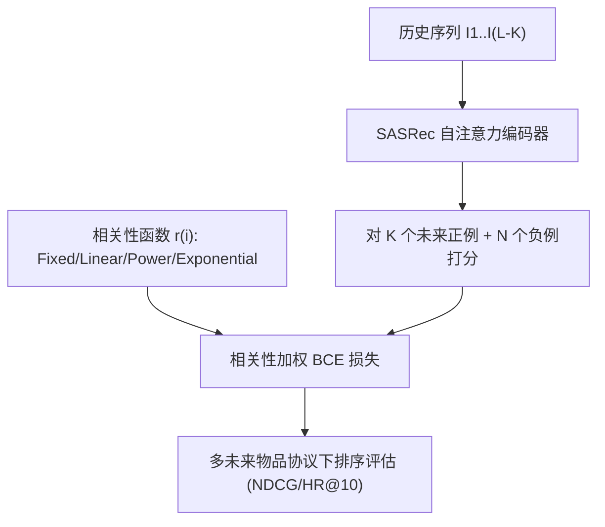
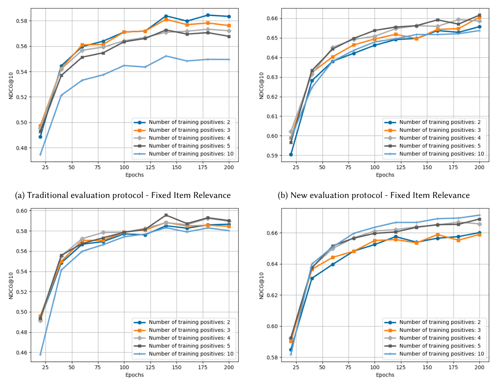

# Integrating Item Relevance in Training Loss for Sequential Recommender Systems (序列推荐训练损失中的物品相关性建模)

- **会议/期刊**: RecSys 2023 (17th ACM Conference on Recommender Systems, short paper, pp. 1114–1119)
- **作者与机构**: Andrea Bacciu, Federico Siciliano, Fabrizio Silvestri (Sapienza University of Rome)；Nicola Tonellotto (University of Pisa)
- **推荐链路定位**: 精排（next-item 排序打分与训练目标）
- **研究方向**: 序列与会话推荐 / 自监督对比学习与交互去噪
- **论文原文**: [论文原文链接](https://arxiv.org/abs/2305.10824v3)
- **开源代码**: 作者未放出实现；实验基于 SASRec 参考实现 [SASRec.pytorch](https://github.com/pmixer/SASRec.pytorch)

## TL;DR (1分钟核心速览)

序列推荐普遍把"下一个物品"当作唯一正样本，而真实交互序列存在误点击、账号共享等噪声，单正样本假设会误判模型优劣并放大噪声惩罚。本文提出多未来物品（MFI）评估协议与相关性加权损失：保留 $K$个未来物品作为正样本，并按位置赋予递减权重$r(i)$。在 ML-1M/ML-100K/Foursquare-NYC/TKY 上以 100 负样本采样排序评测，最佳变体 Linear 相比 SASRec 取得 NDCG@10 +1.2%（旧协议）与 +1.63%（新协议）。

## Background & Motivation (背景与核心矛盾)

- **主流范式**: SASRec 类自注意力序列模型 + 二元交叉熵（BCE），训练与评估均只把一个未来物品视为正例、其余全库/采样物品为负。
- **前人局限**: ① 现实交互含误点击、多人共用账号、兴趣漂移等噪声，唯一正样本可能是"错的"目标，直接惩罚正确排序；② 旧协议下各模型的差距常落在噪声范围内（如 ML-100K 上多模型 HR@10 仅差 0.4%），无法判别模型真实优劣。
- **核心洞察 (Key Insight)**: 一个合理的推荐列表不应只命中 $I_{L+1}$，而应在排名靠前的若干位置容纳$[I_{L+1},\dots,I_{L+K}]$ 这一整段未来行为；越近的未来物品越确定，应被赋予越大权重。
- **本文切入点**: 把评估协议从"单正例"松弛为"$K$ 个有序正例"，并让训练损失与评估目标对齐——用相关性函数对多正样本的损失加权。

## Method (核心方法设计)

### 1. 整体框架 (Overall Architecture)

方法不改动 SASRec 的编码器结构（自注意力块 + 位置嵌入），仅在数据切片与损失层做插入式改造。训练侧把序列切成 $[I_1,\dots,I_{L-K}]$作为输入、$K$个未来物品作为正样本；模型对正样本集合与负样本集合打分后，用相关性加权 BCE 聚合梯度；推理侧仍对候选集输出排序分数，评估时用$K$ 个未来物品共同计算 NDCG/HR。

### 2. 关键设计拆解 (Key Designs)

1. **MFI 多未来物品评估协议（把评估从"命中一个"改为"排好一段"）**：设用户序列 $[I_1,\dots,I_L]$，训练用$[I_1,\dots,I_{L-K}]$，测试用$[I_{L-K+1},\dots,I_L]$；理想排名即这$K$个物品按时间顺序排列。这样偶发噪声点击最多只损失一个位置的收益，而非全盘归零；当$K=1$、$r(1)=1$ 时协议退化为传统设置，故为严格泛化。

2. **相关性函数族（定义"多正例"之间的权重）**：要求 $r:\mathbb{N}\to[0,1]$满足归一化$\sum_{i=1}^{K} r(i)=1$与单调性$r(i+1)\le r(i)$，给出四种闭式：Fixed$r(i)=1$、Linear$r(i)=K-i$、Power$r(i)=(K-i)^2$、Exponential$r(i)=e^{K-i}$（后三者再归一化）。直觉：Linear 在"信任近邻"与"容忍远期噪声"间折中，Exponential 则几乎退回单目标，故在噪声场景中退化最快。

3. **相关性加权损失与训练/推理开销**：将 BCE 从"单正例求和"改为"按相关性加权的多正例求和"，负例项保持等权：
$$\ell(\boldsymbol{x}\mid pos,neg,r)=-\sum_{i=1}^{pos}\log\left(\boldsymbol{x}^{pos}_{i}\right)\,r(pos-i+1)-\sum_{i=1}^{neg}\log\left(1-\boldsymbol{x}^{neg}_{i}\right)$$
其中 $\boldsymbol{x}^{pos}_{i}$为第$i$个正例的 sigmoid 打分。相比原 SASRec，仅正例项由 1 项变为$K$项，前向计算量不变，反向多$K-1$ 个 log 项的乘加，训练开销近似线性微增；推理阶段完全不增加成本（仍是单序列编码 + 候选打分）。

## Experimental Setup & Evaluation Protocol (实验设置与评估协议)

- **数据集与预处理**: 采用领域标准切分（按原文不额外声明 5-core 过滤），四数据集覆盖电影与 POI 签到两类场景：

| 数据集 | #Users | #Items | #Interactions | 稀疏度/密度 | 特征/场景说明 |
| :--- | :---: | :---: | :---: | :---: | :--- |
| MovieLens-1M | 6,040 | 3,706 | 1,000,209 | 4.47% | 电影评分，稠密基准 |
| MovieLens-100K | 943 | 1,682 | 100,000 | 6.31% | 小规模电影，噪声敏感 |
| Foursquare NYC | ~1,083 | ~5,000 | 227,428 | ~4.2% | 纽约签到，短序列多噪声 |
| Foursquare TKY | ~2,293 | ~8,000 | 573,703 | ~3.1% | 东京签到，长尾 POI |

- **数据划分与防穿越 (Splitting Strategy)**: `Leave-One-Out` 的推广形式——传统协议留最后 1 个物品测试；新协议留最后 $K=10$ 个物品测试，其余全部训练，无全局时间戳切分，存在跨用户时间穿越的固有局限。
- **排名评测协议 (Ranking Protocol)**: `Sampled Ranking`，每个正例配 100 个随机负例（不从输入序列中采样），报告 NDCG@10 与 HR@10；未做 Full-Ranking，也未报告显著性检验。
- **对比基线与超参设置**: 基线为 SASRec 原版（Baseline）与等权多正例损失（Fixed，源自 Query-Recommendation 的相似度思想），加上本文 Linear/Power/Exponential 三个变体；沿用 SASRec 原文超参（隐藏维 $d=64$、2 层自注意力、最大序列长 50、Adam、学习率 0.001）。

## Key Experimental Results (实验关键数据)

### 1. 主实验对比 (Main Results)

传统协议（1 正例 + 100 负例，NDCG@10 / HR@10）：

| Model | ML-1M | ML-100K | FSQ-NYC | FSQ-TKY |
| :--- | :---: | :---: | :---: | :---: |
| Baseline (SASRec) | 0.5855 / **0.8228** | 0.4300 / 0.7041 | 0.6649 / 0.7525 | 0.7217 / **0.8116** |
| Fixed (等权多正例) | 0.5483 / 0.8017 | 0.4246 / 0.7084 | 0.6698 / 0.7581 | 0.7247 / 0.8094 |
| Linear | **0.5896** / 0.8187 | **0.4358** / 0.7137 | 0.6715 / 0.7581 | 0.7295 / 0.8081 |
| Power | 0.5751 / 0.8220 | 0.4309 / 0.6999 | **0.6765** / **0.7719** | 0.7229 / 0.8090 |
| Exponential | 0.5169 / 0.7763 | 0.4233 / 0.6999 | 0.5717 / 0.7442 | 0.6195 / 0.7872 |

新协议（10 个未来正例 + 100 负例，NDCG@10 / HR@10）：

| Model | ML-1M | ML-100K | FSQ-NYC | FSQ-TKY |
| :--- | :---: | :---: | :---: | :---: |
| Baseline (SASRec) | 0.6532 / 0.6151 | 0.5638 / 0.5269 | **0.7617** / **0.6864** | 0.8080 / 0.7433 |
| Fixed | 0.6562 / 0.6188 | 0.5632 / 0.5266 | 0.7611 / 0.6848 | 0.8139 / 0.7508 |
| Linear | **0.6694 / 0.6307** | **0.5753 / 0.5368** | 0.7549 / 0.6765 | **0.8234 / 0.7570** |
| Power | 0.6607 / 0.6230 | 0.5694 / 0.5298 | 0.7625 / 0.6848 | 0.8193 / 0.7549 |
| Exponential | 0.6536 / 0.6147 | 0.5667 / 0.5297 | 0.7624 / 0.6845 | 0.8185 / 0.7544 |
| Improv. (Linear vs Baseline) | +2.48% / +2.54% | +2.04% / +1.88% | −0.89% / −1.44% | +1.91% / +1.84% |

### 2. 消融实验 (Ablation Study)

原文以曲线（Fig. 4）而非数值表报告，下表为各变体在"增加训练正例数"时的趋势归纳（$K_{train}\in\{2,3,4,5,10\}$）：

| 变体 | 旧协议 NDCG@10 随 $K_{train}$变化 | 新协议 NDCG@10 随$K_{train}$ 变化 | 结论 |
| :--- | :---: | :---: | :--- |
| Fixed（等权） | 单调下降 ↓ | 升至 $K_{train}=5$ 后骤降 ↓ | 等权忽略时序，不适用 |
| Linear | 轻微下降 ↓（幅度最小） | 单调上升 ↑ | 训练/评估目标一致性最好 |
| Power | 近似 Linear ↓ | 近似 Linear ↑ | 次优 |
| Exponential | 明显下降 ↓ | 近似 Fixed ↓ | 近似退化为单目标 |

核心组件消融（以 ML-1M 为例，定性）：去掉多正例仅保留单正例（Baseline）→ 新协议 NDCG 掉 2.48%；保留多正例但去掉相关性加权（Fixed）→ 相比 Linear 再掉约 2.0%（0.6562 vs 0.6694）。

<figure class="paper-figure" markdown="span">
  <figcaption>图4. 在Movielens-1M上，不同训练正样本数量下，新物品相关性模型在各训练轮次的NDCG@10</figcaption>
</figure>

### 3. 关键实验发现 (Key Findings)

1. **评估协议本身就能放大模型差异**：旧协议下 ML-1M 五个模型 NDCG 极差仅 0.07（0.5896 vs 0.5169）；切换到新协议后同一批模型极差仍相近，但 Linear 对 Baseline 的优势从 +0.70% 扩大到 +2.48%，说明 MFI 更能区分"真会排一段"的模型。
2. **权重形状比"是否用多正例"更关键**：Linear 在 4 个数据集的传统协议中取得 2 个最优、新协议中取得 3 个最优；而等权 Fixed 与近似单目标的 Exponential 在新协议下常与 Baseline 持平甚至更差（NYC 上 Exponential 旧协议仅 0.5717 NDCG，显著低于 0.6649）。
3. **训练正例数需与评估正例数匹配**：旧协议下增加 $K_{train}$一律伤害性能（Fixed 单调下降），因为它引入了评估时不考察的目标；新协议下 Linear 随$K_{train}$增大持续提升，暗示$K_{train}$ 尚未触及饱和点，仍有扩展空间。

## Highlights & Limitations (亮点、对比与审稿批判)

- **与代表作对比 (vs. Prior Work)**: 与 SASRec 的关系是"零结构改动"——仅在损失层替换，故鲁棒性收益可归因明确；与 Query-Recommendation 的相似度加权思想相比，本文用单调归一化函数族替换其等权（Fixed）方案并把时序顺序显式编码进权重；相比 SGL/SimGCL 等对比学习去噪路线，本文不需数据增广与额外视图，成本低一个量级。
- **可迁移亮点**: ① "评估协议与损失必须对齐"这一原则可直接迁移到 CTR/多目标排序中的多正反馈建模（如点击后购买序列）；② 归一化 + 单调性的权重函数族可作为一个轻量正则项插入任意 BPR/BCE 训练目标。
- **审稿级局限批判**: ① 评测仍为 100 负例采样排序而非 Full-Ranking，且未做显著性检验、单次运行（SASRec 本身对随机种子敏感），$1\%$级提升的稳健性存疑；② 新协议留最后 10 个物品做测试会压缩训练序列（短序列数据集如 FSQ-NYC 上序列更不充分，恰是该数据集上 Linear 反而下降 −1.44%），且缺少$K$与$r$ 的联合敏感度分析和在线验证。

## Rating (四维评分)

- **方法创新性 (Novelty)**: ⭐⭐⭐ （"多正例 + 单调归一化权重"的洞察清晰且贴近真实噪声，但本质是损失函数加权的轻量改造，缺乏理论刻画）
- **评估协议与实验扎实度 (Protocol & Experiments)**: ⭐⭐⭐ （MFI 协议与双协议对照设计有价值，但仅 100 负例采样、无显著性检验、消融只给曲线不给数值）
- **写作与数学规范度 (Clarity & Rigor)**: ⭐⭐⭐⭐ （相关性函数的归一化/单调性定义与退化到传统协议的性质交代清楚，公式紧凑易复现）
- **工业落地与复现价值 (Industrial & Practical Value)**: ⭐⭐⭐⭐ （推理零额外开销、训练改动极小，可直接在现有序列模型上替换损失，但作者未开源代码，落地需自行复现）

