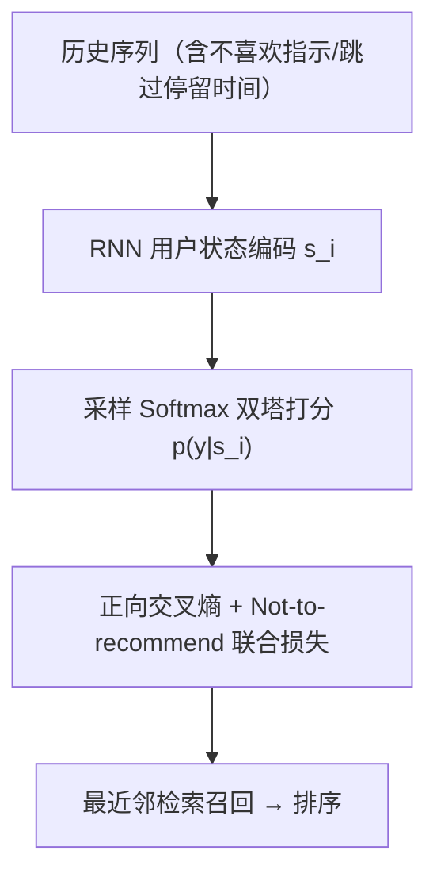
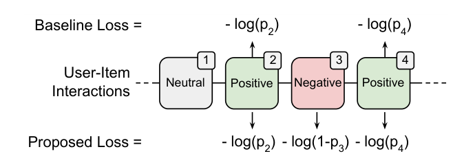

# Learning from Negative User Feedback and Measuring Responsiveness for Sequential Recommenders (面向序列推荐器的负反馈学习与响应性度量)

- **会议/期刊**: RecSys 2023 (Industry Track)
- **作者与机构**: Yueqi Wang, Yoni Halpern, Shuo Chang, Jingchen Feng, Elaine Ya Le, Longfei Li 等 (Google; Alex Beutel 现于 OpenAI)
- **推荐链路定位**: 召回 (Retrieval Stage)
- **研究方向**: 序列与会话推荐 / 自监督去噪与负反馈建模
- **论文原文**: [https://arxiv.org/abs/2308.12256v1](https://arxiv.org/abs/2308.12256v1)
- **开源代码**: 暂未开源

## TL;DR (1分钟核心速览)

序列召回长期只从正向交互学习，显式不喜欢/隐式跳过多交由下游排序或启发式处理。本文在检索阶段引入 not-to-recommend 损失 $-\log(1-p)$，与正向交叉熵加权联合，同时学习“推荐什么”与“不推荐什么”，并规避负奖励梯度爆炸；另提反事实模拟框架，用模拟用户对比有/无反馈两分支的相似推荐比例以量化响应性。线上 A/B：首页不喜欢率 -2.44%、同创作者重复不喜欢 -9.60%，反事实相似推荐 -60.8%/-64.1%。

## Background & Motivation (背景与核心矛盾)

- **主流范式**: 工业序列召回普遍以正向交互为标签，用交叉熵或 REINFORCE 优化 $p(y_i|s_i)$；负反馈只在输入特征、softmax 负样本或辅助任务里被动出现。
- **前人局限**: ①召回目标中缺少“别推荐什么”的显式监督，负反馈来临后模型难以及时收缩同类推荐；②观测数据存在用户-推荐器反馈回路混杂，离线准确率、在线指标与相关性日志都无法直接刻画“系统对负反馈多敏感”。
- **核心洞察 (Key Insight)**: 负反馈应当作为与正向并列的**训练标签**而非仅输入特征；而“不推荐”应被直接建模为独立概率项，使梯度在 $p\to 0$ 时保持有限。
- **本文切入点**: 用 $\log(1-p)$ 形式的 not-to-recommend 损失替代负权重交叉熵 / 负奖励 REINFORCE，并以反事实模拟把“响应性”变成可比指标。

## Method (核心方法设计)

### 1. 整体框架 (Overall Architecture)

模型运行于检索召回阶段。输入为用户历史交互序列，每个物品除交互时长外携带一个二元不喜欢指示特征，跳过信号则编码进停留时间特征；序列经 RNN 汇总为用户状态向量 $\mathbf{s}_i$，与物品嵌入内积后经 softmax 得到召回概率$p(y_i|\mathbf{s}_i)$。训练采用采样 softmax，服务时走最近邻检索。训练目标由正向交叉熵与负向 not-to-recommend 损失加权求和构成，联合优化后输出召回候选交下游排序。**改动仅在损失函数与输入特征，不引入新网络结构或在线开销。**

### 2. 关键设计拆解 (Key Designs)

1. **Not-to-recommend 损失（核心创新）**: 若把负样本塞进交叉熵并赋负权重、或放进 REINFORCE 用负奖励，当 $p(y_i|s_i)\to 0$ 时梯度会爆炸，工业级超大物品空间下更甚。本文直接建模“不推荐该物品”的概率并加权联合：

$$\mathcal{L} = -\sum_{i\in D_{pos}} r_i \log p(y_i|s_i) - \sum_{i\in D_{neg}} w_i \log(1-p(y_i|s_i))$$

因 $-\log(1-p)$在$p\to 0$处梯度为$\frac{1}{1-p}$恒有限，训练稳定；且正负损失**解耦**，$w_i$ 可按反馈强度独立调，不与 softmax 负采样纠缠，从而对负标签实现更“定向”的学习。

<figure class="paper-figure" markdown="span">
  <figcaption>图1：将负向用户反馈纳入序列推荐器的训练目标。图中展示了用户-物品交互序列。具有正向或负向反馈的物品被用作训练标签。</figcaption>
</figure>

2. **显式与隐式负反馈的统一建模**: 显式不喜欢密度低但语义强，隐式跳过密度高但噪声大，二者共享同一损失形式，仅靠权重 $w_i$ 区分强弱；输入侧分别用二元特征与停留时间编码，使模型既能“记住”历史负反馈，也能在梯度上学到抑制同类推荐。这一统一性使方法可平移到其他反馈信号。

3. **训练目标、负采样与推理效率**: 总损失即上述加权和；训练用采样 softmax（批内/采集器负采样，无需额外难负样本挖掘），推理为最近邻检索，复杂度与基线一致、线上不增延迟。超参关键是正向权重 $r_i$与负向权重$w_i$ 的相对标定。

## Experimental Setup & Evaluation Protocol (实验设置与评估协议)

- **数据集与预处理**: 本文为工业赛道论文，无公开离线数据集，评估全部在 Google 短视频平台线上 A/B 与反事实模拟上完成。实验场景配置如下：

| 实验场景 | 反馈类型 | 反馈密度 | 回归指标 | 评估方式 |
| :--- | :---: | :---: | :--- | :--- |
| 首页信息流 | 显式不喜欢 | 低 | 不喜欢率 / 流失用户 | 线上 A/B (95% CI) |
| 沉浸式信息流 | 显式不喜欢 | 低 | 不喜欢率 / 不满意消费 | 线上 A/B (95% CI) |
| 沉浸式信息流 | 隐式跳过 | 高 | 整体愉悦度 / 多样性 | 线上 A/B (95% CI) |
| 反事实模拟 | 不喜欢 | — | 内容/创作者相似度下降 | 2000 次模拟, $k=50$ |

- **数据划分与防穿越 (Splitting Strategy)**: 线上流量随机分桶做 A/B；反事实模拟在**同一用户历史**下构造“反馈 vs 无反馈”两分支，天然避免了穿越与混杂。
- **排名评测协议 (Ranking Protocol)**: 线上以平台真实业务指标（不喜欢率、整体愉悦度、日活、多样性）衡量；响应性以分支间“与最后交互物品同内容簇/同创作者的推荐占比”相对变化衡量，而非离线 Top-K 排序指标。
- **对比基线与超参设置**: 基线包括①完全不使用不喜欢信号；②把不喜欢仅作输入特征；③启发式从输入序列剔除；损失权重 $r_i$、$w_i$ 为可调超参（具体取值未披露），显著性以 95% 置信区间判定。

## Key Experimental Results (实验关键数据)

### 1. 主实验对比 (Main Results)

**表 1：线上 A/B 实验（相对变化，95% CI 显著）**

| 场景 | 反馈类型 | 指标 | 实验组 vs 基线 |
| :--- | :---: | :--- | :---: |
| 首页 | 显式不喜欢 | 不喜欢率 | **-2.44%** |
| 首页 | 显式不喜欢 | 同创作者重复不喜欢 | **-9.60%** |
| 首页 | 显式不喜欢 | 流失用户 / 观看者 | -2.05% / -0.14% |
| 沉浸流 | 显式不喜欢 | 不喜欢率 | **-1.10%** |
| 沉浸流 | 显式不喜欢 | 同创作者重复不喜欢 | **-7.10%** |
| 沉浸流 | 显式不喜欢 | 不满意消费 | -0.35% |
| 沉浸流 | 隐式跳过 | 整体愉悦度 | **+0.40%** |
| 沉浸流 | 隐式跳过 | 日活≥1h 用户 | **+0.61%** |
| 沉浸流 | 隐式跳过 | 同创作者重复跳过 | -1.44% |
| 沉浸流 | 隐式跳过 | 多样性 | **+0.88%** |

### 2. 消融实验 (Ablation Study)

**表 2：不喜欢建模方式对线上指标与响应性的消融**

| 建模方式 | 首页不喜欢率 | 内容相似度下降 | 创作者相似度下降 |
| :--- | :---: | :---: | :---: |
| 基线（不使用不喜欢） | 参照 0 | ~0% | ~0% |
| 启发式过滤（从序列剔除） | -0.84% | — | — |
| 仅作输入特征 | -0.34%（不显著） | -22.7% | -22.8% |
| 输入特征 + 训练标签 (Ours) | **-2.44%** | **-60.8%** | **-64.1%** |

### 3. 关键实验发现 (Key Findings)

- **“进梯度”远胜“进入口”**: 不喜欢仅作输入特征时线上不喜欢率变化 -0.34%（不显著）、相似推荐仅降 22.7%；升级为训练标签后跃升至 -2.44% 与 -60.8%/-64.1%，说明“学不推荐”必须进入损失而非只进入输入。
- **抑制的是结构性同类而非单点物品**: 同创作者重复不喜欢下降 9.60%，远大于总体 2.44%，证明模型学到的是对同类创作者偏好的收缩，正好满足“别再给我推相似的”用户预期。
- **高密度隐式信号可无损增益**: 噪声较大的跳过信号加入后，整体愉悦度 +0.40%、日活≥1h +0.61%、多样性 +0.88%，同时满意消费 +0.00%、不满意消费 -0.35%，说明覆盖面收益不以牺牲体验为代价。

## Highlights & Limitations (亮点、对比与审稿批判)

- **与代表作对比 (vs. Prior Work)**: 相较“负样本进交叉熵 / REINFORCE 负奖励”（$p\to0$时梯度爆炸、工业规模更严重）与“在 softmax 负采样中上采样负样本”（未解耦、监督被稀释），本文以显式$\log(1-p)$ 项实现**梯度有限且正负解耦**的负反馈学习；相较仅作输入特征或启发式过滤，训练标签带来质的跃迁。
- **可迁移亮点**: ①$\log(1-p)$ 的“不推荐”目标可直接套用到双塔召回或列表重排的多目标中；②反事实分支对比框架可推广到任何“系统对某动作是否敏感”的响应性度量。
- **审稿级局限批判**: ①工业赛道 5 页短文，无公开离线基准、无开源代码，复现完全依赖内部平台；②权重 $w_i$ 设定与显式/隐式平衡缺乏敏感性分析，凭经验调参；③反事实模拟依赖模拟用户轨迹假设，与真实分布可能有偏，响应性数值不宜跨系统外推。

## Rating (四维评分)

- **方法创新性 (Novelty)**: ⭐⭐⭐ （not-to-recommend 损失形式简洁、工程有效，本质是带置信度负标签的交叉熵变体，理论深度有限）
- **评估协议与实验扎实度 (Protocol & Experiments)**: ⭐⭐⭐ （线上 A/B 带 95% CI 且覆盖两类反馈两种场景，但缺离线基准、样本量与功效检验细节）
- **写作与数学规范度 (Clarity & Rigor)**: ⭐⭐⭐⭐ （5 页短文公式清晰、问题—方法—测量三段式严谨，但关键超参与骨干细节披露有限）
- **工业落地与复现价值 (Industrial & Practical Value)**: ⭐⭐⭐⭐⭐ （亿级用户线上验证、改动仅在损失与特征、无额外在线开销，落地价值极高；可惜无开源）

