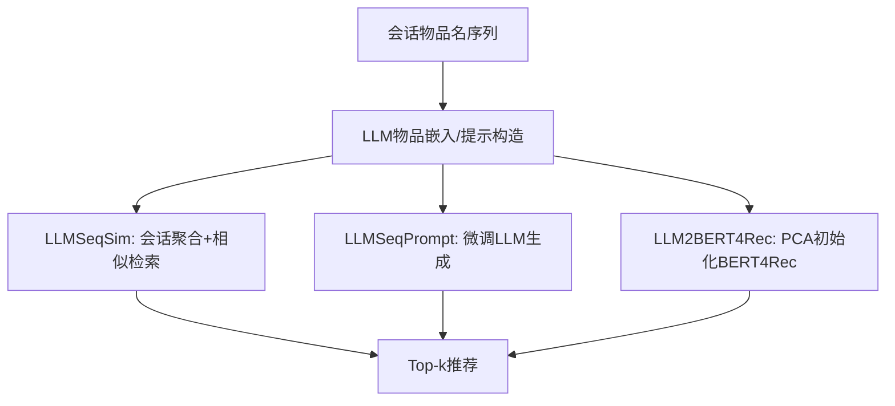

# Leveraging Large Language Models for Sequential Recommendation（利用大语言模型增强序列推荐）

- **会议/期刊**: RecSys 2023
- **作者与机构**: Jesse Harte 等；Delivery Hero Research、TU Delft、AUEB、University of Klagenfurt
- **推荐链路定位**: 召回/精排（下一物品预测）
- **研究方向**: 序列与会话推荐 / 大语言模型推荐
- **论文原文**: [论文原文链接](https://arxiv.org/abs/2309.09261v1)
- **开源代码**: [开源代码仓库链接](https://github.com/dh-r/LLM-Sequential-Recommendation)

## TL;DR (1分钟核心速览)

针对序列推荐仅靠物品ID、语义不足的问题，本文比较三种LLM用法：LLMSeqSim语义相似检索、LLMSeqPrompt生成式微调、LLM2BERT4Rec用LLM嵌入PCA初始化BERT4Rec。在Beauty与Delivery Hero目录Top-k评估中，第三种NDCG@20较BERT4Rec提升18.6%与15.4%，且简单检索在Beauty的覆盖/新颖性突出。

## Background & Motivation (背景与核心矛盾)

- **主流范式**: GRU4Rec、SASRec、BERT4Rec 等用物品ID序列建模下一物品，近期开始用LLM提供物品语义或直接生成推荐。
- **前人局限**: ID嵌入缺少物品名/品牌等语义；直接微调LLM做推荐成本高，且在稀疏、宽目录电商上易退化。
- **核心洞察 (Key Insight)**: LLM物品名嵌入编码了品牌、品类等语义，可作为序列模型的初始化先验；当语义相似性主导时，纯嵌入检索也能竞争。
- **本文切入点**: 系统对比“免训练语义检索、生成式微调、LLM表征初始化”三条正交路线。

## Method (核心方法设计)

### 1. 整体框架 (Overall Architecture)

输入为会话内物品名称序列。LLMSeqSim 先调用 `text-embedding-ada-002` 得到物品向量，对会话按均值/衰减/末项聚合，再在全目录用余弦/点积检索；LLMSeqPrompt 把前缀会话作为 prompt、末项作为 completion 微调 `ada`，生成结果按重复频次置信度排序并用最近邻映射回目录；LLM2BERT4Rec 将1536维LLM物品向量经PCA降至BERT4Rec的64维嵌入层初始化，再按标准 masked item 训练与推理。三者分别代表“免训练语义检索”“生成式微调”“LLM表征增强序列模型”。

### 2. 关键设计拆解 (Key Designs)

1. **LLMSeqSim（语义相似检索）**：针对ID模型无语义的问题，用LLM物品向量直接检索。会话向量可取均值、位置衰减或末项，最佳为仅末项：
\[
\mathbf{s}_u=\mathbf{e}_{i_{|S_u|}},\qquad \hat{i}=\arg\max_{j\in\mathcal{I}}\cos(\mathbf{s}_u,\mathbf{e}_j)
\]
直觉是Beauty中品牌/品类语义强，末项已能表达当前意图；DH宽目录长尾则失效。

2. **LLM2BERT4Rec（LLM嵌入初始化）**：针对随机初始化无先验，将物品向量降维后填入BERT4Rec嵌入层：
\[
\mathbf{E}^{\text{init}}=\mathrm{PCA}_{d}\left(\mathbf{E}^{\text{LLM}}\right),\quad d=64
\]
再以masked item交叉熵训练：
\[
p(i\mid S_u^{\text{mask}})=\frac{\exp(\mathbf{h}_t^\top\mathbf{e}_i)}{\sum_{j\in\mathcal{I}}\exp(\mathbf{h}_t^\top\mathbf{e}_j)}
\]
PCA保留主要语义方向且对齐模型维度，使序列编码器从语义先验出发。

3. **LLMSeqPrompt与训练/推理**：用“前缀会话→末项”prompt-completion微调LLM；重复生成视为置信度，幻觉物品用嵌入最近邻映射回目录。总损失为BERT4Rec masked交叉熵与LLM token交叉熵，均不依赖显式负采样。LLMSeqSim仅需向量检索，LLM2BERT4Rec为标准BERT4Rec推理，LLMSeqPrompt需调用大模型，线上开销最高。

## Experimental Setup & Evaluation Protocol (实验设置与评估协议)

- **数据集与预处理**:

| 数据集 | #Sessions | #Items | #Interactions | 平均长度 | 密度/说明 |
| :--- | :---: | :---: | :---: | :---: | :--- |
| Beauty 5-core | 22,363 | 12,101 | 198,502 | 8.9 | 0.073%，Amazon美妆评论 |
| Delivery Hero | 258,710 | 38,246 | 1,474,658 | 5.7 | 0.015%，QCommerce真实会话 |

- **数据划分与防穿越 (Splitting Strategy)**: 先按时间切分train/test，保证测试会话晚于训练；测试集采用 `Leave-One-Out`，前缀为输入、末项为ground truth。
- **排名评测协议 (Ranking Protocol)**: 在物品目录上做 Top-k 排序，报告 NDCG/HR/MRR@10/20 及 CatCov、Serendipity、Novelty；论文未报告采样负例比例。
- **对比基线与超参设置**: 对比 GRU4Rec、SKNN、BERT4Rec、SASRec、MostPopular；非LLM模型用TPE在3折验证调参，以NDCG@20为目标，报告5次最佳；BERT4Rec嵌入64维，LLM原1536维经PCA降至64。

## Key Experimental Results (实验关键数据)

### 1. 主实验对比 (Main Results)

| 模型 | B-N@10 | B-N@20 | B-HR@20 | B-MRR@20 | D-N@10 | D-N@20 | D-HR@20 | D-MRR@20 |
| :--- | :---: | :---: | :---: | :---: | :---: | :---: | :---: | :---: |
| LLM2BERT4Rec | 0.041 | **0.051** | **0.118** | 0.033 | **0.102** | **0.120** | **0.252** | **0.083** |
| LLMSeqSim | **0.044** | 0.048 | 0.079 | **0.039** | 0.039 | 0.046 | 0.096 | 0.031 |
| V_SKNN | 0.041 | 0.047 | 0.095 | 0.034 | 0.087 | 0.100 | 0.200 | 0.072 |
| BERT4Rec | 0.034 | 0.043 | 0.103 | 0.027 | 0.088 | 0.104 | 0.221 | 0.071 |
| GRU4Rec | 0.027 | 0.035 | 0.082 | 0.022 | 0.085 | 0.101 | 0.218 | 0.068 |
| SASRec | 0.026 | 0.033 | 0.080 | 0.021 | 0.084 | 0.100 | 0.212 | 0.069 |
| LLMSeqPrompt | 0.025 | 0.030 | 0.064 | 0.020 | 0.063 | 0.070 | 0.144 | 0.049 |
| MostPopular | 0.005 | 0.006 | 0.018 | 0.003 | 0.024 | 0.032 | 0.079 | 0.019 |

LLM2BERT4Rec 相对 BERT4Rec 的 NDCG@20：Beauty **+18.6%**，Delivery Hero **+15.4%**；HR@20 分别 +14.6%、+14.0%。

### 2. 消融实验 (Ablation Study)

| 配置 | Beauty NDCG@20 | DH NDCG@20 | 说明 |
| :--- | :---: | :---: | :--- |
| BERT4Rec 随机初始化 | 0.043 | 0.104 | 基线 |
| LLM2BERT4Rec（LLM+PCA） | **0.051 (+18.6%)** | **0.120 (+15.4%)** | 核心增强 |
| 置换LLM嵌入 | 低于BERT4Rec | 低于BERT4Rec | 破坏语义的对照 |

### 3. 关键实验发现 (Key Findings)

1. **语义初始化是主收益来源**：LLM2BERT4Rec 在 Beauty/DH 的 NDCG@20 分别达0.051/0.120，较BERT4Rec提升18.6%/15.4%；置换嵌入后反低于随机初始化，说明增益来自LLM语义而非统计性质。
2. **纯语义检索是双刃剑**：Beauty上LLMSeqSim的NDCG@10达0.044（最佳）、MRR@20达0.039（最佳），CatCov 0.889 vs LLM2BERT4Rec 0.260，Novelty 13.858 vs 11.888；但DH上NDCG@20仅0.046，远低于LLM2BERT4Rec的0.120，长尾宽目录削弱了相似检索。
3. **生成式微调性价比有限**：LLMSeqPrompt在Beauty NDCG@20为0.030，接近SASRec的0.033；DH仅0.070，明显低于BERT4Rec的0.104，虽高于MostPopular的0.032，但API成本与幻觉映射使其不具部署优势。

## Highlights & Limitations (亮点、对比与审稿批判)

- **与代表作对比 (vs. Prior Work)**: 相较VQ-Rec的跨域表征学习，本文不设计新表征，而验证“LLM嵌入初始化BERT4Rec”的简单高收益；相较SASRec+LLM嵌入的早期结论，本文在BERT4Rec与真实DH数据上给出更系统的三类路线对比。
- **可迁移亮点**: 用物品名LLM嵌入+PCA初始化任意ID序列模型，成本低、易复现；将语义检索作为覆盖/新颖性增强或冷启动召回支路。
- **审稿级局限批判**: 仅两个数据集，未报告显著性检验与线上A/B；LLMSeqSim在稀疏宽目录明显退化，LLMSeqPrompt依赖OpenAI API且存在幻觉，复现与成本受外部服务影响。

## Rating (四维评分)

- **方法创新性 (Novelty)**: ⭐⭐⭐⭐ （非新架构，但系统化验证三条LLM路线，语义初始化结论有实践价值）
- **评估协议与实验扎实度 (Protocol & Experiments)**: ⭐⭐⭐⭐ （含真实DH数据、5次运行与覆盖/新颖性指标，但缺显著性检验）
- **写作与数学规范度 (Clarity & Rigor)**: ⭐⭐⭐⭐ （路线清晰、公式精简；生成式细节与复杂度分析较简略）
- **工业落地与复现价值 (Industrial & Practical Value)**: ⭐⭐⭐⭐ （代码开源、LLM2BERT4Rec易落地；LLMSeqPrompt的API成本与幻觉需工程兜底）

