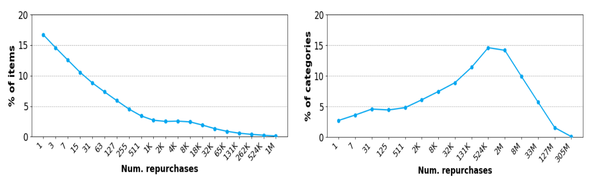
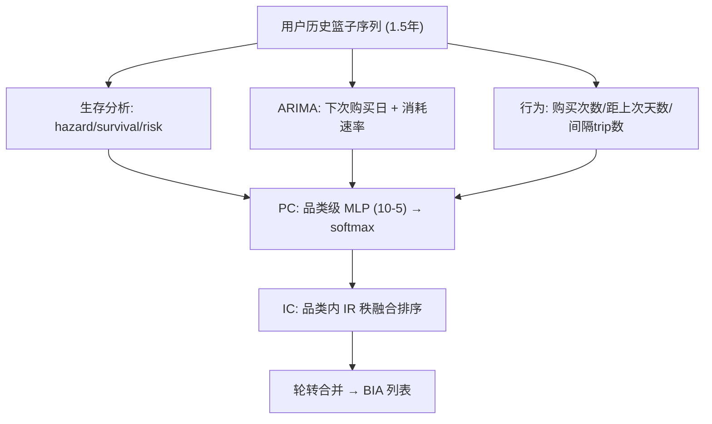

# Personalized Category Frequency prediction for Buy It Again recommendations (面向"再次购买"推荐个性化品类频率预测)

- **会议/期刊**: RecSys 2023 (short paper)
- **作者与机构**: Amit Pande, Kunal Ghosh, Rankyung Park — Target Corporation (Data Sciences)
- **推荐链路定位**: 召回（首页 Buy-It-Again 模块 / 品类虚拟货架）
- **研究方向**: 序列与会话推荐 / CTR 预估与特征交叉
- **论文原文**: [https://arxiv.org/abs/2308.01195v1](https://arxiv.org/abs/2308.01195v1)
- **开源代码**: 暂未开源

## TL;DR (1分钟核心速览)

针对大零售商百万级用户与商品下"逐商品建模复购"极度稀疏、训练不可扩展的痛点，本文将 BIA 拆为**品类级重购概率预测 (PC) + 品类内商品排序 (IC)** 的两级层级模型：PC 以生存分析 (hazard/survival) 与逐用户-品类的 ARIMA 预测 (下次购买日、消耗速率) 共 11 维特征喂入两层 MLP，IC 以频率秩与新近度秩的加权融合并除以"每单购买频次"得到商品次序。在 4 个公开数据集、Last-Basket 划分与全库排序协议下，NDCG@10 相对最强基线最高提升约 **15.4%**，并在 1 亿用户工业数据上 8 小时内完成 Spark 训练，线上 A/B 对比 FBought 提升 CTR +6%、转化 +8.5%、Units +27.5%。

## Background & Motivation (背景与核心矛盾)

- **主流范式**: BIA/Next-Basket 推荐以 item 粒度建模，代表作为 Sets2Sets、TIFUKNN、RepeatNet 与统计分布族 RCP/ATD/PG/MPG（Poisson-Gamma 拟合复购率）。
- **前人局限**: ① 商品级复购极度长尾——绝大多数 SKU 复购交易极少，item-grained 模型在超高维空间欠拟合；TIFUKNN 需"用户向量维度 = 全商品目录"，在亿级目录下**根本无法扩展**，Sets2Sets 的 GRU+Attention 训练以周计。② 顾客常在同一品类内换品牌/口味/规格，商品级模型把这种"品类内探索"误判为信号消失。
- **核心洞察 (Key Insight)**: 如图 1，1.5 年窗口内**少数商品**才有高频复购，而**多数品类**复购交易充足；同时梯度提升特征重要性分析显示，ARIMA 消耗速率预测与"距上次购买天数/历史购买次数"远重要于生存分析的群体性风险项——即**用户自身节奏 > 协同邻居行为**，这解释了为何 itemKNN/TIFUKNN 类协同方法不如自节奏模型。
- **本文切入点**: 把"何时该补货"从协同信号里剥离，用生存分析+时序模型显式算出来，作为特征交给一个极轻的品类级分类器。

<figure class="paper-figure" markdown="span">
  <figcaption>图1：1.5年内商品和类别占比与复购次数的关系。(a) 大多数商品的复购交易次数较少。(b) 大多数类别的复购交易次数较多。与商品相比，类别用于建模的数据量更充足。</figcaption>
</figure>

## Method (核心方法设计)

### 1. 整体框架 (Overall Architecture)

输入为用户过去 1.5 年（覆盖年度周期）的篮子序列；PC 分支为每个 (用户, 品类) 生成 11 维特征（6 个生存分析特征 + 2 个 ARIMA 预测 + 3 个行为特征），经 2 层 MLP 输出品类重购概率并排序；IC 分支在该品类已购商品内用频率秩/新近度秩融合出商品排序；两路结果按轮转 (round-robin) 交错合并为最终 BIA 列表。训练侧以"最后 m 天是否在品类内复购"构造 0/1 标签，用逻辑损失优化；推理侧在 Spark 上批量打分后导出云端实时服务，并按库存与可配送方式过滤。

### 2. 关键设计拆解 (Key Designs)

1. **生存分析驱动的"补货时刻"特征**：痛点在于复购不是稳态泊松过程，存在明显的到期效应（香蕉约 7 天、清洁用品约 21 天）。本文对每个品类构造生命表，定义风险集 $n\_risk_k$与事件集$n\_event_k$，得到离散风险率$hazard_k = n\_event_k / n\_risk_k$与生存函数$survival_k = \exp(-\sum_{k'=0}^{k} hazard_{k'})$；并额外定义一周购物节奏敏感的窗口差分$cum\_survival_k = survival_{k+3} - survival_{k-3}$与相对基准日归一化$norm\_risk_k = n\_risk_k / n\_risk_0$。直觉：把"品类群体的到期分布"转成"该用户今日的补货紧迫度"。
2. **个性化 ARIMA 消耗速率建模**：群体风险率无法刻画"这家洗发水用得快"。对每个 (用户, 品类) 自动拟合两个 ARIMA(p,d,q)（搜索范围 (3,3,0)）：一个以历史购买日为序列预测**下次购买日** $ARIMA(date)$，另一个以购买数量为序列预测**单位时间消耗速率**$ARIMA(rate)$，二者相乘即为"用完日期"。这正是特征重要性最高的两项，等价于给模型注入了用户自身的消费节律先验。
3. **IC 品类的秩融合与训练/推理开销**：品类内不做学习式打分，而是把不可比的"次数"与"天数"都转成秩——$IFR = Rk(Freq)$、$IRR = Rk(DaysSincePurchase)$——加权后再排序并除以每单购买件数：
$$IR = \left\lceil \frac{1}{NIB} \cdot Rk(\alpha \cdot IRR + \beta \cdot IFR) \right\rceil$$
其中 $\alpha,\beta$由网格搜索确定，除以$NIB$是为了让"一次买 3 瓶酸奶"的用户看到同品类多件而非被轮转打散。PC 的训练目标为标准二分类交叉熵$\mathcal{L} = -\sum_{(u,c)} \left[ y_{uc}\log \hat{p}_{uc} + (1-y_{uc})\log(1-\hat{p}_{uc}) \right]$；无负采样，标签由"品类是否在标签窗口内被复购"全量构造；推理为每个用户仅一次 MLP 前向 + 一次排序，瓶颈在 ARIMA 逐对拟合（Spark 上约 6–8 小时/亿级用户）。

## Experimental Setup & Evaluation Protocol (实验设置与评估协议)

- **数据集与预处理**: 4 个公开数据 + 1 个 Target 内部数据（未说明 5-core 类过滤，仅按用户有多次篮子筛选）：

| 数据集 | #Users | #Items | #Baskets/User | Basket Size | 特征/场景说明 |
| :--- | :---: | :---: | :---: | :---: | :--- |
| ValuedShopper | 10,000 | 7,907 | 56.85 | 8.71 | 杂货，长周期 |
| Instacart | 19,935 | 8,000 | 7.97 | 8.97 | 生鲜代购 |
| Dunnhumby | 36,241 | 4,997 | 7.99 | 7.33 | 零售交易流水 |
| TaFeng | 13,949 | 12,062 | 5.69 | 6.27 | 便利店小票 |
| Internal | ~100M | ~3M | ~25 | ~10 | 大型零售商真实流量（约 200 items/user） |

- **数据划分与防穿越 (Splitting Strategy)**: 复购推荐式划分——用用户**历史篮子预测其最后一个篮子**；80% 用户训练 / 20% 测试，5 折交叉验证，训练集再划 10% 作验证集调参。PC 模块另采用时间切分：前 1.5 年构造特征，最后 $m$天（默认$m=7$，另测$m=1$）构造标签，严格保证特征时间早于标签窗口。
- **排名评测协议 (Ranking Protocol)**: 全库候选排序（在用户已购/品类全集上排序，不采样负例），指标为 Recall@K 与 NDCG@K，主表报 K=10。
- **对比基线与超参设置**: 12 个基线，含无个性化 (TopSell)、个性化频次 (FBought)、协同 (userKNN)、神经序列 (RepeatNet/FPMC/DREAM/SHAN/Sets2Sets/TIFUKNN) 与统计分布族 (RCP/ATD/PG/MPG)；网格搜索：userKNN 邻居数 100–1300、FPMC 与神经基线维度 $\{16,32,64,128\}$、ARIMA 自动定阶于$(3,3,0)$ 范围。未报告显著性检验。

## Key Experimental Results (实验关键数据)

### 1. 主实验对比 (Main Results)

| Method | VS Recall@10 | Instacart Recall@10 | Dunnhumby Recall@10 | TaFeng Recall@10 | VS NDCG@10 | Instacart NDCG@10 | Dunnhumby NDCG@10 | TaFeng NDCG@10 |
| :--- | :---: | :---: | :---: | :---: | :---: | :---: | :---: | :---: |
| TopSell | 0.0982 | 0.0724 | 0.0819 | 0.0773 | 0.0779 | 0.0641 | 0.0601 | 0.0519 |
| FBought | 0.2109 | 0.3426 | 0.1853 | 0.0704 | 0.2128 | 0.3618 | 0.1771 | 0.0766 |
| userKNN | 0.0988 | 0.0720 | 0.1135 | 0.1089 | 0.1415 | 0.1020 | 0.1707 | 0.0832 |
| RepeatNet | 0.1031 | 0.2107 | 0.1324 | 0.0645 | 0.1439 | 0.2285 | 0.1545 | 0.0592 |
| FPMC | 0.0951 | 0.0763 | 0.0919 | 0.0868 | 0.1188 | 0.0946 | 0.1025 | 0.0667 |
| SHAN | 0.0847 | 0.0902 | 0.1007 | 0.0878 | 0.1032 | 0.1152 | 0.1149 | 0.0813 |
| Sets2Sets | 0.1259 | 0.3021 | 0.2068 | 0.1190 | 0.1626 | 0.3487 | 0.2134 | 0.0844 |
| TIFUKNN | **0.3578** | **0.3952** | **0.2087** | 0.1301 | 0.3060 | 0.3825 | 0.1983 | 0.1011 |
| MPG | 0.1762 | 0.2183 | 0.0820 | 0.3200 | 0.0680 | 0.1240 | 0.0450 | 0.1600 |
| RCP | 0.0416 | 0.1090 | 0.0635 | **0.3860** | 0.0591 | 0.1175 | 0.0634 | **0.2363** |
| **PCIC** | 0.3528 | 0.2548 | 0.1540 | 0.1427 | **0.3531** | **0.5700** | **0.2321** | 0.1180 |
| Improv. (NDCG) | — | — | — | — | **+15.4%** | **+49.0%** | **+8.8%** | −50.1% |

### 2. 消融实验 (Ablation Study)

| 变体 / 设置 | Recall@3 | NDCG@3 | Recall@5 | NDCG@5 | 说明 |
| :--- | :---: | :---: | :---: | :---: | :--- |
| FBought (内部数据) | **0.2020** | 0.0832 | **0.0305** | 0.1212 | 纯频次基线 |
| MPG (内部数据) | 0.0307 | 0.1036 | 0.0433 | 0.1328 | 统计分布族 |
| PCIC | 0.0267 | 0.1071 | 0.0377 | 0.1368 | 仅 PC+IC |
| PCIC(+MPG) | 0.0317 | **0.1091** | 0.0447 | **0.1408** | 品类级 MPG 参数并入 PC 特征 |
| TIFUKNN (BIA-only 改写) | — | — | — | 0.1860→0.1860* | 从 0.1983 降至 0.1860 (Dunnhumby) |
| 测试窗 7 天 → 1 天 (PC) | — | — | — | 0.2009→0.3501 | 标签窗口对齐购物频率 |

### 3. 关键实验发现 (Key Findings)

1. **PCIC 的收益来自"排序质量"而非"召全率"**：在 ValuedShopper 上 Recall@10（0.3528）略低于 TIFUKNN（0.3578），但 NDCG@10 反而高出 15.4%；Instacart 上差距更悬殊（0.2548 vs 0.3952 的 Recall，却 0.5700 vs 0.3825 的 NDCG）。原因是 PC 先做品类截断会漏掉跨品类长尾复购商品，但 IC 的双秩融合把"真正该补的那一件"顶到了最前，符合 BIA 模块"少而准"的产品定位。
2. **TaFeng 是明确的反例**：RCP 在该集上 Recall/NDCG 分别达 0.3860/0.2363，PCIC 仅 0.1427/0.1180。该集 Basket Size 最小 (6.27)、Users/Items 比最低，大量用户只买过一两次，生存分析的群体风险率缺乏生命表支撑，而纯商品级 Poisson-Gamma 反而更稳——说明**品类路线依赖"品类内复购密度"这一前提**。
3. **内部大数据上规模优势比精度优势更明显**：TIFUKNN 因需"用户向量 = 全商品目录"无法在 1 亿用户上训练，Sets2Sets 训练以周计被放弃；PCIC 在 Spark 上 6–8 小时完成训练+打分。且在 1M 采样子集上，PCIC 已比二者 NDCG/Recall 高 30–35%；进一步把 MPG 的品类级参数并入 PC 特征后 PCIC(+MPG) 达到 0.1091/0.1408，优于任一单模型（互补性成立）。线上 A/B vs FBought：CTR +6%、Conversion +8.5%、Units +27.5%。

## Highlights & Limitations (亮点、对比与审稿批判)

- **与代表作对比 (vs. Prior Work)**: 与 TIFUKNN 的关键差异在于信号来源——TIFUKNN 用**相似用户的 item 频率 kNN**，PCIC 用**用户自身的品类级生存/时序节奏**，特征重要性分析直接验证了后者的主导性；与 Sets2Sets/RepeatNet 相比，PCIC 不学序列表征而把时序模型输出当作特征，牺牲表达力换来亿级可扩展；与 MPG 相比，PCIC 是"统计模型出特征 + 神经网出监督"的叠层，故二者可叠加且确实现实增益。
- **可迁移亮点**: ① "把生存分析 hazard/survival 与 ARIMA 消耗速率当特征喂给轻量分类器"是低成本的强基线范式，可迁移到补货、订阅续费、内容消费疲劳等一切有到期语义的复购场景；② "秩融合 + 除以每单件数 $NIB$"这一无需训练的商品级排序算子，用在任何"品类-商品"两层召回的后处理都很划算。
- **审稿级局限批判**: ① **评测与汇报存在选择性**：全文没有逐组件的消融（如 w/o ARIMA、w/o survival），主表 12 个基线下 PCIC 在 3/4 数据集上的 Recall 均非最优，摘要"recall 提升约 2%"难以从表中复现，且未给显著性检验与随机种子方差；② **工程成本与时效被轻描淡写**：ARIMA 需对每个 (用户, 品类) 自动定阶，是主要耗时项（6–8 小时/天），且逐日打分、无法响应会话内实时行为；超参 $\alpha,\beta$ 靠网格搜索，跨数据集需重调；PC 网络仅 10-5 两隐层、无 embedding，长期看表达力受限——作者也承认未来应融合个性化商品特征与品类-商品互激发建模。

## Rating (四维评分)

- **方法创新性 (Novelty)**: ⭐⭐⭐ （"统计模型出特征 + 浅层 NN 出监督"的层级思路并不新颖，但把生存分析补货时刻与 ARIMA 消耗速率显式注入 BIA 是扎实且有物理直觉的工程创新）
- **评估协议与实验扎实度 (Protocol & Experiments)**: ⭐⭐⭐ （4 个公开集 + 12 基线 + 1 亿用户工业数据与线上 A/B 颇为难得，但缺逐组件消融、缺显著性检验，且 Recall 非最优的结果未被充分讨论）
- **写作与数学规范度 (Clarity & Rigor)**: ⭐⭐⭐ （公式简洁可复现，生命表与 $IR$ 定义清晰；但符号与编号存在笔误、ARIMA 定阶细节与负例构造描述偏薄，模型复杂度分析缺失）
- **工业落地与复现价值 (Industrial & Practical Value)**: ⭐⭐⭐⭐ （已在 Target 线上部署并给出 CTR/Conversion/Units 三指标增益与虚拟货架落地经验，Spark 8 小时可训亿级用户，可惜未开源代码，复现需自行实现生命表与 ARIMA 流水线）

