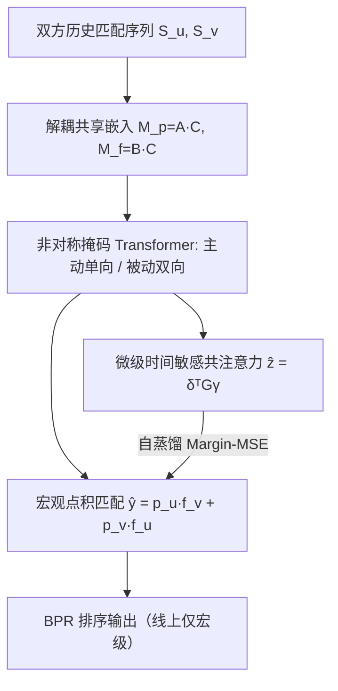
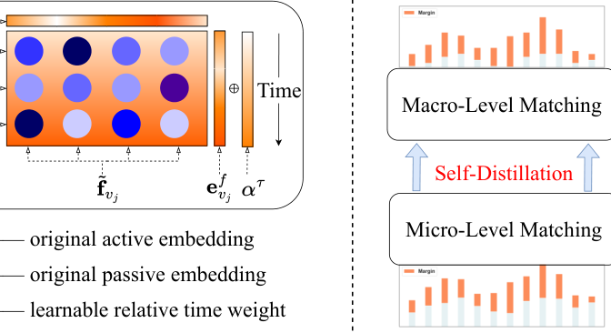

# Reciprocal Sequential Recommendation (双向序列推荐)

- **会议/期刊**: RecSys 2023
- **作者与机构**: Bowen Zheng, Yupeng Hou, Wayne Xin Zhao (中国人民大学高瓴人工智能学院), Yang Song, Hengshu Zhu (BOSS 直聘)
- **推荐链路定位**: 召回（双边候选人—招聘方/提问者—回答者的匹配打分）
- **研究方向**: 序列与会话推荐 / 协同过滤与双塔召回
- **论文原文**: [论文原文链接](https://arxiv.org/abs/2306.14712v1)
- **开源代码**: [RUCAIBox/ReSeq](https://github.com/RUCAIBox/ReSeq)

## TL;DR (1分钟核心速览)

双向推荐（招聘、婚恋、问答）中双方互为"用户"与"物品"，但现有 RRS 模型只用静态画像或静态隐向量，忽略了双方口味随时间的漂移与双向匹配的动态性；而单向序列推荐（SASRec/BERT4Rec）本质是"用户→固定物品"的单视角建模，无法刻画被动被选一方。ReSeq 把 RRS 重构成**双视角行为序列匹配**：为每侧学习"主动偏好/被动特征"解耦共享嵌入，用非对称掩码 Transformer 编码序列，再做"宏观点积 + 时间敏感微级共注意力"的多尺度匹配，并通过 micro→macro 自蒸馏把微级知识压进点积宏级模块，使线上推理只需 $O(d)$。在 5 个真实数据集（3 招聘 + 2 问答）的 **100 负采样排序**协议下，Design 候选人侧 HR@5 从 0.2422 提升至 0.4435（+83.1%），且每 batch 匹配延迟由 8.71ms 降至 0.28ms。

## Background & Motivation (背景与核心矛盾)

- **主流范式**: RRS 分两支——内容画像匹配（PJFNN/IPJF/PJFFF）与协同过滤隐因子（BPR、LFRR、DPGNN），主流做法均是学习**静态**用户表征来刻画长期偏好。
- **前人局限**: ① 招聘场景中求职者随经验积累会抬高求职标准，静态向量无法表达这种时序漂移；② 单向序列推荐只建模"主动选择者"，而 RRS 中用户同时是被选客体，单视角建模漏掉了被选方的"被吸引力"。
- **核心洞察 (Key Insight)**: RRS 的预测对象不是"用户—物品"而是"序列—序列"，候选空间随双方行为动态扩散、比固定物品集更稀疏，因此需要**同时**在宏观（全局兴趣）与微观（逐步交互）两个尺度上做匹配。
- **本文切入点**: 把 RRS 形式化为双视角序列匹配任务，令 $\hat{y}_{i,j}=\vec{g}(u_i,\mathcal{S}^{T}_{u_i},v_j,\mathcal{S}^{T}_{v_j})+\overleftarrow{g}(\cdot)$，一端序列作主动方、另一端序列作被动方，双向对称打分。

## Method (核心方法设计)

### 1. 整体框架 (Overall Architecture)

输入是双方截至当前时刻的行为序列（截断构造，防泄漏）。每侧维护主动偏好嵌入 $M^{p}$与被动特征嵌入$M^{f}$，并通过矩阵分解共享因子$C$使"我的偏好空间"与"对方特征空间"对齐；随后用非对称掩码 Transformer 分别做单向主动编码（近因敏感）与双向被动编码（特质稳定），每条序列输出一个宏观点向量与$n$个微级逐步向量；宏级以双内积相加打分、微级以时间敏感共注意力打分；训练时微级充当教师，用 Margin-MSE 把正负分差蒸馏进宏级，验证/推理阶段仅保留宏级模块以换取$O(d)$ 的打分开销。

<figure class="paper-figure" markdown="span">
  <figcaption>图1：我们的 ReSeq 的整体框架。注意，其仅展示从 𝑢𝑖 到 𝑣𝑗 的模型单视角，从 𝑣𝑗 到 𝑢𝑖 的另一视角是对称的。</figcaption>
</figure>

### 2. 关键设计拆解 (Key Designs)

1. **解耦共享的双视角嵌入（Decompose & Share）**：以往 RRS 直接学四个独立嵌入矩阵，主动偏好与被动特征处在互不对齐的空间，点积相似度缺乏语义。ReSeq 对同侧主动、异侧被动矩阵做低秩分解并**共享** $C$：$M^{p}_{U}=A\cdot C,\; M^{f}_{V}=B\cdot C$，另一视角对称。直观上，这让"我想找什么样的人"与"我是什么样的人"落在同一语义基上，宏观点积才有可比性。
2. **非对称掩码序列编码**：主动方兴趣随时间漂移 → 用单向（因果）掩码 + 序列头部 `[CLS]` 全局聚合，等价于把 `[CLS]` 置于序列末尾；被动方特质相对稳定 → 用双向掩码。末层输出切分为宏观 $\boldsymbol{p}_{u_i}=H^{L}_{0}$与微级$\tilde{\boldsymbol{p}}_{u_i}=H^{L}_{1:n+1}$，一次编码产出两个尺度的表征。
3. **时间敏感微级匹配 + micro→macro 自蒸馏**：逐步匹配矩阵 $G=\tilde{\boldsymbol{p}}_{u_i}(\tilde{\boldsymbol{f}}_{v_j})^{\top}\in\mathbb{R}^{n\times n}$，双向共注意力聚合为$\hat{z}_{i\to j}=\boldsymbol{\delta}^{\top}G\boldsymbol{\gamma}$，其中$\boldsymbol{\gamma}=\mathrm{softmax}(\tilde{\boldsymbol{f}}_{v_j}\boldsymbol{e}^{p}_{u_i})$，$\boldsymbol{\delta}=\mathrm{softmax}(\tilde{\boldsymbol{p}}_{u_i}\boldsymbol{e}^{f}_{v_j}+\boldsymbol{\alpha}_{\tau})$——$\boldsymbol{\alpha}_{\tau}$是从序列尾端倒序编号的可学习相对时间权重，使越近的交互被赋予越大先验。微级复杂度$O(n^{2}d)$不可上线，故用$\mathcal{L}_{sd}=\frac{1}{|B|}\sum[(\hat{z}^{+}-\hat{z}^{-})-(\hat{y}^{+}-\hat{y}^{-})]^{2}$ 对齐师生**正负分差**（排序任务关心 margin 而非绝对分布）。
4. **训练目标、负采样与推理效率**：对每个正样本 $(u_i,\mathcal{S}_{u_i},v_j,\mathcal{S}_{v_j})$，分别采样双侧负用户$u_{i'},v_{j'}$并按其当前时刻截断序列编码，替换宏/微四要素得到 4 类负分集合，$\mathcal{L}=\mathcal{L}_{ma}+\lambda\mathcal{L}_{mi}+\mu\mathcal{L}_{sd}$（两项均为多负样本 BPR）。线上仅保留宏级双内积，序列编码可离线预计算，匹配阶段$O(d)$。

## Experimental Setup & Evaluation Protocol (实验设置与评估协议)

- **数据集与预处理**:

| 数据集 | 场景 | #Users(侧1) | #Users(侧2) | #Interactions | 稀疏度 |
| :--- | :--- | :---: | :---: | :---: | :---: |
| Design | 招聘 | 12,274 | 9,141 | 139,355 | 99.88% |
| Sale | 招聘 | 15,831 | 12,757 | 112,340 | 99.94% |
| Technology | 招聘 | 56,620 | 48,071 | 808,376 | 99.97% |
| StackOverflow | 问答 | 42,381 | 25,004 | 360,063 | 99.97% |
| AskUbuntu | 问答 | 6,030 | 3,415 | 69,865 | 99.66% |

- **数据划分与防穿越**: 先做 `5-core` 过滤剔除不活跃用户；招聘三集按时间切分（最后两周分别为验证/测试），问答两集按时间跨度 `8:1:1` 切分；所有训练样本的序列严格截断到当前交互时刻，评测时负例序列同样截断到该时刻以防穿越。
- **排名评测协议**: `Sampled Ranking`——每个正例从两侧各随机采样 100 个用户作**双视角**负例，指标 HR@5 / MRR@5 / NDCG@5，两侧（候选人/招聘方、提问者/回答者）分别汇报。
- **对比基线与超参**: 4 个 CF 模型（BPR、LFRR、NeuMF、LightGCN）、4 个序列模型（SASRec、SSE-PT、BERT4Rec、FMLP-Rec）、5 个文本人岗匹配模型（PJFNN、BPJFNN、IPJF、PJFFF、DPGNN，仅招聘场景可用）；嵌入统一 $d=64$，Adam 网格搜索学习率，早停 patience=10，基于 RecBole 实现，显著性用配对$t$-test（$p<0.01$）。

## Key Experimental Results (实验关键数据)

### 1. 主实验对比 (Main Results)

| 模型 | Design HR@5 (C/R) | Technology HR@5 (C/R) | SO NDCG@5 (Q/A) | Ubuntu NDCG@5 (Q/A) |
| :--- | :---: | :---: | :---: | :---: |
| BPR | 0.1437 / 0.1300 | 0.2733 / 0.2659 | 0.2572 / 0.2029 | 0.1220 / 0.1009 |
| NeuMF | 0.1611 / 0.1452 | 0.2796 / 0.2711 | 0.2567 / 0.1975 | 0.1780 / 0.1074 |
| LightGCN | 0.1496 / 0.1349 | 0.2775 / 0.2726 | 0.2606 / 0.2103 | 0.1247 / 0.0990 |
| SASRec | 0.2033 / 0.2529 | 0.4145 / 0.4702 | 0.3478 / 0.2001 | 0.1937 / 0.1202 |
| BERT4Rec | 0.1535 / 0.2027 | 0.3650 / 0.4243 | 0.2779 / 0.1772 | 0.1626 / 0.0786 |
| FMLP-Rec | 0.1940 / 0.2845 | 0.4165 / 0.5206 | **0.3718** / 0.2257 | **0.2039** / 0.1246 |
| DPGNN | 0.2422 / 0.2317 | 0.4521 / 0.4409 | — / — | — / — |
| **ReSeq** | **0.4435\* / 0.3722\*** | **0.7597\* / 0.7809\*** | 0.3640 / **0.2825\*** | 0.3447\* / **0.1653\*** |
| Improv.% | +83.1% / +30.8% | +68.0% / +50.0% | −2.1% / +25.2% | +69.0% / +32.7% |

### 2. 消融实验 (Ablation Study)

| 变体 | Design C HR@5 | Design R HR@5 | SO Q HR@5 | SO A HR@5 |
| :--- | :---: | :---: | :---: | :---: |
| ReSeq | **0.4435** | **0.3722** | **0.4868** | **0.4019** |
| w/o DSE（去解耦共享） | 0.4224 | 0.3409 | 0.4787 | 0.3964 |
| w/o MASK（统一双向掩码） | 0.4305 | 0.3406 | 0.4764 | 0.3942 |
| w/o TSA（时间权重→均值） | 0.4139 | 0.3315 | 0.4710 | 0.3697 |
| w/o SD（去自蒸馏损失） | 0.4156 | 0.3446 | 0.4787 | 0.3935 |

### 3. 关键实验发现 (Key Findings)

1. **时间敏感聚合是最大增益源**：去掉 TSA 后 Design 招聘方侧 HR@5 从 0.3722 掉到 0.3315（−10.9%），StackOverflow 回答者侧从 0.4019 掉到 0.3697（−8.0%），说明微级匹配的价值主要来自对"近期交互加权"，而非共注意力本身的结构复杂度。
2. **自蒸馏不只是加速器，还是正则项**：去掉 $\mathcal{L}_{sd}$后 Design 候选人侧 HR@5 下降 6.3%（0.4435→0.4156），因为 margin 对齐把微级的分差软信号注入点积空间，起到平滑排序目标的作用；同时延迟从 0.28ms/batch（ReSeq）飙升到 8.71ms（$30\times$），而 SASRec 仅 0.10ms——即用 +0.18ms 换取双视角建模。
3. **文本增强的收益随数据质量强相关**：叠加 twin-tower BERT 文本分后，Technology 候选人侧 NDCG@5 由 0.5606 升至 0.5943（+6.0%），但 Design 招聘方侧反而从 0.2420 降到 0.2359，印证低质量小文本集上简单相加会引入噪声；此外 StackOverflow 提问者侧 ReSeq 的 HR@5 最高（0.4868）却 NDCG@5 略逊 FMLP-Rec（0.3640 vs 0.3718），说明其"命中率高但前 5 内排序精度"仍有改进空间。

## Highlights & Limitations (亮点、对比与审稿批判)

- **与代表作对比 (vs. Prior Work)**: 相比 DPGNN（也是双视角，但做静态图对比学习）与 LFRR（静态双隐因子），ReSeq 的关键差异是把双边关系建成**序列→序列**匹配并保留逐步粒度；相比 SASRec/FMLP-Rec 等单向序列模型，它补上了"被动被选"视角与跨侧嵌入对齐，因此在招聘方侧提升（+50%）远大于候选人侧。
- **可迁移亮点**: ① "微观精细匹配当教师、宏观内积当学生"的 **micro→macro 自蒸馏范式**可迁移到任何"精排太贵、召回需双塔"的级联系统；② **倒序可学习相对时间权重** $\boldsymbol{\alpha}_{\tau}$ 是一种轻量、可插拔的近因先验，可直接塞进任意序列注意力。
- **审稿级局限批判**: ① 评测仅用 100 负采样排序，未做 Full-Ranking，双向候选池巨大时（$|\mathcal{U}|\!\sim\!10^{5}$）该协议可能高估实际线上排序能力；② 自蒸馏教师仍需$O(n^{2}d)$计算，训练成本随序列长度$n$平方增长，且$\lambda,\mu$ 需按数据集分别调（最优值 5 与 0.005/0.01 差异明显），跨场景迁移需重新搜索超参。

## Rating (四维评分)

- **方法创新性 (Novelty)**: ⭐⭐⭐⭐ （首次将双边推荐重构为双视角序列匹配，解耦共享嵌入 + 非对称掩码 + 时间敏感共注意力组合有清晰物理直觉，并给出 $O(d)$vs$O(n^2d)$ 的复杂度论证）
- **评估协议与实验扎实度 (Protocol & Experiments)**: ⭐⭐⭐ （5 数据集 2 场景、四类基线覆盖全面且有 $t$-test，但仅 100 负采样而非全库排序，问答场景主指标出现个别非最优）
- **写作与数学规范度 (Clarity & Rigor)**: ⭐⭐⭐⭐ （符号统一、公式与框架图一一对应，掩码设计与相对时间权重的定义交代清楚，负例构造的四种替换讲得明确）
- **工业落地与复现价值 (Industrial & Practical Value)**: ⭐⭐⭐⭐⭐ （代码开源、基于 RecBole、给出真实延迟对比，宏级模块可直接嵌入现有双塔召回，落地门槛低）

