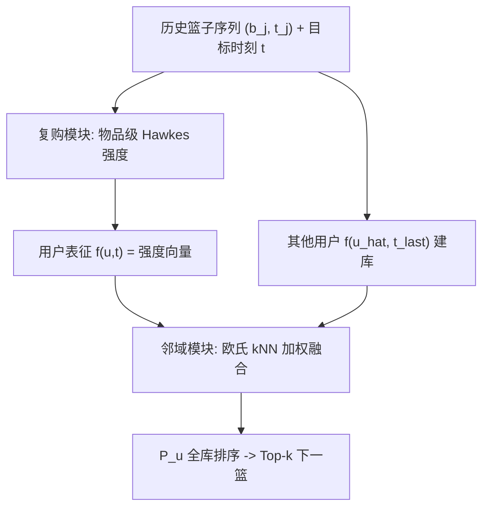
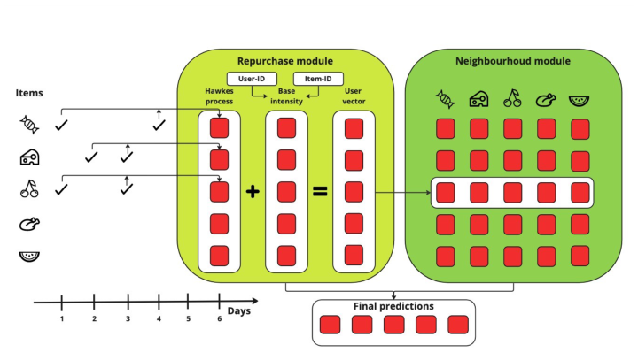
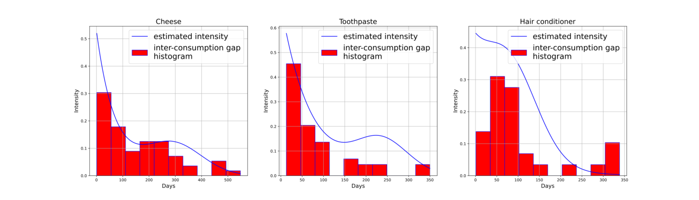

# Time-Aware Item Weighting for the Next Basket Recommendations (面向下一篮推荐的时间感知物品加权)

- **会议/期刊**: RecSys 2023 (Short/Regular Paper, 8 pages)
- **作者与机构**: Aleksey Romanov, Marina Ananyeva (HSE University); Oleg Lashinin, Sergey Kolesnikov (Tinkoff)
- **推荐链路定位**: 召回 / 端到端打分（Next-Basket 直接全库排序）
- **研究方向**: 序列与会话推荐 / 冷启动（归纳式新用户）
- **论文原文**: [https://arxiv.org/abs/2307.16297v1](https://arxiv.org/abs/2307.16297v1)
- **开源代码**: [https://github.com/alexeyromanov-hse/time_aware_item_weighting](https://github.com/alexeyromanov-hse/time_aware_item_weighting)

## TL;DR (1分钟核心速览)

下一篮推荐长期被"频次启发式"统治，但最强基线 TIFU-KNN 只用购物篮的**序数编号**做时间衰减，且所有物品共享同一条衰减曲线，既不知道"用户等了多久"，也不知道"洗衣粉和牛奶的复购周期不同"。本文提出 TAIW：用 Hawkes 过程为每个物品学一条强度函数 $\gamma_i(\Delta t)$（指数短周期 + 高斯长寿命的混合），把用户历史购买映射成**随预测时刻变化的强度向量**，再用 kNN 邻域加权融合。在 TaFeng / TaoBao / Dunnhumby 三个数据集上、Leave-One-Basket + 全库排序协议下，P@10 / R@10 相对最优基线提升 1.6%–9.2%，且间隔越久优势越明显。

## Background & Motivation (背景与核心矛盾)

- **主流范式**: NBR 的实证结论是"频次类方法打败深度模型"——TIFU-KNN 用 Personalized Item Frequency 向量 + UserKNN，UPCF 用固定时间窗频次，DNNTSP 等图/序列模型在多个数据集上反而退化。
- **前人局限**: TIFU-KNN 有三处硬伤：(1) 权重只依赖篮子的**序号**，忽略篮间真实时间间隔；(2) 权重**跨物品共享**，无法区分"下篮就回购的牛奶"与"很久才用完的洗衣粉"；(3) 完全忽略"最后已知篮到预测时刻"的空档。
- **核心洞察 (Key Insight)**: 作者在数据上验证，绝大多数物品的消费间隔分布呈**双峰**——短期指数衰减 + 长周期复购次峰（牙膏/奶酪在 150–250 天出现回升，护发素集中在 50–100 天），因此"逐物品拟合一条时间强度曲线"是可学的。
- **本文切入点**: 借用点过程（Hawkes）与 SLRC 的打分形式，把 TIFU-KNN 的标量权重替换为**物品专属、时刻相关**的强度 $\lambda_{u,i}(t)$，再用邻域模块补足新物品的推荐能力。

## Method (核心方法设计)

### 1. 整体框架 (Overall Architecture)

TAIW 由复购模块与邻域模块串联组成。给定用户历史 $B_u=\{(b_j,t_j)\}$与目标时刻$t_{|B_u|+1}$，复购模块对每个物品输出强度$\lambda_{u,i}(t)$：基强度$\lambda^0_{u,i}$（BPR 可训练的 user/item 内积，负责**新物品**的探索）加上历史中每次含$i$的篮子经$\gamma_i(\cdot)$衰减后的贡献（负责**复购**）。所有物品强度拼接即得该用户在此刻的表征$f(u,t)$；邻域模块在训练集用户表征中取欧氏距离最近的$k$个邻居，按$\alpha$线性混合后全库排序取 top-k。去掉$\lambda^0$ 与 BPR 即得归纳式变体 TAIWI。

<figure class="paper-figure" markdown="span">
  <figcaption>图1：所提出的 TAIW 模型总体概览。它包含两个模块，即复购模块和邻域模块。复购模块使用 Hawkes 过程考虑每个物品的历史购买在当前时刻的贡献。基础强度可估计已消费和未消费物品的相关性得分。最终用户向量是这两个向量的和。邻域模块存储所有用户的向量，并帮助找到相似用户的偏好以提升推荐性能。</figcaption>
</figure>

### 2. 关键设计拆解 (Key Designs)

1. **物品级 Hawkes 复购强度（Time-Aware Item Weighting）**：针对"序数权重 + 跨物品共享"两处痛点，把衰减从篮子编号换成真实时间差，并让每个物品自带参数：

$$\lambda_{u,i}(t)=\lambda^{0}_{u,i}+\alpha_i\!\!\sum_{(b_j,t_j)\in B_u:\,i\in b_j,\,t_j<t}\!\!\gamma_i(t-t_j)$$

其中核函数用指数 + 高斯混合拟合短/长两类复购模式：

$$\gamma_i(\Delta t)=\pi_i\,E(\Delta t\mid\beta_i)+(1-\pi_i)\,\mathcal{N}(\Delta t\mid\mu_i,\sigma_i)$$

直觉：指数项吃掉"马上再买"的即时需求，高斯项刻画"用完了再买"的寿命周期，$\pi_i$自动决定谁主导——这正好对应数据中观察到的双峰分布。与 TIFU-KNN-TA 的单调递减权重相比，$\gamma_i$ 允许强度在某个间隔后**回升**。

2. **邻域模块与免 user-ID 的归纳式变体（Neighbourhood + TAIWI）**：新物品无法靠纯复购分量推荐，作者把 $\lambda_{u,\cdot}(t)$ 当作一种**随时间漂移的用户 embedding**，在训练集用户池中做 kNN 并线性融合：

$$P_u=\alpha f(u,t_{|B_u|+1})+(1-\alpha)\frac{1}{k}\sum_{\hat{u}\in kNN(u)}f(\hat{u},t_{|\hat{B}_{\hat{u}}|})$$

更进一步，令 $\lambda^0_{u,i}\equiv 0$得到 TAIWI：$\lambda_{u,i}(t)=\sum_{j:\,i\in b_j}\gamma_i(t-t_j)$，彻底摆脱 user-ID 嵌入，新用户上线即可打分（零样本冷启动），而实验显示性能几乎无损。

3. **训练目标、负采样与推理开销**：仅 $\{\pi_i,\beta_i,\mu_i,\sigma_i\}$（TAIW 另加$\alpha_i$与 BPR 参数）可训练，用**时刻对齐**的 BPR 成对损失（比较项在$t_j$ 时刻的强度，而非静态分数）：

$$\mathcal{L}=-\sum_{u}\sum_{(b_j,t_j)\in B_u}\sum_{i\in b_j}\ln\sigma\big(\lambda_{u,i}(t_j)-\lambda_{u,i^-}(t_j)\big)+\eta\|\Theta\|_2^2$$

负样本 $i^-$从用户全部历史篮子之外的物品中**均匀随机**采样（无 in-batch / hard negative）。推理时对每个用户只需一次$O(|V|)$强度计算 + 一次$O(|U||V|)$ 的 kNN，无神经网络前向，CPU 可跑。

## Experimental Setup & Evaluation Protocol (实验设置与评估协议)

- **数据集与预处理**: 论文未给出统计量表格，仅描述过滤规则（见下）；三个数据集均为"强重复消费"场景。

| 数据集 | 场景/原始规模 | #Users | #Items | #Interactions | 过滤规则 |
| :--- | :--- | :---: | :---: | :---: | :--- |
| Dunnhumby | 家庭零售小票，2,500 户 × 2 年 | 未报告 | 未报告 | 未报告 | 按数据集阈值滤除低频用户/物品；剔除"全部交易集中在一天"与交易量异常大的用户 |
| TaFeng | 中国杂货店，约 4 个月 | 未报告 | 未报告 | 未报告 | 同上 |
| TaoBao | 阿里淘系用户行为 | 未报告 | 未报告 | 未报告 | 同上 |

- **数据划分与防穿越**: `Leave-One-Basket` —— 每个用户最后一个篮子作测试、倒数第二个作验证、其余作训练；邻居表征严格用训练集最后篮子的时刻计算，避免未来信息泄漏。
- **排名评测协议**: 无偏 `Full-Ranking` —— 对每个测试用户对全库 $V\setminus$ 历史交互物品排序，取 top-k；指标 Precision@10 / Recall@10 / NDCG@10（二值相关性）。
- **对比基线与超参**: 6 个基线覆盖启发式与 SOTA（GP-Pop、TIFU-KNN、UPCF、DNNTSP、SLRC、TIFU-KNN-TA）；每个模型用 Optuna 统一采样 25 组超参，以验证集 NDCG@10 选优；最终结果为 3–5 个随机种子的均值。论文**未做显著性检验**。

## Key Experimental Results (实验关键数据)

### 1. 主实验对比 (Main Results)

| 模型 | TaFeng N@10 | TaFeng R@10 | TaoBao N@10 | TaoBao R@10 | Dunn. N@10 | Dunn. R@10 |
| :--- | :---: | :---: | :---: | :---: | :---: | :---: |
| GP-Pop | 0.1084 | 0.1308 | 0.0741 | 0.1116 | 0.1490 | 0.1577 |
| TIFU-KNN | 0.1179 | 0.1360 | 0.0524 | 0.0749 | 0.1613 | 0.1653 |
| DNNTSP | 0.1120 | 0.1306 | 0.0012 | 0.0016 | 0.0931 | 0.0929 |
| UPCF | 0.1154 | 0.1365 | 0.0553 | 0.0824 | 0.1600 | 0.1663 |
| SLRC | 0.1194 | 0.1458 | 0.0801 | 0.1118 | 0.1675 | 0.1727 |
| TIFU-KNN-TA | 0.1248 | 0.1503 | 0.0543 | 0.0763 | 0.1593 | 0.1705 |
| **TAIW** | **0.1267** (▲1.5%) | **0.1565** (▲4.1%) | **0.0815** (▲1.7%) | **0.1177** (▲5.3%) | 0.1706 (▲1.9%) | **0.1791** (▲3.7%) |
| **TAIWI** | 0.1261 (▲1.0%) | 0.1642 (▲9.2%) | 0.0810 (▲1.1%) | **0.1190** (▲6.4%) | **0.1713** (▲2.3%) | 0.1773 (▲2.7%) |

*（P@10 列因篇幅省略：TAFeng TAIWI 0.0671 vs SLRC 0.0621，▲8.1%；TaoBao 0.0123 vs 0.0116，▲6.0%；Dunnhumby 0.1214 vs 0.1192，▲1.8%。加粗为最优，▲% 为相对最优基线的提升。）*

### 2. 消融实验 (Ablation Study)

原文以图 4 的 NDCG@K 曲线呈现（未给出表格数值），此处按结论归纳：

| 配置 | 移除/替换内容 | 性能变化 |
| :--- | :--- | :--- |
| TAIW (full) | 强度 + 邻域 + BPR 基强度 | 三数据集最优/次优 |
| TAIWI (full) | 去掉 user-ID 基强度与 BPR | 与 TAIW 差距极小（N@10 差 ≤0.0006） |
| w/o Neighbourhood (TAIW) | 邻域模块 → 退化为 SLRC 式单体打分 | **一致且明显下滑**（最大单一跌幅） |
| w/o Neighbourhood (TAIWI) | 退化为纯 Hawkes 强度 | 同样下滑，各 K 值均劣于完整版 |
| $\alpha\to0$（仅邻域） | 丢弃自身强度向量 | N@10 / R@10 显著掉点 |
| $\alpha=0.9$（近仅自身） | 邻域贡献几乎抹去 | 劣于最优$\alpha<0.5$ |

### 3. 关键实验发现 (Key Findings)

1. **增益结构不平衡**：P@10 / R@10 提升 1.6%–9.2%，但 NDCG@10 仅 1.0%–2.3%，说明 TAIW 主要是"把该复购的物品捞回候选"（召回型收益），而非精细优化头部排序；这也解释了为何在 TaoBao 这类 DNNTSP 近乎失效（N@10=0.0012）的数据集上提升最猛。
2. **邻域模块是最大功臣，user-ID 强度几乎可弃**：拆掉邻域模块后所有数据集、所有 K 上都一致下滑；而 TAIW↔TAIWI（去掉 BPR 基强度）差异在 0.001 量级，作者据此论证"物品级时间强度已承载主要信号"，并换来可上线新用户的归纳式部署。
3. **长间隔鲁棒性 + $\alpha$的实证含义**：按"最后训练篮→测试篮"天数五等分后，TIFU-KNN 在长间隔桶掉点最严重，TAIW/TAIWI 曲线最平，直接验证了"序数权重 ≠ 真实时间"；此外最优$\alpha<0.5$表明邻域贡献大于用户自身表征，但$\alpha\to0$ 会崩，说明复购模式**只能部分跨用户泛化**、邻居稀疏时不可全押。

<figure class="paper-figure" markdown="span">
  <figcaption>图5：特定 Dunnhumby 物品的消费间隔分布和估计强度函数。</figcaption>
</figure>

## Highlights & Limitations (亮点、对比与审稿批判)

- **与代表作对比**: 相比 TIFU-KNN（序数权重、跨物品共享）、TIFU-KNN-TA（引入时间戳但权重仍跨物品共享且单调递减），TAIW 的关键差异是**逐物品、非单调**的强度核；相比 SLRC（同样是 Hawkes，但需 user-ID 嵌入、未面向篮子场景），TAIW 增加了邻域模块并给出免嵌入的 TAIWI；相比 DNNTSP 等图/序列模型，本文属于"轻量启发式 + 点过程"路线，无 GPU 需求却全面胜出，是对"深度模型在 NBR 上未必有效"这一实证结论的进一步加固。
- **可迁移亮点**: (1) 把 $\lambda_{u,\cdot}(t)$ 这一"随预测时刻动态变化的用户向量"作为表征，可无缝替换任何 kNN / 双塔召回中的静态用户向量；(2) "指数 + 高斯"混合核是一种极低成本的物品生命周期先验，可直接作为精排打分的时间特征或频次特征的乘性修正项。
- **审稿级局限批判**: (1) **实验体量与严谨度偏弱**——未给数据集统计表、未做显著性检验，三个数据集均属杂货/零售类强重复场景，缺乏短视频、新闻等弱重复场景的外部有效性验证；(2) **增量偏小且推理有隐藏成本**——NDCG 增益仅 1%–2%，而 kNN 需对全体用户两两算欧氏距离（$O(|U|^2|V|)$），用户量上亿时不可行，需近似检索；TAIW 的 BPR 基强度仍需 user-ID，冷启动必须切到 TAIWI；(3) 物品级参数$\{\pi_i,\mu_i,\sigma_i\}$ 对长尾低频物品难以拟合，论文未给低频分桶分析。

## Rating (四维评分)

- **方法创新性 (Novelty)**: ⭐⭐⭐ （把 Hawkes 点过程与 kNN 组合并落到 NBR 的具体病症上，思路清晰但组件均非首创，属"精准补位型"创新）
- **评估协议与实验扎实度 (Protocol & Experiments)**: ⭐⭐⭐ （Leave-One-Basket + Full-Ranking + Optuna 25 组统一调参 + 多 seed 均值值得肯定，但缺数据集统计表、缺显著性检验、缺低频/长尾分桶）
- **写作与数学规范度 (Clarity & Rigor)**: ⭐⭐⭐⭐ （强度—核函数—损失链条推导干净，双峰假设有数据佐证；但公式(6)负样本符号与 $\alpha_i$ 的层级定义稍欠严谨）
- **工业落地与复现价值 (Industrial & Practical Value)**: ⭐⭐⭐⭐ （代码开源、CPU 可训可推、TAIWI 可直接服务新用户，是极低成本的时间感知召回增量；短板是用户两两 kNN 的全量开销需近似化改造）

