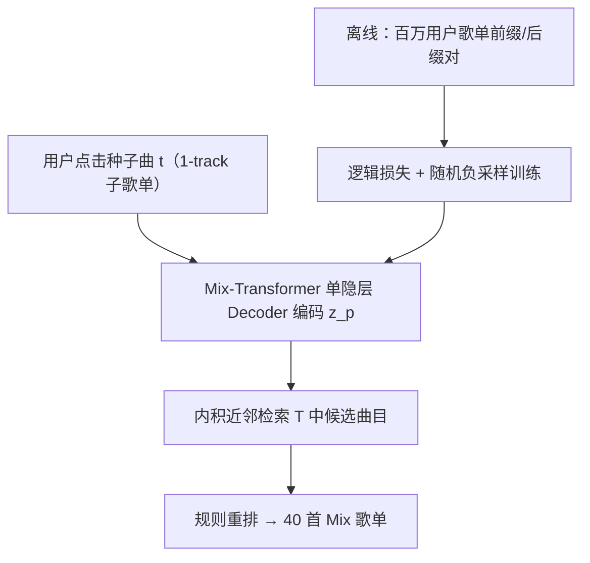

# Track Mix Generation on Music Streaming Services using Transformers (基于 Transformer 的音乐流媒体混音歌单生成)

- **会议/期刊**: RecSys 2023（Industry Track，Oral）
- **作者与机构**: Walid Bendada, Théo Bontempelli, Mathieu Morlon, Benjamin Chapus, Thibault Cador, Thomas Bouabça, Guillaume Salha-Galvan（Deezer Research，法国）
- **推荐链路定位**: 召回（候选歌单生成，端到端序列→向量→ANN 检索）
- **研究方向**: 序列与会话推荐 / 冷启动与长尾推荐
- **论文原文**: [论文原文链接](https://arxiv.org/abs/2307.03045v1)
- **开源代码**: 暂未开源

## TL;DR (1分钟核心速览)

Deezer 的 Track Mix 需在用户只点选**单首种子曲**（极端稀疏上下文）时生成 40 首歌单，传统协同过滤 Mix-SVD 只做静态共现近邻，无法建模列表级序列偏好。作者将 Mix-SVD 换为单隐层 Decoder-only Transformer（Mix-Transformer），以歌单补全任务训练"子歌单→向量"表征并用内积近邻检索，再用 ONNX 图融合 + 动态量化把 4 倍推理延迟压回原水平。法区百万级用户线上 A/B 中，人均日听歌时长中位数 **+6.84%**、新用户日收藏 **+20.26%**（$p<0.01$）。

## Background & Motivation (背景与核心矛盾)

- **主流范式**: 线上基线 Mix-SVD 对歌单共现 PMI 矩阵做 SVD 分解得到曲目隐向量，用 Faiss ANN 取种子曲近邻并规则重排，周更 embedding 导出 Cassandra，Scala/Golang 服务化，工程上极其成熟。
- **前人局限**: 其一，Mix-SVD 只利用"共现相似"，无法表达"接下来该放什么"的顺序性列表偏好；其二，此前 Deezer 的 Transformer APC 模型在**待续写歌单越短时性能越退化**，而 Track Mix 的上下文只有 1 首歌，是该方法的最差工况，其相对 CF 的优越性并非自明。
- **核心洞察 (Key Insight)**: 若把"单曲种子"视作长度 1 的子歌单，则生成问题与歌单续写同构——只要把整个子歌单压缩为一个向量，检索仍可走成熟的 ANN 通路，从而在不改服务架构的前提下引入序列建模。
- **本文切入点**: 用 represent-then-aggregate 框架 + 部署侧量化，把 Transformer 的序列表达力"塞进"原有低延迟歌单生成链路。

<figure class="paper-figure" markdown="span">
  <figcaption>图1. Deezer 网站版 Track Mix 的界面。移动应用提供类似功能。Track Mix 呈现个性化、动态的音乐曲目候选列表，这些曲目来自每位用户此前喜欢和听过的曲目。点击某一曲目会生成一个“受”该曲目“启发”的混音播放列表，旨在帮助用户发现与其喜爱曲目相似的新曲目。</figcaption>
</figure>

## Method (核心方法设计)

### 1. 整体框架 (Overall Architecture)

离线阶段从 Deezer 用户歌单抽取百万级曲目序列，对每条歌单 $p$枚举所有前缀$p_{:k}$与后缀$p_{(l-k):}$构造"续写"监督对，训练 Mix-Transformer 使前缀向量与后缀曲目向量内积最大。线上阶段用户点击种子曲后，服务将其视为 1-track 子歌单编码为$z_{p_{:1}}$，在量化后的 ONNX 图中完成近邻检索与规则重排，输出 40 首歌单。整个编码—检索—排序被打包进单一模型图，避免多服务拼接带来的网络与调度开销。

### 2. 关键设计拆解 (Key Designs)

1. **子歌单向量化 + 内积近邻（represent-then-aggregate）**：解决"上下文仅 1 首曲"与"必须复用 ANN 服务"的矛盾。模型为每个前缀输出 $z_{p_{:k}} = f_\theta(p_{:k}) \in \mathbb{R}^d$，把"下一首"预测降维成向量空间近邻问题；即使$k=1$ 也退化为可用的曲目向量，天然兼容 Faiss。直觉上它把序列信息蒸馏进**曲目 embedding 的几何结构**，检索复杂度与 CF 完全一致。
2. **沿用 APC 逻辑损失 + Mix-SVD 热启动**：对每对 $(p_{:k}, t^+)$，从$\mathcal{T}\setminus p$均匀采负样本$t^-$，最小化
$\mathcal{L} = -\sum_{(p_{:k},t^+)}\Big[\log\sigma(z_{p_{:k}}^{\top} z_{t^+}) + \sum_{t^-\in\mathcal{N}}\log\big(1-\sigma(z_{p_{:k}}^{\top} z_{t^-})\big)\Big]$。
曲目初始 embedding 直接取 Mix-SVD 向量，使 Transformer 从"已具备协同近邻结构"的空间出发，缓解单曲上下文下的欠定问题。
3. **训练目标与推理效率**：无额外 pairwise/BPR 项，仅上述 logistic 损失；推理免负采样、免 beam search，单次前向 + ANN。工程上用 ONNX model merging 把预处理到排序全部并入图内，并对权重做**动态量化**（INT8），实测将直接替换导致的 4 倍延迟降回与 Mix-SVD 可比的吞吐，且"性能仅有轻微影响"。

## Experimental Setup & Evaluation Protocol (实验设置与评估协议)

- **数据集与预处理**: 论文未披露离线数据统计与过滤规则（工业保密），仅给出量级信息：

| 数据/场景 | 规模 | 说明 |
| :--- | :---: | :--- |
| Deezer 曲库 $\mathcal{T}$ | 90M tracks | 全球曲库，embedding 周更 |
| 训练序列 | millions of playlists | 用户歌单前缀/后缀对，长度 $l>1$ |
| A/B 实验人群 | 百万级 Premium 用户 | 法国区，2023 年 3–4 月 |
| 服务体量 | 16M MAU | Track Mix 首页入口，2022 全量上线 |

- **数据划分与防穿越 (Splitting Strategy)**: **未报告**离线训练/验证/测试切分（无 Leave-One-Out、无时间戳切分说明），评估完全依赖线上随机分流 A/B，天然规避穿越但不可复现。
- **排名评测协议 (Ranking Protocol)**: **无离线 Ranking 指标**（无 Full-Ranking / Sampled Ranking，无 Recall@K、NDCG@K），仅报告线上业务指标（听歌时长、stream 数、收藏数）及歌单级指标；显著性 $p<0.01$。
- **对比基线与超参设置**: 唯一基线为内部 Mix-SVD（PMI+SVD+Faiss）；**未与 SASRec / BERT4Rec 等公开序列模型对比**；隐层数为 1，$d$ 与训练超参未公开。

## Key Experimental Results (实验关键数据)

### 1. 主实验对比 (Main Results)

线上 A/B（Mix-Transformer 相对 Mix-SVD 的相对变化，全部 $p<0.01$）：

| 指标类型 | 指标 | 全体用户 | 新用户 (≤30天) | 老用户 (>30天) |
| :--- | :--- | :---: | :---: | :---: |
| 用户级 | 人均日听歌时长中位数 | **+6.84%** | **+7.75%** | +6.83% |
| 用户级 | 人均日 stream 数 | +4.23% | +5.07% | +4.26% |
| 用户级 | 人均日收藏动作数 | −2.48% | **+20.26%** | −3.79% |
| 歌单级 | 单歌单平均收听时长 | +5.12% | +6.62% | +4.98% |
| 歌单级 | 收听 >15min 歌单占比 | +6.56% | +8.69% | +6.20% |
| 歌单级 | 单歌单平均收藏数 | −1.98% | **+24.10%** | −3.88% |

### 2. 消融实验 (Ablation Study)

原文**未做组件消融**（无 `w/o Transformer`、`w/o 量化`、`w/o SVD 初始化` 的定量表）。可用的最接近替代是**用户分层切片分析**：

| 切片 | 听歌时长 | 收藏动作 | 结论倾向 |
| :--- | :---: | :---: | :--- |
| 新用户 (≤30 天) | +6.8%~+7.8% | **+20.3%~+24.1%** | 双指标齐升，发现与沉淀双赢 |
| 老用户 (>30 天) | +4.98%~+6.83% | −3.8%~−3.9% | 时长升但收藏降，流行度偏置显现 |

### 3. 关键实验发现 (Key Findings)

1. **时长收益稳定但幅度有限**：6 项指标中 4 项时长类全为正，歌单级"收听 >15min 占比"提升最大（+6.56%，新用户 +8.69%），说明 Transformer 主要改善**歌单前段留存**而非拉长尾部消费。
2. **收藏行为的用户异质性极强**：新用户收藏 +20.26%/+24.10% 与老用户 −3.79%/−3.88% 形成近 24 个百分点的剪刀差，作者归因为 Mix-Transformer 推荐更偏热门曲，老用户"早已收藏过"且更期待 niche 发现——即收益来自**偏好信息获取**而非普适满意度。
3. **延迟是落地的真正瓶颈**：直接替换导致推理时间 4×、最大吞吐严重下降，靠 ONNX 融合 + 动态量化才回到可比水平，说明该场景下"模型收益 ≈ 工程预算约束下的净收益"。

## Highlights & Limitations (亮点、对比与审稿批判)

- **与代表作对比 (vs. Prior Work)**: 相比 SASRec/BERT4Rec 类序列模型，本文不追求离线 NDCG，而把序列模型压缩成"曲目向量 + ANN"以复用 Mix-SVD 的整套服务栈；相比 Deezer 前作 APC Transformer，本文把该方法推到 $k=1$ 的极端短上下文并给出线上证据。
- **可迁移亮点**: ①"represent-then-aggregate + 用旧 CF 向量热启动新序列模型"是低成本冷启迁移范式；②ONNX 图融合 + 动态量化把 4× 延迟打平的工程配方，可直接迁移到任何双塔/序列召回上线。
- **审稿级局限批判**: ①**评估严重不足**：无离线数据集、无划分说明、无公开基线、无消融，结论完全依赖单市场两个月 A/B，不可复现也不可外推；②**流行度偏置未解决**，作者自承老用户收藏下滑源于主流化推荐，却未给出重排或 popularity 校正方案；③单隐层 Decoder 的表达能力与 $d$、层数敏感性均未分析。

## Rating (四维评分)

- **方法创新性 (Novelty)**: ⭐⭐⭐ （架构本身无新意，价值在于把 represent-then-aggregate 推到单曲极端上下文并验证）
- **评估协议与实验扎实度 (Protocol & Experiments)**: ⭐⭐ （仅线上 A/B，$p<0.01$ 可信但缺离线基准、缺公开基线、无消融）
- **写作与数学规范度 (Clarity & Rigor)**: ⭐⭐⭐ （5 页工业短文，损失与表征定义清晰，但关键超参与数据统计因保密缺失）
- **工业落地与复现价值 (Industrial & Practical Value)**: ⭐⭐⭐⭐ （真实百万级部署 + 量化提速方案极具参考价值，可惜无开源代码）

