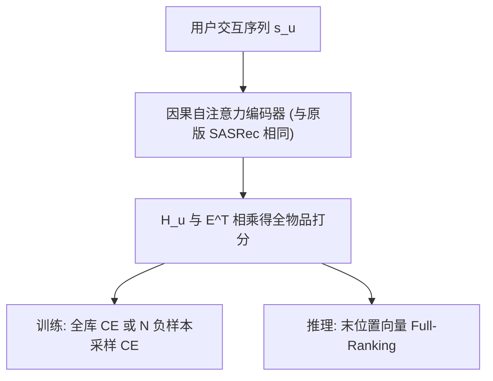
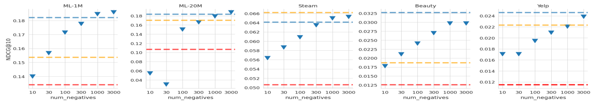

# Turning Dross Into Gold Loss: is BERT4Rec really better than SASRec? （化负为金的损失：BERT4Rec 真的比 SASRec 好吗？）

- **会议/期刊**: RecSys 2023
- **作者与机构**: Anton Klenitskiy, Alexey Vasilev（Sber AI Lab）
- **推荐链路定位**: 召回（序列召回 / Next-Item 预测）
- **研究方向**: 序列与会话推荐 / 协同过滤（负采样损失理论）
- **论文原文**: [https://arxiv.org/abs/2309.07602v1](https://arxiv.org/abs/2309.07602v1)
- **开源代码**: [https://github.com/FeiSun/BERT4Rec](https://github.com/FeiSun/BERT4Rec) （论文自建统一训练/评测代码见原文引用 [2]）

## TL;DR (1分钟核心速览)

过去文献普遍断言 BERT4Rec 优于 SASRec，但作者指出二者比较存在混淆变量：架构（单向 vs 双向）与损失函数（BCE+1 负样本 vs 全库 softmax CE）被同时改变。本文把 BERT4Rec 的全库交叉熵损失原封不动移植到 SASRec（SASRec+），在 5 个基准、`Leave-One-Out` + **无偏 Full-Ranking** 协议下，SASRec+ 在 4/5 数据集上反超 BERT4Rec（ML-1M NDCG@10 0.1821 vs 0.1537，+18.5%），训练时间却只需 540s vs 1409s；若改用 N 个负样本的采样 CE，则 N≈1000 即可逼近全库损失，N=3000 时 ML-1M 达 0.1857（+20.8%）。核心结论：**应当是 SASRec + CE 来做基线，而不是 BERT4Rec**。

## Background & Motivation (背景与核心矛盾)

- **主流范式**: Transformer 序列推荐分两派：SASRec 用因果自注意力做 next-item 预测；BERT4Rec 借 NLP 的 masked language modeling，双向编码 + 随机 mask 物品，且用全库 softmax 交叉熵训练。近年新模型多以二者为基线。
- **前人局限**: 其一，多数论文报告 BERT4Rec 更优，但比较同时改动了架构与损失，归因不成立；其二，原版 SASRec 每个正样本只配 1 个负样本，反向传播只更新 2 行 item embedding，而全库 CE 每步更新所有物品向量，训练信号量级不对等；此外 BERT4Rec 仅对被 mask 位置计算损失，单条序列的有效监督更稀疏。
- **核心洞察 (Key Insight)**: 损失函数与序列建模目标是正交的两件事。既然 BERT4Rec 的优势可能来自 softmax CE 而非双向结构，就应控制变量——把 CE 交给单向模型。
- **本文切入点**: 在完全相同的代码、数据处理与全库评测下，只替换损失函数，重做一场"公平的擂台赛"，并扫描负样本数 N 刻画采样 CE 与全库 CE 的差距。

## Method (核心方法设计)

### 1. 整体框架 (Overall Architecture)

输入用户交互序列 $s_u$，经序列编码器得到隐状态$H_u \in \mathbb{R}^{n_u \times d}$，再与物品嵌入矩阵$E \in \mathbb{R}^{|\mathcal{I}| \times d}$相乘得到全物品相关性矩阵$R_u = H_u E^{\top}$。SASRec+ 与原版 SASRec 的**网络结构完全一致**（因果自注意力 + 位置嵌入），唯一改动是把逐点的 BCE 换成对全部$|\mathcal{I}|$ 个物品的 softmax 交叉熵，并在序列的每个时间步都计损；推理时取最后一个位置的相关性向量做全库排序。整体可概括为"换损失不换模型"的受控实验范式。

### 2. 关键设计拆解 (Key Designs)

1. **全库交叉熵损失（把"双向特权"还给单向模型）**：原版 SASRec 的 BCE 只有 1 正 1 负，正负样本外的物品不获梯度，且损失与全库排序目标不一致。本文改为对所有物品归一化：$\mathcal{L}_{\mathrm{CE}} = -\sum_{u}\sum_{t=1}^{n_u}\log\frac{\exp(r^{(u)}_{t,i_t})}{\sum_{i\in\mathcal{I}}\exp(r^{(u)}_{t,i})}$。直觉上，它把"排序评估指标"直接写进训练目标，并让每个物品嵌入在每一步都参与竞争，梯度密度提升数个量级。

2. **采样交叉熵损失 $\mathcal{L}_{\mathrm{CE}\text{-}sampled}^{N}$（化负为金）**：海量 catalog 下全库 softmax 不可行，故对每条用户序列采样$N$个未交互物品，**在整条序列的所有时间步共享同一负样本集**：$\mathcal{L}=-\sum_{u}\sum_{t=1}^{n_u}\log\frac{\exp(r^{(u)}_{t,i_t})}{\exp(r^{(u)}_{t,i_t})+\sum_{i\in I^{-(u)}_{N}}\exp(r^{(u)}_{t,i})}$。关键在于 N 必须远大于 1——单个负样本只是噪声梯度，而成千上万个"dross（负样本）"能把 softmax 分母逼近全库，转成"gold（有效排序损失）"；共享负样本集还能显著降低采样与显存开销。

3. **训练目标、负采样与推理效率**：训练统一用 Adam、lr=1e-3、batch=128，按验证集 NDCG@10 早停（SASRec/GRU4Rec patience=10、BERT4Rec patience=20）并**回滚到最优 epoch**（Beauty/Yelp 上 SASRec 快速过拟合，此步不可省）。负采样策略为 Uniform 采样未交互物品；由于损失已是全库归一化形式，推理端无需再额外负采样，直接 Full-Ranking，仅需一次 $H_u E^{\top}$ 前向即可。

## Experimental Setup & Evaluation Protocol (实验设置与评估协议)

- **数据集与预处理**: 直接复用 BERT4Rec 官方仓库的预处理版本，`5-core` 过滤（交互少于 5 条的用户剔除），评分/评论一律转为隐式反馈；Yelp **不作时间窗截断**以保留全量数据。

| 数据集 | #Users | #Items | #Interactions | 稀疏度/密度 | 特征/场景说明 |
| :--- | :---: | :---: | :---: | :---: | :--- |
| ML-1M | 6,040 | 3,416 | 999,611 | 4.85% | 电影，长序列（均长 165） |
| ML-20M | 138,493 | 26,744 | 20,000,263 | 0.54% | 大规模电影评分 |
| Steam | 281,428 | 13,044 | 3,488,885 | 0.10% | 游戏分发平台，短会话 |
| Beauty | 40,226 | 54,542 | 353,962 | 0.10% | 美妆电商，用户多物品更多 |
| Yelp | 279,106 | 148,415 | 4,350,510 | 0.11% | 商户评论，超大物品库 |

- **数据划分与防穿越**: 经典 `Leave-One-Out`——每个用户序列最后一条作测试、倒数第二条作验证、其余训练（不涉及时间戳全局切分）。
- **排名评测协议**: 采用**无偏 Full-Ranking（全库未交互物品排序）**，明确拒用前作常见的 101 候选采样指标（作者引用已有研究指出采样指标与全量指标不一致、依赖采样方案）。指标为 HR@10/100 与 NDCG@10/100；因是全库排序故取 k=100 作第二档。
- **对比基线与超参设置**: BPR-MF（Implicit 库 GPU 版）、GRU4Rec（本文用 CE 实现，仅换骨干）、BERT4Rec（HuggingFace 骨干，mask 概率 0.2）、原版 SASRec（BCE）、SASRec+（全库 CE）、SASRec+<N>（采样 CE）。隐藏维 $d=64$（ML-20M 因严重欠拟合用 256），2 层自注意力（SASRec 1 头 / BERT4Rec 2 头），最大序列长 200（ML 系列）/50（其余），每个设置 5 个随机种子取均值（未做显著性检验）。

## Key Experimental Results (实验关键数据)

### 1. 主实验对比 (Main Results)

NDCG@10（Full-Ranking，`Leave-One-Out`，5 种子均值）：

| Dataset | BPR-MF | GRU4Rec | BERT4Rec | SASRec(BCE) | SASRec+(CE) | SASRec+3000 | Improv.(+3000 vs BERT4Rec) |
| :--- | :---: | :---: | :---: | :---: | :---: | :---: | :---: |
| ML-1M | 0.0383 | 0.1648 | 0.1537 | 0.1341 | 0.1821 | **0.1857** | +20.8% |
| ML-20M | 0.0394 | 0.1730 | 0.1703 | 0.1067 | 0.1833 | **0.1872** | +9.9% |
| Steam | 0.0223 | 0.0610 | **0.0662** | 0.0506 | 0.0641 | 0.0652 | -1.5% |
| Beauty | 0.0144 | 0.0163 | 0.0187 | 0.0126 | **0.0327** | 0.0295 | +57.8% |
| Yelp | 0.0087 | 0.0216 | 0.0223 | 0.0115 | **0.0246** | 0.0237 | +6.3% |

效率与次级指标（ML-1M）：SASRec+ 训练 540s / 最优 epoch 63，BERT4Rec 1409s / epoch 197；HR@10 上 SASRec+ 0.3152、SASRec+3000 **0.3159** 均高于 BERT4Rec 0.2843。Yelp 上 BERT4Rec 需 10166s 才收敛，SASRec+ 仅 2505s。

### 2. 消融实验 (Ablation Study)

| 变体（ML-1M） | 损失 | NDCG@10 | HR@10 | 训练时长 |
| :--- | :--- | :---: | :---: | :---: |
| w/o 全库 CE（原版 SASRec） | BCE，1 负 | 0.1341 | 0.2500 | 486s |
| w/o 多负样本（N=3000 采样 CE） | 采样 CE | 0.1857 | 0.3159 | 769s |
| Full（SASRec+ 全库 CE） | 全库 CE | 0.1821 | 0.3152 | 540s |
| 对照：BERT4Rec（双向 + mask） | 全库 CE | 0.1537 | 0.2843 | 1409s |

### 3. 关键实验发现 (Key Findings)

1. **差距几乎全部来自损失，而非双向结构**：仅把 SASRec 的 BCE 换成全库 CE，ML-1M 的 NDCG@10 从 0.1341 跃升至 0.1821（+35.8% 相对自身），Beauty 从 0.0126 到 0.0327（+160%），说明此前"BERT4Rec 更优"的共识是训练信号不对等的产物。
2. **BERT4Rec 的"优势"部分是训练预算不足造成的假象**：其收敛需 197 epoch（ML-1M）、74 epoch（Steam）、21 epoch（Yelp），训练耗时约为 SASRec+ 的 2.6–4 倍；反观 SASRec+ 在 Beauty 上 6 个 epoch 即达最优，印证单向 next-item 目标与最终预测任务天然一致。
3. **负样本数 N 存在明显的"临界点"效应**：N=1 时性能垫底（0.1341），N 增至约 1000 便逼近全库 CE，N=3000 在 ML-1M/ML-20M 略超全库 CE（0.1857 > 0.1821），但在小数据 Beauty/Yelp 上反而轻微退化（0.0295 < 0.0327），说明 N 需按用户数与物品库规模调参，而非越大越好。

<figure class="paper-figure" markdown="span">
  <figcaption>图2：不同负样本数量下的 NDCG@10。标记表示对应负样本数量下的性能。加入 SASRec+（蓝色线）、SASRec（红色线）和 BERT4Rec（橙色线）作比较。</figcaption>
</figure>

## Highlights & Limitations (亮点、对比与审稿批判)

- **与代表作对比 (vs. Prior Work)**: 相较 Petrov 等的 BERT4Rec 复现研究（指出原论文欠拟合，但仍以 BERT4Rec 为最强基线），本文进一步剥离了损失这一混淆因子；相较 CL4SRec / DuoRec 等对比学习序列模型（其基线多为 BCE 版 SASRec），本文表明这些增益的参照系被系统性压低——换成 SASRec+ 后部分"SOTA"优势可能消失。同样的控制变量逻辑也直接质疑 BERT4Rec 系列所有下游改进的归因。
- **可迁移亮点**: ①"共享负样本集 + 大 N 采样 CE"是以极低成本逼近全库 softmax 的通用技巧，可直接用于大规模序列召回与双塔训练；② 将损失函数作为独立消融维度重评基线，是低成本、高产出的 benchmark 校准范式。
- **审稿级局限批判**: 其一，全库 CE 每步需 $O(|\mathcal{I}| d)$ 的 softmax 与全嵌入更新，在千万级 catalog 上不可行，而采样 CE 的 N 只给出经验区间（≈1000）与数据集相关性的定性描述，缺少方差/梯度估计的理论刻画；其二，实验全部为离线指标，未做显著性检验、无线上 A/B，也未讨论 mask 概率、序列长度（其对原版 SASRec 数值影响已达 0.1135 → 0.1341 量级）等超参对结论稳健性的扰动。

## Rating (四维评分)

- **方法创新性 (Novelty)**: ⭐⭐⭐ （无新架构，但"损失与架构正交"的受控实验洞察价值高，且系统刻画了负样本数—性能曲线）
- **评估协议与实验扎实度 (Protocol & Experiments)**: ⭐⭐⭐⭐⭐ （5 数据集、拒绝采样指标改用 Full-Ranking、5 种子均值、训练/收敛时间一并报告，消融干净）
- **写作与数学规范度 (Clarity & Rigor)**: ⭐⭐⭐⭐ （三种损失公式对比清晰、变量定义克制；采样 CE 的梯度/偏差分析偏薄）
- **工业落地与复现价值 (Industrial & Practical Value)**: ⭐⭐⭐⭐ （只换损失即可提质 20%、训练提速 2.6 倍，工程改动极小；但超大物品库仍需采样策略兜底）

