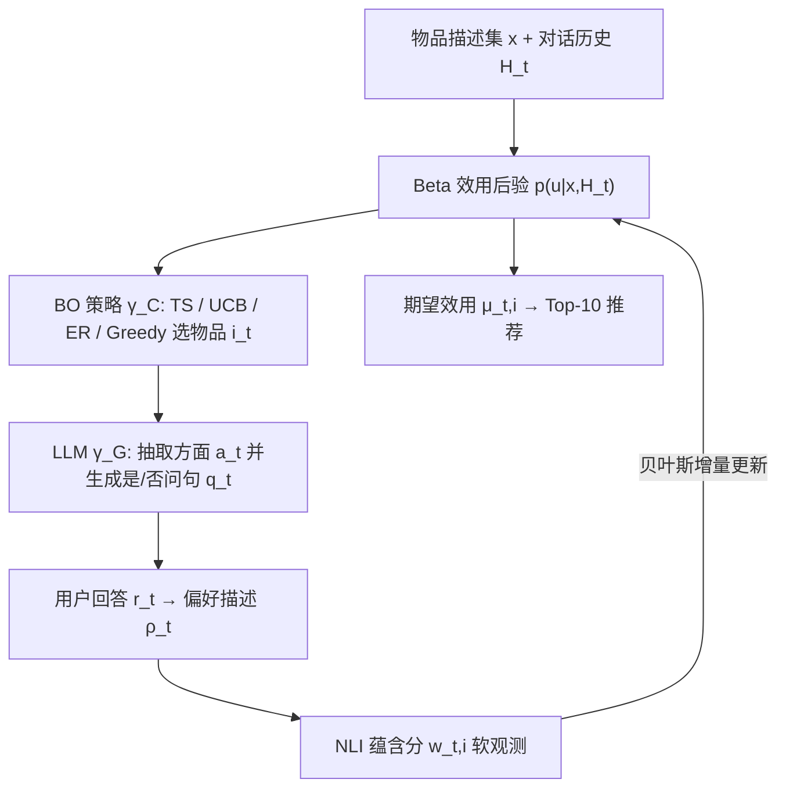
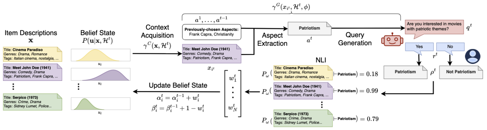

# Bayesian Optimization with LLM-Based Acquisition Functions for Natural Language Preference Elicitation (基于 LLM 采集函数的自然语言偏好引导贝叶斯优化)

- **会议/期刊**: RecSys 2024
- **作者与机构**: David Eric Austin, Anton Korikov, Armin Toroghi, Scott Sanner (University of Waterloo / University of Toronto)
- **推荐链路定位**: 召回（冷启动对话式偏好引导 → Top-10 推荐）
- **研究方向**: 对话推荐与智能体仿真 / 大语言模型推荐 (LLM4Rec)
- **论文原文**: [https://arxiv.org/abs/2405.00981v2](https://arxiv.org/abs/2405.00981v2)
- **开源代码**: [https://github.com/D3Mlab/llm-pe](https://github.com/D3Mlab/llm-pe)

## TL;DR (1分钟核心速览)

冷启动对话推荐中，单体 LLM 缺乏多轮决策论推理，容易**过度利用**（反复追问已知偏好、查询重复）或**过度探索**（追问明显低价值物品）；而经典贝叶斯偏好引导 (PE) 虽策略最优，却只能处理评分/成对比较、无法生成自然语言查询。本文提出 **PEBOL**：把自然语言 PE 形式化为贝叶斯优化，用 NLI 蕴含分在 Beta-Bernoulli 共轭下维护物品效用后验，再用 TS/UCB 从后验中挑选一个物品描述作为 LLM 生成「是/否」查询的上下文。在 100 候选物品、10 轮对话的仿真协议下，MRR@10 在 Yelp 上达 **0.27**，较最优 Gemini-Pro 单体基线 **0.17** 相对提升 **58.8%**，且仅用更小更早的 GPT-3.5 做查询生成。

## Background & Motivation (背景与核心矛盾)

- **主流范式**: ConvRec 主流做法是 LLM 对话外壳 + 推荐模块调用（如 ReDIAL、KBRD 系列），依赖用户-物品交互历史初始化推荐器；另有单体 LLM 直接 prompt 全量物品描述做引导与推荐。
- **前人局限**: (1) 单体 LLM 把全部 $N$个物品描述塞进上下文，代价随$N$ 线性膨胀且无法增量更新物品库，行为不可控、不可解释；(2) 经典 BO/PE 方法（TS、UCB、POMDP、模板关键短语查询）理论上探索-利用平衡最优，但要求用户对**不熟悉**的物品打分或成对比较，无法理解自然语言物品描述。
- **核心洞察 (Key Insight)**: 自然语言查询的「探索/利用」并不需要由 LLM 隐式决定——它可以被一个**显式概率后验**决定；LLM 只需承担「把被选中的物品方面（aspect）转写成自然语言问句」这一生成职责。
- **本文切入点**: 把 acquisition function 拆成 $\gamma=\gamma_G\circ\gamma_C$：$\gamma_C$用 BO 策略在贝叶斯后验上做决策论选择，$\gamma_G$用 LLM 在选定物品描述上做语言生成，从而把「无限语言空间」的采集问题降维到「$N$ 个物品」的离散决策问题。

<figure class="paper-figure" markdown="span">
  <figcaption>图3：来自我们NL-PE实验的精选系统生成对话。Monolithic GPT-3.5对话（左）表现出过度利用：在观察到正向用户偏好后，𝑞3直接扩展𝑞2，并导致查询重复的极端情况（𝑞4 = 𝑞3）。相比之下，PEBOL（右）即使在正向回复后仍继续探索，同时通过UCB引导的查询生成聚焦有希望的方面（四次查询中有三次引发正向回复）。</figcaption>
</figure>

## Method (核心方法设计)

### 1. 整体框架 (Overall Architecture)

给定任意物品集合 $\mathbf{x}=[x_1,\dots,x_N]$（标题/标签/评论等自然语言描述），PEBOL 为每个物品独立维护一个 Beta 效用信念$p(u_i)=\mathrm{Beta}(\alpha_i,\beta_i)$，初始为均匀先验$(1,1)$表示完全冷启动。每轮$t$：BO 策略$\gamma_C$从后验中选出物品$i_t$→ LLM 从$x_{i_t}$抽取 ≤3 词的方面$a_t$并生成「是/否」问句$q_t$→ 用户回答$r_t$→ 由$r_t$构造偏好描述$\rho_t$（赞同取$a_t$，否定取 "not$a_t$"）→ NLI 模型计算每个物品描述$x_i$蕴含$\rho_t$的概率$w_{t,i}$→ 作为软观测更新 Beta 后验。任意轮次均可用期望效用$\mu_{t,i}$ 直接给出 Top-10 推荐，无需重训练。

<figure class="paper-figure" markdown="span">
  <figcaption>图2：PEBOL NL-PE算法在给定任意自然语言物品描述集合x时，维护用户物品偏好的贝叶斯信念状态。该信念由决策论策略使用，通过策略性选择物品描述𝑥𝑖𝑡作为LLM查询生成的基础，以平衡偏好的探索与利用。信念更新通过贝叶斯推断计算，使用物品描述与查询-回复对之间的NLI蕴含分数。</figcaption>
</figure>

### 2. 关键设计拆解 (Key Designs)

1. **NLI 驱动的软观测 Beta 后验（把语言回答变成数值效用观测）**：难点在于用户只回「是/否」一句，却要更新 $N$个物品的效用。作者将二元 Bernoulli 似然$p(r_{t,i}|x_i,u_i,q_t)=\mathrm{Bernoulli}(u_i)$与 Beta 先验构成共轭对，得到闭式增量更新；再用 NLI 蕴含概率$w_{t,i}=P_\omega(x_i,\rho_t)$代替$\{0,1\}$ 得到 PEBOL-P 的松弛式：
   $$\alpha_{t,i}=\alpha_{t-1,i}+w_{t,i},\qquad \beta_{t,i}=\beta_{t-1,i}+(1-w_{t,i})$$
   直觉：$u_i\in[0,1]$被解释为该物品的「偏好强度」，蕴含概率越高说明该物品越符合用户刚表达的偏好，$\alpha$ 累加即似然证据累积；一元 NLI（BART-large-MNLI）计算代价远低于让 LLM 逐物品判断，且天然适配短而泛化的方面短语。
2. **LLM 采集函数：BO 策略选物品 + LLM 只做语言落地**：痛点是 LLM 在无限语言空间中无法做决策论推理。PEBOL 用后验把动作空间压缩为 $N$ 个候选，再套用经典策略：
   $$\text{TS: } \hat{u}_{t,i}\sim p(u_i|x_i,\mathcal{H}_t),\ i_t=\arg\max_i\hat{u}_{t,i};\qquad \text{UCB: } i_t=\arg\max_i P_k\big(\mathrm{Beta}(\alpha_{t,i},\beta_{t,i})\big)$$
   另有 ER（$\arg\max_i \mathrm{Var}(\cdot)$，纯探索）、Greedy（$\arg\max_i \mu_{t,i}$，纯利用）、Random。由于$\alpha/\beta$ 同时编码「均值高」与「不确定」，UCB 的高分位点天然偏好高不确定物品，从而在**不改变 LLM 的前提下**移植了理论最优的探索-利用权衡。
3. **训练目标、负采样与推理效率**：本方法**完全无训练**（no gradient updates、no negative sampling），只做贝叶斯闭式更新 + LLM 推理 prompt。每轮在线开销为：1 次方面抽取 + 1 次查询生成 LLM 调用 + $N$次 NLI 前向；上下文从全部$N$条描述缩减为 1 条，这是相对 MonoLLM 的核心工程优势。方面历史$(a_1,\dots,a_{t-1})$ 被写入 prompt 以抑制重复查询。

## Experimental Setup & Evaluation Protocol (实验设置与评估协议)

- **数据集与预处理**: 三套真实物品描述，各随机采样 **100 个物品**构成候选集（因 MonoLLM 需全量描述入上下文，故限制 $|I|=100$）：

| 数据集 | #Users(仿真) | #Items(候选) | #Interactions | 稀疏度/密度 | 特征/场景说明 |
| :--- | :---: | :---: | :---: | :---: | :--- |
| Yelp (Philadelphia) | 100 | 100 | 无历史交互 | 纯冷启动 | 餐厅描述，过滤为单城市、≥50 条评论、≥5 个类目标签 |
| MovieLens-25M | 100 | 100 | 无历史交互 | 纯冷启动 | 取评论数前 10% 且 ≥20 个 tag，描述=标题+类型+Top-20 用户 tag |
| Recipe-MPR | 100 | 100 | 无历史交互 | 纯冷启动 | 食谱描述，自带 1 条目标偏好的多轮对话数据 |

- **数据划分与防穿越 (Splitting Strategy)**: 采用**冷启动划分**：不使用任何用户-物品交互历史、不做 $k$-core 过滤；每个仿真用户只「喜欢」1 个隐藏目标物品，通过 10 轮对话在线引导，无训练/测试泄漏概念。
- **排名评测协议 (Ranking Protocol)**: **Full-Ranking**（对 100 个候选物品全库打分，按期望效用 $\mu_{t,i}$排序取 Top-10），指标为 MRR@10；因仅 1 个相关物品，MRR@10$\equiv$MAP@10。仿真用户由 GPT-3.5-turbo-0613 扮演，共 3 档回答噪声$\{0,0.25,0.5\}$（随机翻转「是/否」的比例），报告 95% 置信区间。
- **对比基线与超参设置**: 基线仅 2 个 MonoLLM——GPT-3.5-turbo-0613 与 Gemini-Pro（作者论证 ConvRec 基线如 ReDIAL/KBRD 依赖交互历史，属非冷启动，不可比）；NLI 采用 400M 的 `facebook/bart-large-mnli`，MNLI 温度 $T\in\{1,10,100\}$ 按数据集择优；PEBOL 查询生成亦用 GPT-3.5（MovieLens 用 16k 长上下文版）。

## Key Experimental Results (实验关键数据)

### 1. 主实验对比 (Main Results)

第 10 轮对话后的 MRR@10（PEBOL 取各数据集最优策略：Yelp/MovieLens 用 TS，Recipe-MPR 用 UCB）：

| 方法 | Yelp | MovieLens | Recipe-MPR |
| :--- | :---: | :---: | :---: |
| GPT-3.5 MonoLLM | 0.12 | 0.09 | 0.11 |
| Gemini-Pro MonoLLM（更强 LLM） | 0.17 | 0.15 | 0.16 |
| **PEBOL-P (TS/UCB)** | **0.27** | **0.18** | **0.17** |
| Improv. vs 最优 MonoLLM | **+58.8%** | **+20.0%** | **+6.3%** |
| Improv. vs GPT-3.5 MonoLLM | **+125.0%** | **+100.0%** | **+54.5%** |

### 2. 消融实验 (Ablation Study)

| 变体 / 组件消融 | Yelp | MovieLens | Recipe-MPR |
| :--- | :---: | :---: | :---: |
| PEBOL-P + 方面历史（默认） | **0.27** | **0.18** | 0.13 |
| w/o 方面历史（删除 $a_1..a_{t-1}$） | 0.16 | 0.14 | 0.09 |
| PEBOL-B（二元蕴含，$\lfloor w\rfloor$） | 略低 | 略低 | 略低 |
| PEBOL-P（概率蕴含 $w\in[0,1]$） | 较优 | 较优 | 较优 |
| 策略 Random / Greedy / ER / TS / UCB | TS 最佳 | TS 最佳 | UCB≈Greedy≈ER > TS |

### 3. 关键实验发现 (Key Findings)

1. **决策论引导比「换更大模型」更值钱**：PEBOL 用 GPT-3.5 做查询生成即在 Yelp 上取得 0.27，反超使用更新一代 Gemini-Pro 的 MonoLLM（0.17）达 58.8%，说明瓶颈在探索-利用策略而非底座 LLM 的语言能力。
2. **查询去重是低成本高回报的工程杠杆**：仅把已生成方面历史写回 prompt，Yelp 上 MRR@10 从 0.16 跃至 0.27（+68.8%），MovieLens 0.14→0.18、Recipe-MPR 0.09→0.13，验证了单体 LLM「过度利用→查询重复」正是其失效主因（如 $q_4=q_3$ 的退化）。
3. **连续蕴含分与鲁棒性均站得住**：PEBOL-P 普遍优于丢弃概率信息的 PEBOL-B，且在全部噪声档位（0/0.25/0.5）下 Yelp 上所有 PEBOL-P 变体均优于两个 MonoLLM——Beta 后验的软证据累积天然具备抗噪平滑效果。

## Highlights & Limitations (亮点、对比与审稿批判)

- **与代表作对比 (vs. Prior Work)**: 相较 Yang et al. 的关键短语模板化贝叶斯 PE，本文将查询空间从预定义 keyphrase 扩展到**生成式自由语言**；相较 Handa et al. 的「LLM 仅作特征抽取/语言化外壳、内核仍是传统 PE」，本文反向让 BO 成为决策内核、LLM 成为执行器；相较 Li et al. 的 LLM 自问自答式 PE，本文对任意物品集给出显式信念状态与可解释的采集策略。
- **可迁移亮点**: (1)「离散后验 + LLM 落地」的解耦范式可迁移到多轮澄清式搜索、Agent 主动提问、冷启动访谈问卷生成；(2) 用轻量 NLI 蕴含分作为用户话语到物品的「软标签传播」，成本远低于逐物品 LLM 判定，可用于评论/描述级偏好蒸馏。
- **审稿级局限批判**: (1) **评估完全依赖 LLM 仿真用户**，无真人研究，且候选集被压到 100 个物品、只能「是/否」回答，与真实长描述/大目录场景差距大；(2) 物品效用独立假设导致每轮需 $N$次 NLI 前向，$N$上千时在线延迟线性增长；且策略对数据集敏感（Yelp/MovieLens 偏好 TS，Recipe-MPR 反被 UCB/Greedy 超越），超参（MNLI 温度、UCB 分位$k$）需逐数据集调优，泛化性证据偏弱。

## Rating (四维评分)

- **方法创新性 (Novelty)**: ⭐⭐⭐⭐ （首次将 NL-PE 形式化为 BO 并把 acquisition function 拆为「BO 选物品 + LLM 生成语言」，框架层面的概念贡献清晰，但组件本身均为已有技术组合）
- **评估协议与实验扎实度 (Protocol & Experiments)**: ⭐⭐⭐ （三数据集 × 三噪声档 × 五策略 + 95% CI 较完整，但基线仅 2 个 MonoLLM、候选集仅 100 物品、无真人用户与显著性检验，说服力受限）
- **写作与数学规范度 (Clarity & Rigor)**: ⭐⭐⭐⭐ （Beta-Bernoulli 共轭推导与 PEBOL-B→PEBOL-P 的松弛逻辑交代干净，图 1/图 2 的信念更新可视化直观；概率后验的完整推导被外置到附录）
- **工业落地与复现价值 (Industrial & Practical Value)**: ⭐⭐⭐⭐ （完全免训练、代码开源、上下文从 $N$条降至 1 条，极易接入现有对话推荐前端；但$O(N)$ 次 NLI 推理与逐数据集策略调参是规模化部署的主要成本）

