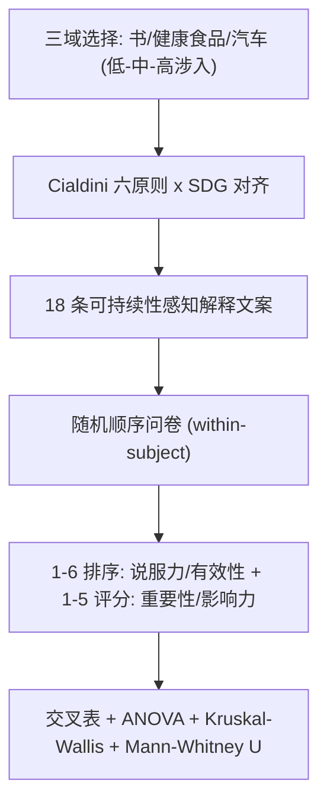
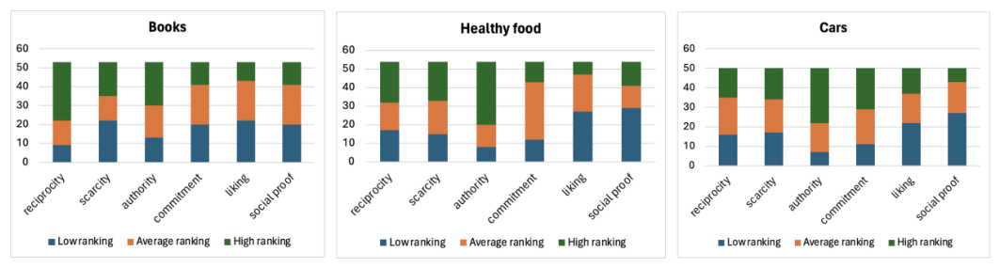

# Less is More: Towards Sustainability-Aware Persuasive Explanations in Recommender Systems (少即是多：迈向推荐系统中的可持续性感知说服性解释)

- **会议/期刊**: RecSys 2024 (LBR / Late-Breaking Results Track, 5 页短文)
- **作者与机构**: Thi Ngoc Trang Tran, Seda Polat-Erdeniz, Alexander Felfernig, Sebastian Lubos, Merfat El-Mansi, Viet-Man Le（格拉茨工业大学软件技术研究所）
- **推荐链路定位**: 重排 / 解释生成层（不改变候选排序，仅对已推荐物品附加解释文案）
- **研究方向**: 对话推荐与智能体仿真 / 可解释推荐、说服性推荐
- **论文原文**: [https://arxiv.org/abs/2409.18690v1](https://arxiv.org/abs/2409.18690v1)
- **开源代码**: 暂未开源

## TL;DR (1分钟核心速览)

主流推荐解释服务于“提升购买/信任/透明”，而本文提出与之正交的**可持续性感知说服性解释（sustainability-aware persuasive explanation）**，其目标函数从“多买”翻转为“少买、买得更健康、买得更环保”，即“less is more”原则。方法上并无新模型：以 Cialdini 六大说服原则（互惠、稀缺、权威、承诺、喜好、社会认同）为骨架，为书、健康食品、汽车三域手工撰写 18 条解释模板。评估采用 158 人 within-subject 用户研究（每域 ~50 人，1–6 排序 + 1–5 李克特评分），非离线排序指标。关键结果：**“权威”原则在三域的说服力与有效性均值排名均居首**（说服力 food 4.52 / cars 4.44 / books 4.11），而“社会认同”在食品与汽车域垫底（2.80 / 2.78）。

## Background & Motivation (背景与核心矛盾)

- **主流范式**: 现有解释研究沿 Tintarev 的目标分类展开（efficiency、persuasiveness、transparency、trust、scrutability、satisfaction），说服性解释的代表作（如 Alslaity & Tran 基于 Cialdini 原则的分析）几乎全部以**提升物品接受率与购买转化**为终点。
- **前人局限**: ① 说服机制被单向绑定在“促成交易”上，与联合国 SDGs（负责任消费与生产、良好健康、可持续城市）存在目标冲突；② 现有电商平台解释中**不存在“劝用户不买/少买”的语义空间**，故无任何可持续维度的解释设计经验或用户感知证据。
- **核心洞察 (Key Insight)**: 解释的说服方向可以与商业目标解耦——把 Cialdini 原则的“推力”重新指向减少冗余购买、降低盐摄入、放弃 SUV，即用同一套说服算子服务于相反的行为目标。
- **本文切入点**: 不训练模型、不改排序，只在“解释文案”这一最轻量环节引入可持续论证，并以用户研究测其可接受性与影响力，验证该概念是否具备落地前提。

## Method (核心方法设计)

### 1. 整体框架 (Overall Architecture)

本文是概念 + 用户研究型短文，无学习式流水线。其“框架”为：**领域选择 → 原则实例化 → 解释生成 → 被试内排序评测**。首先按涉入度（involvement）挑选三个域——书（低涉入，常用协同/内容过滤）、健康食品（中等涉入）、汽车（高涉入，常用知识型推荐），使结论具备跨域张力；随后把 Cialdini 六原则逐一与对应 SDG 对齐，人工撰写 18 条可持续解释（每域 6 条，见表 2–4）；再通过 Google Forms 以随机顺序呈现，规避顺序偏差；最后收集 persuasiveness / effectiveness 的 1–6 唯一排序与 importance / influence 的 1–5 评分，做域内交叉表与跨域假设检验。整体上，解释被假设直接附着于已推荐物品，**不参与基于可持续性准则的重排序**。

<figure class="paper-figure" markdown="span">
  <figcaption>图1：可持续性感知的说服性解释在三个物品领域中的说服力。各纵轴表示对解释进行排序的参与者人数。</figcaption>
</figure>

### 2. 关键设计拆解 (Key Designs)

1. **可持续性感知解释的“逆目标”构造（Less is More）**：痛点在于说服原则天然服务于增量销售。本文的算子替换是——把说服的**受益主体**从“用户即时效用”换成“用户长期福祉/社会外部性”，从而把互惠改写为“删掉购物车中内容重叠的书即得 25% 券”，把权威改写为“书评人指出 A、B 两书内容重叠 90%，剩余 10% 由 C 覆盖”。其有效性直觉是：说服力并不来自“更多商品信息”，而来自**为用户提供减少购买的正当理由（justification）**，故文案的信息量可下降而说服力不降。

2. **原则—SDG 的域内对齐映射**：本文不做通用模板，而是让每条解释显式锚定一个 SDG 与一个域特有行为（书→负责任消费、食品→健康福祉、汽车→可持续城市）。这一设计使得跨域比较有意义：同一原则在不同涉入度下的排名差异可归因于**决策 stakes 与感知环境足迹**，而非文案措辞差异。

3. **评测与统计协议（本文真正的“训练目标”）**：无损失函数、无负采样；统计侧为——域内用交叉表将 1–6 排序折叠为低(1,2)/中(3,4)/高(5,6) 三档；跨域对每条解释做单因素 ANOVA（$\alpha=0.05$）；importance / influence 因序数性且 Shapiro-Wilk 拒绝正态（$p<\alpha$），改用 Kruskal-Wallis（$\alpha=0.05$），若显著则做 Mann-Whitney U 事后检验并以 Bonferroni 校正至$\alpha'=0.05/3\approx0.0167$。推理开销为零（纯文案），故其“工业成本”仅为解释模板库与 A/B 埋点。

## Experimental Setup & Evaluation Protocol (实验设置与评估协议)

- **数据集与预处理**: 本文不使用交互数据集，被试构成即“数据”：

| 域 | #Participants | 涉入度 | 典型推荐范式 | 对应 SDG | 解释条数 |
| :--- | :---: | :---: | :---: | :---: | :---: |
| Books | 53 | 低 | 协同/内容过滤 | 负责任消费与生产 | 6 |
| Healthy Food | 55 | 中 | 混合 | 良好健康与福祉 | 6 |
| Cars | 50 | 高 | 知识型推荐 | 可持续城市与社区 | 6 |
| 合计 | 158（男 118 / 女 40） | — | — | — | 18 |

  人口统计高度集中：18–24 岁占 86.08%，奥地利籍占 72.15%，主体为作者所在大学课程学生——这是后文局限的核心来源。

- **数据划分与防穿越 (Splitting Strategy)**: 不适用（无训练/测试划分）；等价的控制手段是 **within-subject 设计 + 解释顺序随机化**，每位被试对同域 6 条解释给出 1–6 的唯一排名（forced ranking），避免同分与顺序效应。
- **排名评测协议 (Ranking Protocol)**: 非 item ranking，而是 **explanation ranking**——被试对解释排序，非对物品排序；无 Full-Ranking/Sampled 之分，也无 HR/NDCG 类指标。指标为均值排名（mean ranking，1 最低、6 最高）与 Kruskal-Wallis 均值秩（mean rank）。
- **对比基线与超参设置**: 基线即“六原则互为对照”（principle-vs-principle），无外部解释方法基线、无无解释对照组；显著性标准 $\alpha=0.05$，事后校正$\alpha'=0.0167$。

## Key Experimental Results (实验关键数据)

### 1. 主实验对比 (Main Results)

表 5、表 6 给出六原则在三维度的均值排名（1–6，越高越好，加粗为域内最优、下划线为域内最差）：

| 原则 | 书·说服力 | 食品·说服力 | 汽车·说服力 | 书·有效性 | 食品·有效性 | 汽车·有效性 |
| :--- | :---: | :---: | :---: | :---: | :---: | :---: |
| reciprocity | **4.40** | 3.72 | 3.38 | 3.64 | 3.63 | 3.32 |
| scarcity | 3.19 | 3.67 | 3.44 | <u>2.74</u> | 3.94 | 3.64 |
| **authority** | 4.11 | **4.52** | **4.44** | **4.13** | **4.57** | **3.90** |
| commitment | 3.15 | 3.44 | 3.88 | 3.74 | 3.06 | 3.86 |
| liking | <u>3.00</u> | 2.85 | 3.08 | 3.49 | 3.24 | <u>3.10</u> |
| social proof | 3.15 | <u>2.80</u> | <u>2.78</u> | 3.26 | <u>2.63</u> | 3.16 |

跨域 ANOVA 仅在少数原则显著：说服力维度 reciprocity $p=0.011$；有效性维度 scarcity$p=0.001$、commitment$p=0.015$——即“权威”虽稳居第一，但其跨域一致性反而是**描述性**而非统计显著的。

### 2. 消融实验 (Ablation Study)

本文无组件消融，其“消融等价物”是按域与维度拆分的稳健性检验：

| 拆分维度 | importance 均值秩 | influence 均值秩 | 检验结论 |
| :--- | :---: | :---: | :--- |
| Books (低涉入) | 67.14 | 72.43 | 三域 importance 总体 Kruskal-Wallis $p=0.05$ 显著 |
| Healthy Food (中) | **85.53** | **87.03** | 但 Mann-Whitney U 两两比较（$\alpha'=0.0167$）均不显著 |
| Cars (高) | 84.52 | 77.29 | influence 维度 Kruskal-Wallis 不显著 |

### 3. 关键实验发现 (Key Findings)

1. **权威原则跨域通吃，社会认同跨域失效**：authority 在三域的说服力（4.11/4.52/4.44）与有效性（4.13/4.57/3.90）均为第一，而 social proof 在食品与汽车域双维度垫底（说服力 2.80/2.78、有效性 2.63），说明“少买/换购”这类反商业建议更被**专家背书**驱动，用户对同伴影响持怀疑态度。
2. **低涉入域出现原则反转**：书域中 reciprocity 以 4.40 居说服力首位，scarcity 有效性仅 2.74；作者归因为书籍生产分销的环境足迹低，用户感知相关性弱，故需靠“即时互惠（25% 券）”而非“稀缺恐慌”或“同伴示范”来激活。
3. **可持续性的主观重要性随涉入度单调上升，但统计上站不住**：importance 均值秩 books 67.14 < cars 84.52 < food 85.53，方向清晰却因 Bonferroni 校正后 $p>0.0167$ 而全部不显著，提示样本量（每域 ~50）与人口同质（86% 学生、72% 奥地利）不足以支撑跨域断言。

## Highlights & Limitations (亮点、对比与审稿批判)

- **与代表作对比 (vs. Prior Work)**: 相较 Alslaity & Tran 的原则化说服解释（目标为提升物品接受），本文把说服目标函数翻转为“减少消费/替换更可持续选项”，是**目标而非机制**的创新；相较 Tintarev 目标分类框架，本文新增了“可持续性”这一未被覆盖的解释目标维度；相较任何基于特征归因的解释方法（如 SHAP、反事实解释），本文完全绕开“解释与模型一致性”，只测**用户感知**，因此几乎不与现有 XAI 推荐工作可比。
- **可迁移亮点**: ① “原则 × 领域涉入度”的二维解释模板库设计，可直接复用于 LLM 生成解释的 prompt 骨架（如“用权威口径、锚定食品域、给出去购买理由”）；② 把 1–6 forced ranking 折叠为低/中/高三档再做交叉表的做法，在小样本解释评测中比直接算均值更稳健。
- **审稿级局限批判**: ① **证据强度不足**——每域仅约 50 人，跨域结论在 Bonferroni 校正后大面积不显著，却仍在讨论中给出因果式解读（“专家背书权重高”“书籍足迹低”），属过度解释；② **生态效度与利益冲突未测**——实验为合成场景、无真实物品与真实购买行为，且未测量“被劝少买后对平台的信任/满意度下降”，而这恰恰是该概念在商业落地时的第一道门槛。此外 5 页 LBR 篇幅使解释模板的措辞效应（长度、语气、是否指名品牌）完全未受控。

## Rating (四维评分)

- **方法创新性 (Novelty)**: ⭐⭐⭐ （概念翻转——把说服解释指向“少买”确有新意，但无新模型、无新算法，属问题重定义而非方法贡献）
- **评估协议与实验扎实度 (Protocol & Experiments)**: ⭐⭐ （within-subject 与随机顺序是加分项，但样本量小、人群单一、无无解释对照组，跨域显著性大面积缺失）
- **写作与数学规范度 (Clarity & Rigor)**: ⭐⭐⭐ （统计流程交代清楚、检验选择有依据，但全文无形式化定义，讨论部分存在超出数据支持的因果措辞）
- **工业落地与复现价值 (Industrial & Practical Value)**: ⭐⭐⭐ （解释模板可即插即用、零推理开销；但缺开源材料、缺用户留存/信任侧副作用评估，直接上线风险较高）

