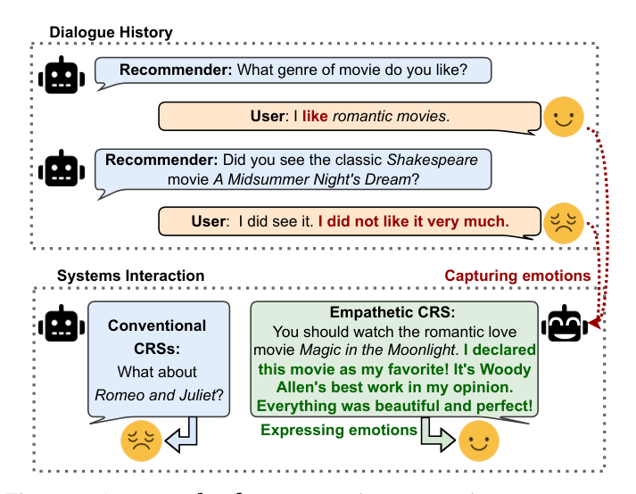
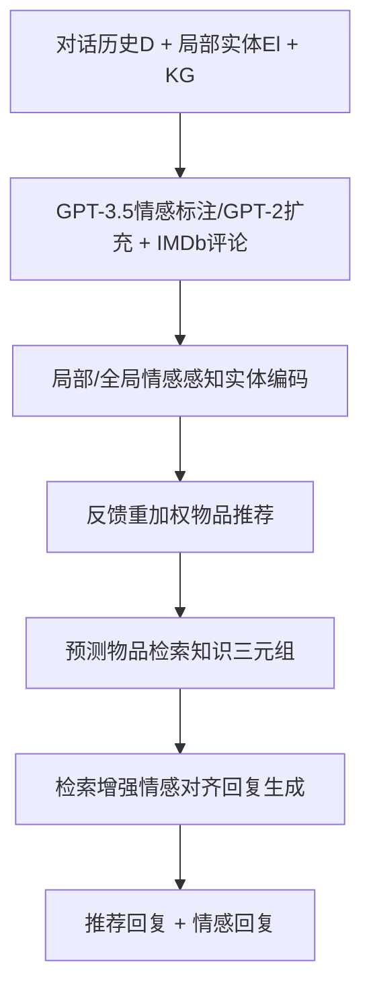
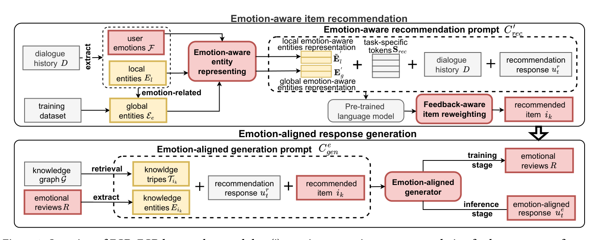

# Towards Empathetic Conversational Recommender Systems（面向共情对话推荐系统）

- **会议/期刊**: RecSys 2024
- **作者与机构**: Xiaoyu Zhang, Ruobing Xie, Yougang Lyu, Xin Xin, Pengjie Ren, Mingfei Liang, Bo Zhang, Zhanhui Kang, Maarten de Rijke, Zhaochun Ren；山东大学、腾讯、阿姆斯特丹大学、莱顿大学
- **推荐链路定位**: 对话推荐（物品推荐 + 回复生成，端到端对话）
- **研究方向**: 对话推荐与智能体仿真 / LLM4Rec
- **论文原文**: [https://arxiv.org/abs/2409.10527v1](https://arxiv.org/abs/2409.10527v1)
- **开源代码**: [https://github.com/zxd-octopus/ECR](https://github.com/zxd-octopus/ECR)

## TL;DR (1分钟核心速览)

针对CRS只拟合数据集标准答案、忽略用户负面情绪与回复情感参与度的问题，ECR把情感注入偏好建模与回复生成：局部/全局情感实体+反馈重加权提升物品推荐，检索知识增强LLM生成情感回复；在ReDial全库排序上AUC较UniCRS提升6.9%，RT@10提升3.9%，五项主观生成指标均最优。

## Background & Motivation (背景与核心矛盾)

- **主流范式**: 现有CRS以KG实体+PLM prompt为核心，UniCRS将物品推荐与回复生成统一到DialoGPT式prompt学习框架。
- **前人局限**: ①把对话中提及实体与推荐项都当正反馈，忽略`dislike`与`not say`标签噪声；②标准回复短、缺情感，难以形成情感参与。
- **核心洞察 (Key Insight)**: 用户情感既是实时偏好信号，也可作为全局协同实体的过滤条件；反馈强度可用于纠正“提及即喜欢”的标签偏差。
- **本文切入点**: 提出ECR，双模块分别做情感感知物品推荐与情感对齐回复生成。

<figure class="paper-figure" markdown="span">
  <figcaption>图1：用户与系统之间电影推荐对话示例。传达用户情感的文本以红色字体高亮，系统表达情感的回复以绿色字体标记。</figcaption>
</figure>

## Method (核心方法设计)

### 1. 整体框架 (Overall Architecture)

ECR以UniCRS为骨架：输入对话历史$D$、局部实体$E_l$与DBpedia知识。离线用GPT-3.5标注9类情感并蒸馏GPT-2扩充数据；在线先经局部/全局情感实体编码和反馈重加权做物品推荐，再以预测物品检索IMDb评论中的知识三元组，构造检索增强prompt微调DialoGPT/Llama2生成情感回复，并与推荐回复拼接。训练两阶段交叉熵，推理解码不额外采样。

<figure class="paper-figure" markdown="span">
  <figcaption>图2：ECR概览。ECR包含两个关键模块：（i）情感感知的物品推荐，以更好地理解用户偏好；（ii）情感对齐的回复生成，以实现有吸引力的对话。</figcaption>
</figure>

### 2. 关键设计拆解 (Key Designs)

1. **情感感知局部/全局实体（Emotion-aware Entity）**：痛点是“实体提及即偏好”，忽略情感极性。对实体$e_j$，将其情感标签概率加权为$\boldsymbol{F}_{e_j}=\sum_i p_i v(f_i)$，与局部实体$\tilde{\boldsymbol{e}}_j$拼接投影：$\tilde{\boldsymbol{e}}'_j=[\tilde{\boldsymbol{e}}_j;\boldsymbol{F}_{e_j}]\mathbf{W}_t^\top+\boldsymbol{b}$。全局侧按共同情感标签过滤共现实体，聚合$\boldsymbol{E}_{e_j}=\sum_i \boldsymbol{e}_iP(e_i|e_j)$，再同法融合，使情感成为协同知识的过滤器。
2. **反馈感知物品重加权（Feedback-aware Reweighting）**：针对数据集`like/dislike/not say`混标，将三者映射为2.0/1.0/0.5，改写交叉熵：$L_{rec}=-\sum_{k=1}^{N}m(f_{ik})\log P_r(i_k|C'_{rec})$。降低错标/未表态项权重，直接校准正负反馈排序，提升AUC。
3. **检索增强情感对齐生成**：针对PLM幻觉与标准回复无情感，训练prompt为$C_{egen}=[S_{E_r};S_{T_r};S_{i_r};u_r^t]$，用IMDb高评分情感评论做监督$L_{gen}=-\sum_j\log P(w_j|C_{egen};w_{<j})$；推理用推荐物品检索$T_{i_k},E_{i_k}$，随机取$p_{nt}=2$三元组、$p_{ne}=4$实体，降低幻觉并泛化到unseen item。总损失为$\mathcal{L}=\mathcal{L}_{rec}+\mathcal{L}_{gen}$；物品端全库softmax、无额外负采样，回复端token-level CE；推理成本主要来自一次LLM解码。

## Experimental Setup & Evaluation Protocol (实验设置与评估协议)

- **数据集与预处理**: ReDial电影双人对话；反馈含`like/dislike/not say`；IMDb评论经筛选后用于生成训练。

| 数据集 | #Users | #Items | #Interactions | 稀疏度/密度 | 特征/场景说明 |
| :--- | :---: | :---: | :---: | :---: | :--- |
| ReDial | — | 51,699 movies | 10,006 conversations / 182,150 utterances | 对话稀疏 | 电影域；DBpedia KG；`dislike` 4.9%、`not say` 14% |

- **数据划分与防穿越**: 按会话级比例划分，沿用ReDial/UniCRS官方划分（正文未披露具体比例）；每轮仅用$D_{t-1}$预测第$t$轮，避免未来轮泄漏。
- **排名评测协议**: 物品推荐从51,699电影**Full-Ranking全库排序**，报告R@1/10/50与RT@1/10/50；AUC以`like`为正、`dislike/not say`为负评估排序。训练为全库softmax，无额外负采样。
- **对比基线与超参设置**: 推荐对比KBRD、KGSF、RevCore、UCCR、UniCRS；生成对比UniCRS、GPT-3.5-turbo-instruct、GPT-3.5-turbo、Llama2-7B-Chat。情感标签嵌入48，$\beta=0.1$，$n_f=3$，$p_{nt}=2$，$p_{ne}=4$；DialoGPT lr$1e-4$，Llama2 LoRA lr$5e-5$；显著性$p<0.05$。

## Key Experimental Results (实验关键数据)

### 1. 主实验对比 (Main Results)

**表1：物品推荐（ReDial全库排序）**

| Model | AUC | RT@1 | RT@10 | RT@50 | R@1 | R@10 | R@50 |
| :--- | ---: | ---: | ---: | ---: | ---: | ---: | ---: |
| KBRD | 0.503 | 0.040 | 0.182 | 0.381 | 0.037 | 0.175 | 0.360 |
| KGSF | 0.513 | 0.043 | 0.195 | 0.383 | 0.040 | 0.182 | 0.361 |
| RevCore | 0.514 | 0.054 | 0.230 | 0.410 | 0.046 | 0.209 | 0.390 |
| UCCR | 0.499 | 0.038 | 0.208 | 0.423 | 0.039 | 0.198 | 0.407 |
| UniCRS | 0.506 | 0.052 | 0.229 | 0.439 | 0.047 | 0.212 | 0.414 |
| **ECR** | **0.541*** | **0.055** | **0.238*** | **0.452*** | **0.049** | **0.220*** | **0.428*** |

ECR较UniCRS：AUC +6.9%，RT@10 +3.9%，RT@50 +3.0%。**表2：回复生成（GPT-4-turbo LLM评分，0–9分）**

| Model | Emo Int | Emo Pers | Log Pers | Info | Life |
| :--- | ---: | ---: | ---: | ---: | ---: |
| UniCRS | 0.400 | 0.942 | 0.793 | 0.673 | 2.241 |
| GPT-3.5-turbo-instruct | 1.706 | 3.043 | 3.474 | 2.975 | 4.182 |
| GPT-3.5-turbo | 2.215 | 3.754 | 4.782 | 4.147 | 5.338 |
| Llama2-7B-Chat | 3.934 | 6.030 | 5.886 | 5.904 | 7.129 |
| ECR[DialoGPT] | 4.011 | 4.878 | 4.736 | 5.094 | 5.906 |
| **ECR[Llama2-Chat]** | **6.826*** | **7.724*** | **6.702*** | **7.653*** | **8.063*** |

ECR[Llama2]较Llama2：Emo Int +73.5%、Emo Pers +28.1%、Log Pers +13.9%、Info +29.6%、Life +13.1%。人评200例排序一致，ECR[Llama2]五项均最优（7.130/7.575/7.403/7.172/8.468），LLM与人评Cohen $\kappa=0.62$。

### 2. 消融实验 (Ablation Study)

| Model | AUC | RT@10 | RT@50 | R@10 | R@50 |
| :--- | ---: | ---: | ---: | ---: | ---: |
| UniCRS | 0.506 | 0.229 | 0.439 | 0.212 | 0.414 |
| ECR[L] | 0.535 | 0.229 | 0.444 | 0.213 | 0.420 |
| ECR[LS] | 0.541 | 0.232 | 0.442 | 0.216 | 0.420 |
| ECR[LG] | 0.535 | 0.232 | 0.453 | 0.216 | 0.428 |
| **ECR** | **0.541** | **0.238*** | **0.452** | **0.220*** | **0.428** |

### 3. 关键实验发现 (Key Findings)

1. **局部情感实体是推荐主增益**：ECR[L]较UniCRS AUC从0.506升至0.535（+5.7%），R@50从0.414升至0.420，说明情感标签能修正“提及即喜欢”的偏好偏差。
2. **反馈重加权主要做排序校准**：ECR[LS]较ECR[L] AUC 0.535→0.541、RT@10 0.229→0.232，但R@50不变（0.420），对应其作用在区分`like`与`dislike/not say`，而非扩大召回。
3. **全局情感过滤与生成侧收益显著**：ECR[LG]较ECR[L] RT@50 0.444→0.453、R@50 0.420→0.428；生成侧ECR[Llama2] Emo Int 6.826 vs Llama2 3.934（+73.5%）、Life 8.063 vs 7.129（+13.1%）。

## Highlights & Limitations (亮点、对比与审稿批判)

- **与代表作对比 (vs. Prior Work)**: UniCRS统一prompt但只拟合标准答案；RevCore用评论情感但偏离线评论分析；UCCR重跨会话用户建模。ECR首次把实时对话情感、反馈权重与检索增强情感生成串成CRS双任务闭环。
- **可迁移亮点**: 用情感标签过滤全局协同实体，可直接迁移到KG推荐去噪；反馈感知重加权适用于含`dislike/not say`的对话推荐数据。
- **审稿级局限批判**: 仅ReDial单数据集验证，跨域/多语言泛化未证；生成训练只用IMDb正向高评分评论，未对齐负向/中性情感；推理依赖LLM解码且知识三元组随机筛选，线上延迟与稳定性需进一步优化。

## Rating (四维评分)

- **方法创新性 (Novelty)**: ⭐⭐⭐⭐ （把情感同时用于偏好建模与回复生成，反馈重加权和情感实体过滤有新意）
- **评估协议与实验扎实度 (Protocol & Experiments)**: ⭐⭐⭐⭐ （ReDial全库排序+AUC+新主观指标+人评一致性，但仅单数据集且划分细节不足）
- **写作与数学规范度 (Clarity & Rigor)**: ⭐⭐⭐⭐ （模块与公式对应清楚，情感/反馈/检索链路完整，部分检索细节在附录）
- **工业落地与复现价值 (Industrial & Practical Value)**: ⭐⭐⭐ （代码开源，情感数据构造可复用；但LLM生成推理成本较高，线上需蒸馏/缓存）

