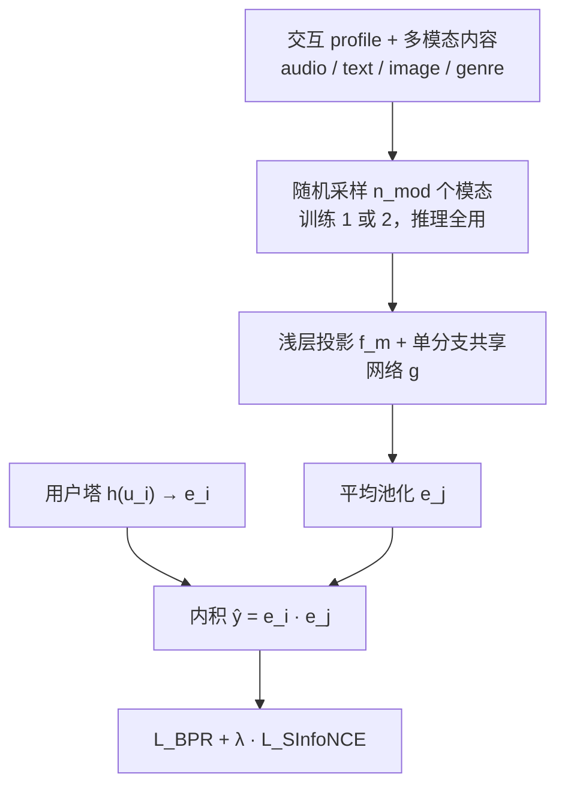
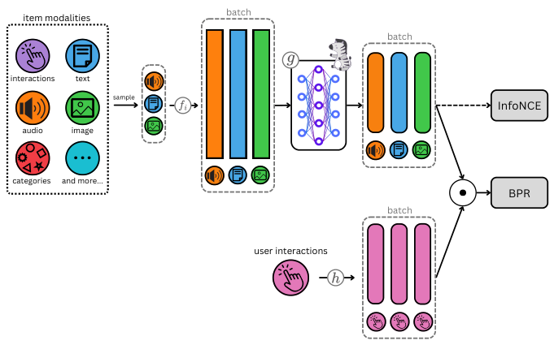
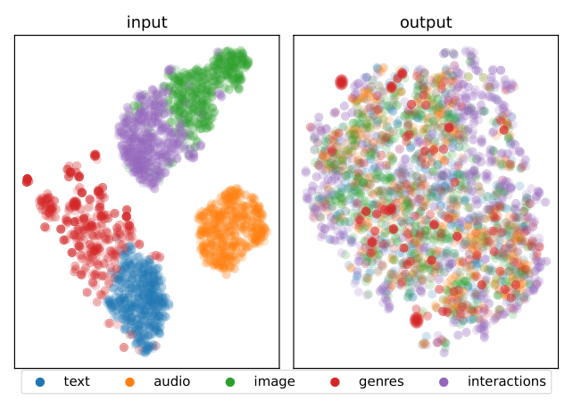

# A Multimodal Single-Branch Embedding Network for Recommendation in Cold-Start and Missing Modality Scenarios (面向冷启动与缺失模态场景的多模态单分支嵌入推荐网络)

- **会议/期刊**: RecSys 2024 (18th ACM Conference on Recommender Systems)
- **作者与机构**: Christian Ganhör, Marta Moscati, Anna Hausberger, Shah Nawaz, Markus Schedl（Johannes Kepler University Linz, Institute of Computational Perception）
- **推荐链路定位**: 召回（用户/物品双塔内积召回，侧重物品侧内容塔）
- **研究方向**: 冷启动与长尾推荐 / 多模态推荐
- **论文原文**: [https://arxiv.org/abs/2409.17864v1](https://arxiv.org/abs/2409.17864v1)
- **开源代码**: [https://github.com/hcai-mms/SiBraR](https://github.com/hcai-mms/SiBraR)

## TL;DR (1分钟核心速览)

冷启动与缺失模态的本质是"某一路输入整块缺席"，而现有多分支/显式对齐 CBRS 一旦少了内容模态或交互锚点就塌陷。本文提出 SiBraR：用**同一个单分支网络 $g$（权重共享）**编码交互 profile 与音频/文本/图像/流派等所有模态，训练时对每条交互随机采样$n_{mod}$ 个模态做平均池化，再叠加 BPR 与对称跨模态 InfoNCE。在 Onion/ML-1M/Amazon 三个域、全库 test-set 排序协议下，**物品冷启动 nDCG@10 相对 CLCRec 提升 70.0%（ML-1M 0.2994 vs 0.1762）与 31.9%（Onion 0.1982 vs 0.1503）**，热启动下竞争力持平。

## Background & Motivation (背景与核心矛盾)

- **主流范式**: CF（MF/DeepMF）靠交互矩阵；冷启动则用混合 CBRS——显式法（CLCRec 让内容表征去逼近 CF 表征）或隐式法（DropoutNet 用 dropout 模拟缺失、直接由内容预测 CF 表征）。
- **前人局限**: ① 显式对齐把**交互表征当作锚点**，纯冷启动物品无交互即无锚点、对齐目标失效；② 多分支多模态架构给每个模态独立编码器，**模态鸿沟**（modality gap）严重，推理期任一模态缺失即性能骤降。
- **核心洞察 (Key Insight)**: 缺失模态与冷启动在数学上是同一件事——集合 $\mathcal{M}^{item}_j$ 少了元素。若强制"同一实体的任意模态子集都映射到共享空间的同一区域"，则缺失模态可由剩余模态自然补偿，交互 profile 亦只是其中一个可选模态。
- **本文切入点**: 引入多模态学习中已被验证的单分支（weight-sharing）架构，首次迁移到推荐，并以"模态随机采样 + 平均池化"替代模态融合。

## Method (核心方法设计)

### 1. 整体框架 (Overall Architecture)

Item-SiBraR 中，用户塔 $h$为 ID 嵌入表或类 DeepMF 的深塔；物品塔为核心：对每个物品$i_j$的训练模态集合$\mathcal{M}_j$均匀采样$n_{mod}$个模态（无对比损失时$n_{mod}=1$，有则$n_{mod}=2$），经浅层投影$f_m$后送入**同一个**深网络$g$，输出嵌入取算术平均得$\mathbf{e}_j$，与$\mathbf{e}_i=h(u_i)$ 做内积打分。训练以 BPR 为主损失、可选 InfoNCE 为跨模态正则；推理解码时改用该物品**全部可用模态**平均，冷启动物品的空 profile 直接视为缺失模态而被跳过，仅由内容模态给出嵌入，无需任何特殊冷启动分支。User-SiBraR 完全对称（用户侧多模态、物品侧单嵌入）。

<figure class="paper-figure" markdown="span">
  <figcaption>图 1：Item-SiBraR 模型与训练流程。SiBraR 网络表示跨模态共享的单分支编码网络 𝑔shared。对于训练集中的每个用户–物品交互对 (𝑢𝑖,𝑖𝑗)，在正物品与负物品之间计算推荐损失 LBPR。对比损失 LSInfoNCE 针对两种物品模态以及由正物品与负物品集合构成的物品集合计算。</figcaption>
</figure>

### 2. 关键设计拆解 (Key Designs)

1. **单分支权重共享 + 模态平均池化（核心创新）**: 痛点是多分支架构的模态鸿沟与缺失即失效。本文将"模态无关"写成算子级约束：对同一实体任意 $m_1,m_2\in\mathcal{M}_i$要求$g(m_1)\simeq g(m_2)$，具体实现为
$\mathbf{e}_j=\frac{1}{n_{mod}}\sum_{m\in\mathcal{M}_j^{s}}g(m)$，$\hat{y}_{ij}=\mathbf{e}_i\cdot\mathbf{e}_j$。直觉上，共享参数迫使$g$只保留**跨模态共有的语义子空间**（如"摇滚/高热度"），模态度差异被投影层$f_m$ 吸收，因此缺失模态时残存模态仍落在同一区域。

2. **对称跨模态 InfoNCE 正则**: 仅靠 BPR 的隐式约束不足以保证跨模态一致性（BPR 只约束"分数序"）。作者在正物品的两个模态 $m_1,m_2$与负样本集$\mathcal{N}_{ij}$ 之间加对比损失：
$\mathcal{L}^{12}_{InfoNCE}=-\sum_{(u_i,i_j)}\ln\frac{\exp\!\big(g(m^{j}_{1})\cdot g(m^{j}_{2})/\tau\big)}{\sum_{k\in\{j\}\cup\mathcal{N}_{ij}}\exp\!\big(g(m^{j}_{1})\cdot g(m^{k}_{2})/\tau\big)}$，
并取 $\mathcal{L}_{SInfoNCE}=\mathcal{L}^{12}+\mathcal{L}^{21}$。它同时惩罚"同物跨模态不相似"与"异物跨模态过于相似"，把 BPR 的排序监督反向传播进**尚未被采样的那一路模态**。

3. **训练目标、负采样与推理效率**: 总损失 $\mathcal{L}=\mathcal{L}_{BPR}+\lambda\mathcal{L}_{SInfoNCE}$，其中$\mathcal{L}_{BPR}=-\sum_{k\in\mathcal{N}_{ij}}\ln\sigma(\hat{y}_{ij}-\hat{y}_{ik})$，每条交互均匀采样$n_{neg}=10$个负样本（Uniform，无 Hard Negative）。推理为纯内积 ANN 检索，物品嵌入离线预计算（每物品$|\mathcal{M}_j|$ 次前向），在线开销与标准双塔召回完全相同，无额外延迟。

## Experimental Setup & Evaluation Protocol (实验设置与评估协议)

- **数据集与预处理**: 三域均转为二元隐式反馈并做 `5-core` 过滤（Onion 交互次数阈值 2 以压制假阳性）：

| 数据集 | #Users | #Items | #Interactions | 稀疏度 | 特征/场景说明 |
| :--- | :---: | :---: | :---: | :---: | :--- |
| Onion (音乐) | 5,192 | 13,610 | 407,653 | 0.99423 | 用户: 性别/国家；物品: 文本 768, 音频 50/100/4800, 图像 4096, 流派 853 |
| ML-1M (电影) | 5,816 | 3,299 | 813,792 | 0.95759 | 用户: 年龄/性别/职业；物品: 剧情文本 768, 流派 18 |
| Amazon VG (电商) | 11,454 | 4,177 | 87,098 | 0.99818 | 物品: 标题+描述 768×2, 图像 2048；无用户侧信息 |

- **数据划分与防穿越**: 三套划分并存——**Warm（比例划分）**：每用户交互 80/10/10 随机切分；**User Cold（冷启动划分）**：用户 80/10/10 不相交，test 用户在训练期完全不可见；**Item Cold**：物品 80/10/10 不相交，test 物品训练期完全不可见。冷启动划分天然杜绝信息穿越。
- **排名评测协议 (Ranking Protocol)**: 无偏 `Full-Ranking`——对每个 test 用户排序 **validation/test 集合内的全部物品**（注意：候选宇宙是 test 子集而非完整目录，比标准全库协议宽松），排除已交互项，取 $k=10$，指标 nDCG@10。
- **对比基线与超参设置**: 朴素基线 Rand/Pop；CF 类 MF-BPR、DeepMF；CBRS 类 DropoutNet（隐式，$one$/$best$两档）、CLCRec（显式，仅支持单内容模态）。所有模型调学习率、weight decay、嵌入维度$d$、层数/宽度，CBRS 额外调"训练模态组合"；SiBraR/CLCRec 再调正则权重$\lambda$与温度$\tau$；Bayesian 优化（W&B Sweep），$n_{neg}=10$，最多 50 epoch、验证集 5 轮不升即早停。显著性用配对$t$检验 + Bonferroni 校正，$p<0.05$。

## Key Experimental Results (实验关键数据)

### 1. 主实验对比 (Main Results)

| 方法 | Warm ML-1M | Warm Onion | Warm Amazon | ItemCold ML-1M | ItemCold Onion | ItemCold Amazon | UserCold ML-1M | UserCold Onion |
| :--- | :---: | :---: | :---: | :---: | :---: | :---: | :---: | :---: |
| Pop | 0.1268 | 0.0182 | 0.0255 | 0.0087 | 0.0063 | 0.0210 | 0.4583 | 0.0994 |
| MF (BPR) | 0.2589 | 0.1438 | **0.0818**† | 0.0300 | 0.0055 | 0.0125 | 0.4613 | 0.0920 |
| DeepMF | 0.1165 | 0.1297 | 0.0556 | 0.0097 | 0.0197 | 0.0210 | 0.4124 | 0.0575 |
| DropoutNet$_{best}$ | 0.2427 | 0.0935 | 0.0445 | 0.2032 | 0.1689 | 0.1033 | 0.4584 | 0.1086 |
| CLCRec | **0.2680**† | 0.1378 | 0.0569 | 0.1762 | 0.1503 | 0.1348 | 0.4616 | 0.0989 |
| SiBraR$_{one}$ | 0.2593 | 0.1466 | 0.0728 | 0.2592 | 0.1457 | **0.1479**† | **0.4673** | 0.0918 |
| SiBraR$_{best}$ | 0.2561 | **0.1616**† | 0.0728 | **0.2994**† | **0.1982**† | **0.1479**† | 0.4659 | **0.1094** |
| **Improv.% (vs 最强基线)** | −4.4% | **+12.4%** | −11.0% | **+70.0%** | **+17.4%** | **+9.7%** | +1.0% | +0.7% |

（† 表示相对所有其他方法显著提升；ItemCold 列最强基线为 CLCRec 或 DropoutNet$_{best}$。）

### 2. 消融实验 (Ablation Study)

原文以"评估期模态子集"做缺失模态消融（同一 SiBraR 实例，Onion Warm，全 5 模态训练）：

| 评估模态集合 | #mod | nDCG@10 | 相对参照 |
| :--- | :---: | :---: | :--- |
| 全模态（交互+音频+文本+图像+流派） | 5 | **0.1609** | > MF 0.1438 |
| 3–4 模态且含交互 | 3–4 | > 0.1438 | 反超 MF |
| 仅交互 profile | 1 | ≈ 0.1302 | > 任意单一内容模态（0.0606–0.1018） |
| 两路内容模态（不含交互） | 2 | 0.1094–0.1248 | < 仅交互，> DropoutNet 0.0935 |
| 仅文本 或 仅图像 | 1 | ≈ 0.10 | 已超过 DropoutNet 0.0935 |

### 3. 关键实验发现 (Key Findings)

1. **冷启动收益集中在物品侧，且与内容模态丰度强相关**：ItemCold ML-1M 从 CLCRec 的 0.1762 跃升到 0.2994（+70.0%），UserCold 却仅与 Pop/MF 持平（0.4659 vs 0.4583）——根因是物品侧有 4–5 路强内容模态，用户侧只有性别/国家/年龄等弱人口统计特征，单分支只能"榨取"已有信息，无法凭空生成语义。
2. **热启动场景不占优甚至退化**：Warm ML-1M 输给 CLCRec 4.4%（0.2561 vs 0.2680），Warm Amazon 输给 MF 11.0%（0.0728 vs 0.0818）。说明"所有模态等权平均池化"在交互稠密场景下会稀释强协同信号，显式对齐（让内容去逼近 CF 表征）反而更优；SiBraR 的价值是**冷启动鲁棒性**而非热启动精度。
3. **模态数量单调增益，但交互 profile 是"万能模态"**：从单内容模态（0.0606–0.1018）到全 5 模态（0.1609）性能单调上升；而仅用交互 profile（≈0.1302）即已超过任意单内容模态与任意两路内容模态组合，证明单分支学习到的是**模态不变的共享语义**，而非模态特异的记忆。t-SNE 亦印证：输入侧各模态占据不同区域，经 $g$ 后大幅重叠（图 3），模态鸿沟被显著压缩。

<figure class="paper-figure" markdown="span">
  <figcaption>图 3：应用 SiBraR 前后的 t-SNE 投影嵌入。SiBraR 输入处（左）可区分不同模态，而应用 SiBraR 后（右），各模态在共享嵌入空间中大幅重叠。</figcaption>
</figure>

## Highlights & Limitations (亮点、对比与审稿批判)

- **与代表作对比 (vs. Prior Work)**: 与 **DropoutNet** 的本质差异在于它仍用"内容编码器 → 预测 CF 表征"的单向映射，冷启动物品因无 CF 目标而退化；与 **CLCRec** 的差异在于后者的对比损失以 CF 表征为锚点，且一次只吃一路内容模态，无法利用模态互补；与**多分支多模态模型（Saeed et al.）**相比，SiBraR 用共享权重+平均池化替代模态特异编码器+融合层，参数量与模态数解耦、天然支持模态子集。本文把"冷启动"重构为"缺失模态"，是概念层面的增量。
- **可迁移亮点**: ① "模态随机采样 + 平均池化"可直接作为双塔召回中物品塔的**模态 dropout 正则**，零成本提升缺失模态/新物品鲁棒性；② 用户塔沿用类 DeepMF 的 profile 输入，使系统天然支持"冷用户"侧，可与物品侧单分支对称扩展。
- **审稿级局限批判**: ① **候选集协议偏宽**：排序宇宙仅限 validation/test 物品子集，而非完整目录，冷启动场景下 test 宇宙本身也几乎只含冷物品，增益可能被高估，缺少与标准全库 Full-Ranking 的对照；② **等权平均忽略模态可靠性**：Onion 中 4800 维音频 i-vector 与 2 维性别被同权平均，高维弱信息模态会稀释强模态，且论文完全未报告参数量、训练/推理 FLOPs 与模态维度敏感性；③ 评测只覆盖"训练期全模态、推理期缺模态"，未测**训练期即缺失**与对比损失 $\lambda/\tau$ 的敏感性（消融仅放在代码仓库），审稿视角下实验闭环不完整。

## Rating (四维评分)

- **方法创新性 (Novelty)**: ⭐⭐⭐⭐ （把单分支权重共享首次迁移到推荐，并以"冷启动=缺失模态"重构问题，思路干净；但平均池化与 InfoNCE 均为已有组件的新组合，缺少理论刻画）
- **评估协议与实验扎实度 (Protocol & Experiments)**: ⭐⭐⭐ （三域三划分 + Bonferroni 校正 t 检验较严谨，但候选集限于 test 子集、对比损失消融未入正文、无全库排序对照）
- **写作与数学规范度 (Clarity & Rigor)**: ⭐⭐⭐⭐ （符号体系与伪代码清晰、Item/User 双变体对称表述完整；BPR 式的负号书写略不规范，缺复杂度分析）
- **工业落地与复现价值 (Industrial & Practical Value)**: ⭐⭐⭐⭐ （代码与三域预处理全部开源，推理仍是标准双塔内积、无额外在线开销，对"新物品冷启动 + 模态不全"的真实工业场景落地成本极低）

