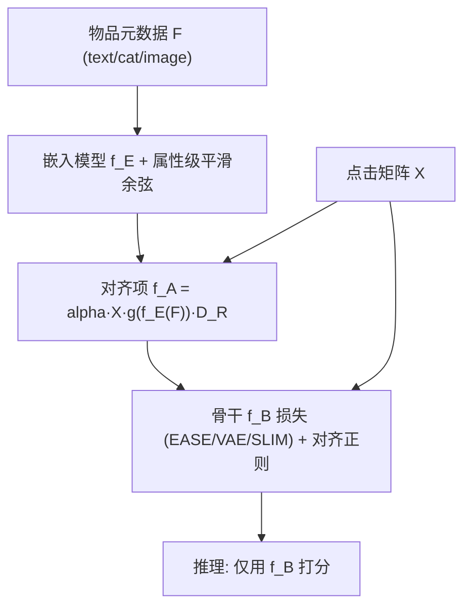
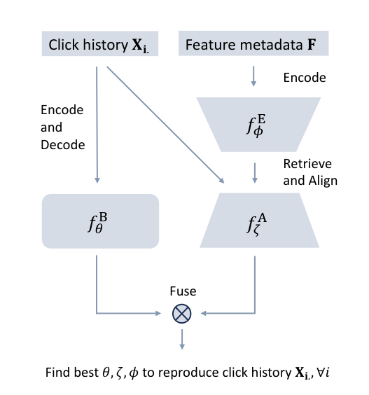

# MARec: Metadata Alignment for cold-start Recommendation (面向冷启动推荐的元数据对齐)

- **会议/期刊**: RecSys 2024
- **作者与机构**: Julien Monteil, Volodymyr Vaskovych, Wentao Lu, Anirban Majumder (Amazon Machine Learning); Anton van den Hengel (University of Adelaide)
- **推荐链路定位**: 召回 / 粗排（低维隐空间打分，兼容矩阵分解与自编码器）
- **研究方向**: 冷启动与长尾推荐 / 协同过滤
- **论文原文**: [论文原文链接](https://arxiv.org/abs/2404.13298v3)
- **开源代码**: [开源代码仓库链接](https://github.com/cesarebernardis/NeuralFeatureCombiner)（论文承诺接收后发布 MARec 代码；当前链接为基线 NFC 的切分/特征化复现仓库）

## TL;DR (1分钟核心速览)

冷启动场景下点击矩阵极稀疏（本文最稀疏数据集点击率仅 0.06%），而主流 hybrid 模型把内容分支也训练去重构点击，易学到损害冷启的内容维度且需手工平衡多项损失。MARec 不改骨干、不动推理，只在训练目标中加一条对齐正则：把元数据嵌入的 item-item 平滑余弦相似度矩阵，按流行度反向加权后推入协同过滤的重构项。在 4 个冷启数据集上 HR@10/NDCG@10 相对 SOTA 提升 +8.4%~+53.8%，训练耗时比次优基线低 1–2 个数量级，热启场景仅落后 SOTA 0.8% 平均。

## Background & Motivation (背景与核心矛盾)

- **主流范式**: 冷启推荐走 hybrid 路线——内容侧 KNN/哈希、meta-learning、VAE 先验、互信息最大化 (CLCRec/EQUAL) 等，把元数据映射到隐因子空间。
- **前人局限**: ① 现有 SOTA 在冷启上强、但迁移到热启/混合场景时性能明显退化，工业上被迫维护双模型；② hybrid 目标让内容分支去"解释"观测点击，模型会拟合到与冷启无关的内容维度，多目标权重难调。
- **核心洞察 (Key Insight)**: item-item 相似度是一个跨模态共享的"锚"——点击诱导的相似度与元数据诱导的相似度应当一致，因此无需新网络层，只需一条正则把两者拉齐，冷启物品即可借元数据"落位"到协同空间。
- **本文切入点**: 用正则做对齐而非用结构做融合，从而骨干可任选 EASE/multi-VAE/SLIM，推理阶段零额外开销，冷热之间自然过渡。

## Method (核心方法设计)

### 1. 整体框架 (Overall Architecture)

MARec 由三部分构成：骨干 $f_B$（任一矩阵分解/自编码器，重构点击矩阵$\mathbf{X}$）、元数据嵌入$f_E$（恒等映射即 itemKNN，或 Siamese 网络）、对齐函数$f_A$（把$\mathbf{X}$与$f_E(\mathbf{F})$的相似度对齐）。训练时以加权和的目标联合优化，对齐项仅作为正则进入损失；预测时丢弃$f_A$与$f_E$，直接用训练好的骨干对用户历史编码解码打分，故线上与原生 CF 完全同构。整体逻辑是"训练期注入元数据先验，推理期回归纯协同"，由此获得冷启增益而不牺牲热启精度。

<figure class="paper-figure" markdown="span">
  <figcaption>图1：MARec的简化架构。嵌入模型𝑓E</figcaption>
</figure>

### 2. 关键设计拆解 (Key Designs)

1. **相似度对齐正则（只改训练目标，不改推理图）**: 针对"内容分支重构点击会学坏、多目标难平衡"的痛点，把对齐矩阵 $B=f_A(\mathbf{X},f_E(\mathbf{F}))=\alpha\,\mathbf{X}\,g(f_E(\mathbf{F}))\,\mathbf{D}_R$当作教师信号塞进骨干的重构项，例如 EASE 变体只需在闭式解里把$\mathbf{X}^\top B$并入右端与逆矩阵（式 9）。冷启物品在$\mathbf{X}$中几乎整列为零，无法自学习表征，但正的$B$项持续为其注入元数据相似度，故物理直觉是"用相似度空间给无数据物品兜底"，且正则强度可由$\alpha,\lambda_1$ 单调调节，热启数据充足时可自动退化为纯 CF。

2. **属性级平滑余弦 + 二次型跨属性混合**: 直接把拼接特征做 cosine 会被高维 tf-idf（1000 维）淹没多热类别特征。MARec 对第 $k$个属性单独计算$G^{(k)}_{ij}=\frac{\mathbf{z}^{(k)\top}_i\mathbf{z}^{(k)}_j}{\|\mathbf{z}^{(k)}_i\|\|\mathbf{z}^{(k)}_j\|+\delta}$，再以二次型混合$g(f_E(\mathbf{F}))=\sum_{k<l}\left(\mu_k G^{(k)}+\mu_{kl}G^{(k)}G^{(l)}\right)$，其中$\delta>0$抑制稀疏特征向量的虚高相似度，二阶乘积项$G^{(k)}G^{(l)}$ 显式建模"演员×导演""品类×品牌"这类跨属性非线性交互。

3. **流行度反向加权 $\mathbf{D}_R$**: 对角矩阵元素$d_j=h\!\left(\sum_{j}X_{\cdot j}\right)$取单调递减阶梯线性函数（以每物品点击数第 10 百分位$p$为拐点，$h=k(p-r(i))$），热门物品的对齐权重被压低、长尾/冷启物品权重抬升，从而抵消 popular bias；热门物品的协同信号仍由骨干自身刻画，两者互补。

4. **训练目标、负采样与推理效率**: 总损失 $\min_{\theta,\phi,\zeta}\mathcal{L}_C\!\left(\mathbf{X},f_B(\mathbf{X})\right)+\mathcal{L}_D\!\left(f_B(\mathbf{X}),f_A(\mathbf{X},f_E(\mathbf{F}))\right)$。multi-VAE 骨干下对齐项化为多项似然中的附加 logit$b_i$（式 7）；modified SLIM 用加权最小二乘放松$\mathrm{diag}(\Theta)=0$约束，改以$\gamma_1|\Theta_{ii}|^2$惩罚，得逐列闭式解$\Theta_{\cdot i}=(\mathbf{X}^\top\mathbf{W}_i\mathbf{X}+\mathbf{X}^\top\mathbf{W}_i B+\lambda_1\mathbf{I}+\Gamma^{(i)})^{-1}(\mathbf{X}^\top\mathbf{W}_i\mathbf{X}_{\cdot i}+\mathbf{X}^\top\mathbf{W}_i B_{\cdot i})$，其中$\mathbf{W}_i$对负样本降权（无需负采样，$w_1$ 网格调至 0.25/0.05）。推理仅走骨干，额外开销为零。

## Experimental Setup & Evaluation Protocol (实验设置与评估协议)

- **数据集与预处理**: 冷启切分（按稀疏度排序）：

| 数据集 | #Users | #Items | #Interactions | 点击率 | 元数据特征 |
| :--- | :---: | :---: | :---: | :---: | :--- |
| Amazon Video Games | 33,858 | 12,463 | — | 0.06% | title/description/feature/brand/categories |
| Netflix | 469,986 | 9,503 | — | 1.19% | title/genres/actors/directors/producers/composers |
| MovieLens10M | 55,485 | 5,986 | — | 1.34% | title/description/genres/actors/directors (+poster/tags) |
| MovieLens Hetrec | 2,107 | 6,234 | — | 3.10% | year/genres/actors/directors/countries/locations |

热启切分：Pinterest (55,187 / 9,916, 0.27%)、MovieLens1M (6,040 / 3,706, 4.47%)。

- **数据划分与防穿越**: 冷启采用**物品级冷启划分**——Hetrec/Amazon 沿用公开切分，60% 物品作训练、20% 验证、20% 测试，指标在 10 次随机切分上取均值；ML10M/Netflix 先抽 20% 物品整体作 cold val/test，其余点击矩阵按 80/10/10 划分得 train/warm val/warm test，再组合出 hybrid 集合。热启采用 `Leave-One-Out`（用户最后一次点击作测试）。
- **排名评测协议**: 冷启实验为**冷启候选集内排序**（并非全库 Full-Ranking，是本协议的主要保守之处）；热启实验为 `Sampled Ranking`，最后点击 + 100 个随机负样本。指标 HR@k / NDCG@k（$k=10,25,50,100$），Bootstrap 重采样 500 次（每次 20% 用户）给出 95% 置信区间并标注显著性。
- **对比基线与超参设置**: NFC、ItemKNNCF、Wide&Deep、FM、CLCRec、EQUAL；文本特征统一用 tf-idf(vocab=1000)/多热编码，EASE 型闭式解下 $\delta\in\{20,50,100\}$、$\lambda_1\in\{1,500,700\}$、$\alpha\in\{1,10\}$、$\beta\in\{0.5,60,100\}$ 全在验证集网格搜索。

## Key Experimental Results (实验关键数据)

### 1. 主实验对比 (Main Results)

| 数据集 | 指标 | NFC | ItemKNNCF | W&D | FM | CLCRec | EQUAL | **MARec** | Improv. |
| :--- | :--- | :---: | :---: | :---: | :---: | :---: | :---: | :---: | :---: |
| Hetrec | HR@10 | 0.1904 | 0.1175 | 0.1555 | 0.1790 | 0.0815 | 0.1310 | **0.2928** | +53.8% |
| Hetrec | NDCG@10 | 0.2076 | 0.1335 | 0.1762 | 0.1946 | 0.0763 | 0.1470 | **0.3071** | +47.9% |
| Amazon VG | HR@10 | 0.1231 | 0.1187 | 0.0103 | 0.0080 | 0.1031 | 0.1171 | **0.1568** | +27.4% |
| Amazon VG | NDCG@10 | 0.0785 | **0.0786** | 0.0060 | 0.0134 | 0.0676 | 0.0778 | **0.1047** | +33.2% |
| ML10M | HR@10 | 0.0322 | 0.0961 | 0.0576 | 0.0718 | 0.0752 | 0.0864 | **0.1094** | +13.8% |
| ML10M | NDCG@10 | 0.0379 | 0.0865 | 0.0571 | 0.0634 | 0.0443 | 0.0626 | **0.0938** | +8.4% |
| Netflix | HR@10 | 0.1087 | 0.1081 | 0.0188 | 0.0586 | 0.0934 | 0.1013 | **0.1369** | +25.9% |
| Netflix | NDCG@10 | 0.1098 | 0.1115 | 0.0146 | 0.0483 | 0.0987 | 0.1027 | **0.1412** | +26.6% |

热启对比（MovieLens1M / Pinterest, HR@10 & NDCG@10）：MARec(式11) 取得 0.7301/0.4560 与 0.8748/0.5683，在 ML1M 上相对最优基线 MF 为 +0.1%/+0.8%，在 Pinterest 上仅落后 MF 1.5%/1.9%（MF 0.8895/0.5794），但稳定优于 SLIM (+2.0%/+1.1%) 与 EASE (+1.5%/+1.3%)。

### 2. 消融实验 (Ablation Study)

MovieLens10M 冷启切分，指标为 HR@10 / HR@25 / HR@50 / HR@100：

| 配置 | HR@10 | HR@25 | HR@50 | HR@100 |
| :--- | :---: | :---: | :---: | :---: |
| ItemKNN（仅元数据，无融合） | 0.0071 | 0.0137 | 0.0241 | 0.0449 |
| 式(5) 一阶混合（仅元数据） | 0.0326 | 0.0484 | 0.0757 | 0.1235 |
| 式(5) 一阶+二阶（仅元数据, BoW） | 0.0329 | 0.0487 | 0.0776 | 0.1302 |
| 式(5) + Sentence-Transformer 嵌入 | **0.0378** | **0.0626** | **0.1028** | **0.1602** |
| 式(5) + Falcon-7B 嵌入 | 0.0373 | 0.0612 | 0.1007 | 0.1545 |
| 式(5) + Siamese(Falcon, 全特征) | 0.0357 | 0.0537 | 0.0820 | 0.1280 |
| 融合：式(9) + BoW | 0.1094 | 0.1956 | 0.2866 | 0.4203 |
| 融合：式(9) + ST | 0.1385 | 0.2240 | 0.3286 | 0.4692 |
| 融合：式(9) + Siamese | 0.0910 | 0.1601 | 0.2457 | 0.4109 |
| 融合：式(10) 加权SLIM + ST | 0.1282 | 0.2204 | 0.3421 | 0.4789 |
| 融合：式(7) multi-VAE + ST | 0.0779 | 0.2037 | 0.3831 | **0.5072** |
| 融合：式(9) + ST + 海报图像 | 0.1401 | 0.2267 | 0.3315 | 0.4721 |
| 融合：式(9) + ST + 图像 + Tags | **0.2194** | **0.3540** | **0.4808** | **0.6168** |

### 3. 关键实验发现 (Key Findings)

- **对齐正则本身是主增益来源，而非元数据兜底**：仅用元数据时 HR@10 最高仅 0.0378，接入对齐项后升至 0.1385（3.7 倍），说明收益来自"把内容相似度映射进协同相似度空间"，而不是把内容模型当独立召回器；同一配置下把 BoW 换成 ST 语义嵌入，HR@100 再涨 +22.8%。
- **语义特征是最强杠杆，但增益按特征类型分层**：ST→+图像仅 +0.5%~1.4%，而再叠加 MovieLens Tags 后 HR@100 从 0.4721 跳到 0.6168（+30.7%），累计相对 BoW 提升 +105.5%(HR@10)/+46.8%(HR@100)；该冷启 HR@100 仅比同数据热启切分低 15.1%，直观量化了"冷热差距可被语义元数据压缩"。
- **骨干闭式解的头部精度与生成式的深度召回互补**：multi-VAE(式7) 在 HR@10 落后式(9) 达 44.8%，但在 HR@50/HR@100 反超 +16.6%/+8.1%；同时式(9) 在 ML10M 训练仅 34 s，而 NFC 需 1.3×10⁴ s、EQUAL 需 6.3×10⁴ s（约两个数量级加速），说明线性闭式解在"高精度短列表 + 极低训练成本"上几乎占优。

## Highlights & Limitations (亮点、对比与审稿批判)

- **与代表作对比 (vs. Prior Work)**: 相对 NFC/SLIM+特征重构这类 hybrid 模型，MARec 不让内容分支去重构点击，因而避免内容维度污染与多目标调和；相对 CLCRec/EQUAL 的互信息/等变学习，MARec 无需专用网络与对比采样，且热启性能不塌陷（EQUAL 在 Hetrec 冷启仅 0.1310，远低于 MARec 的 0.2928）；相对 CVAR 类 ID 预热方法，MARec 的闭式解在百万级用户上可运行。
- **可迁移亮点**: ① "相似度空间对齐"这一正则形式可直接嫁接到任何线性/自编码器召回骨干（含双塔内积、LightGCN 的输出层正则）；② 流行度反向加权矩阵 $\mathbf{D}_R$ 是一个极轻量的长尾扶持算子，可在不改模型结构的前提下替换为时间衰减或曝光数函数。
- **审稿级局限批判**: ① 冷启实验的候选集限定为冷启物品、且热启用 100 负样本采样排序，缺少全库 Full-Ranking 结果，绝对增益可能被高估，也未报告冷热混合候选下的完整曲线；② EASE 型闭式解需对 $|I|\times|I|$矩阵求逆（$\Theta\in\mathbb{R}^{|I|\times|I|}$），物品数上万即内存吃紧，论文仅以 VAE 分支"可批训练"作注脚，缺少十万级物品的实测；③ 关键超参$\delta,\lambda_1,\alpha,\beta$在不同数据集上跨 1–3 个数量级（$\lambda_1$ 从 1 到 700），迁移成本与调参敏感性未被系统分析。

## Rating (四维评分)

- **方法创新性 (Novelty)**: ⭐⭐⭐⭐ （"相似度空间对齐正则 + 属性二次型混合"思路简洁且首次把冷启问题重构为正则对齐问题，但本质仍是 hybrid 目标的一项加权，理论刻画偏弱）
- **评估协议与实验扎实度 (Protocol & Experiments)**: ⭐⭐⭐⭐ （4 个冷启 + 2 个热启数据集、10 次随机切分、Bootstrap 500 次置信区间齐备，但冷启候选集受限、缺少全库排序与逐组件严格消融）
- **写作与数学规范度 (Clarity & Rigor)**: ⭐⭐⭐⭐ （三个闭式解推导完整、符号统一，式(2) 对比损失与式(5) 二次型的角标排版有笔误，复杂度分析仅作定性讨论）
- **工业落地与复现价值 (Industrial & Practical Value)**: ⭐⭐⭐⭐⭐ （训练快 1–2 个数量级、推理与原生 CF 完全同构、冷热共模型平滑过渡，是少见的"改进目标函数即可上线"方案）

