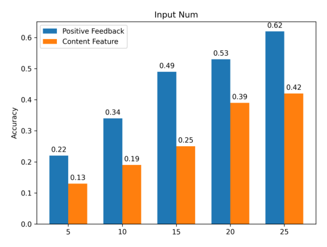
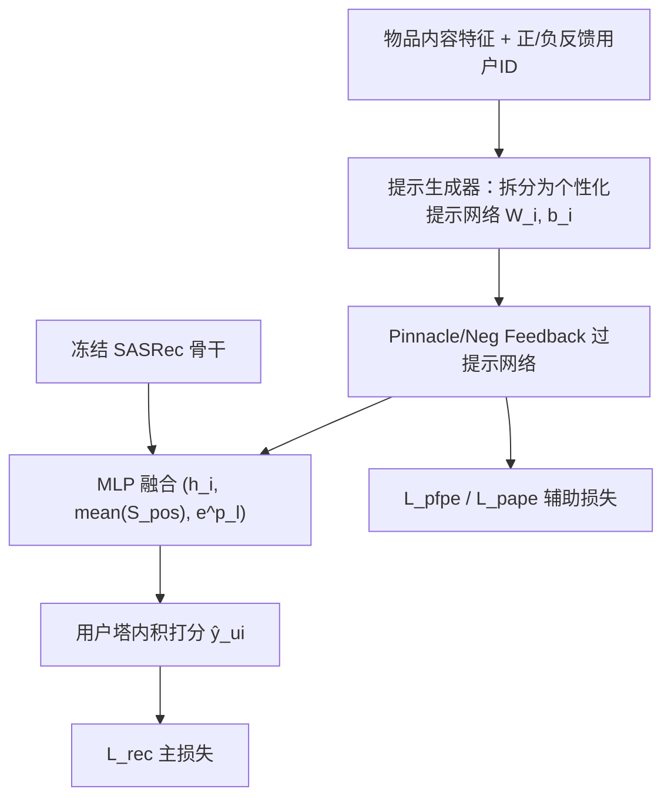
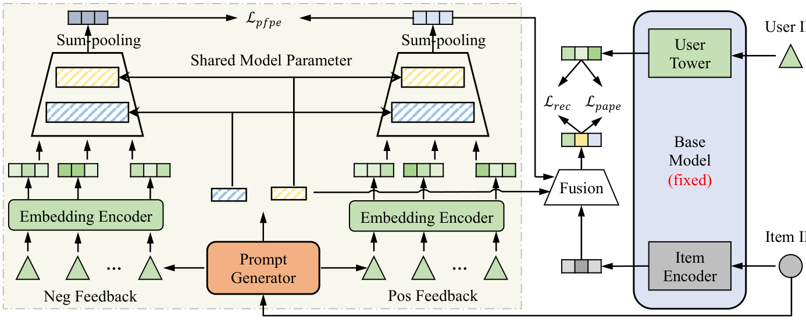

# Prompt Tuning for Item Cold-start Recommendation (面向物品冷启动推荐的提示微调)

- **会议/期刊**: RecSys 2024 (18th ACM Conference on Recommender Systems)
- **作者与机构**: Yuezihan Jiang, Gaode Chen, Yinjie Jiang, Qi Zhang, Jingjian Lin, Peng Jiang (快手科技)；Wenhan Zhang, Jingchi Wang, Kaigui Bian (北京大学)
- **推荐链路定位**: 召回（双塔预训练 + 提示微调）
- **研究方向**: 冷启动与长尾推荐 / 序列推荐
- **论文原文**: [https://arxiv.org/abs/2412.18082v1](https://arxiv.org/abs/2412.18082v1)
- **开源代码**: [https://github.com/PROMOREC/PROMO](https://github.com/PROMOREC/PROMO)

## TL;DR (1分钟核心速览)

现有提示微调冷启动方案把内容特征或人工文本描述当作 prompt，作者指出其存在**语义鸿沟**（内容语义 ≠ 推荐任务）与**模型偏置**（热启物品正样本主导参数更新）两大病灶。PROMO 改用"巅峰正反馈"（pinnacle feedback，即对物品给出最强正向行为的用户 ID 序列）作为提示信息，并为每个物品生成**个性化提示网络**，配合 `pinnacle feedback prompt-enhanced loss` 与 `popularity-aware prompt-enhanced loss`。在 4 个数据集 `Leave-One-Out` + 1:100 采样排序协议下，ML-100K H@10 从 32.8 提至 43.3（+32.0%），线上 A/B 点击率 +3.2%、播放时长 +4.8%。

## Background & Motivation (背景与核心矛盾)

- **主流范式**: 预训练（SASRec 类序列骨干）+ prompt tuning 两阶段范式，冻结骨干、仅调少量 prompt 参数以缓解冷启动物品的交互稀疏。
- **前人局限**: ① 现有 prompt 依赖物品内容特征、item-ID 或人工标注的文本描述（如 PPR、PLATE、LLM 增强路线），标注成本在百万级新物品场景不可承受，且与推荐目标无端到端联系；② 热启物品贡献了绝大多数正样本，模型参数被热门物品"绑架"，导致冷启动物品的正样本打分甚至低于热门物品的负样本。
- **核心洞察 (Key Insight)**: 图 1 的双塔对照实验证明，物品侧输入"历史正反馈用户 ID"比输入"内容特征"在所有特征数量档位上都取得更高点击预测准确率——正反馈 ID 在训练中被注入了用户兴趣信息，是连续 ID 空间中的高信息量信号；图 2 的预测值直方图则量化了偏置：冷启正样本与热启负样本的打分分布重叠度远高于冷启正/负样本之间的重叠。
- **本文切入点**: 用"高价值正反馈"同时消除语义鸿沟与数据成本，用"物品级个性化提示网络"打散参数共享以消除流行度偏置。

<figure class="paper-figure" markdown="span">
  <figcaption>图1：物品侧采用不同输入进行表示编码时，冷启动物品上的模型准确率。正反馈提供了更多任务相关信息，因为使用正反馈信息的模型在用户偏好上获得更高准确率。</figcaption>
</figure>

## Method (核心方法设计)

### 1. 整体框架 (Overall Architecture)

PROMO 沿用两阶段范式：先以 SASRec 为骨干在全部交互上预训练并**冻结**；微调阶段对每个物品 $i$采样$k$个 pinnacle feedback 用户$Pos_i$与$k$个负反馈用户$Neg_i$，经预训练 Embedding 查表得到提示序列$\mathbf{S}^{pos}_i,\mathbf{S}^{neg}_i$；再由提示生成器把一组可学习向量$e^{p_n}_i$ 重塑为该物品专属的提示网络权重与偏置，提示序列过此网络得到提示表征；最后将骨干物品表征、正反馈均值池化、提示网络末层输出三者拼接送入 MLP 融合，与用户塔做内积打分。训练时仅更新提示侧少量参数，用两条辅助损失分别强化巅峰反馈的记忆与校正冷/热物品的打分偏置。

<figure class="paper-figure" markdown="span">
  <figcaption>图3：PROMO 概览。PROMO 利用物品特征和 pinnacle feedback 作为提示信息，生成提示嵌入和个性化提示网络，然后分别通过 pinnacle feedback prompt-enhance loss 和 popularity-aware prompt-enhanced loss 优化提示嵌入并消除模型偏差。</figcaption>
</figure>

### 2. 关键设计拆解 (Key Designs)

1. **Pinnacle Feedback 提示数据构造**：解决"内容 prompt 语义鸿沟 + 标注成本"问题。以用户停留时长与互动行为加权定义反馈价值 $v_{u,i}=\alpha\cdot CR_{u,i}+\beta\cdot IR_{u,i}$，取 top-$k$作为提示；对无反馈的极冷物品，用 Jaccard 式相似度$v_{b,a}=\frac{h_a\cdot h_b}{|h_a|_2+|h_b|_2-h_a\cdot h_b}$ 从最相似热门物品**迁移伪巅峰反馈**。直觉：把 user-item 匹配重构成 user-user 匹配，等于让冷启物品"继承"已验证的兴趣人群画像。
2. **物品级个性化提示网络**：解决"参数被热门物品主导"问题。把提示向量按层切分为权重与偏置 $e^{p_n}_i=\mathbf{W}^{p_n}_i \,\|\, b^{p_n}_i$，满足$|\mathbf{W}^{p_n}_i|+|b^{p_n}_i|=|e^{p_n}_i|=d_{p_n}$，每个物品只更新自己的提示网络，既避免热门物品梯度淹没，又让提示信息独占一条前向通路而不被主特征稀释。
3. **双提示增强损失与训练目标**：① 逐样本对比损失，用 $L_1$距离拉开巅峰与负反馈表征$\Delta_i=\sum_{x\in Pos_i}\sum_{y\in Neg_i}\|h^{pos}_{l,x}-h^{neg}_{l,y}\|_1$，再取$\mathcal{L}_{pfpe}=\log(1+\exp(-\Delta_i))$，以 softplus 形式实现平滑最大化间隔，并为 point-wise 训练的骨干补入成对序信息；② 批内流行度感知损失，跨样本比较冷启正样本与热启负样本打分差$\Delta_{batch}=\sum_{(\bar{u},\bar{i})\in D_{pos\_cold}}\sum_{(e_u,e_i)\in D_{neg\_warm}}(\hat{y}_{\bar{u},\bar{i}}-\hat{y}_{e_u,e_i})$，$\mathcal{L}_{pape}=\log(1+\exp(-\Delta_{batch}))$，直接惩罚"冷正 < 热负"的倒挂。总损失$\mathcal{L}=\lambda_1\mathcal{L}_{pfpe}+\lambda_2\mathcal{L}_{pape}+\mathcal{L}_{rec}$。负采样为每物品采样$k$ 个无正向交互用户作提示负例；免梯度回传骨干使可调参数仅为全量微调的 17.7%–27.6%。

## Experimental Setup & Evaluation Protocol (实验设置与评估协议)

- **数据集与预处理**: 按正反馈频次阈值（ML-100K/ML-1M/KuaiRand/TMall 分别为 20/50/50/20）划分热门与冷启，冷启:热启约 **8:2**，接近长尾定义。

| 数据集 | #Users | #Items | #Interactions | 稀疏度/密度 | 特征/场景说明 |
| :--- | :---: | :---: | :---: | :---: | :--- |
| MovieLens 100K | 943 | 1,682 | 100,000 | 6.30% | 电影，用户 23 / 物品 18 维特征 |
| MovieLens 1M | 6,040 | 3,706 | 1,000,209 | 4.47% | 电影，同上特征 |
| KuaiRand-Pure | 27,285 | 7,583 | 2,599,187 | 1.26% | 短视频，25/55 维特征 |
| TMall | 52,797 | 22,955 | 6,330,878 | 0.52% | 电商，2/3 维特征 |

- **数据划分与防穿越 (Splitting Strategy)**: 采用 `Leave-One-Out`——每用户最后一个交互为测试、倒数第二个为验证、其余为训练，模拟在线推荐环境。
- **排名评测协议 (Ranking Protocol)**: `Sampled Ranking`，对每个测试正样本随机采样 100 个未交互物品构造负例（正负比 1:100），报告 HitRate@{5,10} 与 NDCG@{5,10}（文中指标标注为 H@K / N@K）。
- **对比基线与超参设置**: 涵盖预训练/全量微调（Pre-train、Fine-tune）、CF 类（DCN、DeepFM、SASRec、DSSM）、冷启动专用（CDN、DropoutNet、CB2CF、MetaEmb）与提示微调（PPR、PLATE）；$d$与层数沿用 SASRec 骨干设置，显著性以$p<0.05$ 为准。

## Key Experimental Results (实验关键数据)

### 1. 主实验对比 (Main Results)

| 模型 | ML-100K H@10 | ML-100K N@10 | ML-1M H@10 | ML-1M N@10 | KuaiRand H@10 | KuaiRand N@10 | TMall H@10 | TMall N@10 |
| :--- | :---: | :---: | :---: | :---: | :---: | :---: | :---: | :---: |
| SASRec | 30.2 | 14.9 | 69.2 | 47.6 | 89.3 | 72.7 | 33.5 | 19.6 |
| DSSM | 29.1 | 15.1 | 34.7 | 23.6 | 34.2 | 18.6 | 32.3 | 18.5 |
| DropoutNet | 28.6 | 14.2 | 46.9 | 25.8 | 40.7 | 20.5 | 11.2 | 6.2 |
| CB2CF | 26.4 | 13.1 | 34.0 | 16.8 | 31.3 | 14.8 | 6.1 | 2.8 |
| MetaEmb | 29.3 | 14.9 | 44.8 | 24.8 | 30.0 | 14.3 | 17.6 | 8.0 |
| PPR | **32.8** | 17.6 | 69.0 | 46.1 | 90.0 | 72.7 | 32.3 | 18.7 |
| PLATE | 26.0 | 13.2 | 39.1 | 20.1 | 30.3 | 15.0 | 7.5 | 3.4 |
| **PROMO** | **43.3** | **28.6** | **70.6** | **48.0** | **92.6** | **81.6** | **34.2** | **20.2** |
| Improv. (vs. best baseline) | +32.0% | +62.5% | +2.0% | +0.8% | +2.9% | +12.2% | +2.1% | +3.1% |

### 2. 消融实验 (Ablation Study)

| 变体 | 含义 | ML-100K H@10 | ML-100K N@10 | ML-1M H@10 | KuaiRand H@10 | KuaiRand N@10 |
| :--- | :--- | :---: | :---: | :---: | :---: | :---: |
| PROMO-I | 提示信息仅用 item-ID | 34.8 | 18.3 | 68.8 | 90.0 | 72.9 |
| PROMO-F | 提示信息仅用物品内容特征 | 35.1 | 17.6 | 69.1 | 90.1 | 73.1 |
| PROMO-IF | 内容特征 + ID | 35.7 | 18.7 | 69.2 | 90.2 | 73.0 |
| PROMO-M | 个性化提示网 → 全局共享 MLP | 35.7 | 22.9 | 69.4 | 90.3 | 76.6 |
| PROMO-T | 去掉提示网，正反馈直接拼为输入特征 | 28.7 | 14.6 | 62.8 | 89.4 | 73.1 |
| **PROMO** | 完整模型 | **43.3** | **28.6** | **70.6** | **92.6** | **81.6** |

### 3. 关键实验发现 (Key Findings)

1. **提示信息类型是最大增益源**：把 pinnacle feedback 换成内容/ID 提示（PROMO-I/-F/-IF）后 ML-100K N@10 从 28.6 掉到 17.6–18.7（跌幅 35%+），且 PROMO-I 最差，说明冷启物品的 ID 嵌入几乎未被更新，仅带"内容语义"的 prompt 无法补足推荐任务所需的兴趣信号。
2. **个性化提示网络是去偏关键而非容量关键**：PROMO-M（共享 MLP）在 ML-100K 只有 22.9 N@10、KuaiRand 76.6 N@10，被完整模型拉开 5.7 / 5.0 个点，而 PROMO-T（正反馈直接当特征）跌至 14.6，证明"独立通路 + 物品级参数"两层缺一不可。
3. **t-SNE 与记忆保持率佐证机理**：图 4 显示 PROMO 的物品表征在 K-means 类别语义上聚类明显紧于 DSSM；图 5 显示随累计负反馈增加，DeepFM/MetaEmb/PPR 的巅峰反馈记忆保持率持续下滑，而 PROMO 维持高位——对比损失有效抵抗了流式训练中的灾难性遗忘。
4. **线上收益覆盖隐式与显式反馈**：快手 A/B（每组 >3000 万用户，连续 14 天）点击率 +3.2%、播放时长 +4.8%、点赞 +3.9%、收藏 +4.0%，冷启场景下四指标同向提升。

## Highlights & Limitations (亮点、对比与审稿批判)

- **与代表作对比 (vs. Prior Work)**: PPR 同样基于 SASRec 两阶段提示微调，但以内容画像作 prompt 且用共享网络编码，正好同时踩中本文的两个批判点；PLATE 面向多域/多用户提示但未处理流行度偏置；CB2CF/MetaEmb 走内容桥接与元学习路线，冷启动增益有限（ML-1M H@5 仅 19.7/30.3）。
- **可迁移亮点**: ① "把 user-item 匹配重写为 user-user 匹配"的提示构造思想，可迁移到任何可获取高价值反馈的冷启场景（如新商品用首批高复购用户表征）；② 批内 popularity-aware 排序式对比损失是一段即插即用的去偏插件，可挂到任意 point-wise CTR 模型上。
- **审稿级局限批判**: ① 评估采用 1:100 采样排序，采样负例分布与全库真实分布差距大，且强基线 SASRec 在 KuaiRand 上已接近饱和（H@5 82.5），继续提升空间被压缩，全库 `Full-Ranking` 结论缺失；② pinnacle 判据含 $\alpha,\beta$ 与阈值超参，且需为每个物品维护独立提示网络权重，线上存储与推理侧查表开销随冷启物品数线性增长，文中未给出延迟/显存实测；③ 极冷物品依赖相似热门物品迁移伪反馈，本质上把冷启动问题退化为"相似度估计问题"，相似度失准时收益存疑。

## Rating (四维评分)

- **方法创新性 (Novelty)**: ⭐⭐⭐⭐ （"用反馈而非内容作 prompt + 物品级提示网络"组合新颖，动机图 1/图 2 的数据证据扎实，理论层面偏经验性）
- **评估协议与实验扎实度 (Protocol & Experiments)**: ⭐⭐⭐⭐ （4 数据集 + 10 基线 + 消融 + 表征可视化 + 亿级用户 A/B 全链路完整，但仅采样排序、无全库排序与显著性表）
- **写作与数学规范度 (Clarity & Rigor)**: ⭐⭐⭐ （框架与损失叙述清晰、公式形式简洁，但式 (11) 等记号略草率，$\alpha,\beta$、$k$、$\lambda$ 取值与复杂度分析未完整给出）
- **工业落地与复现价值 (Industrial & Practical Value)**: ⭐⭐⭐⭐⭐ （两阶段微调只调 17.7%–27.6% 参数、开源代码、真实短视频平台线上四指标正向，工程可复用度高）

