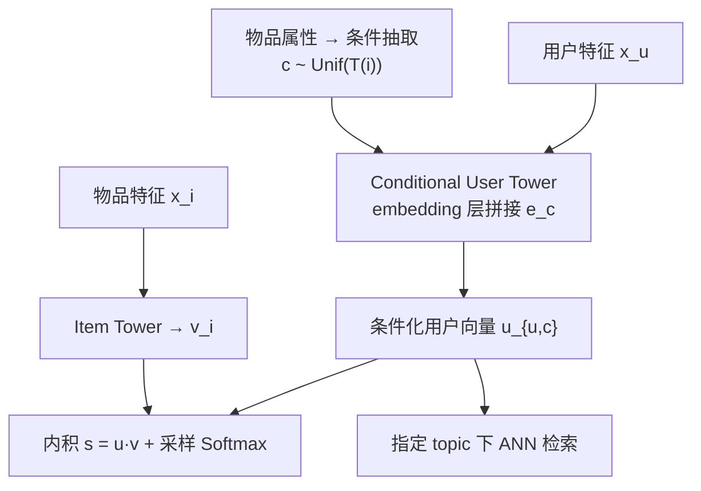

# Bootstrapping Conditional Retrieval for User-to-Item Recommendations (以“条件检索”自举用户-物品召回)

- **会议/期刊**: RecSys 2024（Industry Track，短文，3 页）
- **作者与机构**: Hongtao Lin, Haoyu Chen, Jaewon Yang, Jiajing Xu（Pinterest 应用科学团队）
- **推荐链路定位**: 召回（候选生成 + ANN 检索）
- **研究方向**: 协同过滤与双塔召回 / 冷启动与长尾推荐
- **论文原文**: [论文原文链接](https://arxiv.org/abs/2508.16793v1)
- **开源代码**: 暂未开源

## TL;DR (1分钟核心速览)

条件检索（如“给我推与某 topic 相关、且用户会点击的物品”）的直接做法是双塔 + 后置过滤，但过滤算子不参与训练、需大量 over-fetch，代价高；而直接用 (user, condition) 数据建模，在新业务上又根本没有专属样本。本文把物品侧元数据当作“条件来源”，从正样本物品的 topic 集合中随机抽一个 topic 拼进用户塔 embedding 层，用与标准双塔**完全相同**的 user-item 互动数据训练。Pinterest 主题通知流全量上线后，Email CTR 相对 +2.94%、Push CTR +2.63%、WAU +0.26%，且无过滤时 topic 命中率 82.8%（基线仅 20.3%）。

## Background & Motivation (背景与核心矛盾)

- **主流范式**: 工业召回以双塔模型 + ANN 为主：用户塔与物品塔分别编码，内积后表示为相似度，采样 softmax 对比学习训练。
- **前人局限（路径一）**: “双塔 + 过滤”把条件相关性放在训练之外——要么 over-fetch 后置过滤，要么在 ANN 内嵌过滤，二者都让相关性目标与曝光目标脱钩，并因候选池膨胀导致服务成本激增。
- **前人局限（路径二）**: 直接用 (user, condition) 组合特征训练双塔需要该用例的历史互动；一旦业务要上线新条件（Pinterest 的 topic 通知流即为全新场景），无法自举。
- **核心洞察 (Key Insight)**: 条件本身不应是新的数据问题，而是**物品侧已有的属性**——既然 item-to-topic 映射已存在，就可以从正样本物品“反推”出条件，把标准 user-item 样本免费改造成 (user, condition, item) 三元组。
- **本文切入点**: 在 embedding 层就把条件拼进用户塔，让 MLP 显式学习 user×condition 的高阶交叉，从而把“个性化”与“条件相关性”在同一个塔内联合优化，而非事后过滤。

## Method (核心方法设计)

### 1. 整体框架 (Overall Architecture)

模型对标准双塔只做两处改动，其余（特征、损失、训练数据、负采样）完全复用。离线阶段：对每个正样本 $(u,i)$，条件抽取模块从物品$i$的 topic 集合中随机采样一个 topic 作为条件$c$；用户塔把用户特征与$c$的 embedding 在**第一层**拼接后送入特征交叉 MLP，得到条件化用户向量$\mathbf{u}_{u,c}$；物品塔不变，得$\mathbf{v}_i$。训练用 batch 内负样本做采样 softmax。在线阶段：给定 topic，物化一批用户的条件化向量，在 topic 对应物品索引上做 ANN 检索；由于条件已内化进用户表征，无需 over-fetch，过滤器只在需要硬保证相关性时才叠加。

### 2. 关键设计拆解 (Key Designs)

1. **条件抽取模块（Condition Extraction）**：解决“新条件无专属训练数据”。对正样本物品 $i$取其 topic 标签集合$\mathcal{T}(i)$，按下式合成条件

$$c \sim \mathrm{Unif}\big(\mathcal{T}(i)\big),\qquad \mathcal{D}_{\text{cond}}=\{(u,c,i)\mid (u,i)\in\mathcal{D}_{\text{ui}}\}$$

直觉：该采样分布与 Serving 时“物品被某 topic 命中”的先验同源，故训练/推理分布对齐；同一互动被多个 topic 复用，等价于零成本的数据增广，可直接迁移到 brand、price、merchant 等任意 item 属性。

2. **条件化用户塔（Conditional User Tower）**：解决“相关性与参与度两个目标割裂”。条件 embedding $\mathbf{e}_c$ 与用户特征在第一层拼接，交由 MLP 做交叉：

$$\mathbf{u}_{u,c}=f_\theta\big([\mathbf{x}_u;\mathbf{e}_c]\big),\qquad s(u,i\mid c)=\mathbf{u}_{u,c}^{\top}\mathbf{v}_i$$

直觉：若做晚期融合（后置过滤或分数加权），模型永远学不到“此用户在此 topic 下的偏好偏移”；早期拼接迫使低层神经元构造 user-condition 交互项，等价于把条件当作查询的一部分而非约束，从而在共享的全库物品索引上“软性”地把用户推向该 topic 子空间——这也是无过滤时命中率仍达 82.8% 的机制来源。

3. **训练目标与推理开销**：沿用采样 softmax（in-batch 负采样，无额外 hard negative）：

$$\mathcal{L}=-\log\frac{\exp(\mathbf{u}_{u,c}^{\top}\mathbf{v}_i/\tau)}{\sum_{j\in\mathcal{B}}\exp(\mathbf{u}_{u,c}^{\top}\mathbf{v}_j/\tau)}$$

物品塔与物品索引完全不变，因此**不增加任何物品侧参数量与索引体积**；在线只需按 (user, topic) 重算用户向量，条件化向量可预物化缓存，服务成本从过滤式双塔的 1.2M 降至 180k（年化相对值）。

## Experimental Setup & Evaluation Protocol (实验设置与评估协议)

- **数据集与预处理**: 论文为工业短文，未披露离线数据的用户/物品/互动规模与稀疏度，仅说明使用 Pinterest 现有通知渠道的 user-item 互动日志，条件来自既有 item-to-topic 特征。

| 数据集 | #Users | #Items | #Interactions | 稀疏度/密度 | 特征/场景说明 |
| :--- | :---: | :---: | :---: | :---: | :--- |
| Pinterest 通知互动日志（内部） | 未披露 | 未披露 | 未披露 | 未披露 | user 特征 + item 特征 + item-to-topic / user-to-topic 映射；新场景为 topic 通知流 |
| 线上 A/B（新通知流） | 全网分流 | 全库 | — | — | 每用户检索数百候选 → 精排取约 20 → 每日固定发送量 |

- **数据划分与防穿越 (Splitting Strategy)**: 未披露离线划分细节（无 Leave-One-Out / 时间切分的量化说明）；线上采用随机分流 A/B，对照组为“不发送该新通知类型”。
- **排名评测协议 (Ranking Protocol)**: 以线上真实系统为准——ANN 检索数百候选后精排取约 20 条，指标为 Email CTR、Push CTR 与 WAU 相对提升；相关性以离线代理指标 **topic matching rate**（召回物品落在指定 topic 内的比例）衡量。未报告离线 Full-Ranking / Sampled Ranking 指标。
- **对比基线与超参设置**: 三类基线——INDEX（topic→热门物品，非个性化）、LR（标准双塔 + 流式 topic 过滤）、CR（本文，同训练数据）；Embedding 维度、batch 大小、温度 $\tau$、负采样数与显著性检验均未给出，属短文的主要复现缺口。

## Key Experimental Results (实验关键数据)

### 1. 主实验对比 (Main Results)

| 模型 | 条件过滤 | Email CTR Δ | Push CTR Δ | WAU Δ | 年化服务成本 |
| :--- | :---: | :---: | :---: | :---: | :---: |
| INDEX（topic + 热度） | – | +1.38% | +1.25% | +0.10% | 40k |
| LR（标准双塔） | ✓ | +1.87% | +2.15% | +0.23% | 1.2M |
| CR（本文） | ✗ | +2.86% | **+2.63%** | **+0.27%** | 180k |
| CR（本文） | ✓ | **+2.94%** | +2.58% | +0.26% | 300k |

（相对对照组“无该通知类型”的提升；成本为相对量级，越低越好。相对 LR+过滤，CR+过滤的 Email CTR 提升约 **+57%**、WAU 提升约 **+13%**，成本降至 **1/4**。）

### 2. 消融实验 (Ablation Study)

| 组件/条件 | topic 命中率 | Email CTR Δ | 服务成本 | 说明 |
| :--- | :---: | :---: | :---: | :--- |
| 去个性化（= INDEX） | 高（索引保证） | +1.38% | 40k | 去掉用户塔，仅剩条件先验 |
| 去条件塔（= LR + 过滤） | 20.3%（无过滤时） | +1.87% | 1.2M | 条件只作用于推理期过滤 |
| 去过滤（CR, 无 filter） | **82.8%** | +2.86% | 180k | 条件内化于用户塔 |
| 完整（CR + filter） | ~100% | +2.94% | 300k | 线上最终版本 |

### 3. 关键实验发现 (Key Findings)

1. **条件相关性被“学进去”而非“过滤出来”**：无过滤时 CR 的 topic 命中率 82.8%，LR 仅 20.3%（约 4×）；这说明把条件放进用户塔 embedding 层后，模型自发把用户表征推向该 topic 子空间，而非依赖推理期硬约束。
2. **过滤器对 CR 的边际收益接近零，对 LR 却是刚需**：CR 加过滤后 Email CTR 仅 +2.86%→+2.94%、Push CTR 反而 +2.63%→+2.58%（均在噪声内）；而 LR 不加过滤命中率仅 20.3%，必须靠 over-fetch 才可用，导致成本 1.2M，是 CR（300k）的 4 倍——这是本文最硬的工程结论。
3. **增益来自“个性化 × 条件”交叉，而非新渠道本身**：非个性化 INDEX 的 WAU 仅 +0.10% 且成本最低（40k），CR 达 +0.26%~+0.27%；同为个性化模型的 LR 只有 +0.23%，差值即条件塔带来的交叉增益，最终以 +0.26% WAU 全量上线。

## Highlights & Limitations (亮点、对比与审稿批判)

- **与代表作对比 (vs. Prior Work)**: 相比“标准双塔 + 后置/内嵌过滤”（相关性不参与训练、需 over-fetch），本文将条件纳入训练目标；相比“以 (user, condition) 特征训练双塔”的做法，本文用物品属性合成条件，从而在**没有任何条件专属互动数据**时即可自举，这是其相对前两者的本质差异。
- **可迁移亮点**: ①“从正样本物品属性反推查询条件”的自举范式，可零成本复用于 brand、price、merchant、语种等任意 item 属性检索；②条件仅进用户塔、物品塔与 ANN 索引完全复用，是极低改造成本的召回扩展模板。
- **审稿级局限批判**: ①**训练/推理条件同源风险**：条件取自正样本物品自身的 topic，模型可用“条件≈目标物品属性”走捷径，相关性虽高但可能牺牲参与度（过滤器无增益反证相关性已近饱和），缺少“条件仅来自与目标无关的先验”这一对照；②**评估与复现单薄**：3 页短文，离线仅提到“做了大量实验”却无任何离线指标表、数据规模、$d$/$\tau$/负样本数与显著性检验，也无法区分多 topic 物品均匀采样带来的标签噪声；③新条件仍受限于 topic 词表内的 ID embedding，未见词表外条件的冷启动处理。

## Rating (四维评分)

- **方法创新性 (Novelty)**: ⭐⭐⭐ （“物品属性反推条件 + 用户塔早期混入条件”机制简单但问题刻画精准，属高质量工程创新而非理论突破）
- **评估协议与实验扎实度 (Protocol & Experiments)**: ⭐⭐ （仅线上 A/B 与一个命中率代理指标，离线表格、数据统计与显著性检验全部缺失，消融靠基线组合间接实现）
- **写作与数学规范度 (Clarity & Rigor)**: ⭐⭐⭐⭐ （3 页内把动机、两处改动、成本权衡讲透，公式虽少但符号自洽、无冗余）
- **工业落地与复现价值 (Industrial & Practical Value)**: ⭐⭐⭐⭐ （Pinterest 全量上线 +0.26% WAU、成本降 4 倍，改造成本极低；但未开源、超参与离线细节缺失，复现需自行补齐）

