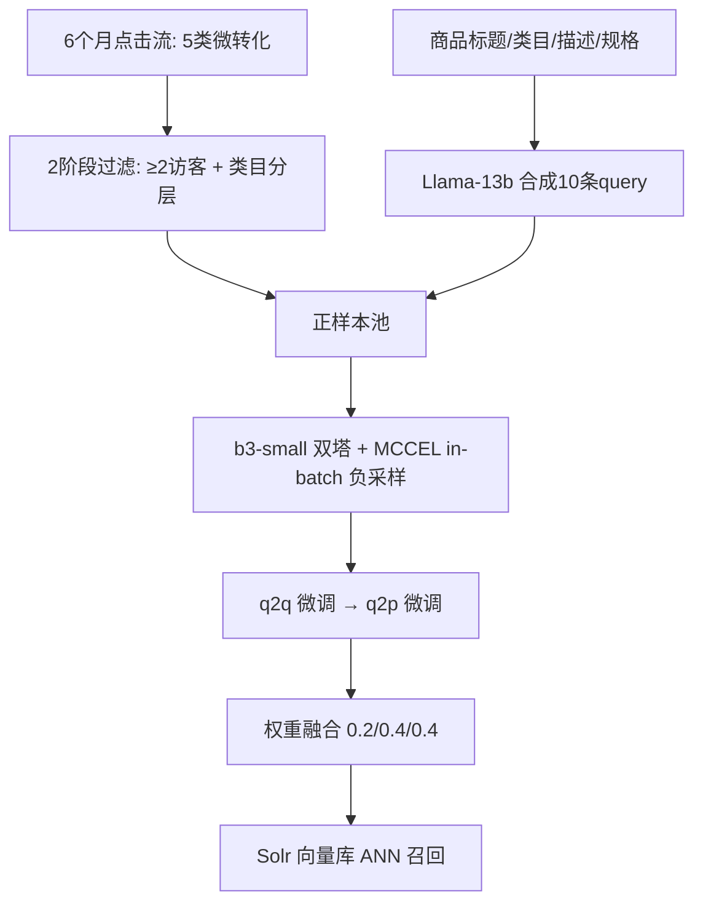

# Embedding based retrieval for long tail search queries in ecommerce (面向电商长尾搜索查询的嵌入式召回)

- **会议/期刊**: RecSys 2024 (18th ACM Conference on Recommender Systems, Industry Track, pp. 771-774)
- **作者与机构**: Akshay Kekuda, Yuyang Zhang, Arun Udayashankar (Best Buy Applied Machine Learning)
- **推荐链路定位**: 召回（语义向量召回，与既有 term-match 召回并联）
- **研究方向**: 协同过滤与双塔召回 / 冷启动与长尾推荐
- **论文原文**: [https://arxiv.org/abs/2505.01946v2](https://arxiv.org/abs/2505.01946v2)
- **开源代码**: 暂未开源

## TL;DR (1分钟核心速览)

针对 bestbuy.com 上服从 Pareto 分布、交互信号极稀疏的长尾搜索 query，本文对工业双塔召回做了一整套"数据+模型"改造：用 Llama-13b 依据商品内容合成查询补足正样本、在站内语料上预训练 b3-small 领域编码器、先 q2q 再 q2p 两阶段微调并做权重融合（0.2/0.4/0.4），最后用 TREC 式池化 + 人工四级相关性构建可持续评测集。离线 recall@200 逐级累加提升，融合模型单步 +2.45%，线上 A/B 转化率 +3%。

## Background & Motivation (背景与核心矛盾)

- **主流范式**: 工业语义召回普遍是"双塔 + in-batch 负采样 + 多类交叉熵"，正样本取自点击/加购/查看库存等微转化行为，商品向量离线灌入 ANN 索引，query 向量实时编码。
- **前人局限 1（信号稀疏）**: 少数高频 query 占据大部分流量，长尾 query 几乎没有转化记录；同时大量长尾商品从未被微转化过，纯行为监督无法学到其语义表征。
- **前人局限 2（评测失真）**: 直接留出行为数据做评测集，会同时引入稀疏性、流行度偏置、位置偏置与展示偏置，离线指标与线上收益脱节；而人工全量标注成本不可接受。
- **核心洞察 (Key Insight)**: 商品标题/类目/描述/规格本身携带可迁移的语义监督信号——LLM 能由商品内容"反向想象"出用户会怎么搜，从而把零交互的长尾商品转成有效正样本。
- **本文切入点**: 以"合成正样本 + 领域预训练 + 任务序列微调 + 权重融合"四步，把长尾召回问题转化为一个低资源语义匹配问题。

## Method (核心方法设计)

### 1. 整体框架 (Overall Architecture)

离线侧：6 个月点击流按唯一 `<query, product>` 聚合出微转化正样本，经"≥2 位独立访客 + 类目分层采样"两阶段过滤压缩 10 倍；再由 Llama-13b 基于商品四类字段为全目录每件商品合成 10 条查询作为代理正样本。编码侧：站内语料 MLM 预训练 RoBERTa-base 得 B3，取前 5 层得 b3-small；query 塔直接初始化自 b3-small（保实时延迟），商品塔对各字段独立编码后均值池化融合。训练上先 q2q 对齐购物意图，再 q2p 对齐商品，最后把三个同构模型按权重融合成一个特征编码器用于推理；向量灌入 Solr 向量库做 ANN。

### 2. 关键设计拆解 (Key Designs)

1. **两阶段正样本过滤（去假正 + 去流行度偏置）**：纯行为正样本含大量误点，且热门类目压倒性占据 batch。第一阶段保留被至少 2 位独立访客微转化过的 pair，第二阶段按商品类目分层采样使各类目占比与目录一致：$|\mathcal{D}_c| = n\cdot\frac{|\mathcal{C}_c|}{\sum_{c'}|\mathcal{C}_{c'}|}$。直觉是"共识即相关性"降噪 + 分层保持长尾类目曝光，数据量降 10 倍而质量上升。
2. **LLM 合成查询 + q2q 前置微调**：长尾商品零交互导致商品塔学不到东西。用 Llama-13b 以 "标题+类目+描述+规格" 为 prompt 生成 10 条多样化查询，构造 $(q_i, p)$代理正样本；再把"同一商品上有转化的任意两条 query"组成$(q_A, q_B)$ 正对（每商品最多采样 400 对），先以同一 MCCEL 做 query 塔内部对齐，使合成 query 与真实用户 query 落在同一语义子空间，随后再切到 q2p。
3. **损失函数、权重融合与推理**：采用缩放多类交叉熵（in-batch 负采样，batch 内 $B-1$个负例）：$\mathcal{L}=-\frac{1}{B}\sum_{i=1}^{B}\log\frac{\exp(\langle \mathbf{q}_i,\mathbf{p}_i\rangle/\tau)}{\sum_{j=1}^{B}\exp(\langle \mathbf{q}_i,\mathbf{p}_j\rangle/\tau)}$。三个同构微调模型做权重平均$\theta^{*}=0.2\,\theta_{q2q}+0.4\,\theta_{q2p}+0.4\,\theta_{q2q\_q2p}$，给 q2p 更高权重以偏向商品相关性；不用 hard negative、不需额外负采样器。推理仅 query 塔实时前向（5 层 BERT），商品向量离线重建，融合只在离线做一次，在线零额外开销。

## Experimental Setup & Evaluation Protocol (实验设置与评估协议)

- **数据集与预处理**: 论文未披露绝对规模（商业敏感），仅给出性质描述：

| 数据集 | #Users | #Items | #Interactions | 稀疏度/密度 | 特征/场景说明 |
| :--- | :---: | :---: | :---: | :---: | :--- |
| 站内点击流 | 未披露 | 全目录商品 | 6 个月微转化 pair | 长尾极稀疏 | 5 类微转化：pdp_view / plp_atc / plp_check_avail / pdp_atc / pdp_check_avail |
| 过滤后训练集 | 未披露 | 未披露 | 约为原始 1/10 | — | ≥2 独立访客 + 类目分层采样，仅保留正样本 |
| 合成正样本 | — | 全目录每件 10 条 | 10×|Items| | — | Llama-13b 由标题/类目/描述/规格生成 |
| 人工评测集 | — | 池化候选 | 未披露 | — | TREC 式 pooling + 4 级相关性标注，月度重采样 |

- **数据划分与防穿越 (Splitting Strategy)**: 行为侧采用 6 个月窗口聚合后留出；评测集并非简单留出，而是"日志按搜索次数对数比例采样 query → 多源（生产 + 实验）检索池化候选 → 按商品跨源平均排名的倒数采样"，每月重新采样并纳入新模型结果，形成持续监控闭环，避免位置/展示偏置与模型自嗨。
- **排名评测协议 (Ranking Protocol)**: 池化候选集内排序，主指标 `recall@200`（长尾场景下召回覆盖优先），辅以 `recall@25`（观察头部排序质量，因长尾 query 不走基于行为的重排器）；相关性以人工 4 级判定（Irrelevant/Acceptable/Good/Excellent）为真值，非全库 Full-Ranking，也非随机负采样。
- **对比基线与超参设置**: 基线为 (a) 生产环境 term-match 召回、(b) 现成通用句向量编码器 `all-mpnet-base-v2`（同架构直接替换双塔）、(c) 本文各消融阶段；编码器统一 b3-small（RoBERTa-base 前 5 层），融合权重 0.2/0.4/0.4 为人工设定未做网格搜索，未报告显著性检验。

## Key Experimental Results (实验关键数据)

### 1. 主实验对比 (Main Results)

原文按"逐级叠加"方式报告相对增量（每行相对上一行的 recall@200 提升）：

| 配置（逐级叠加） | recall@200 增量 | 备注 |
| :--- | :---: | :--- |
| 仅第一阶段过滤（≥2 访客） | 基线 | 去假正 |
| **+ 第二阶段类目分层采样** | **+0.20%** | 数据量降至 1/10 |
| **+ LLM 合成正样本** | **+0.70%** | 长尾商品获得监督 |
| **+ Siamese b3-small（领域预训练双塔）** | **+1.15%** | 替代通用编码器 |
| **+ q2q → q2p 两阶段微调** | **+0.99%** | 同时较 all-mpnet-base-v2 高 +0.80% |
| **+ 商品特征扩展至 13 个字段** | **+1.50%** | 多字段均值池化 |
| **+ 三模型权重融合（推理编码器）** | **+2.45%** | 相对 q2q_q2p 单模型 |
| 线上 A/B：新增语义召回 vs 仅 term-match | **转化率 +3%** | 生产环境 |

### 2. 消融实验 (Ablation Study)

| 消融项 (w/o ...) | recall@200 变化 | recall@25 变化 | 结论 |
| :--- | :---: | :---: | :--- |
| w/o 类目分层采样（仅 1 阶段过滤） | −0.20% | — | 流行度偏置有害 |
| w/o Llama-13b 合成正样本 | −0.70% | — | 长尾覆盖缺口 |
| w/o 领域预训练 B3（换 all-mpnet-base-v2） | −0.80% | 明显更低 | 通用编码器 top-25 最差 |
| w/o q2q 前置微调 | −0.99% | — | 意图对齐有增益 |
| w/o 商品多字段（少 13 字段扩展） | −1.50% | — | 内容特征最敏感 |
| w/o 权重融合（单用 q2q_q2p） | −2.45% | — | 单步最大收益 |

### 3. 关键实验发现 (Key Findings)

1. **权重融合是单步最大增益（+2.45%）**，远超任何数据侧改动，说明"同构多任务微调的参数平均"在低资源工业场景下是一种近乎免费的多任务集成，比继续堆数据更划算。
2. **商品多字段扩展带来 +1.5%**，表明长尾 query 的召回瓶颈主要在商品侧表征而非 query 侧——长尾商品需要更丰富的文本证据才能被正确编码。
3. **通用编码器 all-mpnet-base-v2 的 recall@25 在所有模型中最低**，虽然 recall@200 只差 0.8%，这正好印证：长尾 query 缺少行为重排器兜底，头部 25 位的排序质量必须由向量模型自身保证，仅看 recall@200 会掩盖该差异。
4. **线上 +3% 转化**在纯召回侧扩容中属于较高水平，说明语义召回与 term-match 高度互补，并非简单替换。

## Highlights & Limitations (亮点、对比与审稿批判)

- **与代表作对比 (vs. Prior Work)**: 相比 DSSM/双塔系列经典工作，本文不改网络结构，全部创新集中在训练信号构造；相比依赖人工标注的工业检索（如 TREC 式标注 + 有监督 pair），本文用 Llama-13b 合成查询替代昂贵标注；相比 query 改写/扩展类工作，本文把 q2q 作为 q2p 的"预训练任务"嵌入同一编码器而非独立模块。
- **可迁移亮点**: (1) "同一商品上有共同转化的两条 query 视作正对"这一零成本 q2q 构造，可迁移到任意有会话日志的检索/推荐场景；(2) 按"跨源平均排名倒数"采样候选 + 按"搜索次数对数"采样 query 的评测集配方，可直接用于构建工业界抗偏置离线评测。
- **审稿级局限批判**: (1) 所有结论均为**相对增量**且逐级叠加，未报告绝对 recall 值、未做显著性检验、融合权重 0.2/0.4/0.4 未见调参依据，复现性受限；(2) 合成查询由 Llama-13b 生成，存在与真实长尾 query 分布偏移的风险，论文未量化合成/真实 query 的比例与分布距离；(3) 系统侧依赖 Solr 充当向量库、跨云缓存 query embedding，延迟与吞吐数据完全缺失。

## Rating (四维评分)

- **方法创新性 (Novelty)**: ⭐⭐⭐ （结构零改动，创新全在训练信号工程：LLM 合成正样本 + q2q→q2p 任务链 + 权重融合，单点新颖度中等但组合实用）
- **评估协议与实验扎实度 (Protocol & Experiments)**: ⭐⭐⭐ （TREC 池化 + 人工四级标注 + 月度重采样 + 线上 A/B 很扎实，但只有相对增量、无绝对值、无显著性检验与超参分析）
- **写作与数学规范度 (Clarity & Rigor)**: ⭐⭐⭐ （4 页短文脉络清晰、工业细节到位，但仅给出一个 MCCEL 公式，融合权重、合成数据规模等关键设定缺乏推导与论证）
- **工业落地与复现价值 (Industrial & Practical Value)**: ⭐⭐⭐⭐ （完整给出数据过滤、评测集配方与 Solr/跨云集成方案，是少见的"端到端可抄"工业召回改造实录，唯缺代码开源）

