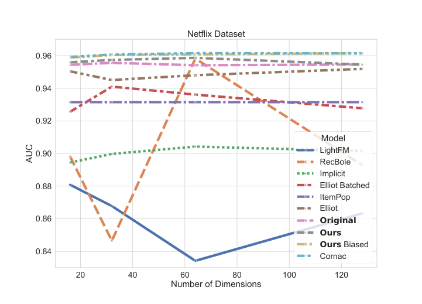
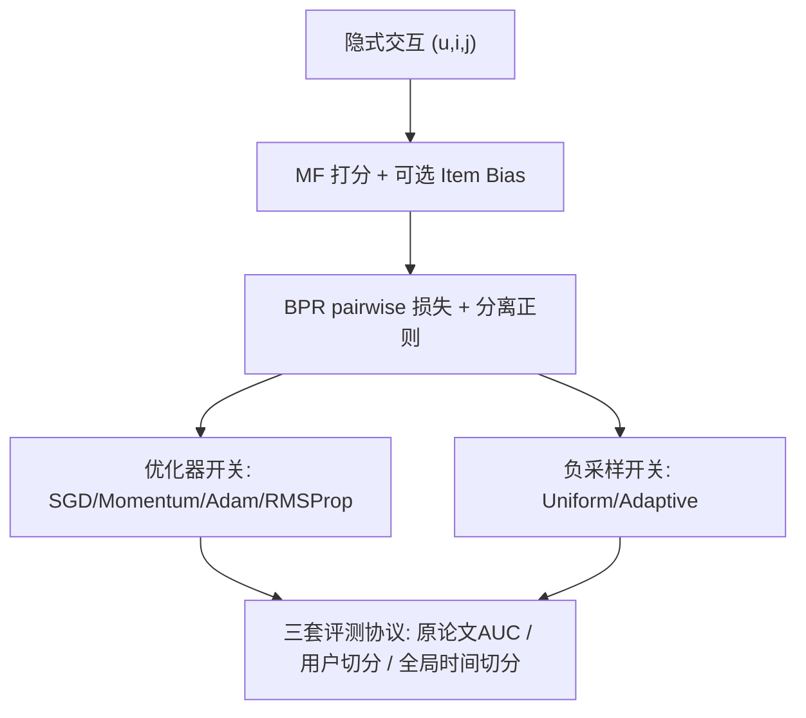
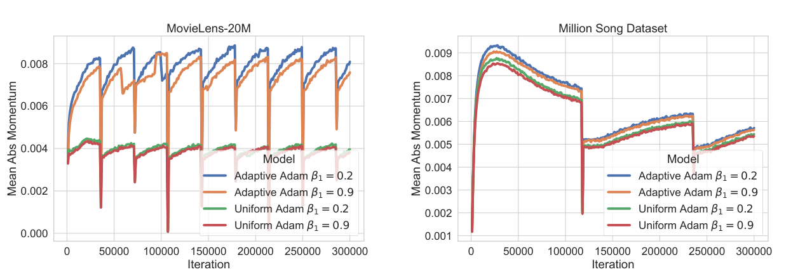

# Revisiting BPR: A Replicability Study of a Common Recommender System Baseline (重访 BPR：一个通用推荐基线的可复现性研究)

- **会议/期刊**: RecSys 2024 (Reproducibility Track)
- **作者与机构**: Aleksandr Milogradskii, Oleg Lashinin, Alexander P, Marina Ananyeva, Sergey Kolesnikov (HSE University / MIPT / T-Bank)
- **推荐链路定位**: 召回（Top-N 全库排序）
- **研究方向**: 协同过滤 / 可信与评测基准
- **论文原文**: [https://arxiv.org/abs/2409.14217v2](https://arxiv.org/abs/2409.14217v2)
- **开源代码**: [https://github.com/nemexur/revisit-bpr](https://github.com/nemexur/revisit-bpr)

## TL;DR (1分钟核心速览)

BPR 被引用逾 6600 次却长期被当作"弱基线"陪跑，本文指出问题不在模型而在**实现与调参**：主流开源框架（RecBole/LightFM/Implicit）缺失原论文的分离正则、可学习 Item Bias、SGD 优化器与自适应负采样，性能最多掉 50%。作者用 PyTorch 重写参考实现并逐特征消融，在 `Full-Ranking` 协议下，调优 BPR 于 MSD 上 NDCG@100 超 Mult-VAE 约 10%，在全局时间切分的 Yelp 上全面显著超越 EASE/Mult-VAE。

## Background & Motivation (背景与核心矛盾)

- **主流范式**: 隐式反馈 Top-N 推荐以矩阵分解 + pairwise BPR 损失为最常用基线，近年被 GCN（LightGCN）、VAE（Mult-VAE）、扩散模型等宣称大幅超越。
- **前人局限**: ① 大量论文只写"BPR 作为基线"，却不交代采样方式、Item Bias、优化器与正则拆分，导致基线被人为削弱；② 原始实现是 C# 的 MyMediaLite，无 GPU 支持，Python 生态里流通的全是行为不一致的第三方复刻。
- **核心洞察 (Key Insight)**: 作者横向审计 8 个开源实现（表 2），发现**只有 Elliot 完整实现原论文特征**，且**没有任何一个实现包含 Rendle & Freudenthaler 的自适应负采样**；同时 RecBole/LightFM 在 Netflix 上 AUC 甚至低于非个性化 ItemPop，说明失效源于实现而非模型容量。
- **本文切入点**: 用一份可控的 PyTorch 参考实现，把 BPR 拆成"正则 / Bias / 优化器 / 负采样"四个正交开关，在现代评测协议下重新定位其真实上限。

<figure class="paper-figure" markdown="span">
  <figcaption>图2：在Netflix数据集上使用多种开源BPR实现的ROC曲线下面积（AUC）预测质量。纳入ItemPop模型以将其性能与非个性化基线进行比较。</figcaption>
</figure>

## Method (核心方法设计)

### 1. 整体框架 (Overall Architecture)

本文不提出新模型，而是构建一个**特征完备、可逐项开关的 BPR 参考实现**，并配套三套评测协议。输入为用户-物品隐式交互三元组 $(u,i,j)$，打分函数保留 MF 内积并可选叠加 Item Bias；训练侧将原论文的三路分离正则、SGD/动量/Adam/RMSProp 优化器、均匀/自适应负采样做成独立配置项；评测侧分别复刻原论文 Netflix 协议（AUC）、Mult-VAE 的用户级切分协议（NDCG/Recall）与全局时间戳切分协议，从而把"实现差异"与"模型能力"彻底解耦。

### 2. 关键设计拆解 (Key Designs)

1. **分离正则与 Item Bias 的解耦开关**：原论文为 user / positive item / negative item 设三个独立 $\lambda$，而多数框架退化为单一共享$\lambda$，抹平了负样本 embedding 应被更强约束这一先验。目标函数为
$\mathcal{L}=\sum_{(u,i,j)\in D_R}-\log\sigma(\hat{r}_{ui}-\hat{r}_{uj})+\lambda_u\|\boldsymbol{p}_u\|^2+\lambda_i\|\boldsymbol{q}_i\|^2+\lambda_j\|\boldsymbol{q}_j\|^2$，
其中 $\hat{r}_{ui}=b_i+\boldsymbol{p}_u^{\top}\boldsymbol{q}_i$。直觉是：负样本数量远多于正样本，独立$\lambda_j$ 相当于给噪声方向加一道"收缩阀"，避免其主导梯度。

2. **优化器—负采样耦合诊断（本文最有价值的机理发现）**：均匀采样在中后期大量产出 easy negative，梯度幅值极小；而 Adam/Momentum 维护一阶动量滑动平均，长期被小梯度"稀释"，导致有效步长反而小于纯 SGD。作者据此把 Adam 的 $\beta_1$ 从 0.9 降到 0.2，一阶动量绝对值提升约 2%，性能随之回升，但仍不及 SGD。这解释了 RecBole(Adam)、LightFM(Adagrad) 的崩溃式表现。

<figure class="paper-figure" markdown="span">
  <figcaption>图4：在Adam优化器中，使用𝛽1 = 0.2/0.9以及均匀/自适应负采样时，两个数据集在前300000次训练迭代中的一阶动量平均绝对值。数值每1000次迭代取平均。图中每次下降表示一个训练轮次的开始。</figcaption>
</figure>

3. **训练目标、负采样与推理开销**：最终推荐配置为 SGD + 自适应负采样（按当前打分 $\exp(\alpha\hat{r}_{uj})$ 加权采样难负例）+ 分离正则 + 关闭 Item Bias。自适应采样把 ML-20M 所需 epoch 从 350 降到 85（减少 265 轮），是本文唯一"既提精度又降成本"的组件；推理阶段仍是纯内积 ANN 检索，无额外开销。注意：自适应采样与 Item Bias **同时开启时在所有数据集上稳定变差**，作者仅给出"待进一步研究"的观察。

## Experimental Setup & Evaluation Protocol (实验设置与评估协议)

- **数据集与预处理**:

| 数据集 | #Users | #Items | #Interactions | 稀疏度 | 说明 |
| :--- | :---: | :---: | :---: | :---: | :--- |
| Netflix (子采样) | 9,949 | 4,825 | 563,577 | 0.9883 | 复刻原 BPR 论文规模 |
| ML-20M | 136,677 | 20,108 | 9.7M | 0.9965 | 用户级切分 |
| MSD | 571,355 | 41,140 | 32.5M | 0.9986 | 极稀疏音乐场景 |
| ML-20M (time-split) | 124,377 | 12,936 | 8.9M | 0.9944 | 全局时间切分 |
| Yelp (time-split) | 252,616 | 92,089 | 2.2M | 0.9999 | 全局时间切分 |

- **数据划分与防穿越**: 三套协议并存——① Netflix 沿用原论文子采样 + AUC；② ML-20M/MSD 沿用 Mult-VAE 的**用户级留出切分**（本文额外把 held-out 用户并入训练集，因 BPR 无法处理冷用户）；③ ML-20M/Yelp 采用**全局时间戳切分**（测试窗 3 年、验证窗 1 年，过滤交互数 <3 的用户与物品），这是当前推荐的防泄漏标准。
- **排名评测协议**: 无偏 `Full-Ranking`（全库未交互物品排序），预测前剔除训练集中已交互物品；指标为二值相关下的 NDCG@K 与 Recall@K。
- **对比基线与超参**: 基线含 ItemPop、EASE、Mult-VAE、Mult-DAE 及 Cornac/Elliot/Implicit/LightFM/RecBole/MyMediaLite 六个 BPR 实现；用 Optuna(TPE) 以 NDCG@100 为目标搜索（Netflix 用 AUC），早停 patience=13；嵌入维度经网格搜索后取 1024（ML-20M/MSD）；显著性用 paired t-test + Bonferroni 校正，$p<0.05$。

## Key Experimental Results (实验关键数据)

### 1. 主实验对比 (Main Results)

| 协议 / 模型 | ML-20M N@10 | ML-20M N@100 | ML-20M R@100 | MSD N@10 | MSD N@100 | MSD R@100 |
| :--- | :---: | :---: | :---: | :---: | :---: | :---: |
| ItemPop | 0.1275 | 0.1906 | 0.3298 | 0.0349 | 0.0582 | 0.0986 |
| EASE | 0.3290 | **0.4215** | 0.6371 | **0.3179** | **0.3907** | **0.5096** |
| Mult-VAE | 0.3075 | 0.4158 | **0.6520** | 0.2156 | 0.2973 | 0.4307 |
| Cornac (最佳第三方) | 0.2589 | 0.3691 | 0.6056 | 0.2120 | 0.3114 | 0.4726 |
| Implicit | 0.2052 | 0.2880 | 0.4745 | 0.1737 | 0.2567 | 0.3898 |
| LightFM | 0.1262 | 0.1843 | 0.3087 | 0.0349 | 0.0575 | 0.0964 |
| RecBole | 0.1213 | 0.1785 | 0.2973 | 0.0009 | 0.0117 | 0.0328 |
| **Ours (SGD)** | 0.3020 | 0.4012 | 0.6258 | 0.2395 | 0.3289 | 0.4730 |
| **Ours (Adam)** | **0.3042** | 0.3986 | 0.6116 | 0.2088 | 0.3029 | 0.4537 |
| *Improv. (Ours-SGD vs Cornac)* | +16.6% | +8.7% | +3.3% | +13.0% | +5.6% | +0.1% |

| 全局时间切分 | ML-20M-ts N@10 | ML-20M-ts N@100 | ML-20M-ts R@100 | Yelp N@10 | Yelp N@100 | Yelp R@100 |
| :--- | :---: | :---: | :---: | :---: | :---: | :---: |
| EASE | 0.1332 | 0.1698 | 0.2496 | 0.0250 | 0.0527 | 0.1387 |
| Mult-VAE | 0.1294 | 0.1722 | **0.2546** | 0.0214 | 0.0468 | 0.1268 |
| Cornac | 0.1263 | 0.1660 | 0.2416 | 0.0247 | 0.0566 | 0.1565 |
| Implicit | 0.1063 | 0.1315 | 0.1910 | 0.0140 | 0.0348 | 0.1004 |
| RecBole | 0.0031 | 0.0061 | 0.0095 | 0.0001 | 0.0005 | 0.0018 |
| **Ours (SGD)** | **0.1357** | **0.1730** | 0.2539 | **0.0276** | **0.0608** | **0.1658** |
| *Improv. (vs 最强基线)* | +1.9% | +0.5% | −0.3% | +10.4% | +7.4% | +5.9% |

### 2. 消融实验 (Ablation Study)

| 配置 (ML-20M / MSD, NDCG@100) | ML-20M | MSD |
| :--- | :---: | :---: |
| 无正则 + 无 Bias + SGD + Uniform | 0.3510 | 0.2753 |
| 共享 $\lambda$ + 无 Bias | 0.3665 | 0.3115 |
| 分离 $\lambda_u,\lambda_i,\lambda_j$ + 无 Bias | 0.3883 | 0.3018 |
| 分离 $\lambda$ + Item Bias | 0.3723 | 0.2796 |
| 共享 $\lambda$ + Item Bias | 0.3530 | **0.3132** |
| 分离 $\lambda$ + Momentum SGD | 0.3655 | 0.2441 |
| 分离 $\lambda$ + Adam | 0.3818 | 0.2950 |
| 分离 $\lambda$ + RMSProp | 0.2209 | 0.0627 |
| **分离 $\lambda$ + SGD + Adaptive** | **0.4012** | **0.3289** |
| 分离 $\lambda$ + Adam + Adaptive | 0.3986 | 0.3029 |

### 3. 关键实验发现 (Key Findings)

1. **实现差异比模型差异更大**：同为"BPR"，RecBole 在 MSD 上 NDCG@100 仅 0.0117（近乎不学习），而本文实现达 0.3289，相差 28 倍；即便最好的第三方 Cornac 也只有 0.3114，说明文献中"BPR 很弱"的结论很大程度上是**框架缺陷造成的伪结论**。
2. **优化器选择是性能分水岭而非细节**：在 ML-20M 上 RMSProp 把 NDCG@100 从 0.3883 打到 0.2209（−43%），MSD 上更从 0.3018 崩到 0.0627（−79%）；根因是均匀负采样产生的微小梯度被动量/自适应二阶矩长期稀释，与 Fig.4 的一阶动量幅值曲线一致。
3. **正则与 Bias 的收益高度依赖数据分布**：ML-20M 上分离正则比共享正则提升 +6.0%（0.3883 vs 0.3665）且 Item Bias 有害；MSD 上 Item Bias 反而最优（0.3132），但相对无 Bias 共享正则版本（0.3115）在 Bonferroni 校正下**统计不显著**——即"Bias 有效"这一常见说法缺乏稳健证据。

## Highlights & Limitations (亮点、对比与审稿批判)

- **与代表作对比 (vs. Prior Work)**: 相较 Dacrema 等对神经模型的复现批判，本文聚焦**被当作基线而非主角**的 BPR，价值在于"给基线正名"；相较 iALS 复现研究，本文进一步揭示了**优化器与负采样的耦合**这一被忽视的机理，而非仅做超参网格。
- **可迁移亮点**: ① "自适应负采样 + SGD"组合可直接迁移到 LightGCN、GRU4Rec 等所有使用 BPR 损失的架构，作为低成本提点手段；② 用一阶动量幅值曲线诊断"负采样难度—优化器"失配，是一个通用且廉价的调试工具。
- **审稿级局限批判**: ① 自适应采样与 Item Bias 同时开启时稳定劣化的现象只被记录、未被解释，缺少梯度层面的分析；② 全部实验限于 MF 打分函数与四个（半）公开数据集，未验证结论在 LightGCN 等深层架构上是否成立；③ 未报告训练时间/显存等效率指标，SGD 需 85–1000 epoch 的收敛成本在工业场景下可能不可接受。

## Rating (四维评分)

- **方法创新性 (Novelty)**: ⭐⭐⭐ （无新模型，但"优化器—负采样耦合"的机理解释与特征解耦实验设计具有实证新意）
- **评估协议与实验扎实度 (Protocol & Experiments)**: ⭐⭐⭐⭐⭐ （三套协议并存、含全局时间切分防泄漏、Bonferroni 校正显著性检验、消融覆盖全部四个特征维度）
- **写作与数学规范度 (Clarity & Rigor)**: ⭐⭐⭐⭐ （特征表格与消融组织清晰，公式沿用原论文记号；部分结论仅停留在观察层面缺少推导）
- **工业落地与复现价值 (Industrial & Practical Value)**: ⭐⭐⭐⭐⭐ （代码全开源、PyTorch + GPU 可跑，直接给出"该用哪个框架、该开哪些开关"的工程结论）

