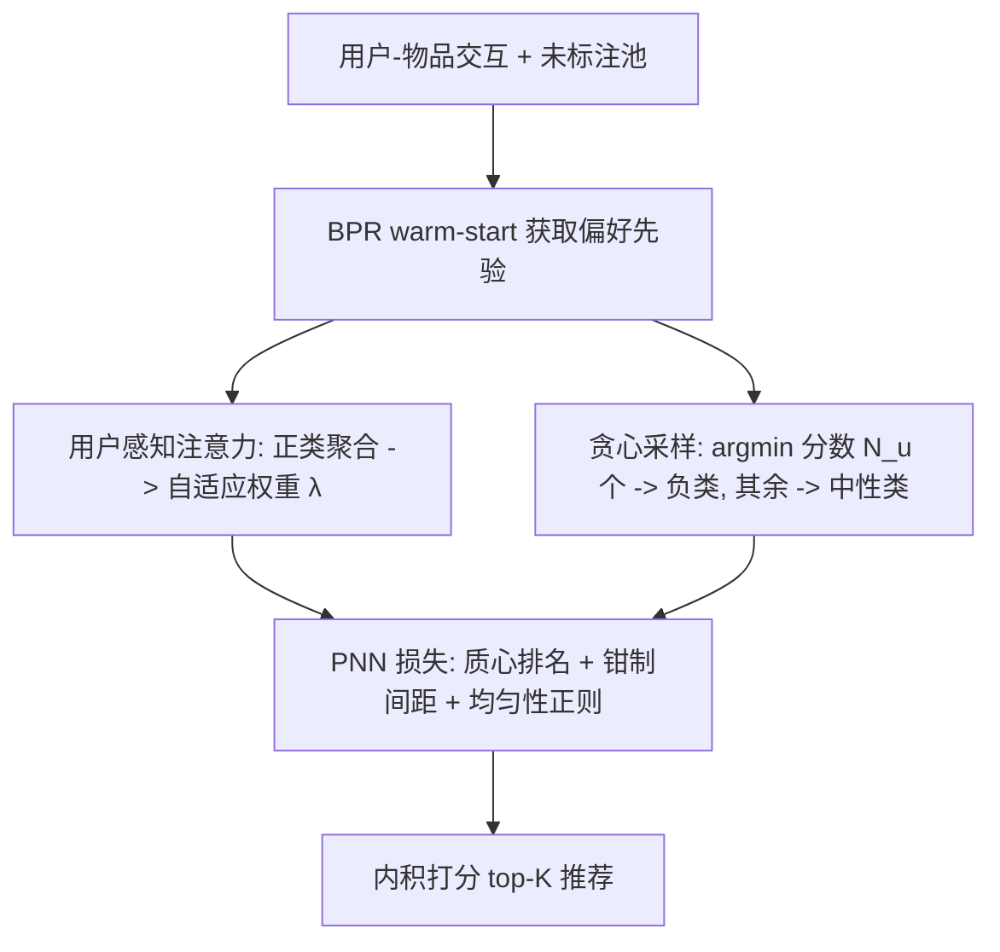
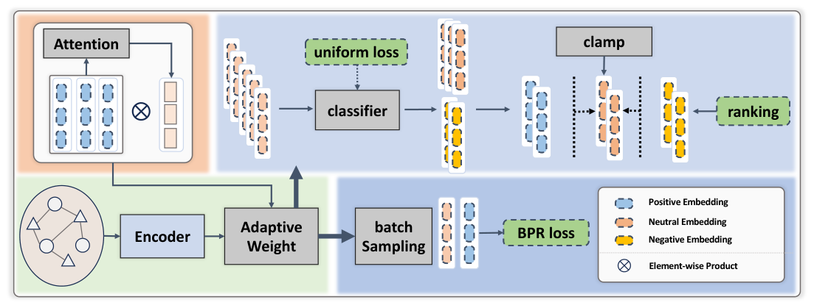

# Unlocking the Hidden Treasures: Enhancing Recommendations with Unlabeled Data (解锁隐藏宝藏：用未标注数据增强推荐)

- **会议/期刊**: RecSys 2024 (18th ACM Conference on Recommender Systems, Bari, Italy)
- **作者与机构**: Yuhan Zhao, Rui Chen, Qilong Han, Hongtao Song (哈尔滨工程大学)；Li Chen (香港浸会大学)
- **推荐链路定位**: 召回（隐式反馈 CF 的排序损失层，可作为通用 loss 插件替换 BPR）
- **研究方向**: 协同过滤 / 自监督与交互去噪
- **论文原文**: [论文原文链接](https://arxiv.org/abs/2412.18170v1)
- **开源代码**: [开源代码仓库链接](https://github.com/Asa9aoTK/PNN-RecBole)

## TL;DR (1分钟核心速览)

现有 CF 负采样研究把未标注数据“切出”一小块当负样本，剩下的海量数据被整体丢弃。本文提出 PNN 范式，把未标注物品显式拆成「中性类」与「负类」，并优化集合级三段偏序 $\Sigma^{pos}_u >_u \Sigma^{neu}_u >_u \Sigma^{neg}_u$；理论上证明该目标等价于优化 OPAUC 的非参数估计。工程上以用户感知注意力自适应加权半监督 BPR、并用质心 + 钳制机制实现集合级排序。在 4 个真实数据集、全库排序协议下，BPR-MF/LightGCN/NGCF/SGL 四类骨干平均指标提升 2.93%–30.07%，简单 MF 逼近 GNN。

## Background & Motivation (背景与核心矛盾)

- **主流范式**: 隐式反馈 CF 普遍假设未交互项即为负反馈，用 BPR 随机采样或 DNS/SimpleX/MixGCF/ANS 等硬负采样从 $\mathcal{I}\setminus\mathcal{I}^+_u$ 里“挖”近似真负样本。
- **前人局限**: 其一，未标注数据与真负样本之间存在必然鸿沟（可能含用户潜在喜欢的物品），激进硬采样会引入假阴性；其二，一旦完成负样本子集抽取，**剩余数据被直接丢弃**，用户偏好构造只用了未标注池的一小部分。
- **核心洞察 (Key Insight)**: 把剩余数据强行当正样本（正-未标注二分类）在排序任务中会崩溃，因为难负样本与真正样本不可分。作者转而证明：OPAUC 估计式 $\widehat{OPAUC}(\delta)=|K|\sum_{i\in\mathcal{I}^+_u}\sum_{i_n\in S_{\mathcal{I}^{un}_u}}\mathbb{I}(r_{ui}>r_{ui_n})\mathbb{I}(i_n\in S_{\mathcal{I}^-_u})$可无损展开为$\mathbb{I}(r_{ui}>r_{ui_n}>r_{uj})$ 的三段式，即“中间那一档”正是被丢弃的中性类。
- **本文切入点**: 引入第三个中性类，用三段偏序统一“可靠负样本 + 模糊样本”的利用方式。

## Method (核心方法设计)

### 1. 整体框架 (Overall Architecture)

PNN 是一个可插拔的损失层，不改变骨干编码器。训练先由 BPR 损失做 warm-start 以获取用户偏好先验；随后用户感知注意力模块用正类物品上的聚合质量评估“分类就绪度”，输出自适应权重 $\lambda$，逐步把优化重心从 BPR 迁移到 PNN 损失。PNN 损失内部先以贪心策略圈出$N_u$个最不可信负样本构成$\Sigma^{neg}_u$、其余为$\Sigma^{neu}_u$，再经“质心化 → 钳制”两步把集合级排序降解为物品级排序，并辅以均匀性正则拉开未标注池。推理阶段退化为普通内积打分 top-K，无额外开销。

<figure class="paper-figure" markdown="span">
  <figcaption>图1：我们的 PNN 学习范式的整体工作流程。</figcaption>
</figure>

### 2. 关键设计拆解 (Key Designs)

1. **用户感知注意力的自适应权重（解决有监督信号稀疏下的“何时切换”）**：固定 $\lambda$或按 epoch 线性升温都与模型实际掌握的知识量脱节。本文以用户正类集合做注意力聚合来间接度量分类性能：$\beta^{attr}_i=\mathbf{e}_u^{\top}\tanh(\mathbf{W}_2\mathbf{e}_i+\mathbf{b})$，softmax 得$\alpha^{attr}_i$，再令$\lambda=\sigma\!\left(\mathbf{W}_1\sum_{i\in\Sigma^{pos}_u}\alpha^{attr}_i\mathbf{e}_i\right)$，总损失$\mathcal{L}_u=(1-\lambda)\mathcal{L}_{BPR}+\lambda\mathcal{L}_{PNN}$。直觉：若模型已能把正类物品聚到用户附近，说明先验足够，应放大 PNN 项；反之退回 BPR 保护。
2. **两步质心 + 钳制排序（解决集合级排序无法用成对损失表达）**：偏好不一定满足传递性，故把三段偏序无损分解为三个成对关系，其中 $\Sigma^{pos}_u>_u\Sigma^{neg}_u$已由 BPR 覆盖，只需建模后两段。第一步用类质心$\mathbf{e}^{i_+},\mathbf{e}^{i_{neu}},\mathbf{e}^{i_-}$ 代表集合，同时缓解中性类规模远大于正/负类的失衡：
$$\mathcal{L}_{rank}=-\ln\sigma\!\left(s(\mathbf{e}_u,\mathbf{e}^{i_+})-s(\mathbf{e}_u,\mathbf{e}^{i_{neu}})\right)-\ln\sigma\!\left(s(\mathbf{e}_u,\mathbf{e}^{i_{neu}})-s(\mathbf{e}_u,\mathbf{e}^{i_-})\right)$$
但质心排序不能保证类间零重叠。第二步引入钳制嵌入：$\Delta_{pos}=\bar{\Delta}\odot\frac{\mathbf{e}^{i_+}}{\lVert\mathbf{e}^{i_+}\rVert}$，$\bar{\Delta}\sim U(0,0.1)$，$\mathbf{e}^{clamp}_{pos}=\mathbf{e}^{i_{neu}}+\Delta_{pos}$，负侧同理，并最小化$\mathcal{L}_{constrain}=\lVert\mathbf{e}^{clamp}_{pos}-\mathbf{e}^{clamp}_{neg}\rVert^2$ 把中性类“夹紧”，从而自适应地撑开类间距，避免人工设 margin 的归纳偏置。
3. **训练目标、负采样与推理效率**：$\mathcal{L}_{PNN}=\alpha\mathcal{L}_{constrain}+\beta\mathcal{L}_{uniform}+\mathcal{L}_{rank}$，其中$\mathcal{L}_{uniform}=\log\mathbb{E}_{i,i'\in\mathcal{E}_u}e^{-2\lVert\mathbf{e}_i-\mathbf{e}_{i'}\rVert^2}$用于打散未标注池中分数粘连的物品，保证“最不相似者”可靠落入负类。负采样采用 batch 内 hard negative：$\mathbf{e}_j=\arg\max_{n\in batch\setminus i}s(\mathbf{e}_u,\mathbf{e}_n)$，规避 DNS 需全库打分的高开销。核心计算量集中在“分数排序选负类”（$O(|\mathcal{E}_u|\log N_u)$ 级别），故单 epoch 耗时介于 BPR-MF 与 SimpleX 之间。

## Experimental Setup & Evaluation Protocol (实验设置与评估协议)

| 数据集 | #Users | #Items | #Interactions | 稀疏度/密度 | 特征/场景说明 |
| :--- | :---: | :---: | :---: | :---: | :--- |
| ML-1M | 6,041 | 3,707 | 1,000,209 | 95.53% | 电影评分，全评分视为交互 |
| Yelp | 31,669 | 38,049 | 1,561,406 | 99.87% | 2018 年后商户评论交易记录 |
| Gowalla | 29,859 | 40,982 | 1,027,370 | 99.92% | 位置签到社交 |
| Foursquare | 1,084 | 38,334 | 91,024 | 99.78% | NYC/Tokyo 约 10 个月签到 |

- **数据划分与防穿越**: 四数据集统一按 **8:1:1 比例划分** train/valid/test（非时间戳切分、非 LOO），因此存在轻度未来信息穿越风险。
- **排名评测协议**: 基于 RecBole v1.1.1 默认实现，采用 **Full-Ranking（全库未交互物品排序）**；指标为 Recall@10/20、Hit(HR)@10/20、NDCG@10/20、MRR@10，取 5 次独立运行均值，并以双侧 $t$-检验$p<0.05$ 报告显著性。
- **对比基线与超参设置**: 骨干侧对比 BPR-MF、NGCF、LightGCN、SGL（分别叠加 PNN）；SOTA 侧对比 SRNS、MixGCF、UIB、SimpleX、ANS（均以 BPR-MF 为底座）。Embedding 维度 $d=64$，Adam，lr=0.001，batch=2048，$L_2=10^{-4}$，$\alpha,\beta\in[0,1]$ 在验证集上调。

## Key Experimental Results (实验关键数据)

### 1. 主实验对比 (Main Results)

| 数据集 | 方法 | HR@10 | Recall@20 | NDCG@20 | MRR@10 |
| :--- | :--- | :---: | :---: | :---: | :---: |
| ML-1M | SRNS | 0.7611 | 0.2618 | 0.2687 | 0.4661 |
| ML-1M | MixGCF | 0.7601 | 0.2604 | 0.2702 | 0.4680 |
| ML-1M | UIB | 0.7346 | 0.2406 | 0.2520 | 0.4279 |
| ML-1M | SimpleX | 0.7586 | 0.2573 | 0.2675 | 0.4607 |
| ML-1M | ANS | 0.7675 | 0.2625 | 0.2683 | 0.4640 |
| ML-1M | **PNN** | **0.7753** | **0.2742** | **0.2869** | **0.4837** |
| Gowalla | SRNS | 0.2295 | 0.1711 | 0.0972 | 0.1042 |
| Gowalla | MixGCF | 0.2401 | 0.1728 | 0.1008 | 0.1145 |
| Gowalla | SimpleX | 0.2192 | 0.1617 | 0.0892 | 0.0949 |
| Gowalla | ANS | 0.2467 | 0.1756 | 0.1027 | 0.1180 |
| Gowalla | **PNN** | **0.2534** | **0.1787** | **0.1052** | **0.1217** |
| Yelp | SRNS | 0.1834 | 0.0862 | 0.0522 | 0.0690 |
| Yelp | MixGCF | 0.1891 | 0.0871 | 0.0536 | — |
| Yelp | ANS | 0.1844 | 0.0862 | 0.0527 | 0.0708 |
| Yelp | **PNN** | **0.1917** | **0.0873** | **0.0543** | **0.0739** |
| Foursquare | SRNS | 0.1948 | 0.0418 | 0.0392 | 0.0840 |
| Foursquare | MixGCF | 0.1994 | 0.0458 | 0.0405 | 0.0863 |
| Foursquare | ANS | 0.1958 | 0.0461 | 0.0386 | 0.0821 |
| Foursquare | **PNN** | **0.2041** | **0.0472** | **0.0405** | **0.0876** |

（注：原文表 3 中 MixGCF/Yelp 的 MRR@10 记为 0.4680，与其他列量级不符，疑为排版错误，此处以“—”略去。）

**骨干通用性（Table 2，全指标平均提升 / Improv.%）**：BPR-MF 在 ML-1M/Gowalla/Yelp/Foursquare 上分别提升 **8.34% / 28.90% / 24.68% / 22.65%**；NGCF 提升 **11.39% / 20.09% / 30.07% / 10.74%**；LightGCN 提升 **7.90% / 6.50% / 21.58% / 2.93%**；SGL 提升 **6.47% / 8.25% / 9.44% / –**（Foursquare 略降）。

### 2. 消融实验 (Ablation Study)

| 变体 (Yelp / Gowalla) | Hit@20 | Recall@20 | NDCG@20 |
| :--- | :---: | :---: | :---: |
| PNN w/o $\mathcal{L}_{constrain}$ | 0.2705 / 0.3078 | 0.0454 / 0.1562 | 0.0389 / 0.0908 |
| PNN w/o $\mathcal{L}_{uniform}$ | 0.2705 / 0.3140 | 0.0451 / 0.1651 | 0.0380 / 0.0951 |
| PNN w/o $\mathcal{L}_{rank}$ | 0.0960 / 0.0406 | 0.0152 / 0.0150 | 0.0115 / 0.0079 |
| PNN w/o 自适应 $\lambda$ | 0.2761 / 0.3008 | 0.0463 / 0.1558 | 0.0399 / 0.0894 |
| PNN w/o 半监督 | 0.1967 / 0.1439 | 0.0319 / 0.0620 | 0.0262 / 0.0361 |
| **PNN (full)** | **0.2770 / 0.3366** | **0.0472 / 0.1787** | **0.0405 / 0.1052** |

### 3. 关键实验发现 (Key Findings)

1. **提升幅度与基线强度强负相关，收益主要来自“低质量负采样基线”**：BPR-MF 在 Gowalla 上提升 28.90%，而 SGL 在 Foursquare 上几乎零增益——说明 PNN 解决的是“未标注数据利用效率”而非单纯堆叠表征能力；也因此简单 MF+PNN 在 ML-1M 上（NDCG@20=0.2869）已反超未加 PNN 的 LightGCN（0.2749）。
2. **$\mathcal{L}_{rank}$是绝对命门，半监督是第二命门**：去掉$\mathcal{L}_{rank}$后 Hit@20 从 0.3366 断崖至 0.0406（Gowalla，降 88%），去掉半监督后降至 0.1439（降 57%），而$\mathcal{L}_{uniform}$、$\mathcal{L}_{constrain}$ 各贡献约 3%–7% 的边际增益——即“三段结构”决定模型是否工作，“均匀性/钳制”决定工作得多好。
3. **对假阴性噪声鲁棒**：将 Yelp/Foursquare 各 10% 真实交互伪造成“负样本”后，依赖大量负样本的 SimpleX 表现最差（图 3），而 PNN 因把这些样本收容到中性类，性能几乎不掉；效率上 Yelp 单 epoch 250.46s/15 epoch、Gowalla 45.66s/27 epoch，远快于 SimpleX（431.92s / 342.33s）。

## Highlights & Limitations (亮点、对比与审稿批判)

- **与代表作对比 (vs. Prior Work)**: SRNS 也做假阴性过滤，但过滤后的样本被“丢掉”，本文则把它们放进中性类继续参与排序；SimpleX 走“大量高信息负样本 + 余弦相似度”，对噪声敏感且耗时；MixGCF/ANS 侧重“生成/合成”负样本，仍是二分类世界观。PNN 的本质差异是把负采样问题重述为**三段偏序 + 集合级排序**，并有 OPAUC 理论背书。
- **可迁移亮点**: ①“质心代理 + 钳制嵌入”这套把集合级 ranking 降维为物品级 ranking 的技巧，可迁移到多行为（点击/收藏/购买）分级排序与多条召回源融合打分；②以正类聚合质量构造 $\lambda$ 的自适应调度，可替代人工设计的课程学习/损失升温策略。
- **审稿级局限批判**: ①评估协议不透明——正文未明确 Full-Ranking 还是采样排序，且 8:1:1 随机划分忽略了时间漂移，与主流时间戳切分结论可比性存疑；②负类贪心选取 $N_u=|\Sigma^{pos}_u|$依赖每 epoch 全池打分，用户交互量大时开销随$|\mathcal{E}_u|$线性增长，且对$\alpha$ 极敏感（过大导致类内塌缩、过小导致类重叠），而 SGL 在 Foursquare 上反而退化，说明该范式与对比学习骨干的耦合尚不稳定。

## Rating (四维评分)

- **方法创新性 (Novelty)**: ⭐⭐⭐⭐ （三段偏序范式 + OPAUC 等价性推导 + 钳制自适应 margin，思路清晰且非拼接式创新）
- **评估协议与实验扎实度 (Protocol & Experiments)**: ⭐⭐⭐☆ （四数据集、四骨干、五 SOTA 与显著性检验较完整，但排序协议与划分方式披露不足）
- **写作与数学规范度 (Clarity & Rigor)**: ⭐⭐⭐⭐ （OPAUC 到集合级偏序的推导链完整，质心/钳制两段动机交代充分；式 6 符号略跳跃）
- **工业落地与复现价值 (Industrial & Practical Value)**: ⭐⭐⭐⭐ （RecBole 已开源，纯损失层可插拔、推理零额外开销，唯训练期全池打分需工程优化）

