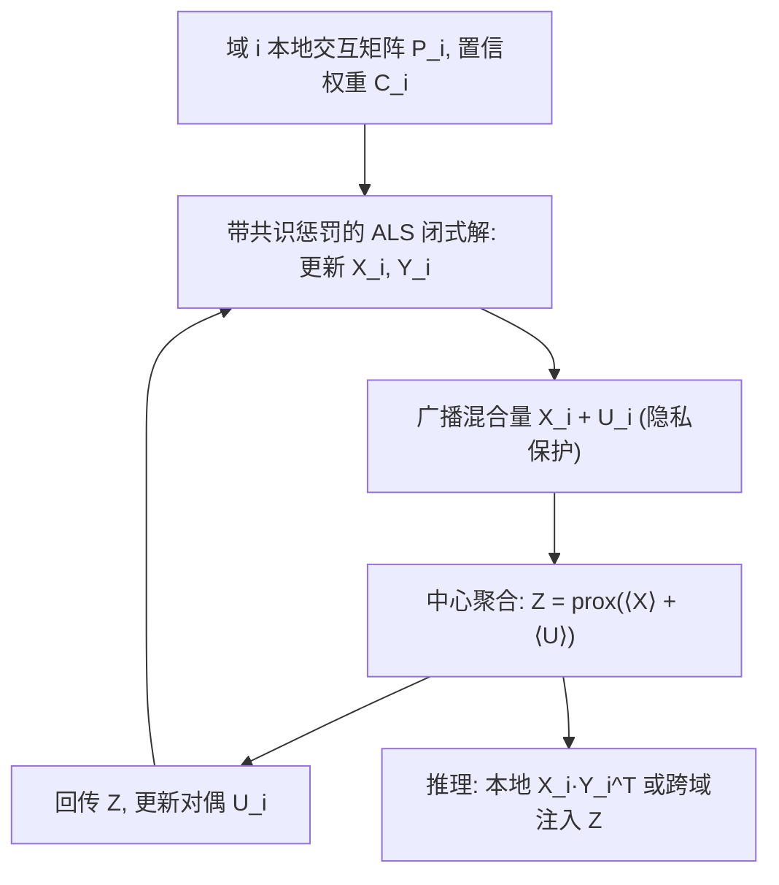
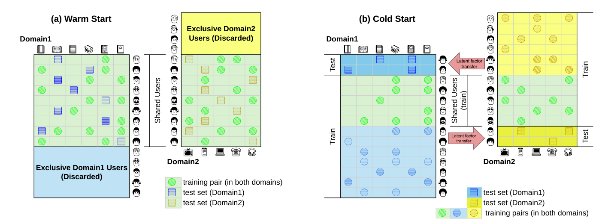

# Cross-Domain Latent Factors Sharing via Implicit Matrix Factorization (基于隐式矩阵分解的跨域隐因子共享)

- **会议/期刊**: RecSys 2024
- **作者与机构**: Abdulaziz Samra (Skoltech)、Evgeney Frolov (AIRI/Skoltech)、Alexey Vasilev、Anton Vakhrushev (Sber AI Lab)、Alexander Grigorievskiy (Comparables.ai)
- **推荐链路定位**: 召回（协同过滤表征学习）
- **研究方向**: 跨域与多场景推荐 / 协同过滤
- **论文原文**: [https://arxiv.org/abs/2409.15568v1](https://arxiv.org/abs/2409.15568v1)
- **开源代码**: [https://github.com/aa-samra/cd-imf](https://github.com/aa-samra/cd-imf)

## TL;DR (1分钟核心速览)

针对跨域推荐“深度架构过重难落地”与“共享用户交互历史侵犯隐私”的双重痛点，本文提出 CDIMF：在标准隐式反馈 ALS 的每条正规方程上追加一个 $\frac{\rho}{2}\lVert X_i-Z+U_i\rVert_F^2$的共识惩罚项，用 ADMM 求全局共享用户因子$Z$，域间仅广播扰动混合量$X_i+U_i$而非原始交互。在 Amazon 双域、$999$ 负样本采样排序、HR/NDCG@10 协议上，热启动 Sport 域的 NDCG@10 相对最强跨域基线 UniCDR 提升 **55.9%**，冷启动 Sport 域提升 **35.1%**，同时保留 ALS 的高并行与易部署特性。

## Background & Motivation (背景与核心矛盾)

- **主流范式**: 跨域推荐（CDR）近年的主流是用深度网络建模域间关联——映射自编码器（DDTCDR/SA-VAE）、图网络（Bi-TGCF/DisenCDR）、对比学习（UniCDR）。
- **前人局限**: ① 这些模型结构复杂、模块众多，训练与调参成本高，工程落地性差，而 MF+ALS 仍是被反复验证的强基线；② CMF 类方法通常需要集中式访问全部域的用户交互，跨企业生态（如集团下互联子业务）场景下隐私不可行。
- **核心洞察**: 跨域迁移的**最小充分条件**其实只是“重叠用户的隐因子在各域训练完后彼此一致”，而不必交换数据、也不必堆叠网络。这正是 ADMM *Global Variable Consensus* 擅长的问题形式。
- **本文切入点**: 把多域联合目标 $\min\sum_i F_i(X_i,Y_i)$约束为$X_1=\cdots=X_N$，用 ADMM 把单域 ALS“分布式化”，只让各域交换带对偶变量的用户因子，从而同时获得跨域增益、隐私保护与 ALS 级效率。

## Method (核心方法设计)

### 1. 整体框架 (Overall Architecture)

每个域 $i$本地持有用户因子$X_i$与物品因子$Y_i$，并维护全局共享因子$Z$与对偶变量$U_i$。每轮迭代：先在本域交互矩阵上以带惩罚项的单步 ALS 更新$X_i,Y_i$（闭式解，逐行独立可并行）；再向中心节点广播混合量$X_i+U_i$（不暴露原始交互）；中心做一次平均并按近端算子更新$Z$；回传$Z$后更新$U_i$。收敛后各域用本地$X_i,Y_i$打分，冷启动场景则直接把源域学到的$Z$ 作为目标域新用户的因子注入，实现零交互迁移。

### 2. 关键设计拆解 (Key Designs)

1. **共识约束的跨域分解（ADMM 三相更新）**：把“重叠用户因子跨域相同”写成等式约束，构造增广拉格朗日 $\mathcal{L}=\sum_i F_i(X_i,Y_i)+\frac{\rho}{2}\lVert X_i-Z+U_i\rVert_F^2+g(Z)$，对应三步：
   $X_i^{k+1},Y_i^{k+1}=\arg\min F_i+\frac{\rho}{2}\lVert X_i-Z^k+U_i^k\rVert_F^2$，$Z^{k+1}=\mathrm{prox}_{g,\frac{1}{\rho N}}\!\left(\langle X\rangle^{k+1}+\langle U\rangle^{k}\right)$，$U_i^{k+1}=U_i^{k}+(X_i^{k+1}-Z^{k+1})$。$\rho$ 在物理上就是“把本地解拽向全局共识的拉力”，也是信息共享速率的旋钮。
2. **带惩罚项的单因子闭式解**：沿用 Rendle 的 iALS 目标（正样本误差 $(\mathbf{x}_u^\top\mathbf{y}_i-1)^2$+ 全对零目标项$\alpha(\mathbf{x}_u^\top\mathbf{y}_i)^2$+ 频率缩放正则$v$），求导后对单个因子行$\mathbf{a}$ 得
   $\left(\mathbf{B}^\top\mathrm{diag}(\mathbf{c}^{\circ 2})\mathbf{B}+(\rho+\lambda r^2)\mathbf{I}_d\right)\mathbf{a}=\mathbf{B}^\top(\mathbf{p}\circ\mathbf{c}^{\circ 2})+\rho\,\mathbf{h}$，
   其中共享用户取 $\mathbf{h}=\mathbf{z}-\mathbf{u}$、非共享用户取$\mathbf{h}=0$、物品更新时左右互换。要点在于：共享用户的正矩阵被加上$\rho\mathbf{I}_d$，相当于在岭回归里额外注入一条指向共识的“虚拟样本”，$\rho\to 0$时精确退化为单域 ALS（论文明确指出可复现该解），$\rho\to\infty$ 则强制因子一致。
3. **近端算子的两种选项与隐私通信**：$Z$步取 identity（$g\equiv 0$，$Z\leftarrow\langle X\rangle+\langle U\rangle$）或 L2 正则（$g=\frac{\lambda}{2}\lVert Z\rVert_F^2$，$\mathrm{prox}=\frac{\mu}{1+\lambda\mu}Z$，$\mu=\frac{1}{\rho N}$）；实测 L2 仅带来微幅增益而显著增加调参开销，故主实验统一用 identity。通信内容为本地因子与对偶变量之和，作者论证：只要不暴露物品因子$Y_i$，外部方无法从$X_i+U_i$ 反演出用户历史，故可走非安全信道——这是相对 CMF/联合训练的核心隐私优势。
4. **训练开销**：单轮本地更新复杂度与稀疏 ALS 相同，$O(d\lvert\mathcal{S}\rvert+d^2\lvert\mathcal{U}\rvert+d^2\lvert\mathcal{I}\rvert)$，全局步仅$O(Nd\lvert\mathcal{U}\rvert)$；因子逐行独立更新天然可并行，无需负采样（零目标项$\alpha$ 已等价于全库隐式负例加权）。

## Experimental Setup & Evaluation Protocol (实验设置与评估协议)

- **数据集与预处理**: Amazon 2014 公开数据（沿用 UniCDR 预处理版本），过滤交互数 $<5$的用户与$<10$ 的物品；物品集跨域不重叠、用户集完全重叠（无物品重叠）。

| 场景 | 域对 | #Users(训练) | #Items(训练) | #Interactions(训练) | #Interactions(测试) |
| :--- | :--- | :---: | :---: | :---: | :---: |
| 热启动 (intra) | Sport / Cloth | 9928 | 30796 / 39008 | 92612 / 87829 | 8326 / 7540 |
| 热启动 (intra) | Phone / Electronics | 3325 | 17709 / 38706 | 50407 / 115554 | 2559 / 2559 |
| 冷启动 (inter) | Sport / Cloth | 26346 / 40839 | 12655 / 17943 | 163291 / 187880 | 2698 / 3085 |
| 冷启动 (inter) | Video / Games | 19240 / 24799 | 8751 / 12319 | 156091 / 155036 | 1458 / 1304 |

- **数据划分与防穿越**: 热启动采用 `Leave-One-Out`（每用户留 1 条交互为测试，测试集先剔除不共享用户）；冷启动采用**用户级留出**——从两域共享用户中抽样两个不相交子集，将其在目标域的**全部历史**抹去作为冷启动测试用户，源域历史保留用于迁移（见图 1）。验证集热启动用官方划分，冷启动从训练集内再做 LOO 切分。
- **排名评测协议**: `Sampled Ranking`，每条测试正样本配 $999$ 个随机负样本，报告 HR@10 与 NDCG@10；作者以样本量足够大为由主张其近似无偏，但未做 Full-Ranking 校验。
- **对比基线与超参**: 单域基线 BPRMF、NeuMF、NGCF、LightGCN、ALS(separate, 等价 $\rho=0$)、ALS(joined, 无隐私约束的上界)；跨域基线 CoNet、DDTCDR、Bi-TGCF、DisenCDR、UniCDR（热启动）、SSCDR、TMCDR、SA-VAE、CDRIB、UniCDR（冷启动）。因子维度$d$与$\alpha,v,\lambda$于验证集网格搜索，因子初始化$\mathcal{N}(0,\sigma/\sqrt{d})$。

<figure class="paper-figure" markdown="span">
  <figcaption>图1：(a) 域内推荐方案（热启动）与 (b) 域间推荐方案（冷启动）的训练/测试数据划分；圆圈表示训练交互，方块表示测试交互。箭头表示用于测试的隐因子迁移。</figcaption>
</figure>

## Key Experimental Results (实验关键数据)

### 1. 主实验对比 (Main Results)

**热启动（dual-intra-domain）**

| 模型 | Sport HR | Sport NDCG | Cloth HR | Cloth NDCG | Elec. HR | Elec. NDCG | Phone HR | Phone NDCG |
| :--- | :---: | :---: | :---: | :---: | :---: | :---: | :---: | :---: |
| BPRMF | 10.43 | 5.41 | 11.53 | 6.25 | 15.71 | 9.19 | 16.32 | 8.53 |
| LightGCN | 13.19 | 6.94 | 13.58 | 7.29 | 19.17 | 10.28 | 23.25 | 12.72 |
| ALS (separate) | 16.67 | 10.43 | 13.90 | 8.86 | 22.11 | 14.01 | **29.54** | **18.74** |
| ALS (joined, 上界) | **25.69** | **18.44** | **22.15** | **16.40** | 21.37 | **14.91** | **32.51** | **22.64** |
| DisenCDR | 17.55 | 9.46 | 16.31 | 9.03 | **24.57** | 14.51 | 28.76 | 16.13 |
| UniCDR | 18.37 | 10.98 | 17.85 | 11.20 | 22.92 | 13.83 | 24.72 | 13.77 |
| **CDIMF** | **23.85** | **17.12** | **20.74** | **15.11** | 22.66 | **14.65** | 28.57 | **18.30** |
| Improv. vs best CDR | +29.8% | +55.9% | +16.2% | +34.9% | −7.8% | +1.0% | −0.7% | +13.5% |

**冷启动（dual-inter-domain）**

| 模型 | Sport HR | Sport NDCG | Cloth HR | Cloth NDCG | Game HR | Game NDCG | Video HR | Video NDCG |
| :--- | :---: | :---: | :---: | :---: | :---: | :---: | :---: | :---: |
| BPRMF | 5.75 | 3.16 | 6.75 | 3.26 | 3.77 | 1.89 | 4.46 | 2.36 |
| NGCF | 7.22 | 3.63 | 7.07 | 3.48 | 5.14 | 2.73 | 7.41 | 3.87 |
| ALS (joined) | **15.01** | **10.61** | 13.68 | 9.36 | 7.44 | 3.83 | 8.16 | 4.64 |
| TMCDR | 7.18 | 3.84 | 8.11 | 5.05 | 5.36 | 2.58 | 8.85 | 4.41 |
| CDRIB | 12.04 | 6.22 | 12.19 | 6.81 | 8.51 | **4.58** | **13.17** | **6.49** |
| UniCDR | 11.20 | 7.04 | 12.48 | 7.52 | 8.78 | 4.63 | 10.74 | 5.89 |
| **CDIMF** | **14.52** | **9.51** | **13.35** | **9.45** | **9.19** | 4.53 | 8.50 | 4.36 |
| Improv. vs best CDR | +29.6% | +35.1% | +7.0% | +25.7% | +4.7% | −2.2% | −35.5% | −32.8% |

### 2. 消融实验 (Ablation Study)

| 变体（Sport&Cloth, 热启动） | Sport HR | Sport NDCG | Cloth HR | Cloth NDCG | 说明 |
| :--- | :---: | :---: | :---: | :---: | :--- |
| w/o 跨域共享（$\rho=0$，单域 ALS） | 16.67 | 10.43 | 13.90 | 8.86 | 共享机制整体移除 |
| w/ L2 近端算子（最优 $\lambda$） | ≈23.9 | ≈17.2 | ≈20.8 | ≈15.2 | 相对 identity 仅微幅提升 |
| CDIMF（identity, 完整） | 23.85 | 17.12 | 20.74 | 15.11 | 默认配置 |
| ALS (joined, 集中式上界) | 25.69 | 18.44 | 22.15 | 16.40 | 无隐私约束 |

### 3. 关键实验发现 (Key Findings)

- **共享机制是唯一主力，且几乎追平集中式上界**: 关闭共享（$\rho=0$）后 Sport NDCG 从 17.12 跌至 10.43（−39%），而开启 ADMM 共享后与“把所有域数据拼成一张矩阵”的 ALS(joined) 仅差 1.32/1.29 个点，说明共识约束几乎无损地替代了原始数据互通。
- **$\rho$是双刃剑，过大导致覆盖率崩塌**:$\rho$增大加速共享、提升 HR/NDCG，但超过临界值后模型发散，少数范数爆炸的物品对任意用户都打分最高，COV@10 从约 0.8 骤降至接近 0——这提示生产中必须对$\rho$ 与覆盖率联合监控，而不能只看 HR。
- **域对“兼容性”决定成败**: 冷启动中 Sport/Cloth、Sport/Game 有稳定收益，但 Video 域 CDIMF（8.50/4.36）显著落后 CDRIB（13.17/6.49），作者归因于该域对存在简单 MF 无法刻画的模式；同时热启动 Phone 域上单域 ALS(separate) 反超所有跨域模型，说明“跨域共享并非普适增益”。
- **通信频率几乎免费**: 聚合周期 AP=1（每轮都同步）优于 AP=2/3/4，说明共享次优解（单步 ALS 结果）比等待本地收敛更划算；亦为异步/丢包场景下的“用旧 $Z$ 继续本地迭代”留出空间。

## Highlights & Limitations (亮点、对比与审稿批判)

- **与代表作对比**: 相对 UniCDR（对比学习式通用 CDR）与 DisenCDR（解耦图网络），CDIMF 不做表征解耦也不做对比增广，而是把“跨域”简化为一个带 $\rho\mathbf{I}_d$ 的正规方程扰动，参数量与单域 ALS 同阶；相对 CMF 类方法，它把集中式联合分解换成 ADMM 分布式共识，无需共享用户交互；相对此前把 ADMM 用于 IMF 的工作（面向大规模加速与差分隐私），本文首次将其对准跨域因子共享且保留隐私约束。
- **可迁移亮点**: ① “在 ALS 正规方程上加 $\rho\mathbf{I}_d$ 实现向全局共识收缩”可迁移到任何基于岭回归闭式解的召回模型（如 EASE、SLIM）；② `X_i+U_i` 混合广播是一种低成本隐私通信范式，可复用到联邦/多业务线联合训练。
- **审稿级局限批判**: ① 评测仅用 $999$负样本的 Sampled Ranking，对 MF 类模型可能高估，缺少 Full-Ranking 与显著性检验；② 冷启动用户与源域用户的重叠假设过强（完全重叠用户），且未讨论部分重叠/多域非齐次情形；③$\rho$ 的稳定区间未给出理论界，仅凭经验，且发散时覆盖率崩塌缺少防护机制；④ L2 近端算子被草率判为“无益”，实验只做了单数据集单场景。

## Rating (四维评分)

- **方法创新性 (Novelty)**: ⭐⭐⭐⭐ （把 ADMM 全局变量一致性精准嫁接到 iALS 闭式解上，形式极简却兼得跨域与隐私，属“少即是多”的优雅增量）
- **评估协议与实验扎实度 (Protocol & Experiments)**: ⭐⭐⭐ （覆盖 4 组域对、热/冷两种场景与 10+ 基线，但仅采样排序、无显著性检验与 Full-Ranking 复核，冷启动划分偏理想化）
- **写作与数学规范度 (Clarity & Rigor)**: ⭐⭐⭐⭐ （从增广拉格朗日到单因子闭式解的推导完整、复杂度与并行性分析清晰，仅 $\rho$ 稳定性缺理论讨论）
- **工业落地与复现价值 (Industrial & Practical Value)**: ⭐⭐⭐⭐⭐ （代码开源、基于成熟的 implicit ALS 生态，通信量仅 $O(Nd\lvert\mathcal{U}\rvert)$、因子更新可并行，天然适配多业务线隐私隔离部署）

